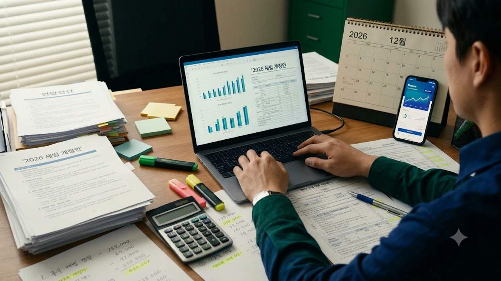

**2026 연말정산** 준비가 본격적으로 시작되는 11월 중순, 올해 바뀐 세법 개정안과 절세 전략을 미리 점검하지 않으면 13월의 월급 대신 세금 폭탄을 맞기 십상입니다. 국세청 연말정산 미리보기 서비스가 열리면서 소득공제 한도와 세액공제 항목을 꼼꼼히 따져봐야 할 시점이 다가왔습니다. 남은 한 달 반 동안 환급액을 극대화할 수 있는 핵심 변경 사항과 실전 대응법을 정리했습니다.

## 2026년 연말정산, 작년과 달라지는 핵심 세법 개정 사항

매년 조금씩 손질되는 세법 덕분에 작년에 공제받았던 항목이 올해는 줄어들거나, 반대로 새롭게 신설된 혜택을 놓치는 경우가 많습니다. 2026년 귀속 연말정산에서는 혼인·출산 지원과 주거비 부담 완화에 초점을 맞춘 개정 사항이 핵심입니다.

### 기본공제 및 부양가족 요건 변경 포인트

부양가족 인적공제(1인당 150만 원)를 받으려면 연간 소득금액 100만 원 이하(근로소득만 있는 경우 총급여 500만 원 이하) 기준을 충족해야 합니다. 특히 올해부터는 부모님이나 배우자의 일용근로소득 외 아르바이트·프리랜서 사업소득(3.3% 원천징수) 합산 여부를 국세청 전산에서 더욱 정밀하게 걸러냅니다.

- **연금소득 기준 주의**: 공적연금(국민연금 등) 수령액이 연 516만 원을 초과하면 부양가족 기본공제 대상에서 제외됩니다.
- **형제자매 공제 요건**: 만 20세 이하 또는 만 60세 이상이어야 하며, 주민등록표상 동거 요건(취학·질병 요양 등 일시 퇴거 예외)을 반드시 충족해야 합니다.

### 결혼·출산·육아 관련 신설 및 확대 세액공제

혼인신고를 마친 신혼부부라면 **결혼세액공제**를 통해 부부 합산 최대 100만 원(1인당 50만 원)의 세액을 직접 감면받을 수 있습니다. 생애 1회에 한해 적용되므로 올해 혼인신고를 완료한 직장인이라면 빠뜨리지 말아야 합니다.

> 자녀세액공제 금액도 첫째 15만 원, 둘째 20만 원, 셋째 이후 1인당 30만 원으로 확대 적용되며, 6세 이하 자녀의 의료비와 산후조리원 비용(총급여 7,000만 원 이하 기준 완화 적용) 공제 한도 역시 꼼꼼히 챙겨야 합니다.

### 월세 세액공제 한도 상향과 무주택자 체크리스트

주거비 부담을 덜어주기 위해 월세 세액공제 소득 기준이 총급여 8,000만 원 이하로 완화되고, 연간 공제 대상 월세 한도 역시 1,000만 원으로 상향되었습니다. 총급여 5,500만 원 이하 무주택 세대주라면 납입 월세액의 17%, 5,500만 원 초과 8,000만 원 이하라면 15%를 세액에서 돌려받습니다.

- 임대차계약서상 주소지와 주민등록등본상 주소지가 반드시 일치해야 전입신고일 이후 지출한 월세부터 공제됩니다.
- 집주인의 동의가 없어도 계좌이체 내역서와 임대차계약서 사본만 제출하면 홈택스에서 경정청구 및 연말정산 신청이 가능합니다.

## 신용카드·체크카드 황금 비율 및 소비 전략 점검

연말정산 소득공제의 꽃은 단연 신용카드 등 사용금액 소득공제입니다. 하지만 무작정 카드를 긁는다고 세금을 돌려받는 것이 아니라, 본인의 총급여액과 결제 수단별 공제율을 계산해 전략적으로 지출해야 합니다.

### 총급여 25% 기준선 초과 여부에 따른 결제 수단 선택법

신용카드, 체크카드, 현금영수증 사용액을 모두 합산해 **본인 총급여의 25%**를 초과한 금액부터 소득공제가 시작됩니다. 예를 들어 연봉이 5,000만 원인 직장인이라면 1,250만 원까지는 어떤 카드를 쓰든 공제 혜택이 전혀 없습니다.

- **25% 도달 전**: 소득공제 구간이 아니므로 포인트 적립이나 할인 혜택이 큰 신용카드를 집중적으로 사용하는 편이 유리합니다.
- **25% 초과 후**: 공제율이 15%인 신용카드 대신, 공제율이 30%로 두 배 높은 **체크카드와 현금영수증**으로 결제 수단을 즉시 갈아타야 합니다.

### 대중교통·전통시장·문화비 추가 공제 한도 극대화 방법

기본 공제 한도(총급여 7,000만 원 이하 300만 원, 초과 250만 원)를 이미 다 채웠더라도 포기하기는 이릅니다. 전통시장 사용분(40%), 대중교통 이용분(80%), 도서·공연·미술관·박물관·영화관람료 등 문화비(30%, 총급여 7,000만 원 이하)는 별도의 추가 공제 한도를 부여받습니다.

### 11월~12월 잔여 기간 결제 수단 전환 실전 시나리오

11월 중순 현재 홈택스 미리보기에서 1~9월 카드 사용액이 이미 총급여의 25%를 넘어섰다면, 남은 한 달 반 동안은 지갑 속 신용카드를 빼두고 체크카드와 지역화폐만 사용하는 것이 정석입니다. 반대로 맞벌이 부부 중 한 명의 사용액이 25% 문턱에 한참 못 미친다면, 연말 대형 가전이나 생활비 지출을 25%를 초과한 배우자의 카드로 몰아주는 편이 환급액을 늘리는 지름길입니다.

## 연금계좌(IRP·연금저축) 및 ISA 세액공제 한도 채우기

소비 공제만으로는 한계에 부딪히는 고소득 직장인이나, 지출을 줄여 자산을 모으는 1인 가구라면 금융상품을 활용한 세액공제가 가장 확실한 대안입니다.

### 연금저축펀드와 IRP 합산 900만 원 공제 한도 활용법

연금저축(최대 600만 원 한도)과 개인형 퇴직연금(IRP)을 합산해 연간 최대 **900만 원**까지 세액공제를 받을 수 있습니다. 총급여 5,500만 원 이하 직장인은 납입액의 16.5%(최대 148만 5,000원), 5,500만 원 초과자는 13.2%(최대 118만 8,000원)를 결정세액에서 곧바로 차감받습니다.

### 만기 도래 ISA 계좌 연금 전환 시 추가 세액공제 혜택

3년 의무가입 기간이 지난 중개형 ISA 계좌의 만기 자금을 60일 이내에 연금저축이나 IRP 계좌로 전환하면, 전환 금액의 10%(최대 300만 원 한도)까지 추가 세액공제 혜택이 주어집니다. 기본 연금계좌 한도 900만 원과 합치면 최대 1,200만 원까지 공제 대상이 늘어납니다. 목돈 운용과 절세 계좌 활용법에 대한 더 넓은 흐름은 [경제 전체 글 보기](/posts/economy/)에서 추가로 확인할 수 있습니다.

### 연말 납입 시 주의해야 할 중도해지 불이익과 과세 기준

12월 31일 영업시간 마감 직전에 한도를 채우려고 무리하게 목돈을 넣기 전에 반드시 유동성 계획을 세워야 합니다. 세액공제를 받은 원금과 운용 수익을 만 55세 이후 연금으로 수령하지 않고 중도 해지하면, 기존에 돌려받은 세금보다 더 많은 **16.5%의 기타소득세**를 토해내야 하기 때문입니다. 당장 1~2년 내 결혼 자금이나 주택 계약금으로 쓸 돈이라면 납입 금액을 보수적으로 조절해야 합니다.

## 홈택스 연말정산 미리보기 서비스 100% 활용 가이드

막연한 감으로 연말을 보내기보다 국세청이 제공하는 데이터를 기반으로 부족한 항목을 채워 넣는 실행력이 필요합니다.

### 국세청 미리보기 서비스 접속 및 예상 세액 조회 절차

국세청 홈택스(또는 손택스 앱)에 공동·금융인증서나 간편인증으로 로그인한 뒤 `[장려금·연말정산·전자기부금] → [연말정산 간소화] → [연말정산 미리보기]` 메뉴로 들어갑니다. 올해 1월부터 9월까지 실제 사용한 신용카드 등 지출 내역이 자동 반영되어 있으므로, 10~12월 예상 지출액과 총급여 변동분을 입력하면 내년 2월 예상 환급액이나 추가 납부 세액을 즉시 계산해 볼 수 있습니다.

### 맞벌이 부부 인적공제·의료비 몰아주기 시뮬레이션 팁

맞벌이 부부는 부양가족 인적공제를 소득이 높은 쪽에 배정하는 것이 유리한 경우가 많지만, 의료비 세액공제는 예외입니다. 의료비는 총급여의 3%를 초과한 금액부터 공제되므로, **연봉이 낮은 배우자** 쪽으로 가족 전체의 의료비 지출을 몰아주는 것이 문턱을 넘기 훨씬 수월합니다. 미리보기 내 '맞벌이 부부 절세 안내' 기능을 활용하면 두 사람의 조합별 최적 시나리오를 한눈에 비교할 수 있습니다.

### 연말까지 추가로 챙겨야 할 필수 증빙 서류 목록

국세청 간소화 서비스에 자동으로 뜨지 않는 영수증은 연말이 지나기 전에 미리 발급받아 두어야 내년 1월 회사 제출 시 누락되지 않습니다.

- **의료비**: 시력교정용 안경·콘택트렌즈 구입 영수증(1인당 연 50만 원 한도), 보청기·휠체어 등 장애인 보장구 구입비
- **교육비**: 취학 전 아동의 학원비·체육시설 수강료 납입증명서, 중·고등학생 교복 구입비(1인당 연 50만 원 한도)
- **기부금**: 간소화 서비스에 조회되지 않는 일부 종교단체 및 지정기부금 단체의 기부금 영수증

연말정산 영수증과 각종 증빙 서류를 분실 없이 한곳에 모아두려면 [관련상품 쿠팡에서 보기](https://www.coupang.com/np/search?q=%EC%84%9C%EB%A5%98+%EB%B3%B4%EA%B4%80+%ED%8C%8C%EC%9D%BC%EC%B2%A0&sourceType=affiliate&trackingCode=AF8691300)를 활용해 항목별로 깔끔하게 정리해 두는 것도 좋은 방법입니다.

#2026연말정산 #연말정산미리보기 #연말정산세액공제 #신용카드소득공제 #월세세액공제 #연금저축세액공제 #연말정산절세팁 #13월의월급