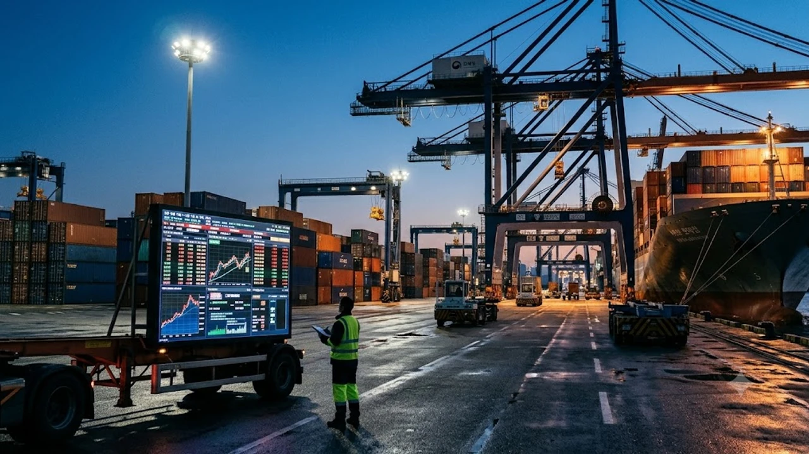

행동주의 펀드가 한국 대표 지주사를 정조준하면서 시장이 요동치고 있다. **얼라인 SK 지분** 1.5% 확보 소식이 전해지자마자 지주사 디스카운트 해소와 기업 밸류업 프로그램에 대한 기대감이 단숨에 시장 중심에 섰다. 저평가된 순자산가치(NAV) 정상화 요구가 거세지는 가운데, 이번 행보가 주가 리레이팅의 신호탄이 될지 투자자들의 관심이 쏠린다.

## 얼라인파트너스의 SK(주) 기습 지분 매입 전말

### 뉴욕 콘퍼런스서 전격 발표된 지분 1.5%의 실체
얼라인파트너스자산운용은 10월 뉴욕에서 열린 글로벌 행동주의 콘퍼런스 현장에서 SK(주) 지분 1.5%를 전격 공개했다. 단순 지분 취득 수준을 넘어 본격적인 주주행동주의를 펼치겠다는 선언이다. 사전에 시장에 노출되지 않던 대규모 물량이 조용히 매집되었다는 사실 자체가 기관과 외국인 투자자들 사이에 적잖은 충격을 안겼다.

### 왜 지금 SK(주)인가: 극심한 NAV 할인율과 지배구조 현주소
SK(주)는 SK하이닉스를 필두로 배터리, 바이오, 통신 등 알짜 자회사를 대거 거느린 핵심 지주사다. 하지만 시장에서 거래되는 기업가치는 보유 지분 가치 대비 70%를 웃도는 기록적인 NAV 할인율에 갇혀 있다. 자회사의 호실적이 모회사 주가에 제대로 반영되지 못하는 기형적인 지배구조 병목이 표적이 된 셈이다.

### 과거 SM·두산밥캣 사례로 본 얼라인의 행동주의 스타일
얼라인은 SM엔터테인먼트의 라이크기획 일감 몰아주기 계약 해지를 이끌어냈고, 두산밥캣과 두산로보틱스의 합병 비율 논란에서도 소액주주 편에 서서 합병안 철회를 끌어낸 전례가 있다. 
> "단순한 주가 부양이 아니라, 자본배치 효율성과 지배구조 투명성을 근본적으로 뜯어고친다."

이러한 기조가 이번 SK(주) 타깃에서도 고스란히 반복될 조짐이다.

## 주주서한에 담긴 핵심 요구사항 3가지

### 자사주 전량 소각 및 단계적 배당 확대 요구
가장 첫머리에 오른 요구는 단연 자사주 소각이다. SK(주)가 보유한 대규모 자기주식을 단순히 쌓아두지 말고 전량 소각해 주당순이익(EPS)을 끌어올리라는 압박이다. 이와 함께 배당 성향을 글로벌 스탠다드 수준으로 끌어올려 현금흐름을 주주에게 직결시킬 것을 요구하고 있다.

### SK하이닉스 등 알짜 자회사 대비 과도한 디스카운트 해소안
SK하이닉스가 고대역폭메모리(HBM) 주도권을 바탕으로 사상 최고 실적을 이어가는 동안, 모회사 SK(주)의 기업가치는 이에 전혀 수렴하지 못했다. 얼라인은 중복상장으로 인한 지주사 디스카운트를 줄이기 위한 구체적인 자본배치 가이드라인 공개를 압박하고 있다.

### 이사회 독립성 강화 및 비주력 자산 유동화 압박
비주력 계열사에 묶인 방만한 차입금과 중복 투자를 정리하라는 주문도 매섭다. 사외이사의 실질적 독립성을 확보해 대주주만을 위한 의사결정을 차단하고, 비핵심 자산을 매각해 차입금 상환 및 주주환원 재원으로 돌려야 한다는 논리다. 시장의 거시 경제 변동성이 극심한 국면에서 [원달러 환율 1410원 급락? 바뀐 전략 3가지](/posts/economy/won-dollar-1410-drop-strategy-2026/) 흐름과 맞물려 자산 효율화 목소리는 한층 힘을 얻고 있다.

## SK그룹의 방어 전략과 실현 가능성 시나리오

### 최태원 회장 및 우호 지분 구조와 경영권 위협 수준 진단
최태원 회장을 비롯한 특수관계인 지분율은 20%대 중반에 머물러 있어 절대적인 안전지대라 단언하기 어렵다. 물론 1.5%의 지분 자체로 경영권을 직접 흔들기는 불가능하다. 하지만 행동주의 펀드의 본질은 다른 소액주주와 연기금의 표심을 결집해 이사회 진입을 노리는 데 있다.

### 밸류업 공시 조기 도입을 통한 선제적 주주환원 카드 검토
사측 역시 수수방관할 수만은 없는 처지다. 정부가 주도하는 기업 밸류업 프로그램에 맞춰 연내 구체적인 주주환원 로드맵을 선제 공시할 가능성이 제기된다. 백기사를 확보하거나 자사주를 점진적으로 소각하는 전향적 제스처 없이는 다가올 주주총회에서 주주들의 반발을 감당하기 어렵기 때문이다.

### 국민연금 및 글로벌 기관투자자의 표심 향방 분석
캐스팅보트는 지분 7% 안팎을 쥔 국민연금과 글로벌 패시브 자금이 쥐고 있다. 스튜어드십 코드가 본격 가동되는 상황에서 명분 없는 경영진 감싸기는 기관 입장에서도 부담이다. 주주가치 제고 명분을 앞세운 얼라인의 제안에 글로벌 의결권 자문사들이 동조할 경우 표 대결 구도는 급격히 얼라인 측으로 기운다.

## 개인 투자자가 챙겨야 할 실전 투자 가이드

### SK(주) 보통주 vs 우선주 투자 매력도와 진입 타이밍
보통주는 지배구조 개편 및 의결권 분쟁 모멘텀에 직접 반응하며 높은 변동성을 보인다. 반면 SK우선주는 배당수익률과 보통주 간 괴리율 축소 관점에서 안정적인 대안이 된다. 이슈 직후 급등 구간에서 추격 매수하기보다는 밸류업 공시 발표 전후의 숨고르기 국면을 분할 매수 기회로 포착하는 접근이 실질적이다.

### 지주사 밸류업 테마 확산 시 함께 주목할 저PBR 수혜주
이번 사태는 SK 단일 종목에 그치지 않는다. 지주사 전반에 걸친 저평가 압박으로 번지며 CJ, LG, 한화 등 NAV 할인율이 60%를 넘는 대형 지주사 전반으로 시장의 매수세가 확산되는 양상이다. [원달러 환율 1300원대 진입, 달러 팔아야 할까?](/posts/economy/won-dollar-1300-fx-investment-strategy-2026/) 분석처럼 거시 유동성이 지주사 저PBR 섹터로 재유입되는 사이클을 눈여겨볼 시점이다.

### 단기 급등 후 변동성 확대 리스크와 필수 손절 기준 설정
행동주의 캠페인은 단기 이벤트가 아니라 수개월에 걸친 지루한 공방전이다. 과거 사례에서도 1차 지분 공개 후 사측의 반박과 장기전 돌입 과정에서 주가가 급등락을 반복했다. 기대감만으로 단기 몰빵하기보다는 명확한 손절 라인을 설정하고 분할 익절하는 기계적 매매 원칙을 고수해야 한다.

[관련상품 쿠팡에서 보기](https://www.coupang.com/np/search?q=%EC%9E%AC%ED%85%8C%ED%81%AC%20ETF&sourceType=affiliate&trackingCode=AF8691300)

#얼라인파트너스 #SK주가 #행동주의펀드 #지주사디스카운트 #자사주소각 #기업밸류업 #주주환원