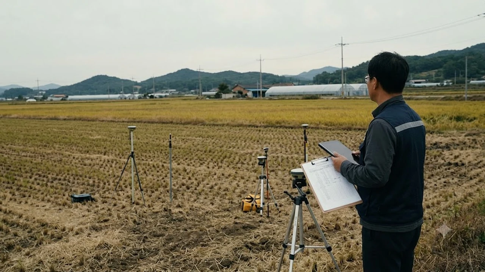

정부가 투기 근절과 경자유전 원칙을 앞세워 전국적인 **농지 전수조사** 칼을 빼 들면서 토지 시장과 2금융권 금융 현장이 얼어붙었습니다. 실경작 입증 기준이 대폭 까다로워지자 손바뀜이 사실상 멈췄고, 담보로 묶여 있던 토지 가치마저 급락해 **부실채권(NPL)** 매각 손실이 단위 농·축협의 재무 건전성을 그대로 파고드는 양상입니다.

## 농지 전수조사 착수와 농·축협 담보대출 NPL 매각 손실 급증의 실체

### 전수조사 예고 후 급격히 얼어붙은 농지 매매 시장 현황
농림축산식품부와 지방자치단체가 농지 소유·이용 실태 합동 전수조사를 본격화한 직후, 전국 전·답·과수원 거래량은 전년 동기 대비 40% 넘게 고꾸라졌습니다. 예전처럼 영농계획서만 형식적으로 적어 내던 시절은 끝났고, 농지취득자격증명(농취증) 발급 심사 과정에서 실제 농기계 보유 내역과 영농 노동력 확보 방안까지 현장 실사로 따지는 탓입니다. 외지인 발길이 완전히 끊기며 경기 외곽과 지방 읍·면 지역의 농지 호가는 20~30%씩 깎였지만 매수 문의조차 자취를 감췄습니다.

### NPL 매각 손해액 226억 급증: 전년 대비 2배 뛴 원인
거래 실종은 금융권의 채권 부실로 직행했습니다. 2026년 10월 국회 농림축산식품해양수산위원회 국정감사 자료를 보면, 전국 농·축협이 2026년 들어 털어낸 농지 담보대출 부실채권(NPL)의 원금 대비 매각 손실액은 **226억 원**에 달합니다. 2025년 같은 기간 손실액인 108억 원과 비교하면 정확히 2배를 웃돕니다. 담보로 잡은 땅이 경매 시장에서 4~5회 연속 유찰돼 감정가의 반토막 이하로 떨어지자, 연체율 관리에 쫓긴 조합들이 NPL 전문 유동화 회사에 헐값으로 넘기면서 확정 손실이 눈덩이처럼 불어났습니다.

### 국회 국정감사에서 드러난 상호금융 건전성 비상 신호
국정감사 현장에서는 일부 지방 단위농협의 자산 건전성에 적색경보가 울렸다는 사실이 공개됐습니다. 전체 여신 중 농지 담보대출 비중이 40%를 넘나드는 특정 조합의 경우, 연체율이 연초 3%대에서 하반기 7%대까지 가파르게 뛰었습니다. 부실에 대비해 쌓아야 할 대손충당금이 급증하면서 조합 당기순이익이 곤두박질쳤고, 조합원 출자 배당금 삭감은 물론 부실 우려 조합의 흡수합병 시나리오까지 거론되는 지경입니다. 감독 당국이 부실채권 정리를 재촉하고 있으나 토지 매수 심리가 죽어버려 손실을 떠안고 파는 것 외엔 뾰족한 수가 없습니다.

## 농지 담보가치 하락과 지역 금융권 건전성 위기 구조 분석

### 감정평가액 하락과 담보인정비율(LTV) 재산정 충격
금융기관이 주기적으로 실시하는 담보물 재평가에서 공시지가와 감정평가액이 일제히 깎이며 차주들의 목을 조르고 있습니다. 기존에 최대 70%까지 인정받았던 담보인정비율(LTV)이 한도 축소와 평가액 하락이라는 이중 타격을 받으면서 유효 담보액이 30% 넘게 축소됐습니다. 은행 창구에서는 차주에게 줄어든 한도 차액만큼 원금을 일시에 갚으라는 통보를 날리고 있고, 현금을 마련하지 못한 농지는 곧장 경매 시장으로 넘겨집니다. 고금리 기조 장기화로 자금 조달 비용까지 치솟은 현 상황의 거시적 배경은 [美 국채금리 5.3% 돌파, 내 대출 영향은?](/posts/economy/us-treasury-yield-5-3-percent-korea-loan-impact-2026/) 글에서도 맥락을 짚어볼 수 있습니다.

### 농업인 vs 비농업인 소유 농지의 부실화율 차이
부실을 주도하는 쪽은 흙 한번 만져본 적 없는 외지 기획부동산 투자자나 은퇴 대비 명목으로 사들인 비농업인 소유 토지입니다. 실태 분석을 살펴보면 실제 영농 활동을 이어가는 전업농의 대출 연체율은 2% 안팎으로 안정세를 유지하는 반면, 외지인이 소유한 농지 담보대출 연체율은 11% 선을 뚫고 올라갔습니다.

- **실제 농업인 소유 농지:** 직불금 수령과 작물 출하 대금으로 원리금 상환을 버텨내며 자경 입증에 결격 사유가 없음
- **비농업인 소유 농지:** 불법 임대차 단속 타깃, 처분명령 압박, 원리금 전액을 본업 소득으로 메워야 해 금리 압박에 바로 연체 전환

### 1금융권 대비 지역 상호금융권이 먼저 흔들리는 구조적 배경
시중은행은 수년 전부터 환금성이 떨어지는 비주택 담보 여신을 걸러내고 아파트 중심의 담보 포트폴리오를 구축해 왔습니다. 반면 지역 농·축협은 지역 조합원 대출뿐 아니라 외지인의 농지 매입 자금까지 끌어모으며 몸집을 불렸습니다.

> "지역 금융기관은 기반 담보물의 거래가 얼어붙었을 때 위험을 분산할 포트폴리오 탈출구가 극히 제한적입니다."

환금성이 사실상 제로에 수렴하는 비주택 토지 담보가 자산의 상당 부분을 차지하는 상호금융 특유의 구조가 이번 충격파를 온몸으로 받아내는 이유입니다.

## 일반 토지 소유자와 귀농·실수요자가 겪는 현실적 파장

### 농지처분의무 통지와 강제 이행강제금 리스크 확대
전수조사에서 유휴지 방치나 불법 임대 사실이 적발되면 관할 지자체는 1년 기한의 **농지처분의무**를 부과합니다. 이 기간 안에 본인이 직접 밭을 갈지 않거나 제3자에게 팔지 못하면 매년 공시지가와 감정평가액 중 높은 금액의 25%가 이행강제금으로 부과됩니다. 매수자가 없어 팔지도 못하는 상황에서 1억 원짜리 땅에 매년 2,500만 원씩 벌금이 떨어지는 셈이라 소유자들의 자산이 강제로 잠식당하는 형국입니다.

### 기존 농지 담보대출 만기 연장 거절 및 상환 압박 사례
경기도 화성시에서 1,200평 밭을 보유한 직장인 A씨는 3년 전 받은 3억 원의 토지 담보대출 만기를 앞두고 조합으로부터 1억 원 원금 상환을 통보받았습니다. 최근 실거래가가 급락한 데다 자경 요건 미달로 담보 재평가액이 깎여 기존 대출액을 연장해 줄 수 없다는 설명이었습니다. 단기 융통 자금이 바닥난 A씨는 결국 연체 3개월 만에 경매 개시 결정을 송달받았습니다. 이처럼 상환 능력이 완전히 무너지지 않은 차주조차 강제 디레버리징(부채 축소) 과정에서 한계 차주로 내몰립니다.

### 실경작자 관점에서 본 토지 매입 기회와 자금 조달 한계
농사를 지으려는 귀농인과 청년 창업농 입장에서는 거품이 꺼진 싼 매물이 나오는 기회로 보일 수 있습니다. 하지만 상호금융 창구가 토지 담보대출을 걸어 잠그거나 LTV를 40% 밑으로 조이면서, 실수요자조차 자금을 빌리지 못해 땅을 사지 못하는 모순이 벌어지고 있습니다. 시장 자금줄이 마르면서 실수요에 의한 정상적인 손바뀜마저 막혀버렸습니다.

## 농지 규제 강화 국면에서 살아남는 자산 방어 및 대응 가이드

### 본인 소유 농지의 영농 실적 및 증빙 서류 사전 점검법
처분명령과 이행강제금을 방어하려면 주먹구구식 농사가 아니라 객관적이고 연속적인 영농 기록을 손에 쥐고 있어야 합니다. 현장 조사가 닥쳤을 때 소명 자료가 부실하면 예외 없이 처분 대상 명단에 오릅니다.

- **농업경영체 등록부 대조:** 등록부에 기재된 재배 작물과 실제 밭에 심겨 있는 농작물이 일치하는지 확인
- **농자재 구매 영수증 전수 보관:** 종자, 묘목, 비료, 비닐, 농약 구매 영수증(신용카드 결제 전표, 농협 경제사업장 세금계산서) 3년 치 편철
- **날짜 채증 사진 일지 작성:** 계절별 파종, 풀매기(제초), 방제, 수확 현장을 날짜가 찍힌 사진으로 남기고 농작업 일지에 기재
- **농지은행 위탁 계약 활용:** 상속 농지이거나 8년 이상 직접 경작한 뒤 부득이 농사를 짓지 못한다면, 한국농어촌공사 농지은행에 장기 임대위탁 계약을 맺어 합법적 자경 인정 지위를 확보

### 만기 도래 농지 담보대출 대환 및 일부 상환 우선순위 설정
대출 만기가 다가오고 있다면 만기 직전에 당황하지 말고 최소 3개월 전에 조합 대출계 담당자를 찾아가 재평가 예상액과 필수 상환액을 먼저 뽑아봐야 합니다. 2금융권 내 다른 상호금융사로 갈아타는 대환은 현재 전 금융권의 토지 담보 축소 기조로 불가능에 가깝습니다. 만 60세 이상이고 영농 경력이 5년을 넘는다면 농지연금에 가입해 채무 상환 자금을 조달하는 방식을 검토하거나, 일부 필지를 분할 매각해 원금을 줄이는 선제적 대응이 필요합니다.

### 급매물 경매 유입 시기 모니터링 및 리스크 관리 체크리스트
농·축협이 털어내야 할 부실채권 규모를 감안하면 경매 법정으로 넘어갈 농지 매물은 지속적으로 쏟아질 수밖에 없습니다. 인근 토지 시세 방어가 목적이든 경매 물건 낙찰이 목적이든, 법원 경매 정보지를 통해 인근 지역 농지의 유찰 횟수와 낙찰가율 흐름을 꼼꼼히 추적해야 합니다. 유동성이 마른 비주택 자산은 한 번 삐끗하면 회복에 수년이 걸리므로 부실 노출도를 줄이고 현금 완충 지대를 넓히는 편이 유리합니다.

[부동산 및 채권 투자 관련서적 쿠팡에서 보기](https://www.coupang.com/np/search?q=%EB%B6%80%EB%8F%99%EC%82%B0%20%EC%B1%84%EA%B2%8C%20%ED%88%AC%EC%9E%90&sourceType=affiliate&trackingCode=AF8691300)

#농지전수조사 #농지담보대출 #부실채권 #NPL #농협대출 #상호금융 #농지처분의무 #이행강제금