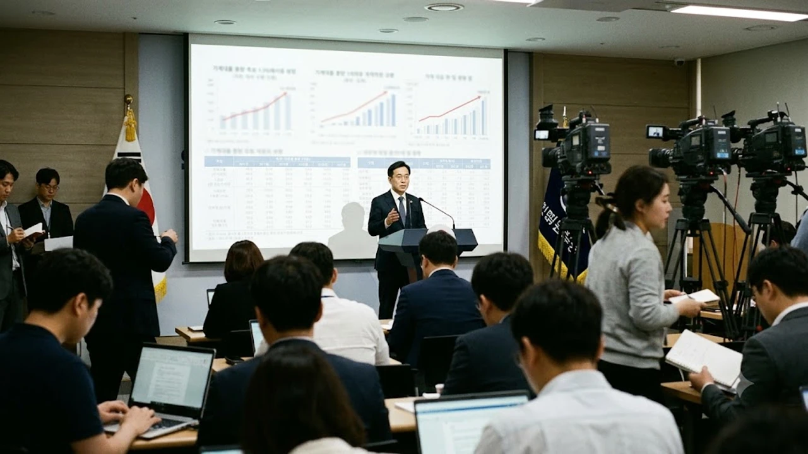

금융당국이 최근 연간 가계대출 증가율 목표치를 기존 1.5%에서 3%로 전격 상향 조정하면서 대출 시장에 일대 변화가 시작되었습니다. 이번 **가계대출 3% 상향** 조치는 연말 대출 절벽을 우려하던 주택 실수요자들에게 숨통을 틔워줄 정책적 전환으로 평가받지만, 실질적인 금융 창구의 체감 온도는 여전히 엇갈립니다. 총량 규제 완화라는 외형 이면에 자리 잡은 세부 조건과 주담대 스트레스 DSR 산정 방식의 변화를 정확히 파악해야만 차질 없는 자금 조달 계획을 완성할 수 있습니다.

## 가계대출 총량 목표 1.5%에서 3%로 상향된 배경

### 4개월 만의 정책 기조 수정과 국감 쟁점
지난 2026년 10월 8일 국회 정무위원회 금융위원회 국정감사에서 금융당국은 연간 가계부채 증가율 관리 목표를 기존 1.5%에서 3%로 4개월 만에 2배 늘려 잡았습니다. 상반기 내내 가계부채 억제를 명분으로 시중은행 대출 창구를 조였으나, 가을 이사철과 겹치며 실수요자의 대출 창구가 연쇄 폐쇄되는 부작용이 현실화했기 때문입니다. 국감장에서는 불과 몇 달 만에 목표치를 번복한 널뛰기 행정을 질타하는 목소리가 쏟아졌고, 이에 금융당국은 실수요 보호를 위한 불가피한 유연화 조치였음을 내세웠습니다.

### 주택 공급 촉진 및 PF 유동성 공급 47.8조 원 연계 방안
이번 목표 상향은 신규 주택 착공 및 분양 일정 정상화를 위한 정책 금융 지원책과 맞닿아 있습니다. 정부가 발표한 총 47.8조 원 규모의 주택 공급 금융 프로그램이 원활히 돌아가려면 분양 계약자들의 집단대출 실행이 필수적입니다. 시공사와 시행사의 자금 경색을 풀고 부동산 PF 부실을 막기 위해 신규 주택 공급과 맞물린 대출 라인을 총량 목표 내에서 추가 확보한 셈입니다.

### 기존 총량 규제와 이번 목표 수정안의 세부 차이점
기존 규제 체계에서는 시중은행의 일반 가계대출과 집단대출을 통합해 동일한 총량 틀 안에 묶어두었습니다. 반면 이번 수정안은 연간 총량 허용치를 3% 수준으로 확대하는 동시에 정책 목적성이 뚜렷한 주택 공급 관련 금융을 총량 계산 방식에서 유연하게 반영합니다.

> **핵심 차이점:**
> - **기존:** 모든 주담대 및 신용대출을 1.5% 틀에 묶어 연말 집단대출 전면 중단 유발
> - **수정안:** 연간 총량 3% 확보 및 주택 공급 연계 집단대출을 분리 반영해 실수요 분양권 보호

## 실수요자 대출 문턱 진짜 낮아졌나: 분야별 영향

### 분양권 중도금 및 잔금 대출 예외 규정 범위
총량이 3%로 늘어나면서 가장 큰 숨통이 트인 대상은 입주를 앞둔 신규 분양 계약자입니다. 기존에는 은행별 한도 소진을 이유로 시공사가 지정한 집단대출 취급 은행이 중도금·잔금 대출 접수를 일방적으로 보류하는 일이 잦았습니다. 이번 방침으로 신규 입주 단지의 중도금과 잔금 대출은 은행별 총량 한도 패널티 평가에서 일부 완화 적용을 받아 정상 집행될 가능성이 대폭 커졌습니다.

### 1금융권 주택담보대출 금리와 가산금리 추이
대출 한도 총량의 숨통이 트였다고 해서 이자 부담까지 줄어드는 것은 결코 아닙니다. 시중은행들은 한도 관리 차원에서 올려둔 가산금리를 즉각 낮추지 않고 버티는 기조를 보이고 있습니다. 글로벌 채권 시장의 변동성과 [美 국채금리 5.3% 돌파, 내 대출 영향은?](/posts/economy/us-treasury-yield-5-3-percent-korea-loan-impact-2026/) 분석에서 나타났듯, 조달 금리 자체가 높은 수준을 유지하고 있어 실제 차주가 부담하는 주담대 체감 금리는 여전히 연 4%대 중후반에 머물러 있습니다.

### 디딤돌·버팀목 등 정책 모기지와의 충돌 및 한도 변화
정책 모기지 기금의 건전성 관리 기조와는 다소 엇박자가 발생하고 있습니다. 주택도시기금 재원으로 운용되는 디딤돌대출의 경우 수도권 소재 주택에 대해 방공제 면제(LTV 산정 시 최우선변제금 제외) 혜택을 축소하고 준공 전 신규 분양지의 후취담보 취급을 제한하는 등 개별 한도를 여전히 묶어둔 상태입니다. 시중은행의 총량 3% 완화와 정책 모기지의 취급 요건 강화가 엇갈리므로 차주 본인이 신청하는 상품이 시중은행 일반 주담대인지 정책 기금 대출인지 명확히 가려내야 합니다.

## 대출 창구 혼선 속 차주별 대출 시뮬레이션

### 수도권 신규 분양 계약자의 자금 조달 시나리오
수도권 분양가 9억 원 아파트(전용 84㎡)에 당첨되어 오는 11월 잔금을 치러야 하는 무주택자 A씨의 사례입니다. 종전에는 시중은행의 가계대출 총량 잠식으로 잔금 대출 심사가 거절되거나 제2금융권으로 밀려날 위기에 놓여 있었습니다.

- **조달 가능액:** LTV 70% 적용 시 최대 6억 3,000만 원 한도 형성
- **실제 실행액:** 연 소득 8,000만 원 기준, 스트레스 DSR 2단계(가산금리 1.2%p) 반영 시 약 5억 1,000만 원 선으로 제한
- **대응 방향:** 총량 3% 상향 덕분에 은행 접수 거절 위험은 해소되었으나, DSR 한도 부족분 1억 2,000만 원은 보유 현금이나 저금리 신용대출로 메워야 합니다.

### 기존 1주택 갈아타기 수요자의 대환 대출 가능성
상급지 갈아타기를 노리는 1주택자의 경우 기존 주택 처분 조건부 대출 요건이 깐깐하게 유지됩니다. 총량이 늘어났더라도 주택 보유 수에 따른 규제 자체가 풀린 것은 아닙니다. 기존 주택을 일정 기간 내 처분하겠다는 약정을 맺어야만 신규 주택 대출이 나오며, 대환 대출 플랫폼을 통한 금리 갈아타기 역시 신규 취급 총량 관리 대상에 포함되어 월별 쿼터가 조기 소진될 위험이 여전합니다.

### 전세대출 증액 및 만기 연장 시 한도 산정 방식
전세대출의 경우 신규 보증금 증액분에 대해서만 까다롭게 굴던 은행권의 문턱이 다소 낮아졌습니다. 기존 계약 갱신에 따른 증액분은 임대차계약서상 확정일자를 기준으로 무리 없이 승인되는 흐름입니다. 다만 소유권 이전 조건부 전세대출(갭투자 매물 전세대출)은 여전히 대다수 시중은행 창구에서 취급 제한 목록에 올려두고 있어 다세대·빌라 차주들의 꼼꼼한 확인이 요구됩니다.

## 연말 대출 절벽 피하는 실전 자금 조달 가이드

### 주거래 은행별 총량 소진 현황 사전 조회 팁
시중은행마다 연간 가계대출 증가율 누적치가 다릅니다. 특정 시중은행(신한, 하나, 국민, 우리 등)의 누적 증가율이 이미 2.5%를 넘어선 상태라면 3% 목표치 안에서도 심사를 옥죌 수밖에 없습니다. 반면 대출 자산 성장이 상대적으로 더뎠던 은행은 10월과 11월에 걸쳐 한도를 넉넉하게 배정하므로 주거래 은행 단 한 곳에만 매달리지 말고 3~4개 시중은행의 모바일 한도 사전 조회 시스템을 동시에 두드려야 합니다.

### 2단계 스트레스 DSR 적용 시 감산액 계산법
총량 규제 상향과 무관하게 차주별 대출 한도를 실질적으로 쥐고 흔드는 변수는 스트레스 DSR입니다. 수도권 주택담보대출에 대해 1.2%p의 스트레스 금리가 가산되어 계산됩니다.

- **원리금 균등상환 30년 만기 기준:** 차주 실제 적용 금리가 4.2%라 하더라도 DSR 계산기에는 5.4%로 입력되어 한도가 산출됩니다.
- **감산 폭:** 연봉 7,000만 원 차주의 경우 일반 DSR 적용 대비 대출 가능 한도가 약 4,500만 원에서 5,500만 원가량 깎입니다.

### 잔금 납부일 맞춤형 신청 시점 및 필요 서류 점검
차질 없는 대출 집행을 위해서는 잔금 납부 예정일 최소 40일 이전에 서류 접수를 끝내야 합니다. 은행의 월별 대출 쿼터는 통상 매월 1일에서 10일 사이에 일찌감치 바닥나므로, 월초에 심사 승인을 받아두는 일정이 안전합니다.

- **필수 구비 서류:** 분양계약서 및 옵션계약서 원본, 소득금액증명원(최근 2개년), 건강보험자격득실확인서, 주민등록등·초본(주소 변동 이력 포함)
- **점검 포인트:** 전입신고 의무 기한과 기존 보유 주택의 등기부등본상 권리 침해 유무를 미리 확인해야 심사 보류를 막을 수 있습니다.

[대출 이자 절감 및 자산 관리 도서 쿠팡에서 보기](https://www.coupang.com/np/search?q=%EC%9E%AC%ED%85%8C%ED%81%AC%20%EB%8C%80%EC%B6%9C%20%EC%A0%88%EC%84%B8&sourceType=affiliate&trackingCode=AF8691300)

#가계대출3퍼센트 #주택담보대출한도 #스트레스DSR #잔금대출조건 #중도금대출예외 #2026대출규제 #실수요자대출 #1금융권금리