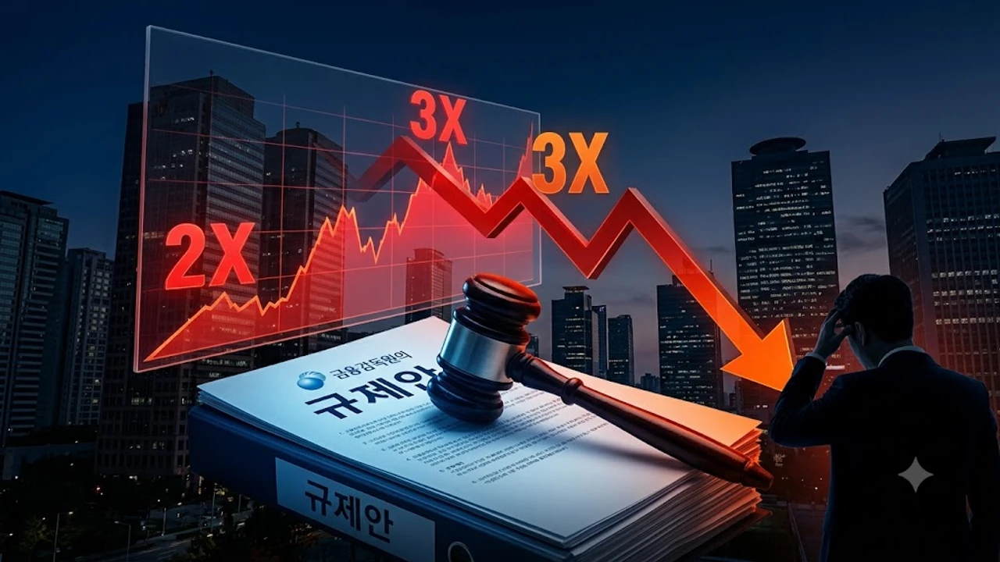

국내 증시를 뜨겁게 달구던 고수익 상품에 제동이 걸리면서 **레버리지 ETF 규제** 폭풍이 금융투자업계를 뒤흔들고 있습니다. 금융감독원이 국정감사에서 부실 심사를 공식 인정하면서 **단일종목 레버리지 ETF** 상품들의 조기 상장폐지 우려와 거래 요건 강화 가능성이 투자자들의 계좌를 짓누르고 있습니다.

## 단일종목 레버리지 ETF, 국감서 불거진 졸속 심사의 전말

### 평균 62일 걸리던 심사가 29일 만에 통과된 배경
상장지수펀드의 신규 상품 약관 검토와 리스크 심사에는 통상 평균 62영업일이 들어갑니다. 하지만 이번 논란의 중심에 선 개별 테마·단일종목 2배 추종 레버리지 상품군은 절반도 안 되는 29영업일 만에 당국 문턱을 넘었습니다. 상장 심사관들이 파생결합증권 특유의 횡보장 음의 복리 잠식 효과를 제대로 검증하지 않은 채, 운용사 간 출시 경쟁을 묵인하며 졸속으로 도장을 찍어준 셈입니다.

### 금감원장 공식 사과와 책임 소재 논란
국회 정무위원회 국정감사 현장에서 이찬진 금융감독원장은 단일종목 레버리지 상품 도입 과정의 시장 안정성 검증 부실을 인정하고 공식 사과했습니다. 인가 부서 업무 전반에 대한 즉각적인 자체 감찰을 지시했고, 금융위원회와 함께 심사 기준을 뜯어고치겠다는 방침을 못 박았습니다. 감독 수장이 절차적 하자를 시인한 만큼, 실무 부서 문책은 물론 기존 상장 상품에 대한 고강도 사후 제재가 확실시됩니다.

### 방산·조선 등 주력 고배율 상품의 주가 급락 현황
부실 심사 인정 소식이 전해지자마자 시장을 이끌던 방산·조선 2배 레버리지 종목들이 하루 만에 10% 안팎으로 무너져 내렸습니다. 기관 투자가들의 기계적 매도세가 쏟아지며 가격 변동 폭은 평소의 두 배를 넘어섰습니다. 기초자산이 조금만 흔들려도 추종 지수가 음의 복리로 깎여나가는 괴리율 확대 현상이 뚜렷해졌고, 고수익을 기대하며 뛰어든 개인 투자자들은 속수무책으로 원금을 잃고 있습니다.

## 금융당국 규제 칼날, 어떤 상품이 타격받나?

### 상장 유지 요건 미달 및 강제 상폐 대상 기준
금융당국은 자산운용사들을 불러 모아 기준선에 미달하는 파생 ETF를 솎아내는 작업에 착수했습니다. 자본시장법 시행령상 설정액 기준을 칼같이 적용해, 순자산총액이 50억 원 밑으로 떨어진 채 회복하지 못하는 종목은 유예 기간 없이 즉각 시장에서 퇴출하는 방안이 유력합니다. 괴리율이 비정상적으로 벌어진 채 거래량이 메마른 단일종목 추종 상품이 퇴출 1순위 후보입니다.

### 개인 투자자 기본예탁금 및 교육 이수 규제 강화안
일반 투자자의 시장 진입 장벽도 턱없이 높아집니다. 기존 금융투자교육원의 1시간 사전 교육과 기본예탁금 1,000만 원 조건에 더해, 고위험 파생 상품의 예탁금을 3,000만 원 선까지 대폭 끌어올리는 규제안이 오르내리고 있습니다. 적합성 원칙을 깐깐하게 들이대 파생상품 거래 이력이 부족한 일반 투자자의 신규 매수 주문을 원천 차단하겠다는 구상입니다.

### 운용사 대상 전수조사와 신규 상품 승인 동결 조치
금감원은 현재 상장된 120여 개 레버리지·인버스 ETF의 약관과 운용 실태를 전수조사하고 있습니다. 동시에 유사한 단일종목 연계 파생 상품의 신규 증권신고서 효력 발생을 기한 없이 멈춰 세웠습니다. 규제 재정비가 끝날 때까지 당분간 국내 시장에서 신규 고배율 상품 출시는 완전히 얼어붙게 됩니다.

## 고배율 투자자 vs 당국 개입, 득과 실 따져보기

### 개인 투자자 보호 명분과 시장 자율성 침해 논란
당국은 깡통 계좌를 막기 위한 최소한의 안전장치라는 논리를 폅니다. 반면 시장 참여자들은 성인 투자자의 자기 책임 원칙을 짓밟고 합법적인 매매 기회를 빼앗는 과잉 규제라며 맞서고 있습니다. 위험성을 알고 뛰어든 시장에 규제 당국이 뒤늦게 발을 들이밀며 시장 가격 왜곡을 부추긴다는 불만도 거셉니다.

### 국내 자금의 해외 직투(미국 레버리지 ETF) 이탈 부작용
국내 상품을 막는다고 레버리지 수요가 사라지지 않습니다. 오히려 서학개미들이 규제가 덜한 TSLL이나 NVDL 같은 미국 2배 레버리지 ETF로 대거 이동하는 풍선효과를 낳고 있습니다. 국내 자본의 해외 유출이 빨라지면 환율 방어 전선에도 부담이 커집니다. 외환시장 변동성이 커지는 장세에서는 [원달러 환율 1410원 급락? 바뀐 전략 3가지](/posts/economy/won-dollar-1410-drop-strategy-2026/)를 함께 확인하면서 환노출 파생상품의 환차손 위험까지 치밀하게 계산해야 합니다.

### 거래량 급감에 따른 유동성 공급자(LP) 호가 스프레드 확대 위험
규제 시그널이 켜지면 유동성 공급자(LP) 증권사들은 재고 리스크를 줄이기 위해 매수·매도 호가 간격을 벌려버립니다. 거래량이 마른 상태에서 호가 스프레드가 벌어지면 매매 오차(슬리피지)가 눈덩이처럼 불어납니다.
> 호가창이 비어 있는 상태에서 매도 물량을 던지면 장부상 순자산가치(iNAV)보다 3~5% 이상 헐값에 강제 청산당하는 치명적인 손실을 피할 수 없습니다.

## 보유 중인 투자자를 위한 실전 포트폴리오 탈출 전략

### 상폐 위기 종목 식별 및 롤오버 비용 점검법
보유 중인 고배율 파생 상품의 최근 3개월 순자산 추이와 일평균 거래대금을 당장 열어봐야 합니다. 하루 거래대금이 1억 원 밑으로 주저앉았거나 괴리율이 마이너스 2%를 웃도는 종목은 지체 없이 털어내야 합니다. 선물 롤오버 비용과 보수 차감으로 가만히 있어도 계좌 가치가 갉아먹히는 상품은 들고 있을수록 손실이 불어납니다.

### 변동성 확대 국면에서 손실 최소화하는 매도 타이밍
당국의 제재 확정 발표나 거래소 규정 개정안이 공포되는 시점에 투매가 집중됩니다. 반등 기술적 파동이 올라오는 날 오전, LP 호가가 촘촘하게 받쳐주는 시간대를 노려 물량을 쪼개 팔아야 체결 손실을 줄일 수 있습니다. 미련을 두고 버티다가 매매 거래정지나 상장폐지 절차에 걸려들면 자금이 몇 주 동안 그대로 묶여버립니다.

### 일반 인덱스 ETF 및 분산 투자로 갈아타는 전환 가이드
원금 회복에 집착해 더 센 레버리지로 물타기를 감행하는 행동은 자멸에 가깝습니다. 고위험 파생 상품을 털어낸 자금은 시장 전체를 추종하는 지수형 인덱스 ETF나 단기 금리형 파킹 상품으로 돌려 계좌 체력을 다져야 합니다. 변동성 장세에서는 방어력이 검증된 배당형·채권형 자산의 비중을 높여 숨고르기를 하는 편이 계좌 회복 속도를 앞당깁니다.

[ETF 투자 바이블 도서 쿠팡에서 보기](https://www.coupang.com/np/search?q=%EC%9E%AC%ED%85%8C%ED%81%AC%20ETF&sourceType=affiliate&trackingCode=AF8691300)

#레버리지ETF #금감원규제 #ETF상장폐지 #금융감독원 #파생상품규제 #주식투자전략 #단일종목ETF #투자자보호 #자산배분