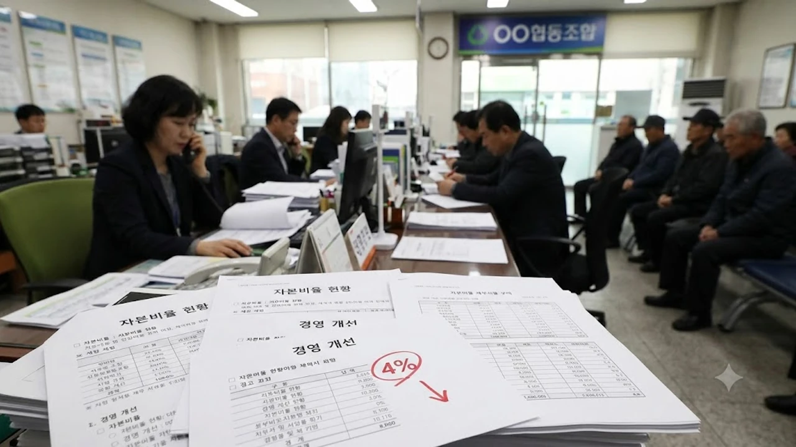

전국 단위 조합 곳곳에서 **상호금융 부실** 경고등이 켜지며 예금자들의 발걸음이 빨라지고 있습니다. 특히 자본 건전성 기준선 밑으로 떨어진 조합 명단이 가시화되면서, 이자 몇 푼 더 받으려 묶어둔 뭉칫돈이 **예금자보호 한도** 안에서 온전히 돌아올지 냉정한 계산이 앞서는 순간입니다.

## 상호금융 368곳 자본비율 4% 미달 사태 전말

### 4% 기준선 붕괴가 의미하는 실제 건전성 경고등
상호금융 감독 체계에서 **순자본비율 4%**는 부실 금융기관을 걸러내는 1차 방어선입니다. 총자산 대비 순자본이 4% 아래로 꺾였다는 뜻은, 보유 자산에 부실이 터졌을 때 자체 체력으로 메울 자본금이 바닥났음을 보여줍니다. 이번에 적발된 단위 조합들은 회수 불능 여신에 대응하느라 대손충당금을 무리하게 쌓았고, 그 결과 자기자본이 잠식되어 감독 최소 기준마저 지키지 못했습니다.

### 부동산·중기 대출 부실과 연체율 10% 돌파 조합의 실태
원인은 무분별하게 취급했던 지방 부동산 PF와 개인사업자 담보대출의 도미노 연체입니다. 공사가 멈춰 선 채 분양이 좌초된 사업장이 늘자 담보 가치는 반토막 났고, 차주들의 원리금 상환 중단이 조합 장부에 고스란히 반영되었습니다.
- **연체율 10% 초과 조합 속출**: 시중은행 연체율(0.3~0.5%대)과 비교하면 20배를 웃도는 위험 수치입니다.
- **수익성 급전직하**: 이자가 들어오지 않는 무수익 여신(NPL)이 장부를 메우면서 조합원 출자금 배당이 중단되고 억대 당기순손실이 확정되었습니다.

### 금융당국 긴급 구조조정 및 합병 가이드라인 추진 현황
금융위원회와 행정안전부는 자본잠식 조합을 겨냥해 경영개선권고와 경영개선요구를 잇달아 통보했습니다. 자체 정상화 계획이 통과되지 못한 한계 조합은 우량 이웃 조합에 통폐합하는 강제 합병 절차가 시작되었으며, 회수 불능 채권을 자산관리공사(캠코)로 넘겨 장부를 털어내는 청산 절차가 속도를 내고 있습니다.

## 내 예금 5천만원과 이자 진짜 안전하게 돌려받을 수 있나

### 새마을금고·신협 중앙회 예금자보호 제도의 구조와 한계
신협과 새마을금고는 정부 산하 예금보험공사가 아닌, **각 중앙회 예금자보호준비금**으로 자금을 보장합니다.
> 새마을금고법과 신용협동조합법에 의거해 중앙회가 기금을 조성하고 고객 1인당 원리금 5,000만 원까지 돌려주도록 명문화되어 있습니다.

다만 여러 곳에서 동시다발적 자금 유출이 일어날 때 중앙회의 현금성 준비금이 단기 지급 수요를 지체 없이 소화할 수 있을지에 대한 시장의 경계감은 꺼지지 않았습니다.

### 1인당 원리금 5,000만원 계산 시 놓치기 쉬운 세금과 이자 함정
가장 흔히 저지르는 실수는 '원금 딱 5,000만 원'을 채워 넣는 행동입니다. 법률상 보호 한도는 **원금과 약정 기간 발생한 이자를 합쳐서 5,000만 원**입니다.
- **이율 재산정 손해**: 당초 약정했던 연 5~6%대 고금리 대신 중앙회가 임의 산정한 정기예치금 평균 금리(연 1~2% 수준)만 얹어 정산될 수 있습니다.
- **세금 우대 한도 계산**: 비과세·세금우대 혜택(농특세 1.4%)으로 가입했더라도 정산 시점의 복잡한 세법 적용으로 통장에 꽂히는 실수령액이 계산과 달라집니다.
따라서 한 조합당 원금은 4,300만~4,500만 원 선에서 끊어두는 자금 분할이 안전합니다.

### 조합 합병 시 기존 예·적금 계약과 약정 이율 승계 방식
단위 조합이 우량 조합에 흡수 합병되면 예금 채권은 새 조합으로 고스란히 넘어갑니다. 계약 당시 확정한 약정 이자율과 만기 조건이 보존되므로 뜬소문에 놀라 무작정 깰 이유는 없습니다. 오히려 공포심에 휩쓸려 중도해지를 누르면 그간 쌓인 이자만 날아가므로, 공시된 합병 승계 통지문을 차분히 읽은 뒤 결단을 내려도 늦지 않습니다.

## 부실 우려 조합인지 1분 만에 확인하는 핵심 지표

### 정기공시에서 순자본비율과 순고정이하여신비율 찾는 법
거래 조합 홈페이지나 중앙회 통합 포털의 **경영공시(정기공시)** 탭을 열어 2가지 수치부터 확인해야 합니다.
1. **순자본비율 (새마을금고는 위험가중자산대비 자기자본비율)**: 4% 밑은 당국의 관리 대상이며, 최소 **8% 이상**이어야 손실 완충력이 충분합니다.
2. **순고정이하여신비율**: 3개월 넘게 연체된 깡통 대출 비중으로, **3% 이하**가 정상 범위입니다. 이 수치가 8%를 웃돌면 빌려준 돈 대부분이 떼였다는 뜻입니다.

### 경영실태평가 등급 기준과 3등급 이하 주의 조합
금융당국은 자본, 자산, 수익, 유동성 지표를 종합해 1~5등급 성적표를 매깁니다.
- **1등급(우수)·2등급(양호)**: 예금자가 발 뻗고 잘 수 있는 체급입니다.
- **3등급(보통)**: 자산 일부에 흠집이 나 당국 감시선상에 올라간 상태입니다.
- **4등급(취약)·5등급(위험)**: 자본잠식이 임박해 경영개선명령이 떨어질 수 있는 곳이므로 만기를 따질 것 없이 즉각 자금 이탈을 검토해야 합니다.

### 지역 금고별 배당률과 연체율 추이 비교 확인 팁
출자금 통장에 찍힌 배당률이 전년 대비 반토막 났거나 '0%'로 공시되었다면 해당 금고의 영업이익은 이미 적자로 곤두박질친 상태입니다. 최근 1년 사이 연체율이 2배 이상 가파르게 뛴 조합 역시 신규 예치 대상에서 가차 없이 제외해야 합니다. 자산 시장의 구조적 위험을 피하고 전체 포트폴리오를 점검하고 싶다면 [경제 전체 글 보기](/posts/economy/)에서 다른 금융 분석도 함께 확인해 둘 만합니다.

## 손실 없이 자금을 지키는 실전 예·적금 이동 전략

### 만기 전 중도해지 vs 만기 유지 실익 비교 계산
만기까지 1~2개월 남짓 남았고 원리금 총액이 5,000만 원 이하라면 합병 승계 제도를 믿고 만기를 채워 약정 이자를 온전히 챙기는 편이 낫습니다. 반대로 남은 기간이 반년 이상이고 예치액이 5,000만 원을 훌쩍 넘긴 상태라면, 중도해지 패널티를 감수하더라도 초과 금액은 당일 영업 시간에 즉각 빼내 다른 금융사로 쪼개 넣어야 합니다.

### 제1금융권 파킹통장 및 국채 투자로 안전하게 분산하기
경고음이 울린 2금융권 특판에서 건져낸 돈은 원금 손실 위험이 없는 확실한 피난처로 옮겨 담아야 합니다.
- **1금융권 수시입출식 파킹통장**: 5,000만 원 예금자보호가 작동하면서 하루만 맡겨도 약정 금리가 붙어 시장 변동성 대기 자금으로 쓰기 좋습니다.
- **개인투자용 국채 및 단기채 ETF**: 국가가 지급을 보증해 원리금 떼일 염려가 없고, 금리 인하기 자본 차익까지 노릴 수 있습니다.

### 고금리 특판 유혹 피하고 원금 안전하게 쪼개기 수칙
시중 평균보다 연 1~2%p씩 얹어주며 고객을 부르는 금고는 수신 잔고가 말라 유동성 불을 끄려는 급한 처지일 공산이 큽니다.
- 다른 동네 지점이라도 **동일 법인(본점과 지점 관계)**에 속해 있다면 모든 계좌 잔액을 합산해 5,000만 원까지만 보호됩니다.
- 계좌를 분산할 때는 법인 등록번호와 대표자 명의가 완전히 다른 독립 법인 조합인지 대조한 뒤 돈을 쪼개 넣어야 보호벽이 완성됩니다.

안전자산 분산과 금리 변동기 자금 관리법에 대한 기초 가이드는 [재테크 ETF 도서 쿠팡에서 보기](https://www.coupang.com/np/search?q=%EC%9E%AC%ED%85%8C%ED%81%AC%20ETF&sourceType=affiliate&trackingCode=AF8691300)를 통해 확인해 볼 수 있습니다.

#상호금융부실 #새마을금고예금자보호 #신협자본비율 #순자본비율 #예금자보호한도 #부실조합확인법 #고정이하여신비율 #예적금분산투자