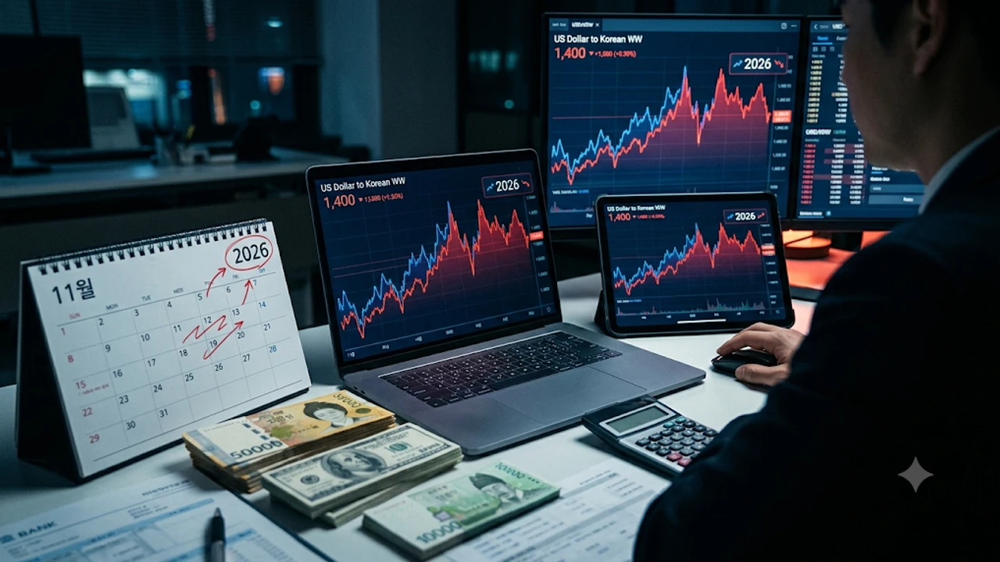
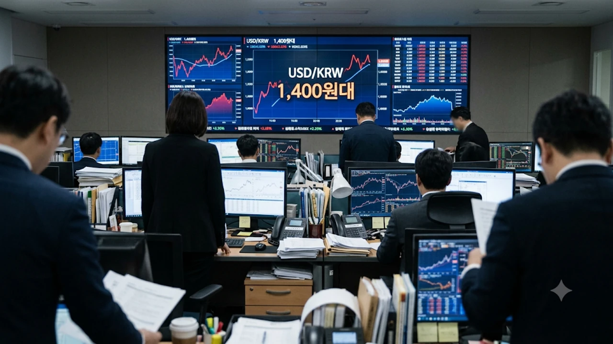

2026년 11월 말, **원달러 환율 전망**을 두고 외환시장의 긴장감이 최고조에 달했습니다. 연말 해외여행을 준비하는 직장인부터 외화 예금으로 현금 흐름을 관리하려는 투자자까지, 하루에도 수십 원씩 출렁이는 환율 앞에서 매수·매도 타이밍을 잡기 위한 눈치싸움이 치열합니다.

## 2026년 11월 말 원달러 환율 급변동 핵심 원인 분석

### 미국 연준(Fed) 금리 정책 시그널과 달러 인덱스 흐름
연말 외환시장의 방향키를 쥔 변수는 미국 연방준비제도(Fed)의 통화정책 속도입니다. 미국 소비자물가와 고용 지표 발표 직후마다 연준 위원들의 매파적·비둘기파적 발언이 엇갈리면서, 주요 6개국 통화 대비 달러 가치를 보여주는 **달러 인덱스(DXY)**가 단기간에 크게 요동치고 있습니다. 기준금리 인하 속도 조절론이 힘을 얻을 때마다 글로벌 자금이 다시 안전자산인 달러로 쏠리며 원화 가치를 끌어내리는 구조입니다.

### 한국은행 통화정책 방향 및 외국인 수급 변동성
국내 증시에서 외국인 투자자가 주식을 팔고 나가는 수급 역시 환율 급등의 직접적인 도화선이 됩니다. 연말 북클로징(회계연도 장부 마감) 시즌을 맞은 외국인 기관들이 차익 실현 물량을 쏟아내며 원화를 달러로 바꿔 이탈하면, 서울 외환시장 개장 직후 환율이 갭 상승하는 장세가 반복됩니다. 이때 한국은행의 금리 결정 기조와 외환당국의 구두 개입·미세조정 여부가 단기 상단을 누르는 방어선으로 작동합니다.

### 연말 수출입 결제 수요가 환율 단기 등락에 미치는 영향
실물 수급 측면에서는 수출기업의 네고(달러 매도) 물량과 수입기업의 결제(달러 매수) 수요가 정면으로 부딪히는 시기입니다. 11월 말부터 12월 중순까지는 국내 대기업들이 한 해 실적을 결산하기 위해 해외에서 벌어들인 달러를 원화로 환전하는 물량이 대거 풀립니다. 이 매도 물량이 집중되는 날에는 장 초반 상승하던 환율이 장 후반 들어 꺾이는 전형적인 '전강후약' 흐름이 나타납니다.

> **핵심 요약:** 연말 원달러 환율은 연준 금리 시그널에 따른 상방 압력과 국내 수출기업의 결산 네고 물량에 따른 하방 압력이 충돌하며 박스권 내 급등락을 거듭합니다.

## 환전 목적별 최적의 달러 매수·매도 타이밍 전략

### 연말·연초 해외여행 및 직구족을 위한 분할 환전 기준
출국 날짜가 정해진 여행자나 연말 세일 시즌 해외 직구족이라면 최저점을 정확히 맞히려는 욕심을 버려야 합니다. 출국 3~4주 전부터 전체 환전 예산을 세 덩어리로 나누어 기계적으로 분할 매수하는 편이 평균 매입 단가를 낮추는 현실적인 해법입니다.
- **1차 매수 (예산의 30%):** 환율이 전일 종가 대비 하락 출발하는 오전 9시~10시 사이 1차 물량 확보
- **2차 매수 (예산의 40%):** 수출기업 네고 물량이 집중 출회되는 월말(25일~말일) 장중 눌림목 공략
- **3차 매수 (예산의 30%):** 출국 1주일 전 잔여 금액 환전 마무리

### 단기 환차익 및 달러 예금 투자자의 목표 환율 설정법
환차익을 노리는 투자자라면 감에 의존한 매매를 피하고 차트상 지지선과 저항선을 기준으로 진입 구간을 못 박아야 합니다. 과거 [환율 1540원 돌파! 달러 투자 지금 할까? 핵심만 정리](/posts/economy/won-dollar-1540-fx-investment/) 구간처럼 시장이 과열됐을 때 뒤늦게 뛰어들면 고점에 물리기 십상입니다. 최근 3개월 이동평균선이나 볼린저밴드 하단까지 환율이 조정을 받았을 때만 분할로 자금을 투입해야 손실 폭을 통제할 수 있습니다.

### 환율 하락기(원화 강세) 전환 시 리스크 헤지 방안
만약 원화 강세 기조가 뚜렷해지며 [원달러 환율 1410원 급락? 바뀐 전략 3가지](/posts/economy/won-dollar-1410-drop-strategy-2026/)와 같은 급락 시나리오가 펼쳐진다면, 보유 중인 달러의 평가손실을 방어할 수단으로 즉시 자산을 옮겨야 합니다. 원화로 손절 환전하기보다 증권사의 **달러 발행어음이나 외화 RP(환매조건부채권)**에 예치해 연 4% 안팎의 달러 이자를 챙기면서 다음 반등 사이클을 기다리는 전략이 유효합니다.

## 시중은행 vs 핀테크 외화통장 환전 혜택 비교

### 주요 시중은행 모바일 앱 환율 우대율 및 한도 비교
신한 쏠, KB스타뱅킹, 하나원큐 같은 시중은행 모바일 앱을 이용하면 주요 통화(USD, JPY, EUR) 기준 **최대 90% 환율 우대**를 손쉽게 적용받을 수 있습니다. 다만 지점에서 실물 지폐로 수령할 때는 일일 한도(통상 미화 1만 달러 이내)와 지점별 외화 시재(보유량) 제한이 걸리므로, 출국 최소 2영업일 전에는 비대면 신청을 완료해야 헛걸음을 피할 수 있습니다.

### 트래블카드·핀테크 외화계좌 무료 환전 조건과 숨은 수수료
토스뱅크 외화통장이나 트래블월렛, 트래블로그 등 핀테크 서비스는 살 때와 팔 때 모두 **100% 환율 우대(수수료 면제)**를 앞세워 여행객의 필수품으로 자리 잡았습니다. 하지만 이 서비스들은 현지 카드 결제와 해외 ATM 인출에 특화되어 있어, 타 은행 외화계좌로 송금하거나 국내 영업점에서 현찰 지폐로 직접 찾을 때는 별도의 현찰 수수료(약 1.5~1.75%)가 붙는다는 함정을 꼭 확인해야 합니다.

### 달러 RP 및 외화 발행어음 파킹형 상품 수익률 비교
단순 입출금이 목적인 일반 외화보통예금은 이자가 연 0.1% 수준에 불과해 인플레이션 방어 효과가 전혀 없습니다. 환전해 둔 달러를 한 달 이상 굴릴 계획이라면 증권사 계좌로 이체해 하루만 맡겨도 약정 금리를 주는 **수시입출금식 달러 RP**나 대형 증권사의 **외화 발행어음**에 넣어두는 편이 수익 면에서 훨씬 유리합니다.

## 환율 변동성 장세에서 피해야 할 실전 실수 3가지

### 단기 급등락 뉴스에 휩쓸린 추격 매수·패닉 셀링
환율이 하루에 15~20원씩 급등하는 날에는 자극적인 속보를 보고 뒤늦게 달러를 사들이는 개인 매수세가 몰립니다. 그러나 급등 직후에는 차익 실현 매물과 외환당국의 미세조정 물량이 동시에 쏟아지며 단기 고점을 형성하는 경우가 잦아, 고점 매수 후 수개월간 자금이 묶이는 패착을 두기 쉽습니다.

### 환전 우대율만 보고 전신환 매도율·현찰 수수료 간과하기
"환율 우대 90%"라는 문구만 믿고 거래했다가 실제 통장에서 빠져나간 원화 금액을 보고 놀라는 경우가 적지 않습니다. 은행마다 고시하는 기준 환율 자체가 조금씩 다를뿐더러, 계좌 이체 거래에 적용되는 '전신환 매도율'과 실물 지폐를 살 때 적용되는 '현찰 살 때 환율'의 스프레드(매매 격차)는 약 2배 가까이 벌어집니다. 우대율 숫자보다 최종 결제될 원화 금액을 직접 대조해 봐야 손해를 막을 수 있습니다.

### 환노출형 해외 주식·ETF 투자 시 환헤지 비중 미조정
미국 S&P500이나 나스닥100 지수를 추종하는 국내 상장 ETF를 매수할 때, 종목명 끝에 **(H)**가 붙은 환헤지형과 붙지 않은 환노출형을 구분하지 않으면 환율 하락기에 미국 주식이 올라도 원화 평가수익이 깎이는 역전 현상을 겪습니다. 환율이 역사적 상단 부근에 머무를 때는 신규 적립 물량의 일부를 환헤지형으로 배분해 환차손 리스크를 상쇄하는 조정이 바람직합니다.

해외여행 출국 전 외화 현찰과 실물 카드, 여권을 한곳에 안전하게 정리하려면 스키밍 방지가 적용된 수납형 지갑을 미리 구비해 두는 것이 실용적입니다. [RFID 차단 여행용 여권지갑 쿠팡에서 보기](https://www.coupang.com/np/search?q=RFID%20%EC%B0%A8%EB%8B%A8%20%EC%97%AC%ED%96%89%EC%9A%A9%20%EC%97%AC%EA%B6%8C%EC%A7%80%EA%B0%91&sourceType=affiliate&trackingCode=AF8691300)

#원달러환율전망 #달러환전타이밍 #환율우대 #외화통장추천 #달러투자전략 #트래블카드비교 #달러RP #연말환율변동