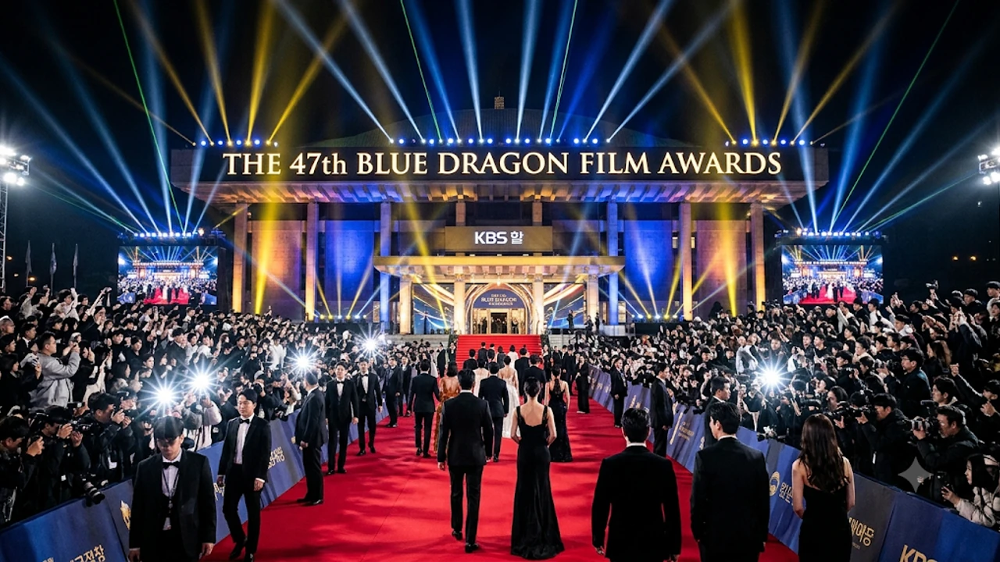

드디어 연말 영화계의 하이라이트, **2026 청룡영화상 후보** 라인업이 베일을 벗었어. 매년 11월이면 제47회 청룡영화상 수상 예측과 시상식 일정, 레드카펫 소식까지 영화 팬들의 관심이 쏠리잖아. 과연 올해 트로피를 거머쥘 진짜 승자는 누구일지 핵심 관전 포인트만 쏙쏙 뽑아서 정리해 줄게!

## 2026 제47회 청룡영화상 주요 부문 후보 총정리

올해 한국 영화계는 극장가 흥행작과 탄탄한 장르 영화들이 고르게 포진하면서 후보 선정 단계부터 치열한 경합이 벌어졌어. 대중성과 작품성을 동시에 입증한 작품들이 대거 이름을 올린 만큼, 어떤 부문에서 어떤 작품과 배우가 격돌하는지 먼저 짚고 넘어가자.

### 최우수작품상 및 감독상 노미네이트 리스트
최우수작품상과 감독상 부문은 그야말로 한 해 한국 영화의 흐름을 압축해 놓은 거울이나 다름없어. 올해는 묵직한 사회적 메시지를 던진 드라마부터 스타일리시한 연출이 돋보인 미스터리 스릴러까지 총 다섯 작품이 최종 후보에 올랐어.

- **작품상 핵심 후보군:** 관객과 평단의 호평을 동시에 이끌어낸 텐트폴 대작 3편과 독립·예술영화의 저력을 보여준 중저예산 수작 2편이 맞붙는 구도야.
- **감독상 관전 포인트:** 베테랑 거장들의 노련한 연출력과 신진 감독들의 감각적인 미장센이 정면으로 충돌하면서 심사위원들의 깊은 고민을 유발하고 있어.

### 남우주연상·여우주연상 쟁쟁한 후보 라인업
솔직히 말해줄게, 올해 연기상 부문은 역대급이라는 수식어가 아깝지 않을 정도야. 이름만 들어도 신뢰감을 주는 톱배우들이 각자의 필모그래피에서 손꼽힐 만한 인생 연기를 펼쳤거든.

- **남우주연상 후보:** 극한의 감정선을 소화하며 러닝타임 내내 극을 이끈 주연 배우들과 강렬한 악역 변신으로 신드롬을 일으킨 배우들이 나란히 이름을 올렸어.
- **여우주연상 후보:** 섬세한 내면 연기로 여운을 남긴 배우부터 거친 액션을 대역 없이 소화하며 카리스마를 뿜어낸 배우까지 연기 스펙트럼이 엄청나게 넓어. 최근 차기작 소식으로 화제를 모은 [임윤아 언내추럴 확정 원작 넘을까](/posts/entertainment/yoona-unnatural-korean-remake-casting-2026/) 사례처럼 배우들의 과감한 연기 변신이 올해 충무로 전반의 핵심 키워드였지.

### 생애 단 한 번뿐인 신인남우상·신인여우상 후보
인생에서 딱 한 번만 받을 수 있는 신인상 부문 역시 풋풋한 에너지와 파격적인 연기를 선보인 루키들로 꽉 채워졌어. 독립영화계에서 탄탄하게 내공을 쌓아 상업영화 주연으로 도약한 신예들과, 첫 스크린 데뷔작에서 주눅 들지 않는 존재감을 각인시킨 배우들이 트로피를 두고 선의의 경쟁을 펼쳐.

## 올해 청룡영화상 유력 수상자 및 작품 예측 분석

후보 명단을 쭉 훑어보면 자연스럽게 "그래서 도대체 누가 받을까?"라는 궁금증이 생기지. 영화 평론가들의 평가와 관객 반응, 그리고 청룡 특유의 심사 성향을 종합해 유력 수상 후보들을 좁혀봤어.

### 작품성과 흥행력을 모두 잡은 최우수작품상 유력 후보
청룡영화상 최우수작품상은 단순히 관객 수만 많다고 주지 않아. 반대로 평단에서만 극찬받고 대중과 동떨어진 작품도 쉽게 트로피를 가져가지 못하지.

> "청룡의 선택은 언제나 시대정신과 대중적 공감대의 교집합에 있다."

올해 가장 유력하게 점쳐지는 작품은 개봉 당시 손익분기점을 가볍게 넘기며 N차 관람 열풍을 일으킨 동시에, 탄탄한 각본과 완성도로 평점 고공행진을 이어간 작품이야. 극장 침체기 속에서도 관객을 스크린 앞으로 불러 모은 공로가 심사 과정에서 높은 점수를 받을 가능성이 커.

### 연기력 논란 없는 남녀주연상 핵심 관전 포인트
주연상 부문은 '원맨쇼에 가까운 하드캐리'를 보여준 배우에게 무게추가 기우는 분위기야. 특히 영화의 시작부터 끝까지 극의 긴장감을 홀로 짊어지고 간 남우주연상 후보는 이미 다른 영화제에서도 트로피를 휩쓸며 대세론을 굳혔어.

여우주연상은 2파전 양상이 뚜렷해. 기존 이미지를 완전히 지워버린 파격 변신파와, 절제된 눈빛 연기만으로 관객을 울린 정통파가 박빙의 승부를 예고하고 있거든. 누가 호명되더라도 이견이 없을 만큼 두 배우 모두 압도적인 연기를 보여줬어.

### 심사위원 표심을 가를 부문별 결정적 변수
수상 결과를 뒤집을 수 있는 결정적 변수는 바로 **'표 분산'**이야. 한 작품에서 주연상 후보가 두 명 동시에 노미네이트되거나, 비슷한 장르의 영화 두 편이 경합할 경우 심사위원 표가 갈리면서 의외의 제3의 인물이 어부지리로 트로피를 차지하는 이변이 종종 연출되곤 해. 올해 역시 특정 대작에 후보가 집중된 부문에서 반전 드라마가 쓰일 여지가 충분해.

## 역대 청룡영화상 수상 기준과 올해 심사 트렌드

청룡영화상이 국내 3대 영화상 중에서도 가장 공정하고 트렌디하다는 평가를 받는 데는 그만한 이유가 있어. 과거 수상 기록을 되짚어보면 올해 심사위원들이 어떤 기준에 가중치를 둘지 명확하게 보여.

### 최근 3년간 수상작으로 본 청룡의 선택 기준
최근 몇 년간 청룡영화상의 트로피 향방을 분석해 보면 뚜렷한 흐름이 읽혀.

- **과감한 세대교체:** 연공서열이나 과거 명성에 기대지 않고, 그해 가장 뜨거운 에너지를 보여준 젊은 감독과 신예 배우들에게 과감하게 트로피를 안겼어.
- **장르적 경계 허물기:** 전통적인 휴먼 드라마나 시대극뿐만 아니라 오컬트, SF, 블랙 코미디 등 실험적인 장르 영화에도 최고상의 영예를 허락하며 한국 영화의 외연 확장에 힘을 실어줬지.

### OTT 오리지널 영화의 약진과 극장 개봉작의 대결
이제 영화제의 기준은 '스크린 상영 여부'를 넘어섰어. 글로벌 OTT 플랫폼을 통해 공개되어 전 세계 차트 1위를 석권한 한국 영화들이 청룡 후보에 당당히 이름을 올리면서 극장 개봉작들과 자존심 대결을 벌이고 있거든. 극장가의 부활을 응원하는 영화인들의 표심이 전통적인 극장 개봉작으로 향할지, 아니면 플랫폼의 경계를 허문 OTT 화제작의 손을 들어줄지가 올해 시상식 최대의 관전 포인트야.

## 2026 청룡영화상 시상식 일정 및 실시간 중계 시청 팁

본방 사수를 놓치면 다음 날 쏟아지는 짤방과 하이라이트 기사만 보면서 아쉬워하게 되잖아. 시상식 당일 일정과 생중계 채널을 미리 체크해 두고 실시간으로 축제를 즐겨봐.

### 시상식 개최 날짜, 장소 및 레드카펫 시작 시간
제47회 청룡영화상은 11월 하순 서울 여의도 KBS홀에서 화려한 막을 올려. 본 시상식은 오후 8시 30분부터 시작되지만, 진짜 볼거리는 그보다 앞서 오후 7시쯤부터 진행되는 **레드카펫 행사**야. 배우들의 드레스와 턱시도 스타일링은 물론, 포토월에서 펼쳐지는 유쾌한 팬서비스까지 놓치지 않으려면 저녁 식사를 일찍 마치고 대기하는 걸 권해.

### TV 생중계 채널 및 온라인 무료 스트리밍 경로
집에서 편하게 시청하고 싶다면 TV와 모바일 중 원하는 환경을 선택하면 돼.

- **지상파 TV 생중계:** KBS 2TV를 통해 시상식 시작부터 대상 발표 순간까지 풀타임으로 생중계돼.
- **온라인 실시간 스트리밍:** TV가 없거나 이동 중이라면 KBS 공식 앱인 'my K'나 네이버 치지직, 유튜브 공식 스트리밍 채널을 통해 무료로 고화질 중계를 시청할 수 있어.

시상식을 보면서 후보작들의 명장면을 다시 찾아보거나, 집에서 영화관 분위기를 내며 주말 정주행을 즐기고 싶다면 빔프로젝터나 사운드바 같은 홈시네마 기기를 활용해 보는 것도 좋은 선택이야. [홈시네마 빔프로젝터 쿠팡에서 보기](https://www.coupang.com/np/search?q=%ED%99%88%EC%8B%9C%EB%84%A4%EB%A7%88+%EB%B9%94%ED%94%84%EB%A1%9C%EC%A0%9D%ED%84%B0&sourceType=affiliate&trackingCode=AF8691300)

#2026청룡영화상 #청룡영화상후보 #제47회청룡영화상 #청룡영화상수상예측 #남우주연상후보 #여우주연상후보 #한국영화추천 #연말시상식일정