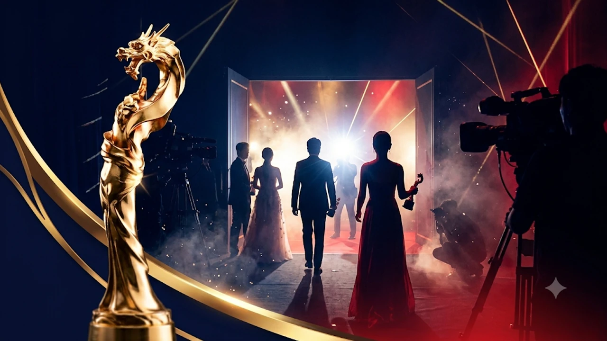

드디어 제47회 청룡영화상의 막이 내렸어! 매년 연말이면 영화팬들의 심장을 뛰게 만드는 행사지만, 올해 **2026 청룡영화상 수상 결과**는 예측을 빗나간 반전이 속출하면서 시상식이 끝난 직후부터 온라인 커뮤니티가 완전히 뒤집어졌거든. 누가 영광의 트로피를 거머쥐었는지, 또 레드카펫과 무대 위에서 어떤 명장면들이 쏟아졌는지 핵심만 쏙쏙 뽑아서 솔직하게 정리해 줄게.

## 2026 제47회 청룡영화상 주요 부문 수상 결과 총정리

### 최우수작품상 및 감독상 영예의 주인공
올해 한국 영화계는 대형 상업 영화의 주춤함 속에서 탄탄한 서사를 갖춘 작품들이 평단과 관객의 지지를 동시에 끌어냈어. 최우수작품상과 감독상 부문에서는 발표 직전까지 누구도 승부를 장담할 수 없을 만큼 쟁쟁한 후보들이 치열하게 맞붙었지.

- **최우수작품상**: 묵직한 사회적 메시지와 치밀한 각본으로 상반기 극장가에 입소문 열풍을 일으킨 화제작이 호명됐어. 제작진 전원이 무대 위로 뛰어올라 서로를 부둥켜안는 장면은 말 다 했지.
- **감독상**: 집요한 디테일과 감각적인 미장센으로 관객들을 스크린 앞에 붙잡아 둔 감독이 트로피를 들어 올렸어. 심사위원단 사이에서도 연출의 밀도 면에서 압도적인 지지를 받았다는 후문이야.

### 남우주연상·여우주연상 치열했던 경합 결과
솔직히 말해줄게, 올해 연기상 부문은 누가 받아도 고개를 끄덕일 만큼 후보 라인업이 팽팽했어. 주연상 발표 직전 생중계 카메라에 잡힌 후보 배우들의 긴장한 표정이 고스란히 전파를 타면서 지켜보는 시청자들까지 숨을 죽이게 만들었거든.

- **남우주연상**: 극한의 감정선과 강렬한 액션을 몸 사리지 않고 소화하며 인생 캐릭터를 새로 쓴 배우가 영예를 안았어.
- **여우주연상**: 미세한 눈빛 떨림만으로도 스크린을 장악하며 관객들의 마음을 울린 여배우가 수상자로 불리면서 객석에서 뜨거운 기립박수가 터져 나왔지.

### 생애 단 한 번뿐인 신인상 및 인기스타상 수상자
신인남우상과 신인여우상은 충무로의 판도를 바꿀 차세대 기대주들에게 돌아갔어. 독립영화 현장에서부터 묵묵히 연기 내공을 쌓아온 신예들이 생애 단 한 번뿐인 트로피를 품에 안고 떨리는 목소리로 소감을 이어가는 모습은 언제 봐도 뭉클해. 한 해 동안 대중의 열렬한 지지를 받은 배우들에게 주어지는 청정원 인기스타상 역시 대세 배우들이 나란히 무대에 오르며 훈훈한 투샷을 완성했어.

## 이번 청룡영화상이 유독 뜨거웠던 결정적 이유 3가지

### 1000만 관객 흥행작과 독립영화의 이변 속출
이거 진짜야? 싶을 정도로 이번 시상식에서는 티켓 파워나 제작비 규모와 상관없이 오직 작품성과 연기력만으로 승부수를 띄운 결과들이 눈길을 끌었어. 막대한 자본이 투입된 대작들 사이에서 저예산 독립영화 출신 배우들과 스태프들이 주요 기술상과 연기상 부문에 이름을 올리며 한국 영화의 저력을 똑똑히 보여줬거든.

### 현장과 온라인을 눈물바다로 만든 화제의 수상 소감
무대 위에 오른 수상자들의 진심 어린 한마디는 시상식 직후 SNS 실시간 트렌드를 장악했어. 특히 오랜 무명 시절을 버텨낸 한 조연상 수상자의 소감은 객석에 앉아 있던 동료 배우들까지 눈시울을 붉히게 만들었지.

> "화려한 조명 뒤에서 묵묵히 제 자리를 지켜준 스태프들과, 극장을 찾아주신 관객분들이 있었기에 오늘 이 자리에 설 수 있었습니다. 앞으로도 부끄럽지 않은 연기로 보답하겠습니다."

### 심사위원 표심이 갈린 주요 부문 비하인드 스토리
시상식 종료 직후 공개된 심사위원 투표 결과표에 따르면, 일부 부문은 단 한 표 차이로 승패가 갈릴 만큼 박빙의 승부였다고 해. 특히 각본상과 편집상 부문에서는 1차 투표에서 동률이 나와 재투표까지 진행되는 진풍경이 벌어졌다는 뒷이야기가 퍼지면서 영화팬들의 N차 관람 열풍을 다시 지피고 있어.

## 2026 청룡영화상 레드카펫 화제의 드레스 및 패션 분석

### 블랙 앤 화이트 정석 룩으로 시선 집중시킨 여배우들
레드카펫의 꽃이라 불리는 드레스 패션에서는 군더더기 없는 블랙 앤 화이트 스타일링이 강세를 보였어. 어깨 라인을 깔끔하게 드러낸 오프숄더 블랙 드레스로 고전적인 기품을 살린 배우부터, 순백의 실크 드레스로 우아한 분위기를 연출한 배우까지 각자의 장점을 살린 룩이 돋보였지.

### 파격적인 스타일링으로 베스트 드레서에 꼽힌 스타
익숙한 턱시도와 드레스 공식을 깬 과감한 시도도 빛났어. 등 라인을 시원하게 드러낸 백리스 디자인과 강렬한 원색 드레스를 소화한 스타들은 카메라 플래시 세례를 한 몸에 받으며 단숨에 베스트 드레서로 떠올랐지. 남자 배우들 역시 기존의 검은색 보타이 대신 벨벳 재킷이나 브로치 포인트로 세련된 감각을 뽐냈어.

## 수상작 다시보기 및 연말 시상식 관전 포인트

### 주요 수상작 OTT 스트리밍 플랫폼 한눈에 보기
아직 극장에서 놓친 수상작이 있다면 이번 주말 안방극장에서 정주행해 보는 건 어때? 주요 수상작 상당수가 넷플릭스, 티빙, 디즈니플러스, 웨이브 등 국내 주요 OTT 플랫폼에 순차적으로 풀리면서 집에서도 극장의 감동을 그대로 이어갈 수 있거든.

- **넷플릭스 & 티빙**: 화제의 최우수작품상 및 주연상 수상작 스트리밍 지원
- **왓챠 & 웨이브**: 평단의 호평을 끌어낸 독립영화 및 신인상 수상작 큐레이션 제공

### 다가오는 연말 연기대상·가요대전으로 이어지는 2026 하반기 결산 흐름
청룡영화상이 2026년 연말 시상식 시즌의 화려한 포문을 열면서 이제 대중의 시선은 방송 3사 연기대상과 연말 가요 축제로 향하고 있어. 최근 드라마와 가요계를 넘나들며 활약 중인 스타들의 행보가 궁금하다면 [임윤아 언내추럴 확정 원작 넘을까](/posts/entertainment/yoona-unnatural-korean-remake-casting-2026/)나 [연예이슈 전체 글 보기](/posts/entertainment/)에서 최신 소식을 함께 확인해 봐. 주말 저녁, 거실 소파에 편하게 앉아 대형 화면으로 올해의 명작들을 다시 감상하고 싶다면 [홈시어터 빔프로젝터 쿠팡에서 보기](https://www.coupang.com/np/search?q=%ED%99%88%EC%8B%9C%EC%96%B4%ED%84%B0+%EB%B9%94%ED%94%84%EB%A1%9C%EC%A0%9D%ED%84%B0&sourceType=affiliate&trackingCode=AF8691300)를 활용해 집안을 나만의 프라이빗 영화관으로 꾸며보는 것도 좋은 방법이야.

#2026청룡영화상 #청룡영화상수상결과 #제47회청룡영화상 #청룡영화상레드카펫 #한국영화추천 #연말시상식 #영화수상작다시보기