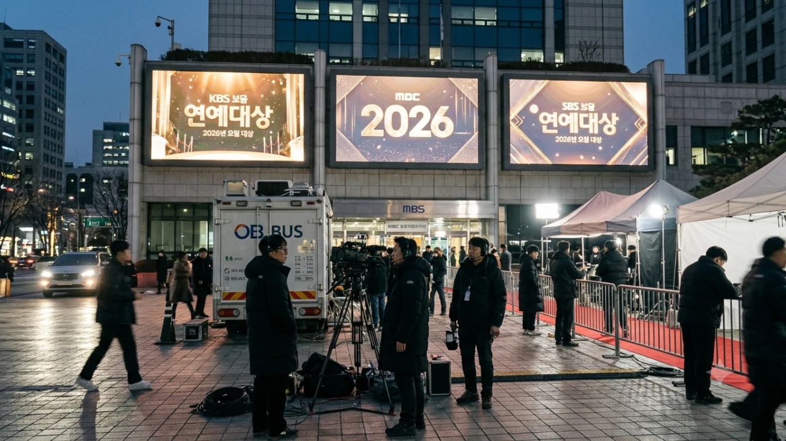

어느덧 11월 말, 연말 시상식 시즌이 코앞으로 다가오면서 **2026 방송연예대상**을 둘러싼 시청자들의 관심이 뜨겁다. 올 한 해 지상파 방송 3사 예능 판도를 흔든 간판 프로그램들과 유력 대상 후보들이 거론되면서 누가 영예의 트로피를 거머쥘지 벌써부터 갑론을박이 치열한 상황이다. 솔직히 말해줄게, 올해는 절대 강자 한 명이 독주하기보다 방송사별로 팽팽한 접전이 예고돼서 끝까지 결과를 속단하기 어렵다.

## 2026 연말 방송연예대상 주요 후보 및 방송사별 판도

### KBS 연예대상 핵심 주자 및 화제성 분석
KBS는 주말 간판 예능인 1박 2일과 슈퍼맨이 돌아왔다, 사장님 귀는 당나귀 귀, 불후의 명곡 같은 장수 프로그램들의 탄탄한 고정 시청층이 핵심 무기다. 특히 전현무와 김종민, 이찬원처럼 여러 프로그램에서 메인 MC로 활약하며 화제성과 시청률을 동시에 견인한 인물들이 매년 유력 후보군에 이름을 올린다. 올해 역시 단일 프로그램의 반짝 인기보다는 방송사 전체 기여도와 흔들림 없는 진행 능력을 증명한 베테랑 예능인들이 대상 경쟁의 한복판에 서 있다.

### MBC 연예대상 대표 예능과 유력 후보군
MBC는 나 혼자 산다와 전지적 참견 시점, 놀면 뭐하니?, 태어난 김에 세계일주 시리즈 등 화제성 지표에서 독보적인 파급력을 뿜어내는 간판 라인업을 쥐고 있다. 전현무와 기안84, 유재석으로 이어지는 쟁쟁한 수상 계보 속에서 올해도 이들을 중심으로 치열한 트로피 쟁탈전이 벌어지는 분위기다.

- **전현무:** 트렌드를 꿰뚫는 캐릭터와 노련한 진행력으로 여러 간판 예능의 중심축을 든든히 지탱
- **기안84:** 꾸밈없는 날것의 매력과 진정성 넘치는 도전 서사로 시청자들의 열렬한 지지 확보
- **유재석:** 놀면 뭐하니?를 비롯한 주말 핵심 시간대 방어 및 새로운 포맷 실험을 묵묵히 주도

### SBS 연예대상 대상 후보와 시청률 기여도
SBS는 미운 우리 새끼, 런닝맨, 신발 벗고 돌싱포맨, 골 때리는 그녀들처럼 충성도 높은 시청자를 확보한 프로그램들의 활약이 눈부시다. 탁재훈, 이상민, 김종국, 유재석 등 오랜 시간 SBS 주말과 평일 심야 시간대를 책임져 온 핵심 멤버들이 올해도 강력한 대상 후보로 거론된다. 스튜디오 토크와 리얼리티 관찰을 버무린 포맷에서 대체 불가한 입담과 캐릭터 플레이를 선보인 출연진의 공로가 유독 돋보인다.

## 방송 3사 대상 후보별 강점과 변수 비교

### 화제성과 시청률을 모두 잡은 예능인 분석
연말 시상식에서 대상의 향방을 가르는 결정적 잣대는 결국 본방송 시청률과 온라인 화제성의 황금 비율이다. TV 시청률만 높고 화제성이 뒤처지거나, 반대로 짧은 클립 조회수만 높고 본방 성적이 부진하면 대상 문턱에서 아쉽게 발길을 돌리는 경우가 잦다. 올해 유력 후보로 꼽히는 주자들은 TV 본방은 물론 OTT와 유튜브 클립까지 전방위적으로 폭발적인 파급력을 입증했다는 공통점을 지닌다.

> "대상은 단순히 한 해 동안 웃음을 준 사람을 넘어, 그 방송사의 자존심과 얼굴 역할을 톡톡히 해낸 인물에게 건네는 영예의 트로피다."

### 신규 포맷 성공 vs 장수 프로그램 유지력 대결
올해 예능계는 검증된 장수 프로그램의 노련미와 파격적인 기획을 앞세운 신규 예능의 패기가 정면으로 충돌한 한 해였다. 수년째 방영 중인 프로그램은 익숙함에서 오는 식상함을 깨고 신선한 멤버 조합이나 특집 기획으로 화제성을 되살린 주역들이 후한 점수를 얻는다. 반면 신규 프로그램으로 단숨에 대중의 시선을 사로잡은 출연진은 트렌드를 선도했다는 강점을 앞세워 대상을 노린다.

### 심사 기준 변화에 따른 수상 가능성 변수
방송사마다 시상식 생방송 당일 집계되는 시청자 문자 투표 비율과 제작진·심사위원단 평가 비중이 미묘하게 엇갈린다. 공동 수상 여부나 공로상 성격의 배분이 이뤄질 경우 유력 후보의 단독 수상 확률에 직접적인 변수가 생기기도 한다. 연말 특집 편성과 12월 초중순 방영분의 성적표까지 최종 심사에 반영되는 만큼 막판 뒷심이 승부를 가를 핵심 열쇠다.

## 시청자가 체감하는 실제 화제성 및 반응 흐름

### 온라인 커뮤니티와 SNS 언급량 추이
방송 직후 숏폼 플랫폼과 온라인 커뮤니티에서 자발적으로 밈(Meme)이 퍼지고 패러디가 쏟아지는지 여부가 체감 인기를 직관적으로 보여준다. 올해 역시 본방송 장면이 짧은 클립으로 재가공되며 폭발적인 조회수를 기록한 에피소드들이 온라인 여론을 뜨겁게 달궜다. 커뮤니티 반응만 살펴봐도 "이 장면 하나로 올해 대상은 말 다 했지"라는 찬사가 나올 만큼 결정적 한 방을 남긴 예능인들에게 표심이 쏠리고 있다.

### 올해 예능 트렌드를 이끈 결정적 명장면
연예계 전반의 생생한 뒷이야기와 최신 흐름을 더 확인하고 싶다면 [연예이슈 전체 글 보기](/posts/entertainment/)에서 관련 소식을 함께 둘러보는 것도 좋다. 올해 예능 트렌드는 억지스러운 설정보다 출연진 간의 자연스러운 호흡과 예측 불허의 돌발 상황에서 터져 나오는 날것의 웃음이 대세를 이뤘다.

- 꾸밈없는 일상 공개와 솔직한 인간미로 깊은 공감을 자아낸 관찰 리얼리티 에피소드
- 예상치 못한 게스트의 등판과 거침없는 입담으로 현장을 초토화한 토크쇼 명장면
- 극한의 상황 속에서도 동료애와 유머를 잃지 않으며 뭉클한 감동까지 안긴 야외 버라이어티 활약상

## 2026 방송연예대상 시청 전 체크해야 할 핵심 포인트

### 방송사별 시상식 편성 일정 및 생중계 확인법
연말 지상파 3사 연예대상은 통상 12월 셋째 주부터 넷째 주 사이 토요일과 일요일 저녁 시간대에 나란히 편성된다. KBS, MBC, SBS 공식 홈페이지 편성표와 각 방송사 공식 온에어 앱을 이용하면 스마트폰과 PC에서도 실시간 생중계를 놓치지 않고 챙겨 볼 수 있다. 본방송 직전에 열리는 레드카펫 포토월 현장은 공식 유튜브 채널을 통해 실시간으로 송출되므로 미리 알림을 켜두는 편이 좋다.

### 시청자 참여 투표 방법과 반영 비율 정리
시청자가 직접 트로피의 주인을 뽑는 '올해의 프로그램상'이나 '베스트 커플상' 투표는 각 방송사 공식 홈페이지와 모바일 포털 사이트 이벤트 페이지에서 참여할 수 있다. 방송 3사 모두 12월 초중순경 공식 후보 명단을 발표함과 동시에 온라인 사전 투표를 시작하므로 기간 안에 소중한 한 표를 행사하는 것이 관건이다. 연말 시상식 생중계의 생생한 현장감을 안방에서 제대로 만끽하고 싶다면 대형 화면으로 시청 환경을 갖춰 두는 것도 만족도를 높이는 방법이다.

[4K 스마트 TV 쿠팡에서 보기](https://www.coupang.com/np/search?q=4K+%EC%8A%A4%EB%A7%88%ED%8A%B8+TV&sourceType=affiliate&trackingCode=AF8691300)

#2026방송연예대상 #KBS연예대상 #MBC연예대상 #SBS연예대상 #연말시상식후보 #전현무 #기안84 #유재석 #예능트렌드 #연예이슈