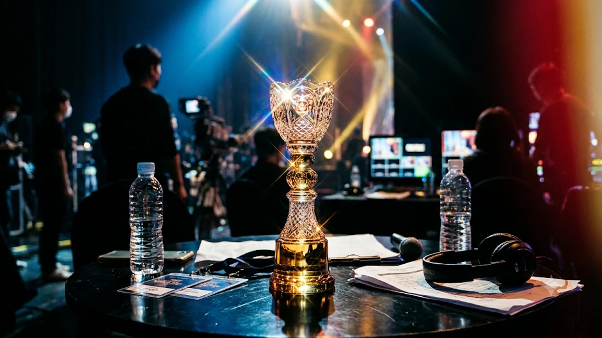

벌써 11월 중순을 넘기면서 방송가와 가요계 분위기가 심상치 않지. 다들 **2026 연말 시상식 대상** 트로피를 누가 거머쥘지 벌써부터 갑론을박이 치열하거든. 지상파 3사 연기대상부터 가요대전, 연예대상까지 올 한 해 화제성과 시청률, 음원 성적을 싹 다 긁어모은 진짜 후보 판도를 솔직하게 짚어줄게.

## 지상파 3사 연기대상 판도 변화

올해 드라마 시장은 OTT 대작들과 지상파 정통 장르물이 맞붙으면서 판이 완전히 달라졌어. 예전처럼 단순히 가구 시청률 숫자 하나만으로 대상을 주던 시대는 끝났다는 말이 방송국 안팎에서 공공연히 나올 정도야.

### 시청률과 화제성 두 마리 토끼 잡은 주역들

상반기부터 하반기까지 주말 안방극장을 꽉 잡았던 중견 배우들의 저력이 여전해. 특히 가족극과 법정물을 오가며 **신들린 연기력**을 보여준 베테랑들이 유력한 대상 후보군에 이름을 올렸지. 광고 완판과 본방 사수율을 동시에 끌어올린 공로는 방송사 입장에서도 결코 외면할 수 없는 카드야.

### 장르물 흥행 이끈 3040 배우들의 약진

미니시리즈 부문에서는 스릴러와 오컬트 요소를 결합한 작품들이 제대로 터졌어. 쇼츠와 릴스 클립 조회수를 폭발시키며 2030 시청층을 TV 앞으로 다시 불러모은 주연 배우들의 활약이 눈부셨거든.

- **전통 강자 라인업**: 주말극 롱런 흥행으로 시청률 하한선을 지켜낸 베테랑 연기자
- **화제성 독식 라인업**: 온라인 커뮤니티 언급량과 클립 조회수를 휩쓴 장르물 주연
- **다크호스 변수**: 연말 편성표 막판 뒷심을 발휘 중인 시즌제 드라마 주인공

> "연기력은 기본이고, 방송사 전체의 자존심을 세워준 화제성 지분이 올해 대상 향방을 가를 결정적 열쇠다."

## 가요 시상식 음원 음반 성적표 비교

가요계는 올해 유독 대형 아티스트들의 컴백과 신인 그룹의 돌풍이 겹치면서 트로피 경쟁이 어느 때보다 빡세졌어. 글로벌 차트 성적과 국내 대중성 사이에서 심사위원들의 머리가 꽤 아플 수밖에 없는 구조야.

### 글로벌 스트리밍 독주 체제와 국내 팬덤의 충돌

해외 빌보드와 스포티파이 차트를 점령한 K팝 간판 그룹들은 이미 압도적인 초동 음반 판매량과 월드투어 규모를 입증했어. 반면 국내 멜론과 유튜브 뮤직 일간 차트에서 수개월씩 장기 집권한 솔로 아티스트와 밴드 음악의 강세도 만만치 않거든. 밴드 열풍과 솔로 컴백 흐름이 궁금하다면 [영케이 YOUNGEST 컴백! 진짜 주목할 핵심 3가지](/posts/entertainment/young-k-youngest-comeback-album-analysis-2026/) 글도 함께 확인해 보면 올해 가요계 판도가 한눈에 보일 거야.

### 방송사 가요축제 무대 화제성 변수

연말 가요 시상식은 결국 **생방송 무대 퀄리티와 현장 장악력**이 모든 걸 말해줘. 음원 점수만 높은 가수보다 연말 특집 무대에서 편곡과 퍼포먼스로 레전드 직캠을 남긴 팀에게 여론이 쏠리는 경향이 뚜렷해.

- 글로벌 팬덤 투표 화력이 막강한 4세대·5세대 대표 보이그룹 및 걸그룹
- 전 세대가 따라 부르는 대중적 히트곡을 배출한 솔로 보컬리스트
- 페스티벌과 대학 축제를 휩쓸며 차트 역주행 신화를 쓴 밴드 그룹

## 연예대상 예능 트렌드와 유력 후보

예능 판은 올해 뻔한 관찰 리얼리티에서 벗어나 날것의 토크와 여행, 스포츠 서바이벌로 무게중심이 확 넘어갔어. 덕분에 오래된 터줏대감들과 새롭게 떠오른 예능 대세들의 정면 승부가 성사됐지.

### 터줏대감 MC들의 여전한 존재감

국민 MC로 불리는 베테랑들은 올해도 주말 간판 예능의 중심을 묵묵히 지켰어. 프로그램 포맷이 바뀌고 경쟁작이 쏟아지는 와중에도 **안정적인 완급 조절**로 고정 시청층을 묶어두는 데 성공했다는 평가를 받아.

### 웹예능과 TV 경계 허문 신흥 강자들

유튜브와 OTT 예능에서 터진 감각을 지상파로 그대로 이식한 방송인들의 기세가 무서워. 대본에 갇히지 않은 솔직한 입담으로 젊은 세대의 열광적인 지지를 얻고 있거든. 연말 연예대상에서는 이런 **세대교체 흐름**을 방송사가 얼마나 과감하게 받아들일지가 최대 관전 포인트야.

> "웃음의 결이 달라졌다. 작위적인 설정보다 출연진 본연의 캐릭터가 살아나는 예능이 시청자의 선택을 받았다."

## 시상식 본방 사수 전 체크포인트

연말 시상식 시즌이 코앞으로 다가오면 각 방송사 홈페이지와 공식 앱을 통해 시청자 투표와 베스트 커플상, 인기상 후보가 순차적으로 열려. 미리 일정을 챙겨두면 본방송을 훨씬 쫄깃하게 즐길 수 있어.

### 생방송 투표 일정과 공식 채널 활용법

대부분의 시상식은 방송 2주 전부터 모바일 사전 투표를 시작해. 일일 투표 참여가 인기상이나 특별상 결과에 직접 반영되는 경우가 많으니 응원하는 배우나 가수가 있다면 알림 설정을 켜두는 게 유리해. 드라마 캐스팅과 원작 리메이크 화제작 흐름까지 미리 훑어보고 싶다면 [임윤아 언내추럴 확정 원작 넘을까](/posts/entertainment/yoona-unnatural-korean-remake-casting-2026/) 포스팅도 참고해 봐.

### 안방 1열 관람 환경 세팅하기

연말 특집 방송은 무대 조명과 라이브 음향이 평소보다 훨씬 화려하게 편성돼. 서너 시간 이어지는 생방송을 피로감 없이 몰입해서 보려면 거실 TV 화질이나 사운드 세팅을 미리 점검해 두는 게 좋지.

- 지상파 3사 및 케이블 시상식 편성표와 레드카펫 생중계 시간 확인
- 공식 투표 플랫폼 계정 연동 및 사전 응원 이벤트 참여
- 고화질 스트리밍과 입체 음향을 즐길 수 있는 거실 시청 환경 준비

[4K UHD 스마트 TV 쿠팡에서 보기](https://www.coupang.com/np/search?q=4K+UHD+%EC%8A%A4%EB%A7%88%ED%8A%B8+TV&sourceType=affiliate&trackingCode=AF8691300)

#2026연말시상식 #연말시상식대상 #연기대상후보 #가요시상식라인업 #연예대상예측 #연말방송일정 #K팝시상식 #드라마대상후보