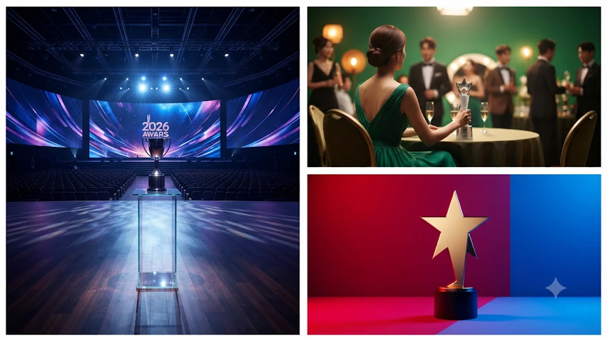

2026년 11월 말부터 연말까지 이어지는 **2026 연말 시상식 일정**이 윤곽을 드러내면서 안방극장과 K팝 팬덤의 시선이 빠르게 쏠리고 있어. 가요대전과 연기대상, 연예대상까지 한 번에 챙기려면 지금부터 달력 체크가 필수야. 올해는 굵직한 솔로·밴드 활동과 화제성 높은 드라마 주연들이 맞붙어서 **연말 시상식** 보는 재미가 유독 클 전망이야.

## 2026 연말 시상식 일정 및 방송사별 중계 가이드

### KBS·MBC·SBS 지상파 3사 연말 시상식 일정표
지상파 3사는 매년 12월 하순에 연예대상, 연기대상, 가요대전을 차례로 배치해. 크리스마스 전후부터 12월 31일 자정 카운트다운 직전까지 각 방송사의 간판 얼굴들이 총출동하는 구조야.

- **연예대상 무대**: 한 해 내내 토요일·일요일 저녁 웃음을 책임진 고정 예능 멤버들과 PD들이 한 테이블에 모여.
- **연기대상 무대**: 미니시리즈와 주말극 흥행을 이끈 주연 배우들이 베스트 커플상과 대상 트로피를 두고 격돌해.
- **가요대전 무대**: 정규 음악방송에서는 볼 수 없던 특별 편곡과 연말 한정 유닛 무대가 쏟아져.

> 방송사별 특집 편성은 생방송 일주일 전에도 세부 시간이 조정될 수 있으니, 본방 당일 오후 편성표를 한 번 더 확인해 두면 헛걸음을 막을 수 있어.

### 2026 MAMA·MMA 등 주요 K팝 시상식 개최일 및 라인업
해외 팬덤 투표와 글로벌 생중계가 결합된 대형 K팝 시상식은 11월 말부터 12월 초 사이에 포문을 열어. 대규모 공연장 연출과 4·5세대 아이돌, 밴드 아티스트의 라이브 퍼포먼스가 겹치면서 연말 분위기를 일찌감치 끌어올리지. 솔로 무대로 음악적 스펙트럼을 넓힌 아티스트들의 출연 여부도 늘 뜨거운 감자인데, [영케이 YOUNGEST 컴백! 진짜 주목할 핵심 3가지](/posts/entertainment/young-k-youngest-comeback-album-analysis-2026/) 같은 흐름을 지켜본 팬들이라면 올해 연말 무대 큐시트가 더욱 궁금할 수밖에 없어.

### 생방송 실시간 시청 방법 및 OTT 다시보기 플랫폼
본방은 방송사 공식 홈페이지와 모바일 앱의 온에어 기능으로 실시간 시청할 수 있고, 방송이 끝난 뒤에는 제휴 OTT와 공식 유튜브 클립 채널에 하이라이트가 순차 업로드돼. 실시간 댓글 반응과 수상 순간을 놓치지 않으려면 시작 10분 전에 미리 스트리밍 화질과 로그인 상태를 점검해 두는 게 편해.

## 2026 연기대상·연예대상 유력 대상 후보 비교분석

### 지상파 3사 화제성·시청률 기반 연기대상 경합 구도
연기대상 트로피의 향방은 **가구 시청률과 온라인 클립 파급력**이 동시에 결정해. 전통적인 주말극 강세에 더해, 장르물이나 원작 리메이크작에서 연기 변신에 성공한 배우들이 유력 후보로 거론되곤 해. 원작 팬덤과 대중의 눈높이를 동시에 맞춰야 하는 작품일수록 화제성이 폭발하는데, [임윤아 언내추럴 확정 원작 넘을까](/posts/entertainment/yoona-unnatural-korean-remake-casting-2026/) 사례처럼 캐스팅 단계부터 관심이 쏠린 흐름을 떠올려 보면 연기력 승부가 얼마나 치열한지 체감돼.

### 2026년 예능 트렌드를 이끈 연예대상 핵심 후보군
연예대상은 **장수 간판 프로그램의 중심축**과 **신규 포맷에서 밈을 터뜨린 주역** 사이의 대결로 압축돼. 매주 안정적인 화제성을 유지한 국민 MC급 진행자들과, 관찰·여행·토크 예능에서 날것의 리액션으로 클립 조회수를 견인한 출연진들이 나란히 이름값을 증명하는 자리야.

### 올해 신설되거나 심사 기준이 달라진 부문별 변화
시상식마다 시청자 투표를 100% 반영하는 인기상이나 베스트 커플상, 화제성 특별상 같은 부문의 비중이 해마다 조금씩 달라져. 전문 심사위원단 점수와 방송사 내부 기여도, 온라인 화제성 지수가 어떻게 배분되는지 알아두면 의외의 수상 결과가 나왔을 때도 맥락을 바로 읽을 수 있어.

## K팝 가요 시상식 대상 및 올해의 노래 관전 포인트

### 음원 차트와 음반 판매량으로 본 대상 유력 아티스트
가요 시상식 대상은 **연간 음원 스트리밍 누적 성적, 초동 및 총 음반 판매량, 심사 점수** 세 축의 균형에서 갈려. 상반기 메가 히트곡으로 대중성을 장악한 팀과 하반기 컴백으로 글로벌 음반 지표와 투어 화력을 입증한 팀이 팽팽하게 맞서는 구도가 가장 흥미로워.

### 연말 무대에서 최초 공개되는 스페셜 컬래버레이션 기대작
연말 가요 축제의 진짜 묘미는 방송사 PD들이 공들여 짠 **스페셜 스테이지**에 있어. 기존 히트곡에 오케스트라나 록 밴드 사운드를 입힌 편곡 무대, 그룹 간 경계를 허문 댄스 브레이크 협업은 다음 날 오전까지 실시간 검색어와 숏폼 알고리즘을 장악해.

### 글로벌 팬 투표 반영 비율 및 참여 일정 확인법
공식 앱 투표는 본식 수주 전부터 예선·본선 형태로 나뉘어 진행되는 경우가 많아. 계정당 일일 투표권 소멸 시각과 추가 투표권 획득 조건을 놓치면 막판 역전 구도에서 힘을 보태기 어려우니 공식 SNS 공지 일정을 캘린더에 저장해 두는 게 좋아.

## 연말 시상식 100% 즐기는 실전 시청 및 투표 팁

### 공식 앱 사전 투표 참여 방법 및 유의사항
사전 투표에서는 **공식 앱 본인 인증 완료, 매일 자정 기준 투표권 초기화 시간 확인, 마감 당일 트래픽 폭주 대비** 세 가지만 챙겨도 실수를 줄일 수 있어. 국내 투표와 글로벌 투표 서버가 분리 운영되는 시상식도 있으니 공지 안내문을 꼼꼼히 확인해야 해.

### 레드카펫 생중계 시간과 주요 포토월 관람 포인트
본식 시작 1~2시간 전 열리는 레드카펫과 포토월은 스타들의 드레스·수트 스타일링과 현장 케미를 가장 먼저 볼 수 있는 시간이야. 올해 함께 호흡을 맞춘 드라마 커플이나 예능 팀이 어떤 포즈로 등장하는지 지켜보는 재미가 쏠쏠해.

### 놓치기 쉬운 시상식 비하인드 및 수상 소감 하이라이트 확인법
생방송 중에는 카메라 전환이나 광고 타이밍 때문에 놓치는 객석 리액션과 수상 소감이 적지 않아. 방송 직후 공개되는 무대 직캠과 백스테이지 인터뷰 클립까지 챙겨 보면 시상식의 여운을 온전히 즐길 수 있어. 연말 특집 무대의 라이브 사운드와 수상 소감을 생생하게 감상하려면 [관련상품 쿠팡에서 보기](https://www.coupang.com/np/search?q=%EC%9C%A0%EC%84%A0%20%ED%97%A4%EB%93%9C%EC%85%8B&sourceType=affiliate&trackingCode=AF8691300) 같은 음향 기기도 함께 확인해 봐.

#2026연말시상식 #연말시상식일정 #연기대상 #연예대상 #가요대전 #K팝시상식 #시상식후보