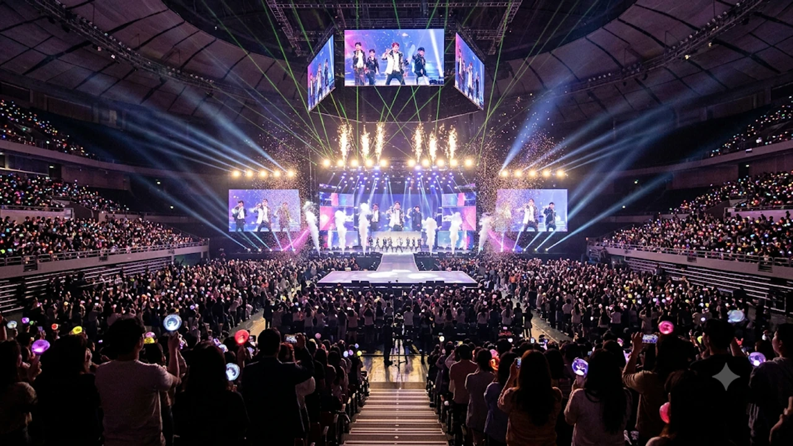

**2026 연말 시상식** 시즌이 코앞으로 다가오면서 11월 말부터 시작되는 가요대축제와 지상파 3사 연기대상·연예대상 편성에 팬들의 눈길이 쏠리고 있어. 올해는 방송사별 개최 날짜와 라인업 구성은 물론이고, 글로벌 팬 투표 방식까지 예년과 달라진 포인트가 꽤 많거든. 솔직히 날짜 헷갈려서 최애 무대나 수상 소감 놓치면 너무 아깝잖아, 핵심 일정부터 시청 팁까지 한 번에 싹 정리해 줄게!

## 2026 연말 시상식 전체 일정 및 방송사별 특징 비교

11월 말 글로벌 K-POP 어워즈가 포문을 열면 12월 마지막 주까지 매일 밤 채널 돌리기 바빠지지. 올해는 방송사마다 해외 돔 투어형 개최와 국내 대형 아레나 집중 편성으로 노선이 뚜렷하게 갈리는 분위기야.

### 주요 가요 시상식 및 연말 가요대축제 개최일

- **11월 말~12월 초 글로벌 어워즈**: 11월 마지막 주부터 일본과 동남아 대형 돔 구장을 무대로 한 K-POP 시상식들이 먼저 시작돼. 해외 팬덤 화력을 그대로 보여주는 초대형 퍼포먼스 위주로 무대가 꾸며지는 게 특징이지.
- **지상파 3사 연말 가요대전·가요대축제**: 크리스마스 시즌인 12월 25일 전후부터 12월 31일 자정 카운트다운 무대까지 쭉 이어져. 영종도 인스파이어 아레나, 일산 킨텍스, 고척스카이돔 같은 대형 실내 공연장을 대관하면서 사운드와 조명 퀄리티가 한층 올라갔어.

### 지상파 3사 연기대상·연예대상 편성 확정 일정

- **연예대상 편성 흐름**: 12월 셋째 주 토요일부터 크리스마스 직전 주간에 집중 배치돼. 올해 화제를 모은 관찰 예능과 서바이벌 프로그램 주역들이 총출동해서 예능감 넘치는 축하 무대를 선보일 예정이야.
- **연기대상 편성 흐름**: 전통적으로 12월 29일부터 31일 밤사이에 몰려 있어. 특히 12월 31일 밤에는 타 방송사 가요 무대와 연기대상 생방송이 정면으로 맞붙기 때문에 미리 본방 사수할 메인 채널을 정해두는 편이 좋아.

### 올해 시상식 포맷 변화와 오프라인 관람 티켓팅 팁

4시간 넘게 수상 소감만 이어지던 지루한 전개에서 벗어나, 올해는 1부와 2부로 나눈 콤팩트한 진행과 아티스트 대기석 리액션 캠 송출이 대폭 강화됐어. 오프라인 방청을 노린다면 방송사 공식 홈페이지 방청 신청 기간과 카드사·통신사 제휴 응모 일정을 최소 3주 전부터 캘린더에 박아둬야 해.

> "방청 당첨 확률을 높이려면 공식 앱 출석 체크와 사연 신청 마감일 자정 직전 응모를 동시에 공략하는 게 가장 현실적인 방법이야."

## 방송사별 예상 라인업 및 주요 부문 후보 분석

라인업이 뜨는 순간 커뮤니티 반응이 뒤집어지는 건 매년 똑같지. 올해는 밴드 붐과 솔로 아티스트의 음원 강세, 그리고 4세대·5세대 아이돌의 대형 퍼포먼스가 맞붙으면서 그 어느 때보다 후보 경쟁이 치열해.

### 2026년 음원·음반 성적 기반 대상 유력 후보군

올해 가요계는 걸그룹들의 음원 차트 장기 집권과 보이그룹의 초동 음반 판매량 기록 경신이 동시에 터졌어. 여기에 밴드 사운드가 대중적으로 큰 사랑을 받으면서 시상식 무대에서도 라이브 밴드 편곡이 대세를 이룰 전망이야. 솔로 활동으로 독보적인 음악성을 증명한 아티스트들의 활약도 빼놓을 수 없는데, [영케이 YOUNGEST 컴백! 진짜 주목할 핵심 3가지](/posts/entertainment/young-k-youngest-comeback-album-analysis-2026/)에서 다뤘던 것처럼 탄탄한 라이브 실력을 갖춘 뮤지션들의 스페셜 스테이지가 큰 기대를 모으고 있어.

### 화제성 드라마 주역과 연기대상 베스트 커플상 관전 포인트

드라마 부문에서는 장르물과 로맨틱 코미디가 나란히 시청률과 화제성을 쌍끌이했어. 주연 배우들의 호흡이 돋보였던 작품들이 많아 베스트 커플상 투표 열기가 벌써부터 뜨겁거든. 차기작 소식까지 겹치며 연말 시상식 레드카펫 참석 여부에 시선이 쏠린 배우들도 많은데, [임윤아 언내추럴 확정 원작 넘을까](/posts/entertainment/yoona-unnatural-korean-remake-casting-2026/)처럼 화제의 신작을 앞둔 주역들이 시상식에서 어떤 소감을 남길지도 관전 포인트야.

### 스페셜 무대 및 컬래버레이션 예고 리스트

- **세대 통합 컬래버레이션**: 레전드 선배 가수와 5세대 신인 그룹이 함께 꾸미는 헌정 무대가 각 방송사 핵심 킬링 파트로 준비되고 있어.
- **그룹 재편 후 첫 연말 완전체 무대**: 올해 팀 활동 방향에 변화를 주며 새롭게 정비한 그룹들의 연말 무대도 팬들에게는 남다른 의미로 다가올 거야. 궁금하다면 [더보이즈 9인 재편 진짜 이유 3가지](/posts/entertainment/the-boyz-9-member-reorganization-truth-2026/) 내용을 함께 참고해 봐.

## 글로벌 팬 투표 참여 방법 및 생중계 시청 가이드

본방 사수만큼이나 손에 땀을 쥐게 하는 게 바로 내 손으로 직접 트로피를 안겨주는 실시간 팬 투표지. 투표 마감 시간 놓쳐서 땅을 치고 후회하지 않으려면 공식 플랫폼 동선을 미리 익혀둬야 해.

### 공식 앱을 통한 부문별 인기상 실시간 투표 절차

1. **공식 투표 애플리케이션 설치 및 본인 인증**: 각 시상식 주관사가 지정한 공식 글로벌 팬덤 앱을 내려받은 뒤 휴대전화 또는 SNS 계정 인증을 완료해.
2. **데일리 투표권 적립**: 매일 출석 체크와 광고 시청, 미션 참여를 통해 무료 투표권을 미리 모아두는 게 유리해.
3. **생방송 문자 투표 병행**: 대상이나 인기상 일부 부문은 본방송 중 유료 문자 투표(`#` 번호 전송) 비중이 높게 반영되니 방송 자막 안내가 뜨자마자 정확히 후보 번호나 이름을 입력해 전송해야 무효표를 피할 수 있어.

### 국내 TV 본방송 및 OTT 실시간 스트리밍 채널 안내

- **국내 지상파 및 케이블 채널**: KBS2, MBC, SBS 본채널과 Mnet, JTBC 등 주관 방송사를 통해 고화질 생방송으로 시청할 수 있어.
- **모바일·PC OTT 스트리밍**: 웨이브(Wavve), 티빙(TVING), 유튜브 공식 채널, 위버스(Weverse) 라이브 등을 통해 스마트폰이나 태블릿으로도 끊김 없이 실시간 스트리밍을 즐길 수 있지.

## 2026 연말 시상식 관람 전 필수 체크리스트

연말 시상식은 러닝타임이 길고 밤늦게까지 이어지는 경우가 많아서, 시청 환경을 제대로 세팅해 두면 몰입감이 완전히 달라져.

### 시상식별 드레스 코드와 레드카펫 사전 생중계 시간

본방송 시작 **1시간 30분에서 2시간 전**부터 포토월 레드카펫 생중계가 먼저 열려. 올해는 클래식한 블랙 턱시도와 하이엔드 주얼리 스타일링은 물론, 콘셉추얼한 의상을 소화하는 아이돌 그룹들의 비주얼 대결이 볼만할 거야. 레드카펫 영상은 주로 유튜브와 틱톡, 네이버 치지직 등 온라인 플랫폼에서만 독점 공개되는 경우가 많으니 본방송 시간만 체크했다가 놓치지 마.

### 방송사별 편성 변경 가능성 및 다시보기(VOD) 제공 일정

연말 특집 편성 특성상 생방송 진행 상황에 따라 종료 시간이 15분에서 30분 정도 지연되는 일이 흔해. 늦은 시간까지 본방송을 챙기기 어렵다면 방송 종료 직후 업로드되는 **공식 유튜브 직캠(Fancam) 클립**과 다음 날 오전에 풀리는 OTT 다시보기(VOD)를 활용하면 원하는 무대만 골라서 깔끔하게 정주행할 수 있어.

집에서 연말 시상식 생방송과 고화질 직캠 무대를 콘서트장 1열처럼 생생한 사운드와 큰 화면으로 즐기고 싶다면, 홈 엔터테인먼트 환경을 미리 세팅해 두는 것도 괜찮은 선택이야. [사운드바 쿠팡에서 보기](https://www.coupang.com/np/search?q=%EC%82%AC%EC%9A%B4%EB%93%9C%EB%B0%94&sourceType=affiliate&trackingCode=AF8691300)

#2026연말시상식 #연말가요대전 #연기대상일정 #연예대상라인업 #시상식투표방법 #케이팝시상식 #연말시상식생중계 #레드카펫일정