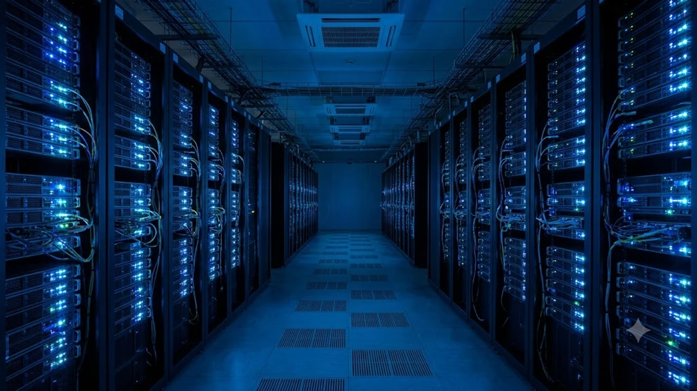

이수만 프로듀서가 야심 차게 선보인 신인 그룹 A2O LITE의 멤버 아이찡이 데뷔하자마자 거센 후폭풍을 맞았어. 바로 현지 SNS를 발칵 뒤집어놓은 **A2O 아이찡 빚투** 의혹 때문인데, 부모의 거액 채무 불이행과 임금 체불 폭로가 터져 나오면서 팬들 사이에서 이게 말이 되냐는 반응이 쏟아지는 중이야. 신인 아이돌 데뷔 리스크와 중국 연예계 특유의 채무 스캔들이 정면으로 충돌한 이번 사건의 전말을 솔직히 짚어볼게.

## 웨이보를 뒤흔든 폭로와 빚투 의혹의 실체

### 수억 원대 채무 불이행과 법원 강제집행 기록
사건의 발단은 중국 현지 법원 집행 정보 공개 플랫폼에 아이찡의 직계 가족으로 추정되는 인물들의 실명과 판결문이 확산되면서 시작됐어. 폭로자에 따르면 아이찡의 부모가 운영하던 사업체에서 직원들의 임금을 장기간 체불했고, 수억 원에 달하는 채무를 상환하지 않아 법원으로부터 '실신피집행인(신용불량자 및 채무 불이행자)' 명단에 올랐다는 거야. 피해를 주장하는 이들은 단순한 계약 분쟁을 넘어 고의적인 재산 은닉 의혹까지 제기하며 강하게 반발하고 있어.

### 명품 착장과 화려한 연습생 생활이 부른 역풍
대중이 더욱 분노한 지점은 극명한 괴리감 때문이야. 피해 노동자들은 밀린 월급과 퇴직금을 받지 못해 생계 위기에 처했다고 호소하는 반면, 아이찡은 연습생 시절부터 수백만 원을 호가하는 명품 가방과 고가 패션 아이템을 착용한 모습이 포착됐거든. "부모는 남의 피땀눈물을 떼어먹고 자식은 그 돈으로 호의호식하며 연예계에 데뷔했다"는 여론이 형성되면서 비판의 수위가 걷잡을 수 없이 치솟았지.

### 현지 피해자들의 연이은 인증과 집단 반발
단순한 뜬소문으로 치부하기엔 피해자들의 증거 제시가 상당히 구체적이야. 온라인 커뮤니티에는 당시 작성된 차용증, 밀린 급여 내역서, 법원 소송 판결문 캡처본이 연달아 올라왔어. 피해자 모임 측은 "아이찡이 공인으로 활동하며 부당한 이득을 누리는 것을 더는 좌시할 수 없다"며 소속사 차원의 공식 해명과 부모의 채무 변제를 강력히 촉구하고 나섰어.

## 데뷔 직후 날벼락 맞은 이수만과 A2O의 행보

### 프로듀서 복귀작에 튄 치명적인 불똥
이수만 전 SM 총괄 프로듀서가 독자 노선으로 세운 A2O 엔터테인먼트의 첫 결과물이라는 점에서 업계 충격은 더 커. 글로벌 시장을 겨냥해 '루키즈' 시스템을 도입하고 야심 차게 론칭한 그룹인데, 출발선부터 이미지에 회복하기 힘든 타격을 입었거든. 가요계 관계자들 사이에서도 "아티스트 본인의 실력이나 매력을 보여주기도 전에 가족 리스크에 발목이 잡혔다"는 한탄이 나오는 상황이야.

> "글로벌 시장을 공략하는 신인 그룹일수록 멤버 개인과 가족에 대한 평판 검증이 핵심인데, 이번 사태는 리스크 매니지먼트의 치명적인 허점을 드러냈다."

### 중국 연예계 '라오라이' 낙인의 파괴력
중국 대중문화계에서 채무 불이행자를 뜻하는 '라오라이(老赖)' 프레임은 연예인 생명을 끊어놓을 정도로 파괴력이 막강해. 과거에도 오디션 프로그램 출신 인기 아이돌들이 부모의 사기나 빚투 논란으로 방송에서 통편집되거나 활동을 전면 중단한 전례가 수두룩하거든. 이미 웨이보 등지에서는 "피해자 돈으로 쌓아 올린 아이돌의 꿈을 응원할 수 없다"는 불매 여론이 급속도로 번지고 있어. 가요계의 복잡한 멤버 이슈와 흐름이 궁금하다면 [더보이즈 9인 재편 진짜 이유 3가지](/posts/entertainment/the-boyz-9-member-reorganization-truth-2026/) 글도 함께 참고해봐.

### 소속사의 초기 대응과 침묵이 부른 불신
논란이 불거진 직후 소속사 측이 즉각적인 입장 표명을 내놓지 않고 침묵으로 일관한 점도 화를 키웠어. 사실관계를 명확히 밝히거나 도의적 책임을 약속하는 대신 미온적인 태도를 보이자, 현지 네티즌들은 이를 사실상 시인한 것으로 받아들이는 분위기야. 초기 골든타임을 놓치면서 사태는 단순한 의혹 해명을 넘어 그룹 전체의 신뢰도 하락으로 번졌지.

## 과거 연예계 빚투 사태와 비교해보면

### 부모의 잘못인가 자식의 연좌제인가
연예인 가족의 채무 문제는 터질 때마다 늘 연좌제 논쟁을 불러일으켜. 법적으로 성인인 자녀가 부모의 빚을 대신 갚아야 할 의무는 전혀 없어. 하지만 대중의 사랑과 관심으로 수익을 창출하는 아이돌 산업의 특성상 도의적 책임에서 결코 자유로울 수 없다는 점이 딜레마지. 부모의 부당한 경제적 지원을 바탕으로 꿈을 이뤘다는 의혹이 제기되는 순간, 대중의 감정선은 싸늘하게 식어버릴 수밖에 없어.

### 국내외 성공적 대처와 몰락의 극단적 사례들
과거 빚투 논란을 겪은 스타들의 결말은 대응 방식에 따라 완전히 갈렸어. 즉시 부모와의 금전적 관계를 투명하게 공개하고, 법적 의무가 없음에도 도의적 차원에서 채무 변제에 발 벗고 나선 이들은 대중의 지지를 지켜냈지. 반면 거짓 해명으로 일관하거나 책임을 회피하려 했던 연예인들은 가요계와 방송가에서 완전히 퇴출당했어. 결국 관건은 **피해자에 대한 진정성 있는 태도**와 **실질적인 피해 회복 노력**뿐이야.

- 피해자들과 직접 대화 채널을 열고 분할 변제 합의를 이끌어낸 경우: 신뢰 회복 성공
- 법적 무관함만 내세우며 강경 대응으로 맞선 경우: 여론 악화로 방송 출연 정지
- 가족 관계 단절을 선언하고 채무 발생 경로를 투명하게 밝힌 경우: 도의적 동정표 획득

## 향후 활동 전망과 해결을 위한 필수 과제

### 활동 지속을 가를 핵심 조건 3가지
아이찡과 A2O가 이번 위기를 딛고 활동을 정상화하려면 반드시 해결해야 할 과제가 명확해. 첫째, 폭로된 판결문과 채무 내역 중 어디까지가 사실인지 객관적인 팩트 체크가 선행되어야 해. 둘째, 법적 책임을 떠나 피해자들과 원만한 합의점을 찾아 채무 변제 계획을 제시해야 대중의 분노를 누그러뜨릴 수 있어. 셋째, 아이찡 본인이 직접 진정성 있는 사과문을 발표하고 가족의 과오에 대한 책임을 회피하지 않는 모습을 보여줘야 해.

### 글로벌 팬덤 분열과 현지 스케줄 타격
이미 중화권 팬덤은 급격히 분열 조짐을 보이고 있어. 사실이 밝혀질 때까지 중립을 지키자는 소수 의견도 있지만, 거센 비난 여론에 밀려 설 자리를 잃고 있지. 특히 중국 내 광고 계약이나 방송 출연은 사실상 막힐 가능성이 매우 높아 보여. 국내외 연예계의 사건과 이슈 흐름이 더 보고 싶다면 [연예이슈 전체 글 보기](/posts/entertainment/)를 확인해보는 것도 좋아.

### 리스크 관리가 바꿀 신인 육성 시스템
이번 사태는 K-POP 및 글로벌 아이돌 육성 시스템 전반에 커다란 경종을 울리고 있어. 단순히 춤과 노래 실력, 비주얼만 평가하던 관행에서 벗어나 연습생 본인과 주변 환경에 대한 철저한 평판 조회가 시스템화되어야 한다는 목소리가 커지고 있거든. 아이돌 산업이 고도화될수록 개인의 윤리성과 가족 리스크 관리는 기획사의 사활을 결정짓는 핵심 요소가 될 수밖에 없어.

연예계 핫이슈를 스마트폰이나 태블릿으로 실시간 챙겨볼 때 배터리 걱정 없이 감상하려면 [고속 충전기 쿠팡에서 보기](https://www.coupang.com/np/search?q=%EA%B3%A0%EC%86%8D%EC%B6%A9%EC%A0%84%EA%B8%B0&sourceType=affiliate&trackingCode=AF8691300)를 확인해봐.

#A2O아이찡 #아이찡빚투 #A2O엔터테인먼트 #이수만신인그룹 #아이찡논란 #아이돌빚투 #라오라이 #연예계이슈