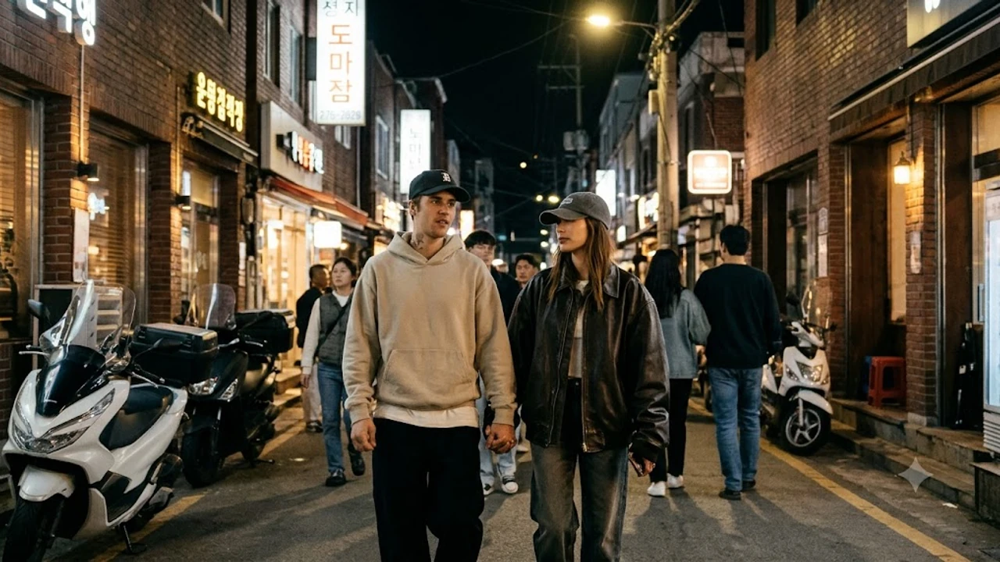

진짜 눈을 의심했어. 저스틴 비버 내한 소식이 아무런 예고도 없이 터지더니, 공연장이 아니라 서울 성수동 골목 한복판에 나타났거든. 아내 헤일리 비버 손을 잡고 힙한 편집숍을 둘러보는 모습이 실시간 목격담으로 올라오면서 지금 연예계와 SNS가 제대로 뒤집어졌어.

## 13년 만의 기습 방한, 저스틴 비버 서울 도착 현황

### SNS로 전해진 깜짝 입국 소식과 실시간 타임라인
공항 입국장 포토라인도 없었고, 소속사의 사전 보도자료 한 줄 없었어. 23일 오후 저스틴 비버가 개인 계정에 "Seoul"이라는 짤막한 캡션과 함께 한강 다리를 건너는 차량 내부 사진을 올리면서 상황이 시작됐지. 팬들은 처음에 예전 사진을 올린 줄 알았지만, 불과 한 시간 뒤 성수동 연무장길에서 후드티를 눌러쓴 비버를 직접 봤다는 인증 사진과 영상이 쏟아져 나왔어. 2013년 첫 내한 공연 이후 장장 13년 만에 밟은 한국 땅인데, 경호원 서너 명만 대동한 채 너무나 태연하게 거리를 걷는 모습이었지.

### 안국동 삼계탕집부터 성수동 탁구장까지 주요 목격담
비버 부부의 첫날 동선은 놀라울 정도로 소탈했어. 화려한 호텔 라운지가 아니라 안국동의 유서 깊은 한옥 삼계탕집에서 뚝배기 한 그릇을 싹 비우는 모습이 옆자리 손님들에게 포착됐거든. 깍두기를 집어먹으며 엄지를 치켜세우는 영상은 순식간에 수백만 뷰를 기록했어. 게다가 늦은 저녁에는 성수동 복합문화공간 내 탁구 클럽에 들러 일반 시민들과 자연스럽게 탁구 랠리를 즐기는 모습까지 목격됐어. 경계심이라곤 찾아볼 수 없는 이 친근한 행보에 현장에 있던 사람들도 얼떨떨해할 정도였지.

### 아내 헤일리 비버 동행 여부 및 포착된 현장 분위기
이번 일정에는 패션 아이콘이자 뷰티 브랜드를 이끄는 아내 헤일리 비버도 완전히 밀착 동행했어. 오버사이즈 레더 재킷에 볼캡을 매치한 특유의 스트리트 룩으로 성수동 일대 뷰티 플래그십 스토어와 라이프스타일 숍들을 꼼꼼하게 둘러봤지. 지나가는 팬들이 인사를 건네자 밝게 손을 흔들어주며 여유롭게 화답하는 태도가 인상적이었어. 현장 목격자들은 두 사람이 손을 꼭 잡고 서울의 골목 분위기를 온전히 즐기는 모습이 무척 다정해 보였다고 입을 모았어.

## 콘서트도 없는데 왜 왔을까? 성수동 방문의 진짜 목적

### 패션 브랜드 팝업스토어 론칭 및 비즈니스 연계
대형 스타디움 콘서트 일정도 잡히지 않았는데 톱스타가 한국을 찾은 이유는 명확해. 바로 성수동에서 비밀리에 준비 중이던 글로벌 패션 브랜드의 한정판 컬래버레이션 팝업스토어 오픈과 관련이 있어. 비버가 디렉팅에 참여한 스트리트 라인의 아시아 첫 공식 오프라인 거점으로 서울, 그중에서도 트렌드의 심장부인 성수동을 직접 낙점한 거지. 단순한 관광이 아니라 자신의 패션 비즈니스 확장을 위한 전략적인 행보였던 셈이야.

### 글로벌 팝스타들이 성수동으로 직행하는 산업적 이유
요즘 해외 유명 아티스트나 명품 하우스 수장들이 방한할 때 강남보다 성수동을 먼저 찾는 건 하나의 공식이 됐어. 젊은 세대의 트렌드 소비 속도가 세계에서 가장 빠르고, 감각적인 팝업 공간이 밀집해 있어 글로벌 바이럴 효과를 극대화할 수 있기 때문이지. 비버 역시 자신의 브랜드 철학을 가장 자연스럽게 보여줄 수 있는 시험대로 성수동의 날것 그대로인 스트리트 감성을 선택했다고 볼 수 있어.

### 아시아 투어 사전 미팅 또는 K-팝 협업 프로젝트 가능성
음악적인 교류 가능성도 여전히 열려 있어. 최근 K-팝 씬이 글로벌 시장에서 막강한 파급력을 보여주는 만큼, 국내 정상급 프로듀서 및 아티스트들과의 비공개 미팅이 잡혀 있다는 풍문이 업계 관계자들 사이에서 돌고 있거든. 컴백을 앞둔 아이돌 그룹이나 솔로 뮤지션과의 깜짝 피처링 작업 논의가 오갔을 수도 있다는 관측이야. 연예계 최신 동향이 궁금하다면 [연예이슈 전체 글 보기](/posts/entertainment/)를 참고해 봐.

## 과거 첫 내한 논란과 180도 달라진 2026년 행보 비교

### 2013년 첫 내한 당시의 해프닝과 아쉬웠던 반응
기억하는 사람도 있겠지만, 13년 전 비버의 첫 내한은 씁쓸한 뒷맛을 남겼어. 2013년 당시 10대 후반 특유의 반항적인 태도와 더불어 예정된 스케줄 지연, 무대 매너 논란 등으로 국내 대중에게 다소 쌀쌀맞은 인상을 심어줬거든. 공연 자체의 퀄리티와는 별개로 스타의 태도를 둘러싼 아쉬운 목소리가 많았던 게 사실이야.

### 13년 만에 보여준 소탈하고 친근한 K-컬처 밀착 일상
하지만 이번 2026년의 모습은 완전히 딴판이야. 한 가정의 가장이자 성숙한 아티스트로 거듭난 비버는 서울의 거리와 문화를 진심으로 존중하고 즐기는 태도를 보여줬어. 
- 시민들의 사진 요청에 미소로 화답하기
- 로컬 한식당을 찾아 현지 음식을 적극적으로 맛보기
- 과도한 의전 없이 대중 속으로 자연스럽게 녹아들기

이런 변화된 태도 덕분에 과거의 부정적인 이미지는 싹 씻겨 나가고, 대중 사이에서 호감도가 급상승하고 있어.

### 국내 정상급 아티스트들과의 교류 및 달라진 위상
그 시절 한국이 그저 아시아 투어의 지나가는 경유지 중 하나였다면, 지금의 서울은 글로벌 문화 트렌드를 선도하는 핵심 도시야. 비버의 달라진 태도 역시 세계 무대에서 격상된 한국 콘텐츠의 위상과 무관하지 않아. 국내 최정상 뮤지션들과 어깨를 나란히 하며 상호 존중을 바탕으로 교류하는 모습은 13년 전과 비교했을 때 격세지감을 느끼게 해.

## 저스틴 비버 성수동 팝업 방문 가이드 및 투어 팁

### 성수 팝업스토어 현장 대기 시스템 및 웨이팅 노하우
비버가 다녀간 성수동 팝업스토어는 현재 오픈런 행렬이 이어지며 대기 번호가 순식간에 마감되고 있어. 현장 방문을 생각하고 있다면 모바일 원격 줄서기 앱 알림을 켜두고 오전 일찍 현장에 도착하는 편이 안전해. 실시간 대기 인원이 300명을 훌쩍 넘어가기 때문에 오후 늦게 방문하면 입장 자체가 제한될 수 있어.

### 비버 부부가 다녀간 핫플레이스 동선과 방문 추천 시간대
안국동 삼계탕집과 성수동 베이커리 카페는 주말에 극심한 혼잡이 예상돼. 평일 이른 오전 시간대나 점심 피크 타임이 지난 오후 2시에서 4시 사이를 노리는 동선이 훨씬 쾌적해. 비버 부부가 머물렀던 카페 테라스 자리는 이미 인증샷 명소로 지정되어 긴 줄이 생겼으니 시간 여유를 넉넉히 잡고 움직여야 해.

### 인파 밀집 대비 안전 관람 수칙 및 팬 에티켓 안내
골목길이 좁은 성수동 특성상 갑작스러운 인파 쏠림 사고에 각별히 유의해야 해. 통행을 방해하거나 인근 상점에 피해를 주는 무리한 촬영은 삼가고, 진행 요원의 안내선에 협조하는 성숙한 팬 에티켓이 필요해. 장시간 골목 투어와 웨이팅을 계획 중이라면 발이 편한 스니커즈를 챙겨 신는 센스도 잊지 마.

[관련상품 쿠팡에서 보기](https://www.coupang.com/np/search?q=%ED%8E%B8%ED%95%9C%EC%8A%A4%EB%8B%88%EC%BB%A4%EC%A6%88&sourceType=affiliate&trackingCode=AF8691300)

#저스틴비버 #저스틴비버내한 #헤일리비버 #성수동팝업 #성수동목격담 #성수핫플 #K컬처 #헐리우드스타