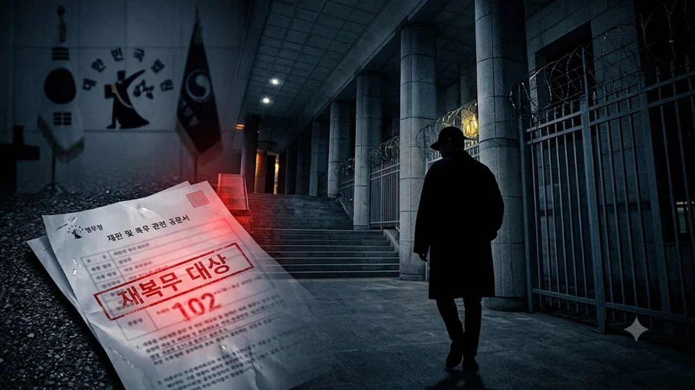

사회복무요원 복무 중에 102일을 무단결근해서 재판에 넘겨졌던 송민호가 결국 1심 판결에 항소하지 않으면서 형이 확정됐어. 그러자마자 병무청이 즉각 행정 처분 절차를 밟겠다고 공식 발표하면서 연예계와 온라인 커뮤니티가 완전히 뒤집혔지. 다들 제일 궁금해하는 게 대체 **송민호 재복무 기간**이 며칠이나 되고, 군 복무를 진짜 처음부터 다시 해야 하는지 여부잖아? 솔직히 말해서 법 조항과 병무청 규정을 뜯어보면 눈여겨볼 포인트가 한둘이 아니야.

## 1심 판결 확정과 병무청의 재복무 공식 착수 배경

### 102일 무단결근 혐의와 집행유예 확정 경위
송민호는 서울 마포구 모 시설에서 사회복무요원으로 대체 복무를 하던 중, 정당한 승인 절차 없이 출근하지 않은 일수가 무려 102일에 달했어. 병역법 위반 혐의로 열린 1심 재판에서 법원은 징역 1년에 집행유예 2년을 선고했지. 연예인 신분을 떠나 복무 기강 훼손 정도가 가볍지 않다는 취지였어. 송민호 측이 항소 기한 내에 항소장을 내지 않으면서 이 판결은 그대로 최종 확정됐어.

### 병무청의 재복무 행정 처분 발표 요약
형이 확정되자 병무청은 발 빠르게 움직였어.
> "판결 확정에 따라 규정대로 부실 복무 및 무단이탈 기간에 대한 재복무 행정 처분을 진행하며, 정확한 잔여 복무 기간 산정과 새 복무 기관 재배치를 확정해 정식 통지할 방침이다."

법원 처벌과 별개로 남은 병역 의무는 끝까지 치르게 하겠다는 뜻이지. 실형이 아닌 집행유예라서 병역 면제 사유가 성립하지 않고, 무단으로 빠진 날수를 법에 맞춰 고스란히 다시 채워 넣어야 해.

### 팬들과 대중이 가장 주목하는 핵심 쟁점
지금 대중이 가장 주목하는 부분은 두 가지야. 결근한 102일만 더 일하면 끝나는 건지, 아니면 복무 일수 산정이 아예 리셋되는지 여부지. 군 복무를 성실하게 마치고 활발하게 활동하는 동료 아이돌들의 행보와 극명하게 대비되면서 시선이 한층 냉랭해졌어. 국방의 의무를 당당하게 마치고 무대로 돌아온 케이스는 [영케이 YOUNGEST 컴백! 진짜 주목할 핵심 3가지](/posts/entertainment/young-k-youngest-comeback-album-analysis-2026/) 글에서도 찾아볼 수 있어.

## 병역법 기준 실제 추가 복무 기간 팩트체크

### 무단결근 102일만 채우면 끝날까?
결론부터 말하면 102일만 달랑 채우고 끝날 가능성은 낮아. 사회복무요원 복무 관리 규정과 병역법 시행령상 정당한 사유 없는 복무 이탈은 단순히 결근한 날짜만큼만 때우는 구조가 아니거든. 무단이탈 일수에 대해 최대 5배수까지 복무 연장 처분을 받거나, 고발로 형사처벌을 받은 기간은 정상 복무 일수에서 제외돼. 단순 계산으로 102일만 더 출근하면 끝난다고 보면 오산이지.

### 기존 인정 복무일수와 감면·취소 적용 여부
병무청 조사 과정에서 정상 출근으로 잡혔던 날들 중 근무지 이탈 정황이 추가로 확인되면 기존 인정 일수 자체가 깎일 위험도 있어.
- **기존 복무 인정치:** 정상 출근과 업무 수행이 객관적으로 확인된 일수만 인정
- **무단결근 102일:** 복무 일수에서 전액 제외
- **가중 연장 일수:** 병역법상 이탈 일수에 따른 배수 연장 규정 검토 대상

결국 송민호가 실제로 소집 해제 통지서를 손에 쥐기까지는 최소 수개월에서 1년 가까이 복무 일정이 늘어날 공산이 커.

### 병역법 제33조에 명시된 복무 연장 및 재소집 규정
병역법 제33조(사회복무요원의 연장복무 등)는 '정당한 사유 없이 복무를 이탈한 경우 이탈 일수의 5배 범위에서 기간을 연장해 복무하게 한다'고 규정해. 징역형 집행유예를 선고받았더라도 남은 의무 복무는 피할 길이 없어. 재소집 통지서가 발부되는 즉시 카운트다운이 다시 시작되는데, 30대 중반의 나이에 다시 공공기관으로 매일 출퇴근해야 하는 상황에 놓인 셈이지.

## 과거 연예인 재복무 선례와 송민호 사례 비교

### 싸이 산업기능요원 재입대 사례와의 구조적 차이
과거 병역 문제로 두 번 군대를 간 싸이 사례가 자주 소환되지만, 둘은 법적 구조가 전혀 달라. 싸이는 산업기능요원 복무 당시 지정업체 부실 근무 판정을 받아 군 복무 자체를 취소당하고 현역 육군으로 '재입대'를 한 케이스야. 반면 송민호는 사회복무요원 신분을 유지하면서 결근 일수와 연장 복무 일수를 합산해 잔여 기간을 채우는 '복무 연장 및 재배치' 형태지. 현역 부대로 끌려가는 건 아니지만 법적 전과와 행정 징계를 동시에 안았다는 점에서 상처뿐인 결말이야.

### 사회복무요원 부실 복무 판정 시 기관 재배치 기준
병무청은 부실 복무 판정을 받은 대상자를 기존 기관으로 돌려보내지 않아. 관리 부실 논란이 재발하는 걸 차단하기 위해서지.
- **원 소속 기관 복귀 원천 배제:** 문제를 일으킨 근무지 제외
- **출결 관리 엄격 기관 우선 배치:** 근태 관리가 깐깐한 사회복지시설이나 직할 관리 기관 배정
- **전담 관리관 지정:** 일일 근태 기록 확인 및 불시 현장 점검 시행

편하게 출퇴근하려다 오히려 매일 일거수일투족을 철저히 감시받는 환경에서 근무해야 하는 처지가 된 셈이지.

### 소집 해제 시점 지연이 연예계 복귀에 미치는 파장
원래대로라면 진작에 소집 해제되어 앨범이나 예능으로 복귀했어야 할 타이밍인데, 이번 일로 모든 일정이 꼬였어. 연장된 복무 기간을 다 채우고 방송가 자숙 기간까지 거치면 최소 2028년 전후에나 조심스럽게 복귀를 타진할 수 있을 거라는 관측이 지배적이야. 한창 활동해야 할 시기에 몇 년간의 공백을 자초했으니 본인 커리어에도 치명타가 불가피해.

## 향후 남은 절차와 자필 사과문 이후의 여론 반응

### 병무청 복무 기관 통지 및 잔여 기간 확정 일정
병무청은 이달 중으로 송민호의 무단결근 일수와 법적 가중 연장 일수를 최종 산정할 계획이야. 행정 처분 통지서가 송달되면 지정된 날짜부터 새 복무지에서 곧바로 근무를 시작해야 해. 만약 여기서 또다시 무단결근이나 지각을 반복하면 집행유예가 취소되고 실제 수감될 수 있기 때문에 규율을 엄격하게 지킬 수밖에 없어.

### 송민호 공식 입장문 분석과 싸늘한 대중 여론
판결 직후 송민호는 SNS에 자필 사과문을 올리고 "공인으로서 책임을 다하지 못해 실망을 안겨드려 반성하며, 남은 복무 기간 동안 성실히 임하겠다"고 밝혔어. 하지만 여론 반응은 싸늘해. 매일 성실히 복무하는 일반 청년들과의 형평성 문제가 도마 위에 올랐기 때문이지. 온라인상에서는 "성실하게 복무한 사람들은 뭐가 되냐", "특혜 논란에 대한 확실한 재발 방지책이 필요하다"는 비판이 쏟아지고 있어.

### 위너 완전체 활동 일정 및 향후 활동 전망 영향
이 사건으로 가장 곤혹스러워진 건 팀 멤버들과 팬들이야. 다른 멤버들이 병역 의무를 마치고 완전체 플랜을 논의하던 시점에 핵심 멤버가 법적 처벌과 재복무 이슈에 묶여버렸으니까. 방송 출연 정지 처분 가능성까지 거론되는 상황이라 위너의 완전체 컴백은 당분간 기약 없이 미뤄질 수밖에 없어.

[매일 출퇴근 기록용 디지털 탁상시계 쿠팡에서 보기](https://www.coupang.com/np/search?q=%EB%94%94%EC%A7%80%ED%84%B8+%ED%83%81%EC%83%81%EC%8B%9C%EA%B3%84&sourceType=affiliate&trackingCode=AF8691300)

#송민호 #송민호재복무 #송민호무단결근 #사회복무요원 #병역법위반 #위너 #병무청 #송민호군대