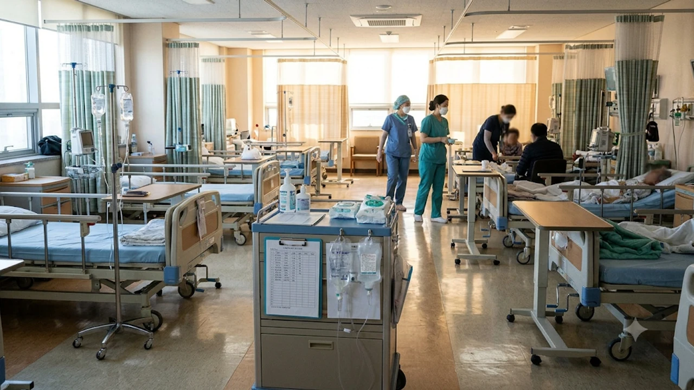

2026년 11월 들어 전국 병원급 의료기관의 **독감 입원환자 급증** 속도가 심상치 않습니다. 질병관리청 표본감시 결과 입원환자가 전년 동기 대비 두 배 가까이 치솟으면서, 인플루엔자 예방접종과 초기 항바이러스제 투여 골든타임을 놓치지 않으려는 주의가 절실해졌습니다. 특히 고령층과 수험생을 중심으로 중증 합병증 위험이 커지고 있어, 올해 독감 유행의 특성과 반드시 확인해야 할 핵심 위험 신호를 정리했습니다.

## 2026년 11월 독감 입원환자 2배 급증, 작년과 무엇이 다른가

### 질병관리청 표본감시 통계로 본 유행 속도와 입원·사망 추이

2026년 11월 13일 질병관리청이 발표한 감염병 표본감시 통계에 따르면, 11월 첫째 주 전국 220여 개 병원급 의료기관의 인플루엔자 입원환자는 **639명**으로 집계되었습니다. 이는 지난해 같은 기간(334명)과 비교해 **91.3% 급증**한 수치이자, 직전 주(461명)보다도 약 38.6% 늘어난 규모입니다. 

더욱 경계해야 할 대목은 중증도 지표입니다. 독감 확진 후 30일 이내 사망자는 24명으로 전년 동기(5명)의 **4.8배**에 달했습니다. 전체 입원환자 중 65세 이상 고령층 비중이 64.9%를 차지하면서, 단순 유행을 넘어 고위험군 병상 관리와 조기 치료가 시급한 국면에 접어들었습니다.

### 지난해 정점의 90% 육박, 유행 시기가 한 달 빨라진 원인

통상 국내 독감 유행은 12월 말에서 이듬해 1월 사이에 정점을 찍습니다. 하지만 올해는 11월 첫째 주 입원환자 수만으로도 지난해 겨울 최고 정점이었던 11월 넷째 주(708명)의 **90.2% 수준**까지 이미 차올랐습니다.

유행 시기가 한 달가량 앞당겨진 배경에는 11월 초부터 급격히 떨어진 기온과 큰 일교차, 그리고 실내 밀집 활동 증가가 자리 잡고 있습니다. 차갑고 건조한 공기는 인플루엔자 바이러스의 생존 기간을 늘리는 반면, 호흡기 점막의 섬모 운동과 방어력은 떨어뜨려 전파 속도를 순식간에 끌어올립니다.

### 백신 접종률과 유행 피크의 엇박자: 항체 형성 전 감염 주의

국가 예방접종 사업이 9월 말부터 순차적으로 시작되었음에도 유행이 한발 먼저 덮치면서 **면역 공백** 문제가 불거졌습니다. 독감 백신은 주사를 맞은 직후 곧바로 방어력을 발휘하지 못하며, 체내에 충분한 항체가 자리 잡기까지 **최소 2주**가 걸립니다. 

실제로 10월 말이나 11월 초에 뒤늦게 접종을 마친 시민들이 항체가 형성되기도 전에 학교, 학원, 출퇴근 대중교통에서 바이러스에 노출되어 확진되는 사례가 잇따르고 있습니다.

## 일반 감기와 다른 2026 독감 주요 증상 및 연령별 고위험군

### 38도 이상 고열·근육통 외에 놓치기 쉬운 비전형 증상 비교

일반 감기는 리노바이러스나 아데노바이러스 등이 원인으로 콧물, 코막힘, 가벼운 인후통이 서서히 시작됩니다. 반면 인플루엔자는 예고 없이 들이닥치는 **38℃ 이상의 고열**과 온몸을 두드려 맞은 듯한 **극심한 근육통·관절통**, 뼈마디가 쑤시는 오한이 특징입니다.

| 구분 | 일반 감기 | 2026 유행 독감(인플루엔자) |
| :--- | :--- | :--- |
| **발병 속도** | 1~2일에 걸쳐 서서히 진행 | 몇 시간 만에 갑자기 증상 폭발 |
| **주요 발열** | 미열이거나 열이 없는 경우 많음 | 38~40℃에 이르는 고열 동반 |
| **전신 증상** | 가벼운 피로감 위주 | 극심한 근육통, 오한, 두통 |
| **주요 합병증** | 부비동염, 중이염 등 경미한 수준 | 2차 세균성 폐렴, 기존 만성질환 악화 |

> **현장 사례:** 서울 강남구의 한 IT 기업에 근무하는 30대 직장인 박 모 씨는 아침 출근길에 약간의 으슬으슬함만 느꼈으나, 점심시간이 지나자마자 체온이 38.9℃까지 치솟고 허리 통증이 심해져 인근 내과를 찾은 끝에 A형 독감 판정을 받았습니다. 이처럼 잠복기(1~4일) 직후 증상이 급격히 악화하는 것이 독감의 전형적인 양상입니다.

### 입원환자 65% 차지하는 고령층의 2차 폐렴 합병증 위험

65세 이상 어르신에게 독감이 치명적인 이유는 바이러스 자체보다 뒤이어 찾아오는 **2차 세균성 폐렴** 때문입니다. 고령층은 젊은 층과 면역 반응 양상이 달라 전형적인 고열이나 심한 기침이 나타나지 않는 경우도 적지 않습니다.

- 평소보다 식사량이 절반 이하로 뚝 떨어지는 갑작스러운 식욕 부진
- 기운이 없어 하루 종일 누워만 있으려는 극심한 무기력증
- 날짜나 장소를 헷갈리는 등 평소와 다른 횡설수설과 의식 혼미(섬망)
- 가만히 있어도 숨이 차거나 호흡수가 평소보다 빨라지는 현상

부모님에게 위와 같은 신호가 보인다면 단순 노화나 피로로 넘기지 말고 즉시 호흡기 내과 진료를 받아야 합니다.

### 의심환자 39% 급증한 10대 청소년 및 수험생 집중 전파 양상

외래 환자 기준으로는 학령기 아동과 청소년층의 확산세가 가장 가파릅니다. 질병관리청 통계에서 13~18세 청소년층의 독감 의사환자 분율은 외래환자 1,000명당 수십 명대로 치솟으며 직전 주 대비 39% 이상 급증했습니다. 

환기가 어려운 교실과 독서실, 학원에서 장시간 밀집해 생활하는 탓에 한 명이 감염되면 순식간에 번지며, 이를 통해 가정 내 조부모나 영유아에게 바이러스가 옮겨가는 연결고리가 만들어지고 있습니다.

## 지금 독감 백신 맞아도 늦지 않았을까? 접종 타이밍과 효과 분석

### 백신 접종 후 면역 형성까지 걸리는 2주간의 '방어 공백' 대처법

이미 유행이 시작되었더라도 **지금 바로 백신을 맞는 편이 유리**합니다. 국내 독감 유행은 11월 1차 정점 이후에도 이듬해 봄(3~4월)까지 B형 독감을 동반하며 길게 이어지기 때문입니다. 

다만 접종 후 2주간은 항체가 만들어지는 과도기이므로, 이 기간에는 사람이 몰리는 실내 다중이용시설에서 KF94 마스크를 착용하고 손 씻기를 철저히 병행해 방어 공백을 메워야 합니다.

### 독감 백신을 맞았는데도 돌파 감염이 발생하는 진짜 이유

백신을 접종했는데도 독감에 걸렸다는 호소가 많지만, 헛수고한 것은 아닙니다. 인플루엔자 백신의 감염 예방 효과는 건강한 성인 기준 약 40~60% 수준입니다. 백신의 핵심 역할은 감염 자체를 100% 막는 것이 아니라, 감염되더라도 **입원율과 사망률을 약 70~80% 이상 낮추는 중증화 예방**에 있습니다.

### 65세 이상·14세 이하 국가 무료 예방접종 대상 및 동시 접종 기준

질병관리청은 고위험군 보호를 위해 아래 대상자에게 지정 의료기관 무료 접종을 지원하고 있습니다.

- **어르신:** 65세 이상(1961년 12월 31일 이전 출생자)
- **어린이:** 생후 6개월 ~ 14세 이하
- **임신부:** 임신 주수와 관계없이 산모수첩 등 확인 후 무료 접종 가능

65세 이상 고령층은 지정 위탁의료기관 방문 시 **코로나19 백신과 독감 백신을 같은 날 동시에 접종**할 수 있으며, 양팔에 나누어 맞으면 병원 방문 횟수를 줄이면서 겨울철 호흡기 감염병을 한 번에 대비할 수 있습니다. 평소 기초 체력과 면역 방어력을 키우는 생활 습관이 궁금하다면 [건강 전체 글 보기](/posts/health/)에서 관련 관리법을 함께 확인해 보세요.

## 독감 의심 시 골든타임 48시간 내 대처 및 가정 내 전파 차단 가이드

### 항바이러스제(타미플루·조플루자) 처방 시기와 복용 시 주의사항

독감 치료의 핵심은 증상 발현 후 **48시간 이내에 항바이러스제를 투여**하는 것입니다. 이 골든타임 안에 약을 복용해야 바이러스 증식을 억제해 앓는 기간을 1~2일 단축하고 폐렴 등 합병증을 막을 수 있습니다.

- **경구용 오셀타미비르(타미플루 등):** 하루 2회, 5일간 복용합니다. 열이 내리고 컨디션이 돌아왔다고 중간에 임의로 복용을 끊으면 내성 바이러스가 생기거나 증상이 재발할 수 있으므로 처방받은 5일 치를 끝까지 복용해야 합니다.
- **단회 투여제(조플루자) 및 수액제(페라미플루):** 알약을 5일간 챙겨 먹기 어렵거나 구토가 심한 환자는 의사와 상담해 1회 복용 또는 정맥 주사 치료제를 선택할 수 있습니다.

### 응급실·상급종합병원 진료가 즉시 필요한 중증 위험 신호 체크리스트

일반 외래 진료와 약물 복용 중이라도 아래 3가지 위험 신호가 나타나면 지체 없이 응급실로 이동해야 합니다.

1. 해열제를 복용해도 39℃ 이상의 고열이 3일 이상 꺾이지 않을 때
2. 입술이나 손끝이 파래지는 청색증이 보이거나 숨을 쉴 때 가슴 통증·호흡곤란이 동반될 때
3. 소변량이 급격히 줄고 물을 마시지 못할 정도로 심한 구토나 의식 저하가 나타날 때

### 가족 간 2차 감염을 막는 실내 습도·환기 및 격리 관리 수칙

가정 내 확진자가 발생하면 해열 후 **24시간이 지날 때까지** 독립된 공간에서 생활하며 식기와 수건을 분리해야 합니다. 실내 온도는 20~22℃, 습도는 **50~60%**로 유지하면 바이러스 활성도를 낮추고 호흡기 점막을 보호할 수 있습니다. 하루 최소 3회, 한 번에 10분 이상 맞통풍 환기를 실시하는 것도 공기 중 비말 농도를 줄이는 확실한 방법입니다. 발열 여부를 수시로 정확하게 체크할 수 있도록 가정 내 [비접촉식 체온계 쿠팡에서 보기](https://www.coupang.com/np/search?q=%EB%B9%84%EC%A0%91%EC%B4%89%EC%8B%9D%20%EC%B2%B4%EC%98%A8%EA%B3%84&sourceType=affiliate&trackingCode=AF8691300)를 미리 구비해 두면 초기 대응에 유용합니다.

#독감입원환자급증 #2026독감유행 #인플루엔자증상 #독감백신접종시기 #타미플루골든타임 #고령층폐렴예방 #환절기건강관리 #독감감기차이