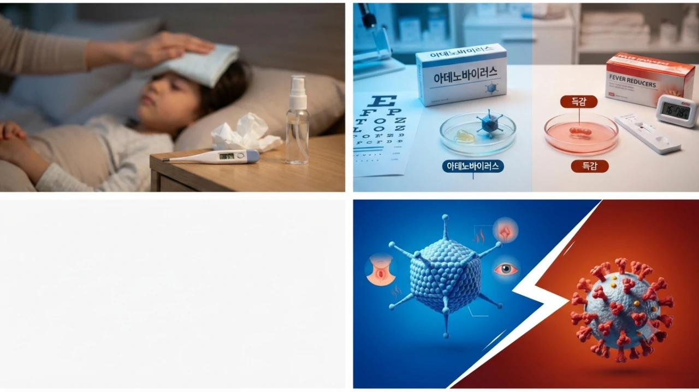

기온이 뚝 떨어지는 초겨울이면 단순 목감기나 독감으로 착각하기 쉬운 **아데노바이러스 증상**이 급증합니다. 해열제를 삼켜도 떨어지지 않는 고열과 칼로 찌르는 듯한 인후통, 눈곱이 겹친다면 일반 호흡기 질환과는 다른 대처가 필요합니다. 초기 징후부터 독감과의 구별법, 가정 내 격리 요령까지 핵심만 짚어냅니다.

## 아데노바이러스 초기 증상과 발병 원인

### 목감기처럼 시작되는 대표 징후
아데노바이러스는 상기도 점막에 침투해 급성 인후염과 편도선염을 일으킵니다. 처음에는 목이 칼칼하고 침을 삼킬 때 따끔거리는 가벼운 인후통으로 출발하지만, 반나절 만에 체온이 39도 안팎으로 치솟으며 심한 오한과 전신 근육통이 덮칩니다. 일반 감기와 달리 편도가 붉게 붓고 하얀 삼출물이 끼어 물조차 삼키기 버거운 사례가 흔합니다.

### 눈곱과 결막염이 동반되는 이유
이 바이러스의 가장 두드러진 특징은 호흡기 점막뿐 아니라 눈의 결막까지 동시에 공격하는 **인두결막열** 형태를 띤다는 점입니다. 아침에 눈을 떴을 때 속눈썹이 엉겨 붙을 정도로 노란 눈곱이 끼거나, 흰자위가 충혈되고 눈물이 계속 흐른다면 단순 감기가 아닙니다. 한쪽 눈에서 시작된 충혈은 며칠 내로 반대쪽 눈까지 번집니다.

### 전염 경로와 잠복기 특성
감염자의 기침·재채기 비말은 물론, 바이러스가 묻은 수건·문고리·장난감을 만진 손으로 눈이나 입을 비빌 때 순식간에 전파됩니다. 알코올 손소독제만으로는 바이러스 외피가 완전히 파괴되지 않을 만큼 생존력이 강해 비누로 30초 이상 흐르는 물에 씻어내야 합니다. 잠복기는 보통 수일에서 일주일 안팎이며, 열이 내린 뒤에도 며칠간 호흡기 분비물과 대변을 통해 바이러스가 배출됩니다.

## 독감 및 일반 감기와의 결정적 차이점

### 해열제 반응 속도와 고열 지속 기간 비교
독감은 항바이러스제(타미플루 등)를 투여하면 복용 후 하루 이틀 만에 열이 확연히 꺾입니다. 반면 아데노바이러스는 전용 항바이러스제가 없어 대증 요법으로 버텨야 하며, 해열제를 먹여 체온을 잠시 낮춰도 약효가 떨어지면 다시 치솟는 현상이 **평균 4일에서 길게는 일주일 가까이** 이어집니다.

> "해열제를 교차 복용하는데도 열이 며칠째 잡히지 않고 눈 충혈까지 겹친다면, 독감 검사 외에 호흡기 바이러스 PCR 검사를 확인해 보는 편이 정확합니다."

### 호흡기 외 위장관 증상(설사·구토) 유무
바이러스 혈청형에 따라 호흡기가 아닌 소화기 점막에 염증을 일으키기도 합니다. 기침·콧물과 함께 배가 뒤틀리는 복통, 묽은 설사, 구토가 동반된다면 아데노바이러스 감염 가능성이 큽니다. 실제 외래 진료실에서도 고열과 장염 증세를 동시에 겪으며 탈수 증상을 보이는 환자가 적지 않습니다.

### 자가진단 키트 활용법과 병원 내원 기준
약국에서 구매한 독감·코로나19 콤보 자가진단 키트에서 음성이 나왔는데도 고열과 인후통이 악화한다면 병원 진료가 필요합니다. 아래 징후가 보이면 지체 없이 의료기관을 찾아야 합니다.

- 해열제 복용 후에도 체온이 내려가지 않고 아이나 환자가 축 처질 때
- 입술이 바짝 마르고 소변 횟수가 눈에 띄게 줄어드는 탈수 징후가 보일 때
- 숨을 쉴 때 쌕쌕거리는 천명음이 들리거나 흉통, 발작적인 기침이 계속될 때

## 연령별 위험도와 합병증 주의사항

### 영유아 및 초등학생 집단 감염 대처법
어린이집, 유치원, 초등학교처럼 밀폐된 공간에서 수건이나 교구를 함께 쓰는 연령대는 집단 감염으로 번지기 쉽습니다. 열이 나고 눈곱이 낀다면 등원을 즉시 멈추고, 해열 후에도 최소 이틀 정도는 가정에서 경과를 지켜봐야 교실 내 재확산을 차단할 수 있습니다.

### 성인 감염 시 나타나는 비전형적 증상
면역 체계가 성숙한 성인은 40도에 육박하는 고열 대신 지독한 목감기나 유행성 각결막염 형태로 앓고 지나가는 경우가 많습니다. 가벼운 감기로 오인해 출근하거나 모임에 나갔다가 가족과 동료에게 바이러스를 옮기는 매개체가 되곤 합니다. 성인이라도 편도가 심하게 붓고 눈 충혈이 겹친다면 개인 위생 수칙을 철저히 지켜야 합니다.

### 폐렴·중이염 등 2차 합병증 예방 수칙
고열과 염증이 며칠간 계속되면 점막 방어벽이 무너지면서 세균성 2차 감염 위험이 치솟습니다. 귀를 자꾸 만지거나 통증을 호소하면 급성 중이염을, 누런 가래가 끓고 호흡이 가빠지면 폐렴을 의심해 흉부 엑스레이 등 정밀 검진을 받아야 합니다.

## 가정 내 격리 및 빠른 회복을 위한 관리법

### 수분 보충과 실내 온·습도 유지 튜토리얼
고열로 인한 탈수를 막고 부어오른 인후 점막을 달래려면 실내 환경부터 바로잡아야 합니다.

1. **수분 섭취 분할 실행**: 한 번에 물을 들이켜면 구토를 유발할 수 있으므로, 미지근한 물이나 이온음료를 한두 모금씩 자주 나누어 마십니다.
2. **실내 습도 조절**: 공기가 건조하면 목 통증이 배가되므로 가습기나 젖은 수건을 활용해 실내 습도를 50~60% 수준으로 유지합니다.
3. **미온수 마사지 병행**: 오한이 없는데 체온이 높다면 미지근한 물에 적신 수건으로 목, 겨드랑이, 사타구니 등 큰 혈관이 지나는 부위를 가볍게 닦아냅니다.

### 가족 간 2차 전염 막는 생활 위생 수칙
전염력이 워낙 강해 가족 중 한 명이 걸리면 순식간에 번집니다. 감염자는 방을 따로 쓰고, 욕실 수건은 개인별 핸드타월이나 일회용 페이퍼타월로 즉시 교체해야 합니다. 문손잡이, 리모컨, 수도꼭지 등 손이 자주 닿는 표면은 차아염소산나트륨(희석한 락스) 성분의 소독제로 닦아내는 편이 안전합니다.

### 회복기 면역력 관리를 위한 식단 가이드
열이 내린 직후에는 위장 기능이 약해져 있으므로 기름지거나 매운 음식은 피해야 합니다. 목 넘김이 부드러운 흰죽, 달걀찜, 순두부로 단백질을 채우고, 비타민이 풍부한 제철 과일을 갈아 마시면 손상된 점막 회복을 돕습니다. 건강 관리와 관련한 더 많은 정보는 [건강 전체 글 보기](/posts/health/)에서도 확인하실 수 있습니다.

건조한 겨울철 실내 습도를 50~60%로 일정하게 유지해 호흡기 점막을 보호하려면 세척이 간편한 가습기를 구비해 두는 것이 유리합니다. [초음파 가열식 복합 가습기 쿠팡에서 보기](https://www.coupang.com/np/search?q=%EA%B0%80%EC%8A%B5%EA%B8%B0&sourceType=affiliate&trackingCode=AF8691300)

#아데노바이러스증상 #아데노바이러스독감차이 #초겨울고열 #인두결막열 #아데노바이러스전염 #목감기고열 #눈곱감기 #호흡기질환예방