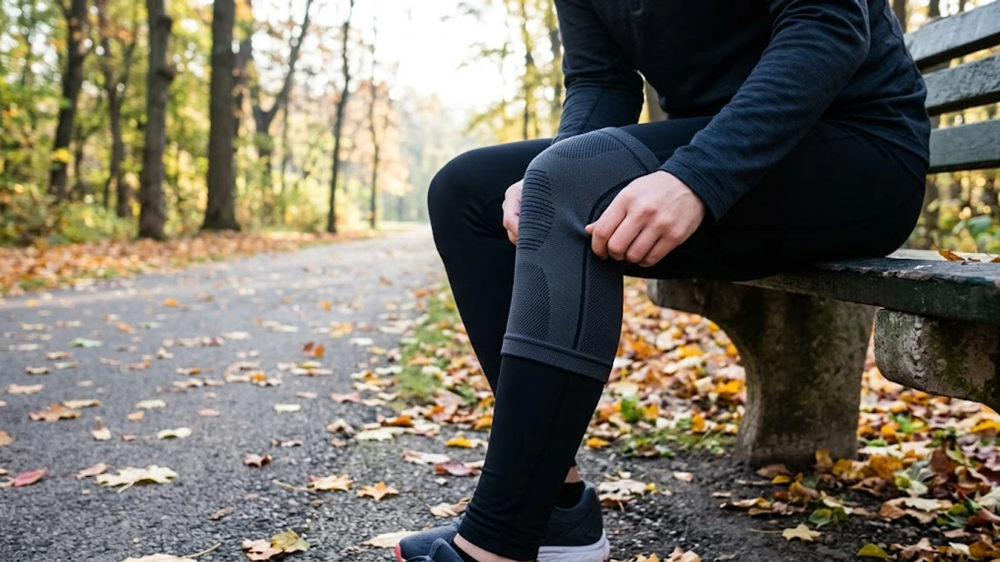

아침저녁으로 찬 바람이 불며 수은주가 한 자릿수로 뚝 떨어지자 주로 위를 뛰는 발걸음마다 관절이 뻣뻣해지기 일쑤입니다. 찬 공기를 가르며 달릴 때 슬개골 아래가 찌릿하거나 정강이 쪽으로 당기는 시림을 방어하려면 **가을 러닝 무릎보호대**로 체온을 사수하고 지면 충격을 분산시켜야 합니다. 발을 내디딜 때마다 지면 반발력이 고스란히 무릎 연골로 꽂히는 계절인 만큼, 러닝 슬리브 같은 기능성 장비를 갖추면 부상 위험을 확실히 덜어낼 수 있습니다.

## 10월 급격한 기온 저하와 가을 러닝 무릎 부상의 상관관계

### 차가운 바람에 굳어지는 관절 활액과 인대 탄성 저하
기온이 한 자릿수로 내려가는 10월 중순의 야외 환경에서는 체온이 순식간에 달아납니다. 이때 관절 안쪽을 채우며 마찰을 줄여주는 활액의 점성이 차가워진 자동차 엔진오일처럼 뻑뻑하게 굳어버립니다.
- **활액 유동성 저하**: 연골끼리 맞닿는 마찰 계수가 치솟아 착지 충격이 뼈로 직격
- **결합조직 수축**: 관절을 감싼 인대와 건의 신축성이 떨어져 팽팽하게 당겨짐
- **충격 완충 실패**: 대퇴사두근이 유연하게 받아내야 할 지면 반발력이 무릎 결합조직을 압박

체온이 덜 오른 상태에서 1km당 5분대의 페이스로 치고 나가면 무릎 안쪽과 바깥쪽 인대에 가해지는 장력이 평소보다 몇 배로 치솟아 통증을 부릅니다.

### 슬개건염과 장경인대 마찰 증후군이 가을에 급증하는 이유
달리기 좋은 가을철에 정형외과 외래 환자가 폭증하는 대표적인 원인은 바로 슬개건염과 장경인대 마찰 증후군입니다.
> 무릎뼈 바로 아래 힘줄 부위가 묵직하게 쑤신다면 슬개건염을, 착지할 때마다 무릎 바깥쪽 돌출부가 칼로 베이듯 쓰라리다면 장경인대 증후군을 먼저 의심해야 합니다.

찬 공기 속에서 장시간 발을 구르면 허벅지 외측 근막과 건이 밧줄처럼 빳빳해져 대퇴골 외측 융기부를 긁어댑니다. 이 마찰이 수천 번 누적되면 단순 근육통을 넘어 염증성 조직 손상으로 번집니다.

### 단순 준비운동만으로 관절 보온이 부족한 환경적 요인
출발 전 제자리 뛰기나 스쿼트로 땀을 살짝 냈더라도, 얇은 쇼츠 아래로 드러난 무릎 살갗은 찬바람에 닿자마자 1~2분 만에 차게 식습니다. 무릎 전면은 지방층이 거의 없어 혈관 수축과 체온 유출이 신체 부위 중 가장 빠릅니다. 외부 냉기를 막아주는 차폐 장비 없이 달리면 웜업으로 끌어올린 심부열이 관절까지 도달하지 못합니다. 장시간 일정한 페이스를 유지하는 [존2 유산소 운동법, 진짜 살 빠질까?](/posts/health/zone-2-cardio-fat-burn-routine-2026/)를 이어갈 때도 관절부를 덮어주는 보온 장비는 필수입니다.

## 러닝 무릎보호대 착용이 주는 진짜 3가지 신체 변화

### 관절 내 체온 유지와 국소 혈류 개선 효과
첫 번째 신체 변화는 관절의 최적 작동 온도를 지켜내는 것입니다. 네오프렌이나 기능성 니트 섬유로 관절을 감싸면 살을 에는 찬 공기를 차단해 미세 혈액순환을 촉진합니다.
- 착용 부위 표면 온도를 약 1~2도 높여 모세혈관 수축을 방지
- 관절 활액의 점도를 적절한 액체 상태로 유지해 무릎을 구부릴 때의 뻑뻑함 해소
- 산소 공급과 젖산 순환을 촉진해 5km 이후 찾아오는 무릎 앞쪽 둔통을 완화

차가운 주로를 달릴 때 맨다리와 슬리브 착용 다리를 비교해보면, 장비를 찬 다리 쪽 대퇴사두근 하단부의 경직도가 현저히 낮아집니다.

### 고유수용성 감각 자극을 통한 착지 시 흔들림 제어
두 번째는 뇌와 근육 사이의 반응 속도를 당겨주는 고유수용성 감각(Proprioception) 자극입니다. 피부와 피하 조직이 적당한 압박을 받으면 뇌는 관절의 실시간 위치와 뒤틀림을 훨씬 또렷하게 파악합니다.
- 착지 순간 무릎이 안쪽으로 꺾여 들어가는 외반(Knee Valgus) 현상을 반사적으로 억제
- 아스팔트 균열이나 코너링 구간에서 발목과 골반이 한쪽으로 무너지는 흔들림을 상쇄
- 대퇴사두근과 햄스트링이 착지 타이밍에 맞춰 균형 있게 수축하도록 유도

의식해서 발을 디디지 않아도, 보호대가 주는 압박 신호가 러닝 폼이 흐트러지는 것을 신경계 차원에서 막아섭니다.

### 슬개골 궤도 안정화로 연골 마모 및 충격 분산
세 번째는 슬개골이 제자리를 벗어나지 않도록 경로를 잡아주는 기능입니다. 다리를 굽히고 펼 때 슬개골은 대퇴골 홈을 따라 매끄럽게 오르내려야 하지만, 피로가 쌓이면 바깥쪽으로 슬쩍 틀어지며 마찰을 일으킵니다. 슬개골 주위를 도넛 형태로 감싸는 지지 패드나 압박 밴드는 이 뼈가 본래 궤도를 벗어나지 않도록 단단히 붙잡아 연골 연화증 위험을 현격하게 낮춥니다.

## 압박 슬리브 vs 힌지형 보호대 완벽 비교

### 통기성과 기동성을 갖춘 니트형 컴프레션 슬리브
원통형으로 쑥 올려 신는 니트 컴프레션 슬리브는 일상적인 로드 러너들에게 가장 어울리는 장비입니다.
- **장점**: 벨크로나 철물 부속이 없어 피부 쓸림이 적고, 무릎을 굽힐 때 걸리는 저항감이 없어 경쾌한 주행 가능
- **단점**: 인대 파열 등 구조적 결손이 있는 환자에게는 측면 지지력이 다소 부족
- **추천 대상**: 관절 부상 이력은 없으나 가을철 보온과 착지 떨림을 잡아 부상을 미리 막으려는 러너

장거리를 달릴 때는 땀 배출이 빠른 3D 원형 직조 방식 제품을 택해야 습기가 차지 않고 쾌적하게 뛸 수 있습니다.

### 인대 불안정증 및 재활 목적의 스트랩·패드 결합형
측면에 유연한 와이어 스프링이나 실리콘 패드, 조임 끈이 들어간 지지형 모델은 흔들림을 꽉 틀어막습니다.
- **장점**: 힌지와 와이어가 측면 뒤틀림을 받아내 인대로 전해지는 충격을 대폭 감소
- **단점**: 자체 무게감이 있고 무릎 뒤 오금 부위가 접혀 고속 질주 시 피부 쏠림 발생 가능
- **추천 대상**: 과거 십자인대 손상이나 반월상 연골판 손상 이력이 있는 러너, 체중 부하가 큰 입문자

자신의 다리 둘레와 주행 강도에 맞춰 압박 정도를 벨크로로 즉각 조절할 수 있어 안정감이 뛰어납니다.

### 잘못된 압박 강도 선택 시 발생하는 혈액순환 저하 위험
> 무조건 꽉 조여야 단단히 보호된다는 생각으로 작은 치수를 억지로 끼워 넣으면 역효과가 납니다.

과도한 압박은 무릎 뒤 오금의 슬와혈관을 눌러 정맥류 순환을 가로막습니다. 3~4km 지점부터 발가락 끝이 찌릿하게 저리거나 종아리에 쥐가 올라온다면 보호대 압박이 혈류를 틀어막고 있다는 뜻입니다. 무릎뼈 중심에서 위로 10~12cm 지점의 허벅지 둘레를 잰 뒤, 제조사 치수 차트에 딱 맞추거나 애매할 땐 한 치수 큰 것을 택해야 탈이 없습니다.

## 부상 없이 달리기 위한 올바른 착용법과 스트레칭 루틴

### 다리 각도에 맞춘 무릎보호대 정확한 밀착 위치
무릎보호대를 당겨 올릴 때는 서서 억지로 잡아당기기보다 의자에 앉아 무릎을 약 30도 정도 살짝 구부려야 합니다.
1. 미끄럼 방지 실리콘 밴드가 허벅지 하단 피부에 뜨지 않게 밀착
2. 보호대 중앙의 슬개골 홀이나 압박 타원 링 중앙에 무릎뼈를 정확히 일치
3. 무릎 뒤쪽 오금 원단이 주름져 살을 꼬집지 않도록 위아래를 가볍게 털어 정돈

위치가 위나 아래로 어긋나면 달리는 동안 흘러내려 착지 밸런스가 흐트러지고 오히려 발목 정렬까지 무너뜨립니다.

### 달리기 전 고관절 및 대퇴사두근 5분 동적 스트레칭
장비를 찼다고 해서 곧바로 아스팔트를 박차면 굳어있던 근육이 놀라 쥐가 날 수 있습니다. 관절 주변부를 데우는 5분 동적 스트레칭이 반드시 뒤따라야 합니다.
- **레그 스윙(Leg Swing)**: 벽을 짚고 다리를 앞뒤, 좌우로 부드럽게 흔들어 고관절 가동 범위를 확보
- **워킹 런지(Walking Lunge)**: 보폭을 넓혀 천천히 내디디며 허벅지 앞쪽과 장요근을 부드럽게 이완
- **카프 레이즈(Calf Raise)**: 발뒤꿈치를 천천히 들어 올렸다 내리며 아킬레스건에 탄성을 충전

정지 상태에서 10초 이상 버티는 정적 스트레칭보다는 관절을 부드럽게 돌리고 움직이는 동적 웜업이 가을철 체온 상승에 훨씬 유리합니다.

### 달린 후 보호대 탈착 요령과 냉·온 찜질 관리법
러닝을 끝마치면 땀과 열기가 갇힌 보호대를 즉시 벗어 피부 습진과 마찰 발진을 차단해야 합니다.
- **통증 확인**: 관절에 화끈거리는 열감이나 부기가 있다면 10~15분간 냉찜질을 둘러 염증 확산을 차단
- **근육 뻐근함 해소**: 부기 없이 다리 전체가 묵직하게 뻐근하다면 온찜질이나 폼롤러 마사지로 뭉친 근섬유를 이완
- **장비 세탁**: 섬유 탄성사를 지키기 위해 중성세제로 가볍게 손빨래한 뒤 그늘에 뉘어 자연 건조

찬 바람에 관절이 위축되는 계절인 만큼, 알맞은 지지 장비와 꼼꼼한 사후 관리를 결합해 부상 없는 완주의 기쁨을 누려보시길 권합니다.

[러닝 무릎보호대 쿠팡에서 보기](https://www.coupang.com/np/search?q=%EB%9F%AC%EB%8B%9D+%EB%AC%B4%EB%A6%8E%EB%B3%B4%ED%98%B8%EB%8C%80&sourceType=affiliate&trackingCode=AF8691300)

#가을러닝 #무릎보호대 #러닝무릎통증 #장경인대증후군 #슬개건염 #마라톤부상예방 #러닝장비추천