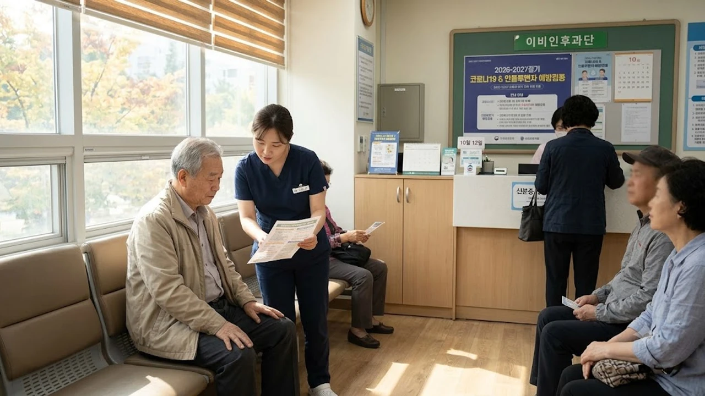

2026년 10월 12일부터 코로나19 백신 관리가 국가 감염병 체계 내 정규 단계로 개편되면서 **코로나 필수접종**을 둘러싼 혼선이 일고 있습니다. 팬데믹 시기 가동되던 한시적 임시접종 체계가 종료되고 정기 접종 체계로 편입되면서, 고위험군 중심의 국비 지원 기준과 인플루엔자 백신 동시접종 가이드라인이 명확히 자리 잡았습니다. 기온이 급격히 떨어지는 가을 환절기를 맞아 개인이 반드시 짚고 넘어가야 할 제도적 변화와 행동 요령을 정리합니다.

## 2026년 10월 12일 코로나19 필수예방접종 전환 핵심 정리

### 임시접종 종료와 정규 법정 필수예방접종 지정의 의미
질병관리청은 2026년 10월 12일 0시를 기해 코로나19 예방접종을 감염병의 예방 및 관리에 관한 법률상 필수예방접종 항목으로 정식 등재했습니다. 과거 긴급사용승인에 기대어 특별회계로 집행하던 임시 처방이 완전히 매듭지어진 셈입니다. 이제 코로나19 백신은 결핵(BCG), B형 간염, 인플루엔자처럼 국가필수예방접종(NIP) 틀 안에서 계절마다 예측 가능하게 굴러가는 상시 감염병 방어선으로 규정됩니다.

### 기존 권고 단계와 10월 12일부터 달라지는 제도적 차이점
가장 손에 잡히는 변화는 백신 조달과 이상반응 처리 경로의 일원화입니다. 제약사와 정부 간 비정기 대량 계약에 의존하던 방식에서 벗어나 조달청 정규 입찰을 통해 백신이 유통됩니다.

- **예산 운용**: 재난관리기금 및 특별회계 편성을 종료하고 보건복지부 정규 감염병 관리 예산으로 집행
- **피해보상 심사**: 감염병예방법 제71조에 따른 법정 국가예방접종 피해보상 전문위원회의 정규 심의 절차 적용
- **이력 전산화**: 질병보건통합관리시스템 내 필수접종 등록망으로 개인별 접종 이력 통합 관리

### 일반 국민의 접종 강제성 여부와 자율 선택 원칙
'필수'라는 단어 탓에 미접종 시 과태료를 물거나 출입 제한을 받는지 묻는 이들이 많습니다. 행정 명령 형태의 강제 조치는 전혀 아닙니다.

> 국가필수예방접종 지정은 방역 당국이 국민 건강권을 지키기 위해 예산과 공급망을 의무적으로 확보해 둔다는 의미이며, 접종 선택권은 전적으로 개인에게 있습니다.

방역패스 같은 물리적 제약은 부활하지 않으므로 본인의 면역 상태와 과거 백신 반응을 따져 스스로 접종 여부를 정하면 그만입니다.

## 국가 무료 지원 대상자와 일반인 유료 접종 기준

### 65세 이상 고령층 및 감염취약시설 무료 지원 조건
국가가 접종 비용 전액을 책임지는 2026-2027절기 무료 지원군은 고위험군으로 압축됩니다. 주민등록상 1961년 12월 31일 이전 출생자인 **65세 이상 어르신**은 신분증만 들고 전국 지정 위탁의료기관을 찾으면 본인 부담금 없이 접종을 마칠 수 있습니다. 요양병원, 노인요양공동생활가정, 장애인 거주시설 입소자 역시 촉탁의 방문 진료나 보건소 기동전담반을 통해 국비 지원을 받습니다.

### 면역저하자의 의사 소견서 제출 및 무료 대상 확인 절차
생후 6개월 이상 면역저하자도 전액 국비 지원 대상에 묶입니다. 백혈병 같은 혈액암 환자, 항암치료 중인 고형암 환자, 장기이식 후 면역억제제를 삼키고 있는 환자가 여기에 듭니다. 전산망에 등록되지 않은 경우 병원 접수창구에 최근 6개월 이내 발급된 진단서, 소견서, 혹은 면역억제제 처방전을 보여줘야 본인 부담금 면제 코드가 생성됩니다. 만성질환이나 기저 면역 상태를 가다듬는 평소 건강 관리 흐름은 [건강 전체 글 보기](/posts/health/)를 통해 파악할 수 있습니다.

### 일반 성인·청소년 유료 접종 비용과 의료기관 확인법
무료 명단에 들지 않는 12~64세 일반인은 비급여 진료 항목으로 분류되어 주삿값을 전부 본인이 치러야 합니다. 제약사 백신 공급가와 의료기관별 접종 행위료가 묶여 실제 청구액은 **7만 원에서 9만 원 선**을 맴돕니다. 병원마다 비급여 책정액이 제각각이므로, 건강보험심사평가원 비급여 진료비 조회 창구를 뒤지거나 인근 내과·이비인후과에 유선으로 접종 단가를 미리 확인하고 움직이는 편이 발품을 아끼는 지름길입니다.

## 독감 백신 동시접종 시 주의해야 할 3가지 수칙

### 같은 날 양팔 분할 접종 원칙과 이상반응 분별법
보건당국은 겨울철 호흡기 감염병의 동시 유행을 막으려 코로나19 백신과 독감 백신의 동시 접종을 권장합니다. 다만 접종 과정에서 반드시 지켜야 할 물리적 원칙이 있습니다.

- **접종 부위 분리**: 한쪽 팔에 두 백신을 몰아맞는 것은 엄격히 금지되며, 왼팔 삼각근에 코로나19 백신을 맞았다면 오른팔 삼각근에 독감 백신을 놓아야 합니다.
- **국소 반응 추적**: 양팔을 갈라 맞아야 어느 쪽 주사 부위에서 통증, 부종, 붉은 발적이 돋아나는지 똑똑히 가려낼 수 있습니다.

### 이전 백신 부작용 이력자 대상 접종 간격 조율 가이드
과거 mRNA 백신을 맞고 39도를 넘나드는 고열이나 이 빠지는 오한으로 고생한 적이 있다면 굳이 하루에 두 주사를 맞설 필요가 없습니다. 면역 반응이 한 번에 거세게 몰아쳐 일상을 마비시킬 수 있으니, **1~2주 간격을 두고 따로 맞는 전략**이 현명합니다. 독감 백신을 먼저 맞고 몸살 기운이 말끔히 가신 뒤 코로나19 백신을 접종하는 식으로 일정을 조율하면 부담을 크게 덜어낼 수 있습니다.

### 접종 후 48시간 발열·근육통 대처법과 타이레놀 복용 타이밍
주사를 맞은 뒤 찾아오는 미열과 뻐근한 근육통은 체내 항체 공장이 가동되고 있다는 신호입니다. 주사를 맞기도 전에 겁을 먹고 아세트아미노펜(타이레놀 등)을 삼키면 초기 항체 형성을 방해할 수 있어 피해야 합니다. 체온이 38.5도 위로 튀거나 관절통이 거세질 때 비로소 4~6시간 간격을 두고 복용하는 것이 정석입니다. 만약 이틀이 지나도록 숨이 차거나 가슴을 쥐어짜는 통증, 식은땀을 동반한 어지럼증이 이어진다면 지체 없이 응급실로 직행해야 합니다.

## 2026-2027 절기 접종 예약 방법 및 잔여백신 확인 절차

### 질병관리청 예방접종도우미 누리집을 통한 사전 확인법
과거와 같은 번거로운 10부제 사전예약 시스템은 사라졌습니다. 질병관리청 **예방접종도우미 누리집(nip.kdca.go.kr)** 이나 모바일 앱에 접속하면 동네 병·의원의 백신 재고 현황을 한눈에 확인할 수 있습니다. 간편인증으로 접속하면 본인이 65세 이상 무료 대상인지 즉시 전산 판별이 끝나며, 주민등록상 주소지와 무관하게 전국 위탁의료기관 어디서나 접종할 수 있습니다.

### 위탁의료기관 당일 현장 방문 및 잔여 백신 조회 요령
사전 등록을 건너뛰었더라도 신분증만 챙겨 동네 의원을 찾으면 당일 잔여 백신으로 곧장 접종이 이뤄집니다. 1바이알(병)당 개봉 후 유효시간이 촉박하게 흐르는 만큼, 오전 진료 시간대에 유선으로 백신 개봉 여부를 묻고 찾아가야 헛걸음을 막을 수 있습니다. 접종 당일에는 숨이 턱에 차는 격렬한 운동과 사우나를 건너뛰고 물을 넉넉히 마시며 쉬어야 면역 세포가 제 몫을 해냅니다.

[비접촉 체온계 쿠팡에서 보기](https://www.coupang.com/np/search?q=%EB%B9%84%EC%A0%91%EC%B4%89%20%EC%B2%B4%EC%98%A8%EA%B3%84&sourceType=affiliate&trackingCode=AF8691300)

#코로나필수접종 #코로나19백신 #2026코로나접종 #독감코로나동시접종 #코로나무료접종대상 #코로나백신비용 #예방접종도우미 #질병관리청