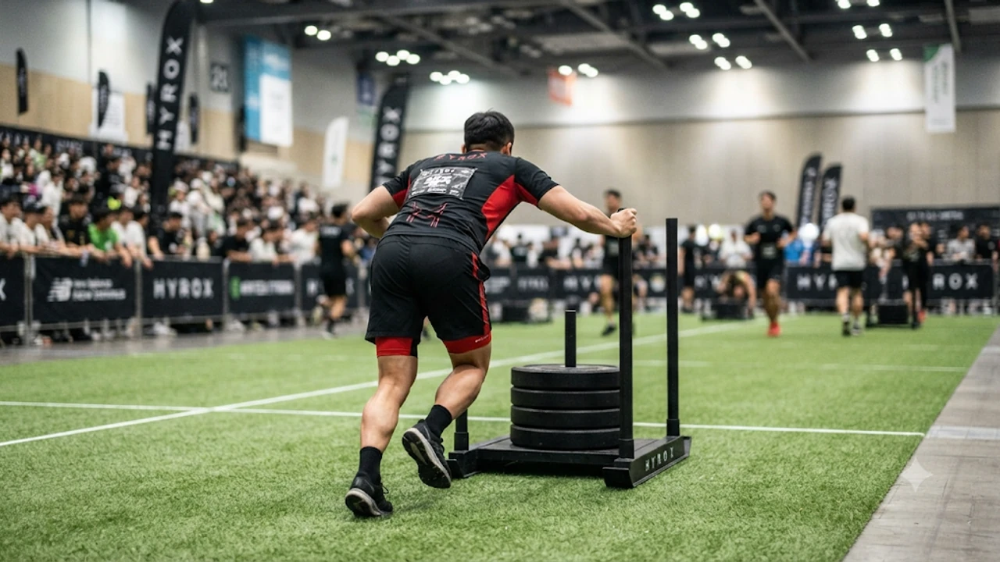

지난 주말 성황리에 막을 내린 **하이록스 서울** 대회 이후, 피트니스 마니아들 사이에서 '악마의 레이스'라 불리는 이 복합 기능성 운동에 대한 관심이 최고조에 달하고 있습니다. 특히 1km 러닝과 8가지 고강도 워크아웃을 번갈아 수행하는 극한의 체력 테스트 속에서, 평소 [존2 유산소 운동법, 진짜 살 빠질까?](/posts/health/zone-2-cardio-fat-burn-routine-2026/)로 체계적인 심폐 지구력을 다져온 참가자들의 완주 후기가 쏟아지며 도전을 꿈꾸는 이들이 늘고 있습니다.

## 2026 하이록스 서울 대회 성황리 폐막, 무엇이 달랐나?

### 현장 분위기와 참가 열기
올해 고양 킨텍스에서 개최된 2026 하이록스 서울은 역대 최대 규모의 참가자들이 몰리며 국내 피트니스 레이스의 저력을 입증했습니다. 현장을 찾은 2만여 명의 관중과 선수들은 트랙을 가득 채운 열정 속에서 서로를 격려하며 완주 메달을 향해 달렸습니다. 단순히 개인의 기록을 경쟁하는 것을 넘어, 전 세계가 열광하는 글로벌 피트니스 컬처가 국내에도 완전히 뿌리내렸음을 증명하는 자리였습니다.

### 악마의 레이스, 종목별 체감 난이도
하이록스는 1km 러닝을 마친 뒤 스키에르고, 슬레드 푸시, 슬레드 풀, 버피 브로드 점프, 로잉, 파머스 카리, 산들 런지, 월볼 등 8가지 스테이지를 연속으로 수행하는 방식입니다. 참가자들은 특히 허벅지와 코어 근육을 극한으로 몰아붙이는 슬레드 푸시와 마지막 관문인 월볼 구간에서 체력적 한계를 강하게 체감했다고 입을 모읍니다.

---

## 하이록스 완주를 결정짓는 핵심 훈련법

### 1km 러닝과 기능성 워크아웃 페이싱 전략
> "초반 러닝에서 과도하게 페이스를 올리면 4번째 스테이지를 넘기기 어렵다."

성공적인 완주를 위해서는 1km 단위의 러닝과 웨이트 스테이지 사이의 체력 안배가 승부를 가릅니다. 숨이 턱까지 차오르는 상태에서 곧바로 무거운 기구를 다뤄야 하므로, 심박수를 안정적으로 유지하는 페이싱 전략이 필수적입니다. 레이스 도중 퍼지는 현상을 막으려면 평소 인터벌 트레이닝을 통해 젖산 내성을 기르는 훈련이 효과적입니다.

### 8가지 워크아웃 구간별 부상 방지 팁
반복되는 러닝과 복합 관절 운동은 무릎과 발목, 허리에 엄청난 부하를 줍니다. 특히 슬레드 푸시와 런지 구간에서는 자세가 무너지면서 부상으로 이어지는 경우가 허다합니다. 코어의 긴장을 끝까지 유지하고 하체 정렬을 바르게 가져가는 반복 숙달 훈련이 완주 기록을 단축하는 지름길입니다.

## 하이록스 준비물과 필수 기어 가이드

### 레이스용 러닝화 및 카본화 선택 기준
총 8km를 뛰어야 하는 하이록스 레이스 특성상 발의 피로도를 낮추는 신발 선택이 승부를 가릅니다. 지나치게 쿠셔닝만 강조된 모델보다는 안정성이 뒷받침되면서도 반발력이 좋은 카본 레이싱화나 하이브리드 트레이닝화를 착용하는 것이 유리합니다. 거친 바닥 마찰력과 급격한 방향 전환을 버텨낼 수 있는 접지력 확인도 필수입니다.

### 기록 단축을 위한 스마트웨어 활용법
실시간으로 심박수와 페이스를 체크하는 스마트워치는 레이스 운영의 나침반 역할을 합니다. 목표 심박 존을 이탈하지 않도록 경고 설정을 해두면, 후반부에 체력이 급격히 소모되는 래깅 현상을 미연에 방지할 수 있습니다. 훈련 데이터와 대회 실적을 연동해 페이스의 강약을 조절하는 능력이 기록 단축의 핵심입니다.

## 다음 시즌 하이록스 도전, 지금 당장 시작할 일

### 비시즌 기초 체력 및 근지구력 훈련 계획
대회가 끝났다고 휴식만 취하기보다는, 다가오는 다음 시즌을 위해 지금부터 기초 체력을 빌드업하는 것이 현명합니다. 맨몸 운동과 고중량 근력 운동을 결합한 크로스핏 스타일의 서킷 트레이닝을 주 3회 이상 꾸준히 소화해야 합니다. 특히 악력과 하체 지구력을 키우는 보조 운동을 병행하면 스테이지 전환 구간에서 큰 시간 단축을 이룰 수 있습니다.

### 홈트레이닝과 박스 트레이닝 병행 요령
바쁜 일상 속에서 대형 기구를 모두 갖춘 박스에 매일 가기 어렵다면, 홈트레이닝과 병행하는 하이브리드 루틴이 대안이 됩니다. 케틀벨이나 저항 밴드를 활용해 홈짐에서 전신 근지구력을 다지고, 주말에는 전문 피트니스 센터나 박스를 찾아 실전과 동일한 세트 시뮬레이션을 소화하는 것이 효과적입니다. 체계적인 훈련과 회복을 동시에 챙기는 자만이 다음 레이스의 주인공이 될 수 있습니다.

[하이록스 기록 단축을 위한 폼롤러 마사지건 보기](https://www.coupang.com/np/search?q=%ED%8E%80%EB%A1%A4%EB%F0%AC%A1%EC%82%AC%EC%A7%80%EA%B8%B0&sourceType=affiliate&trackingCode=AF8691300)

#하이록스서울 #하이록스후기 #기능성운동 #크로스핏 #존2유산소 #인터벌트레이닝 #피트니스레이스 #하이록스준비물 #슬레드푸시 #러닝기록단축