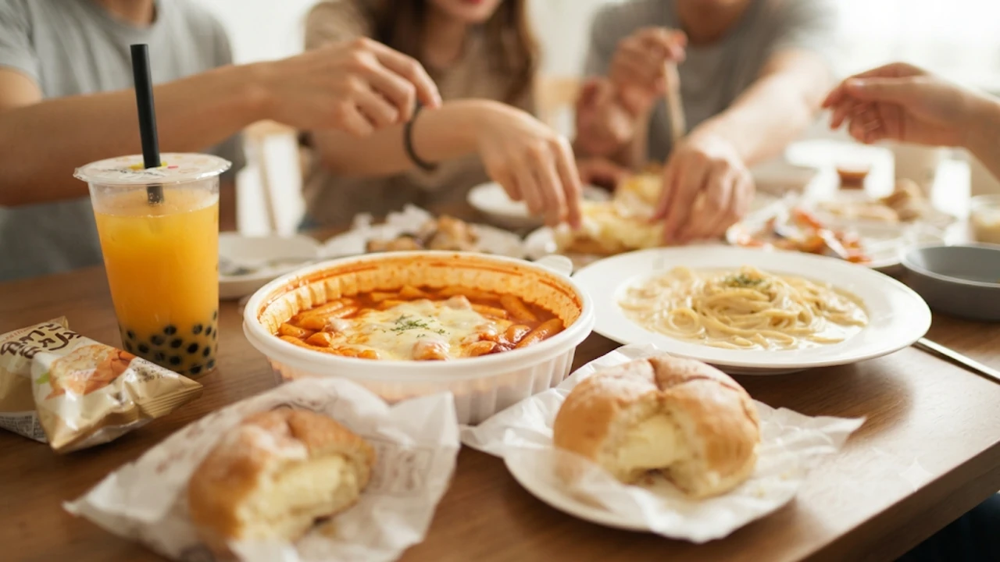
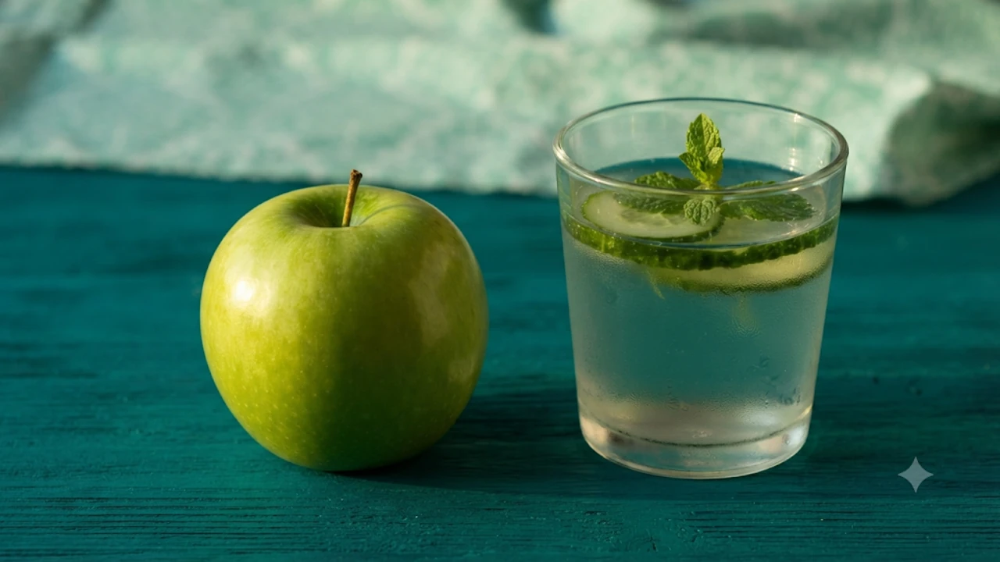

수능이 끝나고 밀렸던 야식과 단 음식을 한꺼번에 먹다 보면 **수능 후 혈당 관리 식단**이 무너지며 심한 피로와 식곤증이 찾아오기 쉽다. 정제 탄수화물 위주의 폭식은 **혈당 스파이크**를 반복시켜 포만감 신호를 흐트러뜨리고 다음 끼니의 과식을 부추긴다. 지금 필요한 건 극단적인 굶기가 아니라 혈당 변동을 완만하게 묶어 두는 현실적인 한 끼 구조다.

## 수능 직후 폭식과 혈당 흔들림이 겹치는 이유

오랜 입시 기간 동안 긴장 상태로 버틴 몸은 시험 종료 직후 보상 심리와 함께 빠른 에너지를 요구한다. 이때 떡볶이, 마라탕, 크림빵, 가당 음료처럼 당과 정제 전분이 뭉친 음식을 공복에 몰아넣으면 혈당이 급격히 치솟았다가 반동으로 떨어지며 다시 허기를 자극한다.

### 늦은 밤 보상 식사가 아침 공복감을 키우는 구조

밤늦게 고당·고지방 식사를 하고 잠들면 수면의 질이 떨어지고 다음 날 아침 인슐린 감수성이 둔해진다. 아침을 거른 채 점심에 면이나 밥을 단독으로 먹으면 혈당 변동폭이 커져 오후 내내 집중력이 끊긴다.

- 밤 10시 이후 단 음료·과자 대신 따뜻한 물이나 무가당 차로 입가심하기
- 아침을 건너뛰더라도 삶은 달걀이나 그릭요거트 한 컵으로 단백질 바닥 다지기
- 식사 속도를 늦춰 씹는 횟수를 늘리고 포만감이 올라올 시간을 확보하기

### 단맛 중독을 줄이는 현실적인 전환 방식

갑자기 모든 간식을 끊으면 반동으로 야식이 더 커진다. 초콜릿이나 케이크를 통째로 참기보다 식후 디저트로 소량만 두거나, 단맛이 당길 때 견과류와 무가당 요거트를 먼저 먹어 혈당 상승 속도를 늦추는 편이 훨씬 오래간다.

> 폭식을 참는 의지보다 혈당이 널뛰지 않게 만드는 식사 순서가 다음 끼니의 식욕을 좌우한다.

## 식이섬유와 단백질을 먼저 채우는 한 끼 설계

같은 양을 먹더라도 무엇을 먼저 입에 넣느냐에 따라 식후 졸음과 허기 재발 속도가 달라진다. 채소와 단백질, 건강한 지방을 먼저 깔아 두면 뒤이어 들어오는 탄수화물의 흡수 속도가 완만해진다.

### 접시 채우기 순서로 만드는 포만감

점심 도시락이나 외식 메뉴를 고를 때도 밥이나 면부터 들이붓지 않는 습관이 핵심이다. 먼저 나물, 샐러드, 김치 등 식이섬유 반찬을 먹고, 이어서 고기·생선·두부·계란 같은 단백질 반찬을 챙긴 뒤 밥량을 줄여 마지막에 먹는다.

- 백미 100% 대신 잡곡이나 현미를 섞어 식감과 식이섬유 보완하기
- 국물 요리에서는 건더기 위주로 먹고 나트륨과 전분이 뭉친 국물은 남기기
- 외식 시 덮밥·볶음밥보다 백반이나 정식처럼 반찬 구성이 분리된 메뉴 선택하기

### 퍽퍽한 닭가슴살 없이 단백질 챙기는 법

단백질을 챙겨야 한다는 압박에 퍽퍽한 닭가슴살만 고집하면 며칠 만에 질려 식단이 무너진다. 계란찜, 두부부침, 소고기 부챗살·목심, 돼지고기 안심·앞다리살, 연어, 고등어구이처럼 조리 변주가 쉬운 재료를 번갈아 쓰는 것이 현실적이다.

[존2 유산소 운동법, 진짜 살 빠질까?](/posts/health/zone-2-cardio-fat-burn-routine-2026/) 글에서 함께 다룬 가벼운 유산소 루틴을 식후 산책과 결합하면 혈당 안정과 체력 회복에 시너지를 낼 수 있다.

## 외식과 간식 상황별 혈당 방어 루틴

수능 이후에는 친구 모임, 가족 외식, 카페 방문이 잦아 집밥만 고수하기 어렵다. 상황이 바뀔 때마다 무너지지 않으려면 미리 정해 둔 대체 기준을 꺼내 쓰는 것이 유리하다.

### 카페와 분식집에서 선택을 줄이는 기준

카페에서는 휘핑크림과 시럽이 들어간 음료 대신 아메리카노, 라떼, 무가당 티를 고르고, 베이커리를 고른다면 잼이나 크림이 적은 빵을 반으로 나누어 먹는 식의 타협점을 잡는다. 분식집에서는 떡과 튀김 비중을 줄이고 어묵이나 계란, 김밥 속재료처럼 단백질·채소 비율이 높은 메뉴를 곁들인다.

- 시럽 추가 음료 대신 무가당 음료 선택 후 허기질 때 견과류 한 줌 추가
- 튀김류는 한 번에 1~2조각 이내로 제한하고 샐러드나 채소 반찬 병행
- 야식이 당기는 날엔 늦은 저녁을 가볍게 먹고 다음 날 아침 식사로 에너지 보충

### 야식과 회식 다음 날 회복 식사법

전날 과식이나 음주로 속이 무겁고 얼굴이 부었다고 해서 다음 날 하루 종일 굶는 방식은 권장하지 않는다. 수분을 충분히 보충하고 따뜻한 국물 건더기와 단백질, 채소 위주로 가볍게 먹으며 몸의 리듬을 되돌리는 편이 회복이 빠르다.

> 하루 한 끼를 그르쳤다고 식단 전체를 포기할 필요는 없다. 다음 끼니 한 번만 제대로 차려도 흐름은 다시 이어진다.

## 생활 리듬과 함께 이어가는 현실적 유지 팁

식단만 따로 떼어 놓고 보면 수면 부족이나 스트레스 누적 앞에서 쉽게 흔들린다. 규칙적인 기상 시간과 짧은 걷기 습관이 맞물릴 때 식욕 호르몬과 혈당 반응이 한결 안정된다.

### 수면과 가벼운 움직임으로 식욕 진정시키기

밤새 게임이나 영상을 보며 늦게 자면 다음 날 당류 욕구가 커지고 움직임이 줄어든다. 식후 10~15분 정도 가볍게 걷거나 스트레칭을 곁들이면 식후 혈당 변동을 완화하고 답답한 기분을 해소하는 데 도움이 된다.

- 기상 직후 물 한 잔 마시고 햇빛을 쬐며 하루 생체리듬 깨우기
- 식후 바로 눕기보다 실내 걷기나 가벼운 정리정돈으로 몸 움직이기
- 주 2~3회 이상 20분 내외의 걷기·유산소 운동으로 기초 체력 유지하기

실내에서 가볍게 몸을 풀거나 혈당 관리와 병행할 운동·건강 보조용품을 찾고 있다면 [관련상품 쿠팡에서 보기](https://www.coupang.com/np/search?q=%EA%B1%B4%EA%B0%95%EA%B8%B0%EA%B8%B0%20%EB%A7%88%EC%82%AC%EC%A7%80%EA%B8%B0&sourceType=affiliate&trackingCode=AF8691300)에서 옵션을 비교해 볼 수 있다.

#수능후혈당관리식단 #혈당스파이크 #수능후식단 #폭식예방 #혈당관리 #수험생건강 #식단관리루틴 #건강식단