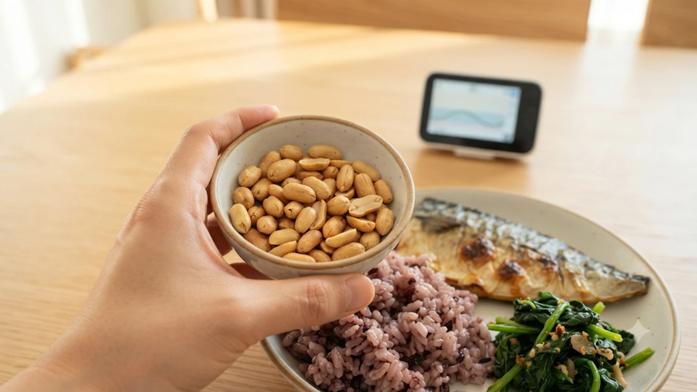
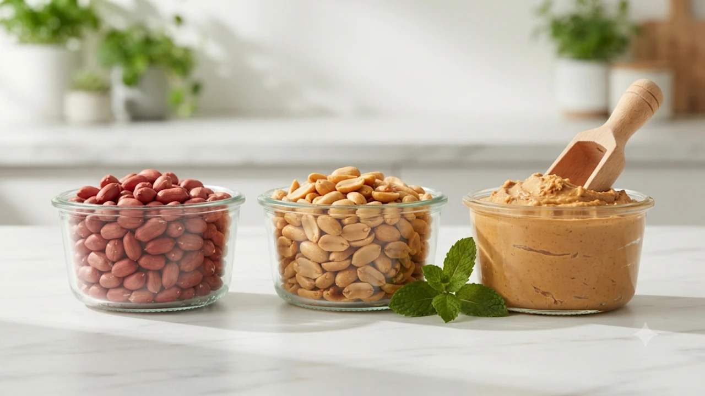

점심 식사 직후 쏟아지는 식곤증을 잡기 위해 시도하는 **식후 땅콩 혈당** 관리법이 2026년 대사 건강 커뮤니티에서 실전 루틴으로 자리 잡았습니다. 흰쌀밥이나 면류 위주의 한국인 식단에서 **인슐린 저항성**을 낮추고 **혈당 스파이크**를 완화하는 현실적인 대안으로 견과류가 재조명받는 흐름입니다. 실제 영양학적 기전과 실패 없는 섭취 기준을 짚어봅니다.

## 식후 땅콩 섭취가 혈당 스파이크를 억제하는 핵심 원리

### 불포화지방산과 식이섬유가 당 흡수 속도를 늦추는 과정
땅콩에 풍부한 **단일불포화지방산(올레산)**과 불용성 식이섬유는 위장에서 음식물이 소장으로 넘어가는 위 배출 속도를 물리적으로 늦춥니다. 탄수화물 식사 직후 땅콩을 씹어 먹으면 소화 효소가 전분을 포도당으로 분해해 혈액으로 내보내는 속도가 완만해집니다. 덕분에 췌장이 인슐린을 한꺼번에 쏟아내는 비상 상황을 피할 수 있습니다.

### 탄수화물 단독 섭취 대비 혈당 곡선 변화 비교
직장인 점심 메뉴로 흔한 김치볶음밥이나 칼국수만 단독으로 먹으면 식후 30분에서 1시간 사이 혈당이 가파르게 치솟았다가 급락하는 반응성 저혈당이 찾아옵니다. 반면 식사 직후 무가염 땅콩 한 줌을 곁들이면 혈당 최고점(피크) 도달 시점이 늦춰지고 하강 곡선도 완만하게 이어집니다. 오후 2~3시경 몰려오는 극심한 피로감과 헛배고픔을 줄이는 데 체감 효과가 큽니다.

### 2026년 최신 대사 건강 트렌드에서 주목받는 이유
연속혈당측정기(CGM)를 착용해 음식별 혈당 반응을 직접 확인하는 '혈당 다이어트'가 일상화되면서, 극단적인 단식 대신 기존 식사 직후 소량의 지방과 단백질을 덧붙이는 현실적인 방식이 호응을 얻고 있습니다. 식단 조절과 함께 [존2 유산소 운동법, 진짜 살 빠질까?](/posts/health/zone-2-cardio-fat-burn-routine-2026/) 같은 저강도 유산소 운동을 병행하면 근육의 포도당 소모 효율을 한층 끌어올릴 수 있습니다.

## 볶은 땅콩 vs 생땅콩 vs 땅콩버터, 혈당 관리 승자는?

### 가공 방식에 따른 GI 지수 및 영양 성분 차이
땅콩 자체는 혈당지수(GI)가 낮은 식품군에 속하지만, 가공 형태에 따라 포만감과 칼로리 밀도가 확연히 달라집니다.

- **볶은 땅콩(무가염):** 수분이 날아가면서 고소한 풍미가 살아나고 폴리페놀 같은 항산화 성분 이용률이 높아집니다. 소금이 묻지 않은 제품을 골라야 불필요한 나트륨 섭취를 막을 수 있습니다.
- **생땅콩(삶은 땅콩):** 껍질째 삶아 먹으면 수분 함량이 높아 적은 양으로도 포만감이 크고, 붉은 속껍질 속 레스베라트롤 성분을 온전히 챙길 수 있습니다. 단, 익히지 않은 생땅콩을 과다 섭취하면 트립신 저해제 성분 때문에 복통을 유발할 수 있어 반드시 삶거나 볶아 먹어야 합니다.
- **땅콩버터:** 곱게 갈아 세포벽이 부서진 상태라 알갱이 형태보다 지방과 열량 흡수가 빠릅니다. 숟가락으로 퍼 먹다 보면 하루 권장량을 순식간에 넘기기 십상입니다.

### 시중 땅콩버터 선택 시 반드시 피해야 할 첨가물 기준
혈당 방어를 목적으로 땅콩버터를 고를 때는 앞면 광고 문구보다 뒷면 원재료명 표기를 먼저 확인해야 합니다.

> **원재료 라벨 체크 기준:** 성분표에 '땅콩 100%' 또는 '땅콩, 천일염'만 적힌 제품을 고르세요. **팜유(경화유), 설탕, 물엿, 액상과당**이 섞인 제품은 달콤한 맛과 반비례해 혈당 스파이크를 오히려 부추깁니다.

### 상황별 가장 효율적인 섭취 형태 추천
외식이 잦은 직장인이라면 1회분씩 소포장된 무가염 볶음 땅콩을 사무실 서랍에 두고 점심 직후 꺼내 먹는 편이 가장 간편합니다. 집에서 아침 식사로 통밀빵이나 사과를 먹을 때는 100% 땅콩버터 1티스푼을 얇게 펴 발라 먹으면 식감과 혈당 완충 효과를 동시에 챙길 수 있습니다.

## 혈당 방어 효과를 극대화하는 하루 적정량과 타이밍

### 식전 섭취와 식후 10분 이내 섭취의 혈당 반응 차이
공복 상태에서 식사 15분 전에 땅콩을 먼저 씹어 먹는 '거꾸로 식사법'은 위벽에 미리 지방과 식이섬유 막을 형성해 당 흡수를 막는 데 가장 유리합니다. 하지만 식전 섭취를 놓쳤더라도 **식사를 마친 직후 10분 이내**에 땅콩을 먹으면 위장 안에서 탄수화물과 지방이 섞이면서 소화 속도를 늦추는 효과를 충분히 얻습니다. 이미 혈당이 정점을 찍은 식후 1시간 뒤에는 방어 효과가 크게 떨어집니다.

### 체중 증가 없이 혈당만 잡는 하루 권장 섭취 알 수
땅콩은 100g당 560kcal를 훌쩍 넘는 고열량 식품이므로 눈대중이 아닌 계량 습관이 필요합니다.

- **1회 적정 섭취량:** 성인 손바닥 오목한 부분에 가볍게 담기는 **약 15~20g(땅콩 알맹이 기준 15~20알 내외)**이 적당합니다.
- **땅콩버터 환산량:** 일반 티스푼으로 깎아서 **1~1.5스푼(약 15g)** 이내로 제한해야 내장지방 축적을 막을 수 있습니다.

### 함께 먹으면 시너지가 나는 저혈당 식단 조합
점심으로 백미밥과 찌개, 면 요리를 먹었다면 식후 10분 이내에 무가염 땅콩 15알과 함께 따뜻한 녹차나 무가당 우엉차를 곁들여 보세요. 찻잎의 카테킨과 수용성 식이섬유가 당분 분해 효소의 작용을 한 번 더 늦춰 오후 혈당 곡선을 안정적으로 잡아줍니다.

## 무턱대고 따라 했다가 역효과 나는 주의 대상과 부작용

### 고지혈증 및 지방간 환자가 주의해야 할 칼로리 함정
이미 혈액 검사에서 중성지방 수치가 높거나 비알코올성 지방간 소견을 받았다면, 평소 식사량을 그대로 유지한 채 식후 땅콩만 추가하는 습관은 일일 총섭취 열량을 초과시켜 간 내 지방 축적을 악화합니다. 이 경우 끼니마다 밥의 양을 3분의 1 공기 정도 덜어낸 뒤, 줄인 탄수화물 열량만큼만 땅콩으로 대체하는 방식이 안전합니다.

### 아플라톡신 독소 예방을 위한 올바른 보관법
땅콩을 고온다습한 상온에 오래 방치하면 1급 발암물질인 곰팡이 독소 **아플라톡신**이 생길 위험이 큽니다. 대용량 봉지를 뜯은 뒤에는 공기를 최대한 뺀 지퍼백이나 밀폐 용기에 담아 **냉장 또는 냉동 보관**하고, 눅눅하거나 퀴퀴한 냄새가 올라오는 알맹이는 아까워하지 말고 바로 버려야 합니다.

### 견과류 알레르기 및 소화불량 대처 가이드
평소 담낭 질환이 있거나 지방 소화력이 약한 사람이 식후에 찬물과 함께 땅콩을 급하게 삼키면 설사나 복부 팽만감을 겪을 수 있습니다. 어금니로 30회 이상 충분히 씹어서 침과 섞어 삼키고, 입안이 간지럽거나 목이 붓는 알레르기 반응이 나타나면 즉시 섭취를 멈추고 병원을 찾아야 합니다.

[무가염 볶음 땅콩 쿠팡에서 보기](https://www.coupang.com/np/search?q=%EB%AC%B4%EA%B0%80%EC%97%BC%20%EB%B3%B6%EC%9D%8C%20%EB%95%85%EC%BD%A9&sourceType=affiliate&trackingCode=AF8691300)

#식후땅콩혈당 #혈당스파이크예방 #식후혈당관리 #땅콩버터다이어트 #인슐린저항성개선 #혈당다이어트식단 #저혈당간식 #대사건강관리