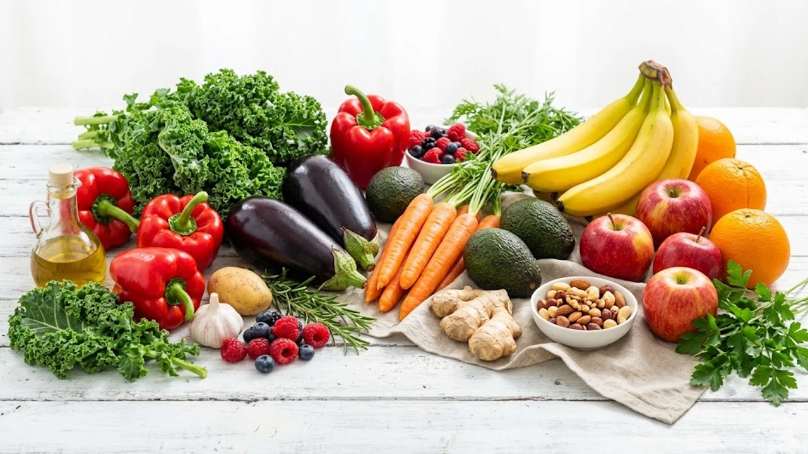

바쁜 점심시간 분식집에서 무심코 고르는 **라면 김밥 식단**은 직장인들의 대표 메뉴지만, 체내 대사 관점에서는 가장 가혹한 조합입니다. 정제 탄수화물과 나트륨이 겹쳐 일어나는 **혈당 스파이크**는 오후 2시만 되면 쏟아지는 극심한 식곤증과 만성 피로의 직접적인 방아쇠 역할을 합니다. 평소 즐겨 찾는 친숙한 분식 조합을 포기하지 않으면서도 혈당 급등 충격을 줄이는 실전 영양 섭취 원칙을 정리했습니다.

## 직장인 단골 메뉴 라면과 김밥, 왜 혈당 폭탄이 될까?

### 탄수화물 중복 섭취가 부르는 급격한 혈당 스파이크
라면 한 그릇에 들어간 순수 탄수화물은 약 70~80g이며, 일반 야채김밥 한 줄 역시 밥공기 기준 한 공기 반에 달하는 약 80~90g의 당질을 품고 있습니다. 

> 두 음식을 한 끼에 전부 비워내면 한 번에 150g이 넘는 고밀도 정제 탄수화물이 위장에 쏟아져 들어옵니다.

수용성 섬유질이나 단백질 완충 장치 없이 유입된 다량의 당질은 소화관에서 순식간에 포도당으로 분해되어 혈관 속으로 쏟아집니다. 췌장은 이 급격한 농도를 맞추기 위해 과도한 인슐린을 한꺼번에 뿜어내고, 혈당 수치는 롤러코스터처럼 가파르게 솟구쳤다가 바닥으로 곤두박질칩니다.

### 튀긴 유탕면과 단무지·밥의 정제 당질 시너지 위험
라면의 면발은 기름에 튀겨낸 유탕면이라 지방과 정제 밀가루가 결합해 인슐린 저항성을 부추깁니다. 여기에 찰기 가득한 흰쌀밥과 설탕·식초에 절인 단무지, 조림 우엉의 단순당이 겹치면 혈당 상승 속도는 한층 날카로워집니다.

- **유탕면의 튀김 기름**: 세포막의 인슐린 감수성을 떨어뜨려 혈당 대사 처리를 지연시킵니다.
- **가공 부재료의 단순당**: 단무지, 조림 우엉, 양념 어묵 속 액상과당이 당질 흡수 속도를 배가합니다.
- **국물 속 과다 나트륨**: 세포 안팎의 삼투압 균형을 흔들어 식욕 중추를 자극하고 탈수를 부릅니다.

### 식후 1시간 뒤 찾아오는 극심한 식곤증과 피로의 원인
점심을 먹고 자리로 돌아와 1시간 남짓 지났을 때 눈꺼풀이 천근만근 무거워지는 현상은 피로 누적이 아니라 생리적 방어 반응입니다. 치솟았던 혈당을 떨어뜨리기 위해 인슐린이 쏟아져 나오면서 일시적으로 저혈당 영역으로 떨어지는 '반동성 저혈당'이 일어난 탓입니다. 뇌로 향하는 포도당 공급선이 일시적으로 교란되면서 두통, 멍한 느낌, 업무 집중도 저하가 연쇄적으로 이어집니다.

## 분식집에서 혈당 충격을 절반으로 줄이는 주문 전략

### 라면 면 절반 남기기 vs 달걀·치즈 단백질 토핑 추가
가장 직관적이고 확실한 타개책은 탄수화물의 총량을 물리적으로 덜어내는 것입니다. 주문할 때 면을 반만 넣어 달라고 미리 부탁하거나, 식사 시 면의 절반을 과감히 덜어내는 습관을 들여야 합니다.

- **달걀 추가 풀기**: 양질의 단백질과 지방을 더해 위장 배출 속도를 늦춥니다.
- **슬라이스 치즈 1장**: 유지방과 단백질이 탄수화물 흡수 속도를 제어하는 완충막 역할을 합니다.
- **국물 떠먹지 않기**: 불필요한 나트륨 섭취를 차단해 식후 부종과 갈증을 막습니다.

### 밥 적고 채소·단백질 꽉 찬 키토·참치김밥 고르는 법
일반 야채김밥보다는 밥알 비중이 낮고 속재료가 묵직한 메뉴를 택하는 편이 안전합니다. 마요네즈 기름기를 가볍게 뺀 참치김밥이나 계란 지단이 밥 대신 꽉 들어찬 키토김밥이 대표적입니다.

> 밥알이 얇게 깔리고 계란, 채소, 참치가 알차게 채워진 김밥을 고르면 순수 탄수화물 섭취량을 40% 넘게 줄일 수 있습니다.

참치 속 단백질과 불포화지방산은 포만감을 서너 시간 이상 안정적으로 유지해 오후 4시경 찾아오는 가짜 배고픔을 잠재웁니다.

### 혈당을 서서히 올리는 식사 순서(단백질·채소→면) 지키기
입에 넣는 순서만 재배열해도 식후 혈당 곡선의 기울기는 완만해집니다. 라면 냄비가 놓이자마자 뜨거운 면발부터 급하게 들이켜는 방식이 혈관에 가장 큰 충격을 줍니다.

1. 김밥 속 단백질(참치, 계란)이나 기본 반찬으로 나오는 콩나물무침을 먼저 천천히 씹어 넘깁니다.
2. 국물에 풀린 계란 토핑을 먼저 건져 먹어 위벽을 코팅합니다.
3. 면발은 맨 마지막에 건져 먹으며 포만감이 올라오는 순간 젓가락을 내려놓습니다.

## 라면·김밥 대체하는 건강한 점심 분식 식단 조합 비교

### 단백질 강화형: 삶은 달걀 2개 + 묵은지 참치김밥
탄수화물 비중을 덜어내고 근육 보호와 포만감을 동시에 챙기는 실전 조합입니다. 분식집 카운터나 편의점에서 파는 삶은 달걀 2개를 본식 전에 먼저 먹어두면 인슐린 급분비를 막는 탄탄한 방어벽이 생깁니다.

여기에 묵은지 참치김밥을 곁들이면 묵은지의 풍부한 섬유질과 젖산균이 느끼함을 덜어주고, 주문 시 "밥 양만 반으로 줄여달라"고 요청하면 군더더기 없는 고단백 분식 식단이 갖춰집니다.

### 섬유질 보충형: 채소 듬뿍 쫄면 대신 메밀국수 + 야채김밥
쫄면의 면발은 전분을 강하게 압착해 뽑아낸 고밀도 탄수화물이며, 새콤달콤한 비빔 양념장에는 정제 설탕이 대량 들어갑니다. 시원한 면 요리가 당긴다면 메밀 함량이 높은 온메밀이나 메밀국수를 택하는 쪽이 혈당 방어에 훨씬 유리합니다.

메밀 속 루틴 성분은 모세혈관을 보호하고 당질 대사 안정을 돕습니다. 여기에 밥 대신 오이와 당근 같은 생채소 비율이 높은 김밥을 맞물리면 장내 당 흡수 속도가 눈에 띄게 늦춰집니다.

### 칼로리와 혈당을 모두 잡는 저당 곤약면·두부면 활용 팁
점심 도시락을 챙기거나 사무실에서 간편 조리를 할 수 있다면 정제 밀가루면을 바꿀 수 있는 선택지가 넓어집니다. 시판 곤약면이나 건두부면, 대두 단백면으로 라면 수프를 끓여내면 1회 탄수화물 섭취량이 5~10g 안팎으로 뚝 떨어집니다.

- **두부면 라면**: 식물성 단백질이 풍부해 식사 후 든든함이 오래 이어집니다.
- **해조류 곤약면**: 팽창성 수용성 섬유질 덕분에 장 건강을 돕고 식후 혈당 스파이크를 원천 봉쇄합니다.

식단 교정과 더불어 근본적인 대사 효율을 끌어올리고 싶다면 [존2 유산소 운동법, 진짜 살 빠질까?](/posts/health/zone-2-cardio-fat-burn-routine-2026/) 글을 참고해 모세혈관과 미토콘드리아 기능을 함께 활성화해 보세요.

## 외식 후 혈당 급등을 막는 10분 즉각 루틴

### 국물 속 나트륨 배출을 돕는 식후 물 섭취 가이드
분식을 다 먹자마자 얼음물을 들이켜면 소화 효소가 희석되어 헛배가 부르고 소화 불량이 일어납니다. 식후 30분 정도 소화 기관이 움직일 시간을 준 다음 미온수를 1~2잔 천천히 끊어 마시는 루틴이 이상적입니다.

오후 간식으로 칼륨이 풍부한 방울토마토나 오이를 가볍게 곁들이면 분식으로 과다 섭취한 나트륨을 소변으로 밀어내며 붓기를 가라앉힙니다.

### 인슐린 저항성을 낮추는 식후 15분 가벼운 산책법
식사 직후 의자에 등을 기대고 모니터를 바라보면 혈액 속 포도당이 근육으로 들어가지 못한 채 중성지방으로 쌓입니다. 숟가락을 놓자마자 곧장 회사 인근을 15분 정도 빠른 걸음으로 거닐어야 합니다.

> 허벅지와 엉덩이 같은 대근육을 가볍게 움직여주면 인슐린 신호 체계와 무관하게 근육 속 수송체(GLUT4)가 활성화되어 핏속 포도당을 바로 흡수하므로 식후 혈당 최고치를 20~30% 낮춥니다.

실내에 머물러야 한다면 계단을 천천히 오르내리거나 자리에 서서 뒤꿈치를 올렸다 내리는 종아리 까치발 운동을 3분간 반복해도 비슷한 효과를 냅니다.

### 연속혈당측정기(CGM)로 확인하는 나만의 안전한 분식 섭취선
사람마다 췌장의 인슐린 반응 속도와 장내 미생물 환경이 달라 특정 음식에 대한 혈당 반응은 제각각입니다. 누군가는 김밥 반 줄만 먹어도 혈당이 180mg/dL을 뚫고 올라가는 반면, 누군가는 라면에 달걀과 치즈를 얹어 먹었을 때 안정적인 수치를 유지하기도 합니다.

팔에 부착하는 연속혈당측정기를 열흘 남짓 착용해 보면 내가 즐겨 먹는 분식 조합이 체내에서 어떤 파동을 만드는지 스마트폰 그래프로 즉각 확인할 수 있습니다. 직접 눈으로 수치 급등을 확인하는 것만큼 식단을 빠르게 바로잡는 확실한 동기부여는 없습니다.

[혈당측정기 쿠팡에서 보기](https://www.coupang.com/np/search?q=%EC%97%B0%EC%86%8D%ED%98%88%EB%8B%B9%EC%B8%A1%EC%A0%95%EA%B8%B0&sourceType=affiliate&trackingCode=AF8691300)

#라면김밥식단 #혈당스파이크 #직장인점심 #분식혈당관리 #식후식곤증 #키토김밥 #당뇨식단관리