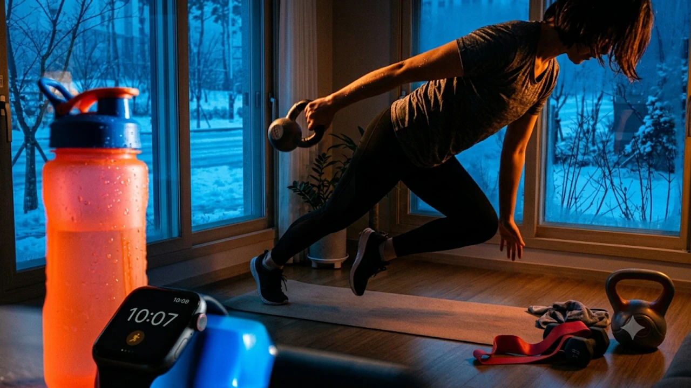

기온이 영하권으로 뚝 떨어지는 11월 말이면 야외 러닝이나 산책이 망설여지기 마련입니다. 한파와 찬 바람을 피해 체지방을 효율적으로 태우려면 검증된 **겨울 실내운동 추천** 루틴으로 방향을 전환해야 합니다. 층간소음 걱정 없는 홈트레이닝부터 헬스장 유산소 기구 활용법까지, 실제 체중 감량으로 이어지는 핵심 운동 4가지를 정리했습니다.

## 영하권 한파 시작, 왜 겨울 실내운동이 필수일까?

### 기온 급강하 시 야외 러닝이 심혈관에 주는 부담
갑작스러운 추위에 노출되면 우리 몸은 체온을 빼앗기지 않으려고 말초 혈관을 급격히 수축합니다. 이 상태에서 준비운동 없이 야외 달리기 같은 고강도 유산소를 시작하면 혈압이 순간적으로 치솟아 심장에 무리가 갑니다. 실제로 겨울철 이른 아침 야외 운동 중 어지럼증이나 흉통을 호소하는 사례가 적지 않으므로, 기온이 낮은 날에는 실내로 동선을 옮기는 편이 안전합니다.

### 기초대사량 상승기(11월~2월)를 활용한 체지방 감량 원리
추운 계절은 오히려 다이어트에 유리한 시기입니다. 외부 온도가 낮아지면 인체는 체온 유지를 위해 스스로 열을 만들어내며 평소보다 더 많은 에너지를 소모하기 때문입니다. 실내에서 적정 온도를 유지한 채 꾸준히 움직이면 기초대사량 상승 효과와 운동 에너지 소모가 맞물려 여름보다 체지방 연소 효율이 높아집니다.

> **핵심 포인트:** 추울수록 활동량이 줄어 살이 찌기 쉽지만, 주 3~4회 실내 운동만 유지해도 계절성 기초대사량 증가 덕분에 감량 속도가 빨라집니다.

## 층간소음 없이 칼로리 태우는 겨울 실내운동 추천 4가지

### 슬로우 버피 & 인치웜: 관절 충격 줄인 전신 유산소
아파트 거실에서 점프 동작이 포함된 일반 버피테스트를 하면 아랫집에 큰 소음이 전달됩니다. 점프 구간을 빼고 한 발씩 뒤로 뻗었다가 천천히 일어나는 **슬로우 버피**나, 선 자세에서 손을 바닥에 짚고 엎드렸다가 돌아오는 **인치웜**으로 대체해 보세요. 15회씩 4세트만 반복해도 전신 근육이 동시에 개입하면서 숨이 턱 끝까지 차오르는 유산소 효과를 얻을 수 있습니다.

### 스텝박스 오르내리기: 아파트 환경에 맞춘 저소음 고효율 루틴
두꺼운 요가매트 위에 15~20cm 높이의 스텝박스를 올려두고 리듬감 있게 오르내리는 동작은 하체 근력과 심폐 지구력을 동시에 자극합니다. 발바닥 전체로 박스를 딛고 무릎이 안쪽으로 모이지 않게 신경 쓰면 발목이나 무릎 충격 없이 30분 내내 일정한 심박수를 유지할 수 있습니다. TV나 유튜브 영상을 보면서 지루하지 않게 지속하기 좋은 대표적인 **겨울 실내운동 추천** 종목입니다.

### 케틀벨 스윙: 짧은 시간에 심박수를 끌어올리는 근력·유산소 결합
좁은 공간에서 15분 내외로 땀을 흠뻑 빼고 싶다면 케틀벨 스윙이 제격입니다. 팔 힘이 아니라 엉덩이를 뒤로 뺐다가 골반을 앞으로 강하게 밀어내는 힘(힙 힌지)으로 중량을 들어 올리는 것이 핵심입니다. 척추기립근과 둔근, 햄스트링 같은 후면 사슬 근육을 집중적으로 쓰기 때문에 근손실을 막으면서 체지방을 태우는 데 유리합니다.

### 실내 사이클 인터벌: 하체 근력 유지와 내장지방 연소 동시 공략
헬스장 고정식 자전거나 가정용 실내 사이클을 탄다면 일정한 속도로 페달을 밟기보다 강약을 조절하는 방식이 훨씬 효과적입니다. 
- **워밍업 (5분):** 가벼운 저항으로 분당 60~70회(RPM) 속도로 천천히 페달링합니다.
- **인터벌 구간 (15분):** 1분간 저항을 높여 전력으로 달린 뒤, 2분간 저항을 낮춰 천천히 호흡을 고르는 패턴을 5회 반복합니다.
- **쿨다운 (5분):** 저항을 최대로 풀고 심박수가 정상 범위로 내려올 때까지 가볍게 마무리합니다.

## 야외 운동 vs 실내 운동, 겨울철 다이어트 효율 비교

### 운동별 30분당 예상 소모 칼로리와 심박수 구간 비교
체중 70kg 성인 기준으로 30분간 운동했을 때 실내 종목들도 야외 러닝에 뒤지지 않는 에너지 소모량을 보여줍니다.

| 운동 종목 | 운동 강도 (심박수 구간) | 30분 예상 소모량 | 관절 부담 및 소음 |
| :--- | :--- | :--- | :--- |
| **야외 러닝 (시속 8km)** | Zone 3~4 (중고강도) | 약 280~310 kcal | 무릎 충격 있음 / 소음 무관 |
| **케틀벨 스윙** | Zone 4 (고강도) | 약 260~300 kcal | 허리 자세 주의 / 저소음 |
| **실내 사이클 인터벌** | Zone 3~4 (중고강도) | 약 250~290 kcal | 관절 부담 매우 적음 / 무소음 |
| **스텝박스 오르내리기** | Zone 2~3 (저중강도) | 약 200~240 kcal | 충격 적음 / 매트 사용 시 저소음 |

체지방 연소에 최적화된 심박수 설정법이 궁금하다면 [존2 유산소 운동법, 진짜 살 빠질까?](/posts/health/zone-2-cardio-fat-burn-routine-2026/) 글을 함께 참고해 본인에게 맞는 강도를 계산해 보세요.

### 내 체력 수준과 주거 환경에 맞는 최적의 종목 선택 기준
운동 초보자이거나 체중이 많이 나가 무릎 통증이 걱정된다면 체중 부하가 적은 **실내 사이클**부터 시작하는 편이 안전합니다. 반대로 별도 기구를 들여놓을 공간이 부족한 원룸이나 아파트 거주자라면 **요가매트와 스텝박스, 또는 케틀벨 1개**만 구비해도 충분한 운동 강도를 뽑아낼 수 있습니다.

## 작심삼일 막는 겨울철 4주 실내운동 주간 루틴표

### 주 4회 기준 요일별 유산소·무산소 분할 스케줄
매일 같은 동작만 반복하면 쉽게 질리고 특정 부위에 피로가 쌓입니다. 주 4회 기준으로 유산소와 근력성 전신 운동을 번갈아 배치해 보세요.
- **월요일 (전신 유산소):** 슬로우 버피 15회 + 인치웜 10회 × 4세트 (총 25분)
- **수요일 (저강도 지속주):** 스텝박스 오르내리기 30분 연속 진행
- **금요일 (근력·유산소 결합):** 케틀벨 스윙 20회 × 5세트 + 플랭크 1분 × 3세트
- **일요일 (고강도 인터벌):** 실내 사이클 인터벌 25분 + 하체 스트레칭 10분

### 실내 난방 건조함 대비 수분 섭취 및 준비운동 가이드
겨울철 실내는 난방 기구 가동으로 습도가 매우 낮아 땀이 증발하는 속도가 빠릅니다. 목이 마르지 않더라도 운동 전후로 미지근한 물을 한 컵씩 마셔 탈수를 예방해야 합니다. 또한 기온이 낮은 실내에서 바로 본 운동에 들어가면 근육과 인대가 뻣뻣해 부상 위험이 커지므로, 어깨 돌리기와 고관절 스트레칭으로 최소 5분 이상 체온을 높인 뒤 시작하세요.

집에서도 층간소음 걱정 없이 간편하게 유산소 운동량을 늘리고 싶다면 미끄럼 방지 패드가 적용된 스텝박스나 가정용 실내 사이클을 활용해 보는 것도 좋은 방법입니다. [관련상품 쿠팡에서 보기](https://www.coupang.com/np/search?q=%EC%8A%A4%ED%85%9D%EB%B0%95%EC%8A%A4%20%EC%8B%A4%EB%82%B4%EC%82%AC%EC%9D%B4%ED%81%B4&sourceType=affiliate&trackingCode=AF8691300)

#겨울실내운동추천 #실내유산소운동 #홈트레이닝루틴 #층간소음없는운동 #겨울다이어트 #스텝박스운동 #케틀벨스윙 #실내사이클인터벌