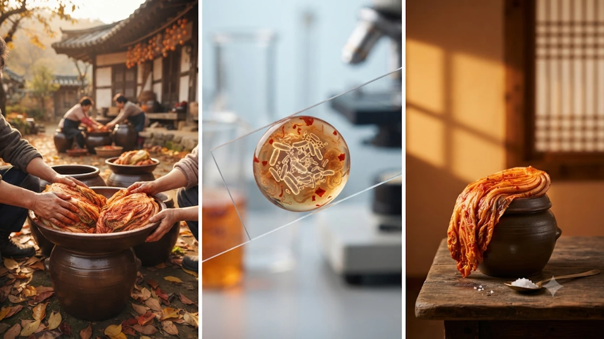

찬 바람이 불어오는 **김장철 김치유산균**의 계절, 2026년 11월의 밥상 위에서도 젖산 발효의 호흡이 이어진다. 한겨울 풀잎 하나 귀하던 시절 생존을 걸고 빚어낸 발효의 기록은, 가공식품과 좌식 생활에 지친 현대인의 장 생태계를 다시 세우는 현실적 무기다. 시대를 건너온 발효 서사와 몸속 미생물이 엮어내는 실전 효능을 짚어본다.

## 김장 문화의 인문학적 기원과 공동체 정신

### 조선시대 침채(沈菜)에서 시작된 겨울나기 지혜
김치는 한자어 '침채(沈菜)'에서 뿌리를 내렸으며, 영하의 날씨에 신선 채소가 말라붙던 시절 소금물로 숨을 죽여 영양을 붙잡아 두려던 절박한 고안에서 출발했다. 이규보의 『동국이상국집』에 무 절임이 등장하고, 조선 후기 『산림경제』와 『증보산림경제』를 거치며 고춧가루와 젓갈이 어우러진 오늘날의 조리 문법이 자리를 잡았다. 냉장고 없던 시절 옹기를 땅속에 묻어 지열로 온도를 붙잡아 둔 방식은 자연의 리듬을 거스르지 않으면서도 계절의 한계를 넘은 생활 공학이었다.

### 품앗이에서 유네스코 인류무형문화유산까지의 변천사
배추 수백 포기를 절이고 양념을 치대는 일은 한 집안의 팔힘만으로 감당하기 버거웠기에, 이웃들이 품을 보태는 '품앗이'가 자연스럽게 자리 잡았다. 양념통을 앞에 두고 수육 한 점을 나누며 세대 간 손맛과 삶의 고충을 건네던 풍경은 마을의 결속을 다지는 사회적 의식이었다. 이러한 공동체적 협력과 세대 계승의 가치를 인정받아 김장 문화는 2013년 유네스코 인류무형문화유산에 등재되었다.

> "김장은 겨울 찬거리를 채우는 노동이 아니라, 계절의 가혹함에 맞서 이웃과 체온을 나누던 공동체의 의식이다."

### 현대 핵가족 시대에 변화하는 2026 김장 트렌드
1인 가구와 맞벌이 가정이 늘어나면서 마당에 가마솥을 걸고 배추 수십 포기를 쌓아 올리던 풍경은 낯설어졌다. 절임배추와 손질 양념을 조합해 꼭 필요한 만큼만 버무리는 방식이나, 지역 농가 체험장에서 한 상자 단위로 담가 오는 실속형 김장이 자리 잡았다. 겉모습은 가벼워졌지만 찬 바람 불 때 가족의 건강을 챙기려는 마음은 그대로 이어진다. 한국 사회와 문화의 흐름을 더 깊이 들여다보려면 [인문 전체 글 보기](/posts/humanities/)에서 다른 글들도 함께 살펴보자.

## 김치유산균이 주목받는 과학적·인문학적 이유

### 일반 유산균과 식물성 김치유산균의 결정적 차이
우유 기반 동물성 유산균과 달리 김치유산균은 높은 염도와 마늘·생강·고춧가루의 매운 기운을 견뎌낸 강인한 생존력을 지닌다. 위산과 담즙산이라는 까다로운 관문을 통과해 장까지 살아남는 비율이 높으며, 대표적으로 **류코노스톡(Leuconostoc)**과 **락토바실러스 플란타룸(Lactobacillus plantarum)**이 손꼽힌다.

- **동물성 유산균**: 풍부한 유당과 단백질 환경에서 자라 온순하지만, 산도가 높은 위장 통과 과정에서 개체 수가 줄어들기 쉽다.
- **식물성 김치유산균**: 항균 성분이 강한 향신료와 소금기 속에서 단련되어, 장내 환경에서도 버텨내는 힘이 뛰어나다.

### 장내 미생물 생태계와 정신 건강(장-뇌 축)의 연결고리
장내 미생물 군집과 중추신경계가 미주신경과 대사산물을 통해 신호를 주고받는 '장-뇌 축(Gut-Brain Axis)' 연구는 몸과 마음의 경계를 허물고 있다. 체내 세로토닌의 상당 부분이 장 점막과 관련 경로에서 만들어지므로, 장내 균형이 흐트러지면 기분 변동이나 피로감과도 맞물릴 수 있다. 속이 편안해야 마음도 가라앉는다는 오래된 경험칙이 현대 신경면역학의 언어와 만나고 있다.

### 발효 온도와 숙성 기간에 따른 유산균 활성도 변화
김치유산균은 담근 첫날보다 저온 숙성 구간에서 본격적으로 불어난다. 담근 직후 1g당 수만 마리 선이던 균 수는 0~4℃ 안팎의 저온에서 발효가 진행되며 2~3주 차에 1g당 수억 마리 규모로 치솟는 양상을 보인다. 톡 쏘는 시원한 산미를 만드는 류코노스톡 계열은 저온에서 더 활기를 띠므로, 실온에 오래 방치해 급격히 익히기보다 서늘한 온도에서 천천히 숙성시키는 편이 유리하다.

## 2026 김장철 김치유산균의 진짜 효능 3가지

### 면역 세포 활성화와 환절기 바이러스 방어 효과
면역 세포의 상당수가 포진한 장 점막은 외부 유해 인자와 마주하는 최전선이다. 발효 과정에서 형성되는 락토바실러스 계열 유산균과 발효 대사산물은 장내 유해균 증식을 누르고, NK세포나 대식세포 같은 선천면역 반응의 균형을 돕는다. 일교차가 커지고 실내 난방이 시작되는 늦가을·겨울철에 잘 익은 김치를 꾸준히 곁들이면 계절 변화에 대비한 기초 컨디션 관리에 보탬이 된다.

### 콜레스테롤 수치 개선 및 대사 증후군 예방
배추와 무에 담긴 식이섬유, 마늘의 알리신, 고추의 캡사이신은 유산균 발효 산물과 어우러져 지질 대사와 혈당 흐름에 긍정적인 영향을 준다. 유산균이 장내에서 담즙산 및 콜레스테롤 재흡수를 일부 억제해 체외 배출을 돕는 기전은 기름진 식사가 잦은 현대인에게 특히 반가운 대목이다. 정제 탄수화물 위주의 식단 대신 채소 발효 반찬을 곁들이는 습관은 대사 리듬을 정돈하는 데 힘을 보탠다.

### 장 점막 보호와 만성 염증 완화 메커니즘
장 상피세포 간 치밀결합(tight junction)이 느슨해지면 염증 유발 물질이 체내로 스며들기 쉬워진다. 김치유산균이 만들어내는 단쇄지방산(SCFA)은 장 상피세포의 에너지원이자 장벽을 지탱하는 핵심 물질로 꼽힌다. 매일 식탁 위에서 적정량의 김치를 섭취해 장내 환경을 정돈하면 저강도 만성 염증을 가라앉히는 데 도움이 된다.

## 유산균을 극대화하는 2026 김장 및 보관 실전 가이드

### 천일염과 젓갈 비율에 따른 발효 속도 조절법
절임의 성패는 간수를 뺀 천일염으로 배추 숨을 고르게 죽이는 데서 갈린다. 소금기가 너무 세면 유산균 번식이 더뎌지고, 반대로 너무 약하면 잡균이 끼어 조직이 쉽게 물러진다. 젓갈은 감칠맛과 아미노산을 더해 발효를 북돋우지만, 많이 넣을수록 신맛이 빨리 올라오므로 봄·여름까지 길게 두고 먹을 김장김치라면 평소보다 젓갈 양을 20% 정도 줄여 담그는 편이 낫다.

### 김치냉장고 적정 온도 설정과 산패 방지 노하우
발효가 절정에 이른 시점을 길게 붙잡으려면 산소 접촉과 온도 요동을 줄여야 한다.

1. **용기 여유 공간 확보**: 발효 가스로 국물이 넘치지 않도록 통의 70~80%까지만 채운다.
2. **공기 차단막 만들기**: 겉잎 우거지나 위생 비닐로 윗면을 덮어 공기와 닿아 하얀 효모막(골마지)이 생기는 현상을 줄인다.
3. **숙성·보관 모드 전환**: 담근 직후 실온에서 반나절가량 둔 뒤 김치냉장고 숙성 모드로 익히고, 원하는 맛이 들면 영하 1℃~0℃ 수준의 저장 모드로 낮춰 과숙성을 늦춘다.

### 유산균 파괴 없이 섭취하는 최적의 조리 및 식습관
살아있는 유산균은 높은 열에 약해 60℃ 이상으로 끓이거나 볶으면 대부분 사멸한다. 찌개나 볶음밥으로 익혀 먹어도 발효 균체 성분의 이점은 남지만, 살아있는 균의 활성을 기대한다면 가열하지 않은 생김치로 먹는 편이 낫다. 염분 섭취가 신경 쓰일 때는 물에 헹궈 맛을 해치기보다 칼륨이 풍부한 고구마, 바나나, 생채소와 함께 먹어 나트륨 배출 균형을 맞추는 방법이 현실적이다.

[김장용 국산 천일염 및 김치통 쿠팡에서 보기](https://www.coupang.com/np/search?q=%EA%B9%80%EC%9E%A5%EC%9A%A9+%EC%B2%9C%EC%9D%BC%EC%97%BC+%EA%B9%80%EC%B9%98%ED%86%B5&sourceType=affiliate&trackingCode=AF8691300)

#김장철 #김치유산균 #식물성유산균 #발효과학 #장내미생물 #면역력관리 #김장보관법 #2026김장 #인문학적식탁