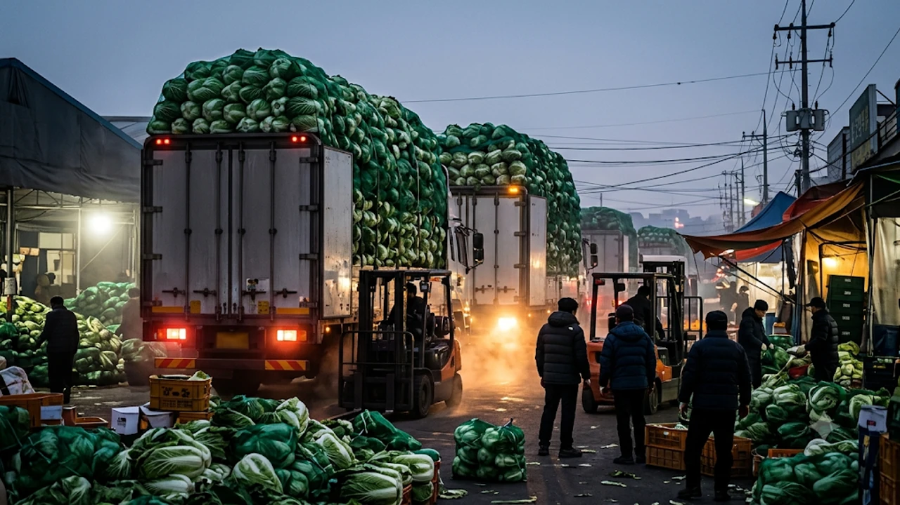

2026년 11월 하순, 본격적인 김장 대목에 접어들면서 **2026 김장철 배추값** 흐름과 절임배추 수급 상황을 살피는 가계가 늘고 있습니다. 가을철 기상 변동과 유통 비용 상승이 맞물려 장바구니 물가 부담이 커졌지만, 김장은 여전히 한국인의 겨울 식탁과 공동체 기억을 지탱하는 핵심 의례입니다. 배추 시세 변동의 실질적 배경부터 유네스코 인류무형문화유산에 등재된 김장 문화의 인문학적 의미, 가구별 맞춤 준비 전략까지 차근차근 짚어보겠습니다.

## 2026년 11월 김장철 배추·양념값 급등 원인과 수급 전망

### 이상기후와 가을배추 작황 부진이 빚은 가격 변동성
가을배추는 밭에 모종을 옮겨 심는 8월 말부터 9월 초 사이의 기온과 강수량에 한 해 작황이 좌우됩니다. 초가을까지 꺾이지 않은 늦더위와 국지성 호우는 배추 뿌리가 땅에 깊이 자리 잡는 것을 막고 무름병을 유발해 초기 출하 물량을 줄이는 직접적인 요인으로 작용합니다. 여기에 산지 작업 인건비와 물류 운송비 인상분까지 도매 시세에 반영되면서 소비자가 마트 매대에서 체감하는 장바구니 가격 상승폭이 한층 가팔라졌습니다.

### 대형마트 할인대전과 정부 비축 물량 방출 효과
농림축산식품부와 대형 유통업체는 김장 성수기 체감 물가를 낮추기 위해 정부 비축 물량을 시장에 풀고 농축산물 할인지원 쿠폰을 연계해 공급합니다. 대형마트와 농협 하나로마트 역시 11월 중순부터 12월 초까지 산지 계약 재배 물량을 집중적으로 풀어 할인전을 엽니다. 소매점별 행사 주기와 정부 할인 지원 한도를 먼저 확인해 두면 도매가 오름세 속에서도 실제 결제 금액을 크게 아낄 수 있습니다.

### 알뜰한 김장을 위한 시기별·품목별 구매 전략
- **배추와 무**: 충청·호남권 가을배추 출하가 본격화되는 11월 넷째 주 이후 대형마트와 농협의 주말 특가 행사를 노리는 편이 유리합니다.
- **고춧가루와 마늘**: 햇고추 건조가 끝난 직후 산지 직거래 장터나 지역 로컬푸드 매장을 이용하면 중간 유통 단계를 줄여 신선한 재료를 구할 수 있습니다.
- **천일염과 젓갈**: 보관이 길게 가능한 부재료는 김장 대목 직전보다 한두 주 앞서 장만해 두어야 단기 품절과 급등세를 피할 수 있습니다.

## 유네스코 인류무형문화유산 '김장 문화'의 인문학적 가치

### 단순한 저장 음식을 넘어 공동체 품앗이로 이어진 역사
> "김장은 겨울철 푸른 채소를 구하기 어려웠던 한반도의 기후에 적응하며 일궈낸 생존의 지혜이자, 이웃과 일손을 맞대며 정을 나누던 공동체 연대의 기록입니다."

2013년 유네스코 인류무형문화유산으로 등재된 한국의 김장 문화는 특정 양념 배합법이 아니라 **세대를 건너 이어지는 나눔과 협업의 정신** 자체에 본질이 있습니다. 예전 마을 골목마다 모여 수십 포기의 배추를 함께 절이고 속을 채우던 품앗이는 고된 겨울 채비를 잔칫날로 바꾸었으며, 갓 버무린 김치를 옆집과 나누는 풍습은 동네 공동체를 단단하게 묶는 끈이 되었습니다. 우리 전통 문화유산의 보존과 현대적 해석에 관한 더 깊은 이야기는 [인문 전체 글 보기](/posts/humanities/)에서도 이어서 읽을 수 있습니다.

### 1인 가구·핵가족 시대에 달라진 현대적 김장 풍경
요즘에는 대가족이 마당에 모여 대량으로 김치를 담그는 대신, 1인 가구와 맞벌이 부부를 중심으로 **소포장 절임배추와 시판 양념 속을 결합한 '간편 김장'**이 자리 잡았습니다. 부모와 자녀 세대가 주말 하루 모여 다섯 포기에서 열 포기 정도만 함께 버무린 뒤 각자의 냉장고로 나누어 담는 모습은 규모만 줄었을 뿐 가족 간 유대를 다지는 오늘날의 김장 풍경입니다.

## 사먹는 포장김치 vs 직접 담그는 김장, 비용과 만족도 비교

### 배추 20포기 기준 직접 김장 시 예상 소요 비용 분석
4인 가족 기준으로 배추 20포기를 직접 담글 때는 절임배추 구매 금액이 전체 재료비의 절반 가까이를 차지합니다. 여기에 고춧가루, 깐마늘, 생강, 새우젓, 멸치액젓, 무, 쪽파, 생굴 등 부재료 값과 택배비까지 더하면 초기 지출 규모가 만만치 않습니다. 또한 배추 물기를 빼고 양념을 치대어 통에 담기까지 꼬박 하루 이상의 시간과 체력이 들어간다는 점도 함께 따져보아야 합니다.

### 시판 포장김치 정기구독 및 절임배추 활용 시 가성비 비교
- **직접 김장(절임배추 활용)**: 배추 산지와 염도를 직접 고를 수 있어 집안 입맛에 맞춘 깊은 발효미를 낼 수 있으며, 김치 소비량이 많은 대가족일수록 장기적인 식비 절감 효과가 뚜렷합니다.
- **시판 포장김치(정기구독 포함)**: 별도의 조리 노동이나 대용량 보관 공간이 필요 없고 원하는 주기에 맞춰 소량씩 받아볼 수 있어 김치를 조금씩 먹는 1~2인 가구에 알맞습니다.

### 가구 형태와 라이프스타일에 따른 최적의 선택 기준
김치찌개나 김치볶음밥처럼 잘 익은 묵은지를 활용한 집밥을 자주 차리는 3인 이상 가구라면 절임배추에 양념을 직접 버무리는 방식이 맛과 경제성 면에서 만족도가 높습니다. 반대로 외식 비중이 높고 김치냉장고 여유 칸이 넉넉하지 않은 가구라면 무리하게 대량 김장을 치르기보다 소용량 포장김치를 주기적으로 주문하는 편이 음식물 쓰레기와 지출 낭비를 함께 줄이는 현실적인 대안입니다.

## 실패 없는 2026 김장 준비를 위한 단계별 실전 체크리스트

### 좋은 절임배추 선별법과 고춧가루·젓갈 비율 황금 공식
잘 절여진 배추는 겉잎이 지나치게 두껍지 않고 노란 속잎이 촘촘히 차 있으며, 흰 줄기 부분을 손으로 살짝 구부렸을 때 뚝 부러지지 않고 부드럽게 휘어집니다. 택배로 받은 직후에는 비닐을 열어 채반에 밭쳐 물기를 충분히 빼주되, 간이 세다고 느껴질 때만 찬물에 가볍게 한 번 흔들어 씻어야 아삭한 식감이 무너지지 않습니다. 양념 소를 버무릴 때는 찹쌀풀을 너무 묽지 않게 쑤어 식힌 뒤 멸치액젓과 새우젓을 1:1 비율로 섞으면 감칠맛과 깔끔한 뒷맛의 균형이 잘 맞습니다.

### 김치냉장고 온도 설정과 아삭함을 유지하는 보관 노하우
버무린 김치는 바깥 공기와의 접촉을 최대한 차단해야 군내 없이 오래 보관할 수 있습니다. 김치통에 포기째 차곡차곡 눌러 담아 내부 공기를 뺀 뒤 겉잎 우거지나 김장용 위생 비닐로 윗면을 빈틈없이 덮어 산패를 막습니다. 서늘한 실온에서 반나절에서 하루 정도 두어 유산균 발효의 물꼬를 튼 다음, 김치냉장고의 **표준 보관 모드(영하 1도 안팎)**에 안착시키면 이듬해 봄까지 아삭하고 시원한 김장김치를 맛볼 수 있습니다. 올해 김장을 더욱 깔끔하고 위생적으로 보관할 수 있는 전용 용품을 찾고 있다면 [김장용품 김치통 쿠팡에서 보기](https://www.coupang.com/np/search?q=%EA%B9%80%EC%9E%A5%EC%9A%A9%ED%92%88%20%EA%B9%80%EC%B9%98%ED%86%B5&sourceType=affiliate&trackingCode=AF8691300)에서 규격별 구성을 확인해 보세요.

#2026김장철배추값 #김장비용 #절임배추추천 #김장문화 #유네스코무형문화유산 #포장김치비교 #김치냉장고보관법 #김장준비체크리스트