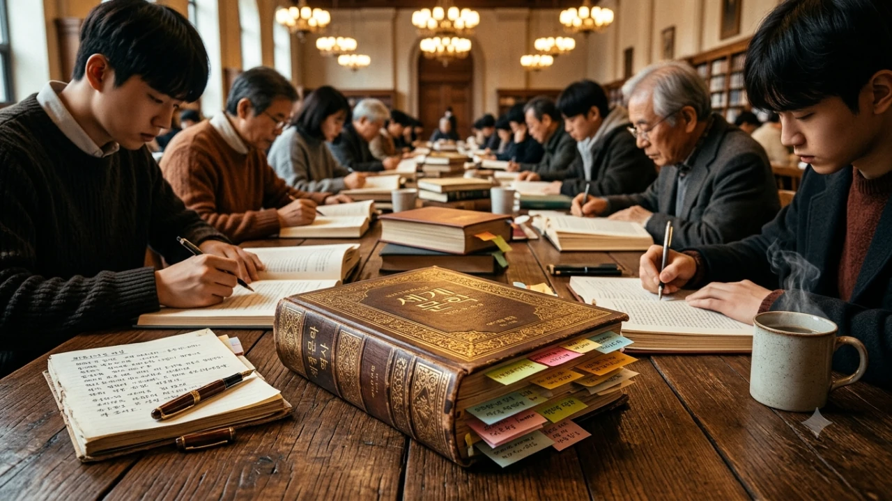

2026년 11월 말, 한 해의 끝자락에 접어들면서 서점가와 독서 커뮤니티에 **2026 연말 독서** 바람이 거세게 불고 있습니다. 15초짜리 숏폼 영상과 자극적인 알고리즘 피드에 피로감을 느낀 2030 세대가 두꺼운 고전 문학과 필사 노트를 다시 집어 들며 깊이 있는 사유의 시간을 찾는 움직임입니다. 2026 연말 독서 열풍의 구체적인 배경부터 독서 모임 선택 기준, 한 달 완독 실전 루틴까지 핵심만 정리했습니다.

## 2026년 11월 말 다시 주목받는 고전 독서 트렌드 배경

### 숏폼 피로감과 깊이 있는 사유에 대한 갈증
손가락 하나로 수십 개의 짧은 영상을 넘기던 독자들이 스스로 질문하고 생각하는 힘을 되찾기 위해 고전으로 돌아오고 있습니다. 생성형 AI가 버튼 한 번으로 책의 핵심 줄거리를 요약해 주는 시대일수록, 문장 하나를 오래 붙잡고 행간의 맥락을 곱씹는 느린 읽기가 오히려 희소한 지적 경험이 되었기 때문입니다. 알고리즘 추천에서 벗어나 주체적인 사고력을 회복하려는 흐름은 [제로 클릭 2026, 내 자유의지는 진짜 살아있을까?](/posts/humanities/zero-click-era-autonomy-2026/)에서 다룬 주체성 찾기 움직임과도 맞닿아 있습니다.

### 연말 회고 시즌과 맞물린 인문 도서 수요 증가
11월 말은 지나온 1년의 선택을 돌아보고 새해의 방향을 가늠하는 시기입니다. 실용서나 트렌드 서적이 당장 써먹을 기술과 요령을 알려준다면, 동서양의 고전은 인간 본성과 삶의 기준에 관한 근원적인 질문을 던집니다. 퇴근 후 스마트폰 알림을 끄고 조용히 책장을 넘기며 내면의 목소리를 정리하려는 직장인과 대학생이 늘어나면서 연말 인문 서적 구매가 활발히 이어집니다.

> "고전은 시대가 바뀌어도 인간이 반복해서 마주하는 갈등과 불안 앞에서 가장 단단한 기준점을 세워주는 나침반이다."

### 오프라인 필사 모임과 독서 기록 문화 확산
눈으로만 빠르게 훑는 독서에서 벗어나 마음에 닿은 구절을 손글씨로 직접 옮겨 적는 **필사 문화**가 강세를 보입니다. 주말마다 독립서점이나 조용한 북카페에 모여 각자 고른 고전 문장을 필사하고 짧은 감상을 나누는 소모임이 활발히 열립니다. 종이 위에 만년필이나 연필을 눌러 쓰며 문장의 호흡을 천천히 따라가는 아날로그 감성이 연말 분위기와 어우러져 깊은 몰입감을 선사합니다.

## 2026 하반기 독자들이 선택한 인문·고전 분야 특징

### 철학·윤리학 입문서와 현대적 재해석 도서 비교
2026년 하반기 서점가에서는 학술 용어가 가득한 직역본보다 현대인의 일상에 맞춰 풀어낸 철학·윤리학 도서가 독자들의 선택을 받고 있습니다.

- **전통 원전 번역서**: 저자 고유의 문체와 사상의 원형을 온전히 만날 수 있으나, 시대적 배경지식이 없으면 초반 50쪽을 넘기기가 쉽지 않습니다.
- **현대적 재해석 입문서**: 스토아 철학이나 실존주의 사상을 오늘날 직장인의 인간관계, 번아웃 극복과 연결해 풀어내어 고전 초심자도 막힘없이 읽어 내려갈 수 있습니다.

### 완독 부담을 줄인 문고판·해설판 출간 흐름
두꺼운 벽돌책의 무게에 눌려 중도 포기하는 독자를 위해 한 손에 쏙 들어오는 **문고판 시리즈**와 친절한 각주가 달린 **해설판** 출간이 잇따르고 있습니다. 출퇴근길 지하철에서 가볍게 꺼내 읽을 수 있는 판형과 200쪽 안팎의 부담 없는 분량은 바쁜 현대인이 고전 완독의 성취감을 경험하게 만드는 일등 공신입니다. 도서 구매 지원 혜택을 활용할 수 있는 [청년문화예술패스 도서 확대! 바뀐 3가지](/posts/humanities/youth-culture-pass-book-expansion-2026/) 정보를 참고하면 연말 책값 부담도 한결 덜 수 있습니다.

## 2030 세대 독서 모임 참여 방식과 장단점 분석

### 온라인 비대면 독서 인증 커뮤니티의 장단점
메신저 오픈채팅방이나 독서 기록 앱에 매일 읽은 페이지와 밑줄 친 문장을 사진으로 올려 인증하는 방식입니다.

- **장점**: 거주지나 야근 일정에 구애받지 않고 참여할 수 있으며, 다른 멤버들의 실시간 인증 알림이 흐트러지기 쉬운 독서 습관을 잡아줍니다.
- **단점**: 매일 분량을 채우는 데 급급해질 경우 책의 맥락을 깊이 파고들거나 타인의 시선과 부딪히는 토론 경험을 얻기 어렵습니다.

### 오프라인 소규모 인문 토론 모임의 장단점
격주 또는 월 1회 지정된 서점이나 라운지에 모여 한 권의 책을 두고 발제문 중심으로 대화를 나누는 방식입니다.

- **장점**: 같은 문장을 읽고도 전혀 다른 해석을 내놓는 참여자들과 대화하며 혼자 읽을 때 놓쳤던 입체적인 시각을 얻을 수 있습니다.
- **단점**: 모임 장소까지 이동하는 시간과 공간 대여비 부담이 따르며, 모임 날까지 책을 끝내야 한다는 압박감이 작용합니다.

### 개인 취향에 맞는 독서 모임 선택 기준
아직 매일 책상 앞에 앉는 루틴이 자리 잡지 않았다면 하루 10쪽씩 인증하는 온라인 커뮤니티로 시작해 읽기 근육부터 기르는 편이 현실적입니다. 이미 혼자서도 한 달에 두세 권 이상 완독하는 독자라면 오프라인 토론 모임에 합류해 자신의 생각을 언어로 정리하고 타인과 교류하는 경험을 쌓는 쪽이 훨씬 유익합니다.

## 연말 한 달 동안 고전 한 권 완독하는 실전 루틴

### 하루 15분 분량 배분과 핵심 문장 발췌법
남은 연말 동안 고전 한 권을 끝까지 완주하려면 의욕만 앞세우기보다 매일 지킬 수 있는 물리적 분량을 정해두는 편이 효과적입니다.

- **전체 쪽수 나누기**: 300쪽 분량의 고전이라면 하루 10쪽씩, 30일 일정으로 쪼개어 잠들기 전 15분 등 고정된 시간대에 펼칩니다.
- **인덱스 플래그 활용**: 읽다가 생각이 멈추거나 밑줄 긋고 싶은 대목이 나오면 반투명 인덱스 플래그만 붙여두고 책장을 넘겨 읽기의 호흡이 끊기지 않게 유지합니다.

### 완독 후 사유를 확장하는 독서 노트 작성 단계
책을 다 읽은 뒤에는 인덱스 플래그가 붙은 페이지만 다시 펼쳐 독서 노트에 옮겨 적습니다. 원문 구절을 그대로 필사한 다음, 그 아래에 **왜 이 문장이 지금 내 상황에 와닿았는지** 세 줄 이내로 짧은 메모를 남깁니다. 이 기록이 차곡차곡 쌓이면 연말을 마무리하는 가장 밀도 높은 내면의 기록장이 완성됩니다. 연말 독서와 필사 루틴을 시작할 때 [독서대 및 필사 노트 문구용품 쿠팡에서 보기](https://www.coupang.com/np/search?q=%EB%8F%85%EC%84%9C%EB%8C%80%20%ED%95%84%EC%82%AC%EB%85%B8%ED%8A%B8&sourceType=affiliate&trackingCode=AF8691300)를 함께 갖춰두면 바른 자세로 오래 집중하는 데 도움이 됩니다.

#2026연말독서 #고전독서 #인문학추천 #필사모임 #독서루틴 #2030독서트렌드 #연말책추천 #인문고전완독