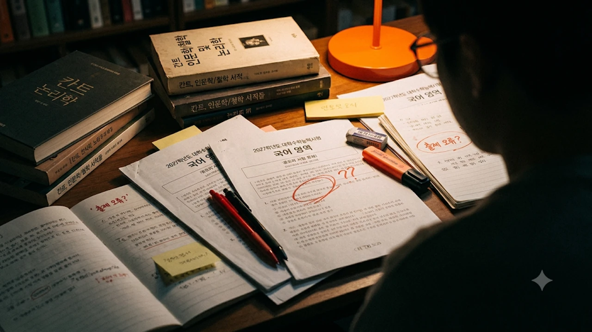

2026년 11월 2027학년도 대학수학능력시험이 끝난 직후, 국어 영역 비문학 독서 파트에서 출제된 **수능 인문 지문 논란**이 수험생과 입시 현장을 거세게 흔들고 있습니다. 철학 고전 텍스트 특유의 압축된 개념 정의와 까다로운 추론형 선지가 맞물리면서 체감 난이도와 출제 타당성을 둘러싼 공방이 이어지는 양상입니다. 올해 시험에서 불거진 핵심 쟁점 세 가지와 출제 흐름의 변화, 그리고 실전에서 통하는 독해 해법을 짚어봅니다.

## 2027 수능 국어 인문 지문, 왜 논란의 중심에 섰나

### 올해 출제된 인문·철학 융합 지문의 핵심 소재 분석

2027학년도 수능 국어 독서 영역에서는 동서양 철학사의 인식론과 언어철학 개념을 교차 배치한 (가)·(나) 통합 지문이 등장했습니다. 특정 사상가의 이론을 시간순으로 나열하던 과거 출제 방식에서 벗어나, **서로 다른 존재론적 전제를 지닌 두 학자의 관점을 하나의 현상에 동시에 대입해 비교하는 고밀도 텍스트**가 제시된 점이 돋보입니다.

특히 일상에서 흔히 쓰는 한국어 낱말을 지문 내부에서만 통용되는 철학적 술어로 재정의해 사용한 대목이 수험생들을 괴롭혔습니다. 평소 익숙하게 쓰던 단어라도 첫 문단에서 약속한 문맥적 정의를 놓치는 순간, 뒤이어 펼쳐지는 논증 고리 전체가 무너지도록 설계되었습니다.

### 수험생과 입시 전문가가 지적한 3가지 난이도 급등 요인

시험 종료 직후 한국교육과정평가원 이의신청 게시판과 주요 입시 커뮤니티에 빗발친 문제 제기는 크게 세 갈래로 모입니다.

- **추상적 개념어의 연쇄 치환:** 앞 문단에서 정의한 개념 A를 뒷 문단에서 곧바로 변형된 개념 B로 바꿔 부르면서도 징검다리 역할을 하는 연결 표지를 생략해 독해 피로도를 끌어올렸습니다.
- **선지 간 미세한 인과관계 비틀기:** 정답과 오답 선지의 서술어가 겉보기에 거의 같지만, 조건절의 주체나 시간적 선후 관계를 교묘하게 뒤바꾸어 촘촘한 대조를 요구했습니다.
- **제한 시간 내 정보 처리 한계:** 앞선 문학과 선택과목에서 시간을 소모한 수험생들이 지문당 15분 남짓한 짧은 시간 안에 이중 부정이 얽힌 선지 5개를 끝까지 검증하기 버거웠다는 반응이 많습니다.

> "배경지식 없이 지문만으로 풀게 하겠다는 출제 원칙이 오히려 지문 속 논리적 비약과 문장 압축률을 극단으로 끌어올리는 역설을 낳았다." — 입시 현장 국어 영역 강사진 분석평 중

## 역대 불수능 인문 지문과 올해 출제 경향 비교

### 배경지식 의존도를 낮추려다 독해량을 늘린 출제 구조

과거 2022학년도 헤겔 변증법 지문이나 2024학년도 유가 철학 지문은 철학사적 배경지식을 미리 익힌 수험생에게 유리하다는 비판을 받았습니다. 출제진은 이러한 사교육 유발 요인을 걷어내기 위해 외부 지식을 배제하고 **지문 속 명시적 조건만으로 결론을 조립하는 퍼즐형 독해 구조**를 택했습니다.

문제는 배경지식을 차단하는 과정에서 지문 자체의 문장 호흡이 길어지고 수식어가 겹겹이 쌓였다는 데 있습니다. 정보의 절대량 자체는 줄어든 듯 보이지만, 문장 하나를 해독하기 위해 머릿속에 동시에 띄워놓아야 할 변수가 늘어나면서 수험생이 느끼는 압박감은 한층 커졌습니다.

### 2026학년도 기출과 달라진 선지 구성 및 논리적 함정

직전 연도인 2026학년도 수능 인문 지문과 나란히 놓고 보면 올해 문항은 **발문의 요구 조건과 보기 사례를 구체화하는 방식**에서 뚜렷한 차이를 드러냅니다.

| 구분 | 2026학년도 인문 지문 | 2027학년도 인문 지문 |
| :--- | :--- | :--- |
| **지문 구조** | 단일 이론의 시대별 변천사 중심 | 상반된 두 관점의 (가)·(나) 통합형 |
| **핵심 평가 요소** | 세부 정보의 일치 여부 확인 | 전제 조건 변경 시 결론 추론 |
| **오답 유도 방식** | 지문에 없는 외부 사실 혼합 | 지문 내 개념의 주체·객체 뒤바꿈 |

단순히 지문 속 문장을 찾아 짝짓기하는 정보 검색 능력이 아니라 **논리적 정합성을 따져 묻는 방향**으로 선지가 진화하면서, 밑줄만 그으며 빠르게 훑어 읽는 기존 독해 습관으로는 고득점을 지키기 어려워졌습니다.

## 이의신청 쟁점과 철학적 텍스트 해석의 오해

### 논란이 된 핵심 문장의 원전 맥락과 출제진 의도 대조

수능 직후 불거진 **수능 인문 지문 논란**의 한복판에는 보기 문항의 특정 선지가 학계의 원전 해석과 어긋난다는 주장이 자리하고 있습니다. 일부 수험생과 전공자들은 지문이 인용한 철학 원전의 본래 맥락을 따를 경우, 정답으로 발표된 선지 외에 다른 선지 역시 참으로 해석할 여지가 있다고 맞섰습니다.

하지만 평가원 출제 매뉴얼의 관점에서 수능 독서 지문은 원전의 학술적 완결성을 따지는 시험이 아니라 **시험지에 인쇄된 텍스트라는 닫힌 체계 안에서의 타당성**을 묻는 평가입니다. 원전에서 해당 학자가 어떤 주장을 펼쳤든, 제시된 글이 규정한 정의 범위 안에서만 논리를 전개해야 한다는 것이 출제진의 일관된 입장입니다. 텍스트 해석의 주체성과 정보 수용의 한계는 [제로 클릭 2026, 내 자유의지는 진짜 살아있을까?](/posts/humanities/zero-click-era-autonomy-2026/)에서도 짚어본 현대인의 능동적 독해 문제와 맞닿아 있습니다.

### 실제 시험장에서 오답률을 높인 추론 과정 복기

실제 시험장에서 오답률이 치솟은 결정적 계기는 **직관적 상식과 지문 논리의 충돌**이었습니다. 수험생들은 평소 자신이 지닌 윤리적·상식적 판단 기준을 무의식적으로 보기에 개입시켰고, 지문이 설정한 가상의 전제 조건을 놓친 채 매력적인 오답을 골랐습니다.

- **1단계 실수:** 지문 (가)의 핵심 명제를 읽고 자신의 기존 배경지식으로 성급하게 일반화함
- **2단계 실수:** 지문 (나)에 등장한 반론의 적용 범위를 전체 대상이 아닌 일부 조건으로 한정하지 못함
- **3단계 실수:** 보기 사례를 분석할 때 지문의 정의 대신 일상어적 어감으로 선지의 정오를 판별함

## 고난도 인문 지문을 뚫는 실전 독해 프레임워크

### 개념어 간 대립쌍을 구조화하는 3단계 문단 요약법

길고 추상적인 철학 지문을 흔들림 없이 읽어내려면 문장을 일일이 번역하려 애쓰기보다, 글 전체의 뼈대를 이루는 **개념어 대립쌍**을 먼저 뽑아내야 합니다.

1. **첫 문단에서 화제와 기준점 고정하기:** 글쓴이가 무엇을 해명하려는지 핵심 대상에 네모 표시를 하고, 이를 가르는 분류 기준을 찾습니다.
2. **대립하는 두 개념의 속성 묶어내기:** 'A는 ~한 반면, B는 ~하다' 꼴의 문장이 나오면 각 주체별로 수식어를 수직으로 정리해 머릿속 비교표를 만듭니다.
3. **인과관계 화살표로 메커니즘 연결하기:** 조건이 바뀔 때 결과가 어떻게 달라지는지 '원인 → 매개 → 결과'의 흐름으로 여백에 짧게 도식화합니다.

### 향후 모의고사 및 논술 대비를 위한 인문 고전 독해 전략

수능 이후 이어지는 대학별 논술고사나 다음 학년도 모의고사를 준비하는 수험생이라면 짧은 기출 지문만 반복해서 푸는 연습에서 한 걸음 더 나아가야 합니다. 호흡이 긴 인문 철학 교양서나 고전 해제집을 읽으며 **저자의 논증 뼈대를 스스로 요약해 보는 훈련**이 큰 힘을 발휘합니다.

동서양 철학사의 주요 쟁점을 현대적 사례와 엮어 풀어낸 입문서를 꾸준히 접하면, 낯선 개념어가 쏟아지더라도 문맥 속에서 뜻을 추론하는 기초 체력이 단단해집니다. 평소 인문 독서 습관을 기르고 싶다면 [청년문화예술패스 도서 확대! 바뀐 3가지](/posts/humanities/youth-culture-pass-book-expansion-2026/) 같은 지원 제도를 활용해 양질의 인문 서적을 가까이 두는 것도 좋은 방법입니다. 체계적인 인문 고전 독해와 사고력 확장을 돕는 추천 도서는 아래에서 확인해 보실 수 있습니다.

[인문 철학 독해 필독서 쿠팡에서 보기](https://www.coupang.com/np/search?q=%EC%9D%B8%EB%AC%B8+%EC%B2%A0%ED%95%99+%EB%8F%85%ED%95%B4+%EC%B6%94%EC%B2%9C%EB%8F%84%EC%84%9C&sourceType=affiliate&trackingCode=AF8691300)

#수능인문지문논란 #2027수능국어 #수능국어비문학 #인문지문독해법 #수능이의신청 #불수능국어 #국어독서공부법 #철학지문분석