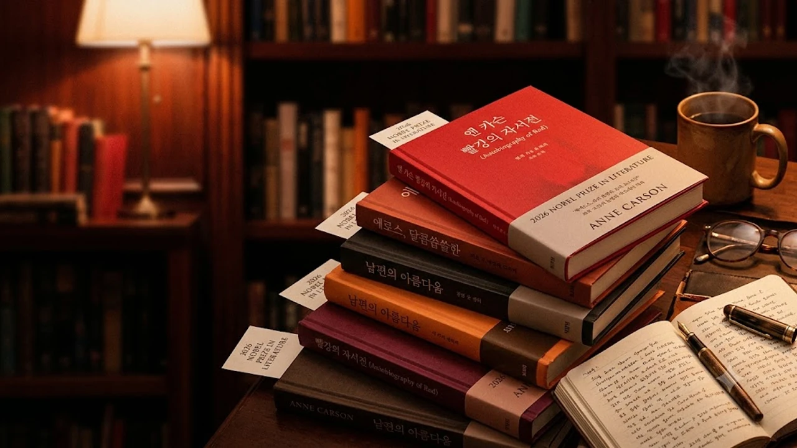

2026년 스웨덴 한림원의 발표 직후 국내 주요 온·오프라인 서점가에서 전례 없는 품절 대란이 벌어지며, 입문자들을 위한 **앤 카슨 책 추천**과 대표작 독서 순서에 이목이 집중되고 있습니다. 고전문헌학과 현대 시문학의 경계를 거침없이 허무는 독보적인 세계관 덕분에, 노벨문학상 특유의 높은 진입장벽을 넘어 지적 쾌감을 갈망하는 독자들의 탐독 열풍이 거세졌습니다.

## 앤 카슨 돌풍과 서점가 품절 대란의 배경

### 수상 직후 불거진 대표작 품절 사태 현주소
발표 당일 저녁부터 교보문고, 예스24, 알라딘 등 주요 온라인 서점의 서버 접속이 지연될 정도로 주문이 폭주했습니다. 반나절 만에 국내 번역 출간된 주요 단행본의 재고가 동났고, 출판계는 긴급 중쇄 인쇄기를 돌리기 시작했습니다. 오프라인 서점 매대 역시 입고 예약표를 작성하는 발길로 붐비며, 순수 문학 코너가 문화 담론의 중심으로 복귀했습니다.

### 단순 시인을 넘어선 고전문헌학자의 독창성
앤 카슨은 고대 그리스어와 라틴어 텍스트를 파고든 정통 고전문헌학자입니다. 사포, 호메로스, 에우리피데스 같은 수천 년 전 텍스트의 조각을 현대의 서사와 엮어 완전히 낯선 질감의 문장으로 탈바꿈시킵니다. 학문적 엄밀함과 날카로운 감각이 한 줄 안에서 맞부딪히며 기존 현대 시문학에서 맛보기 힘든 서늘한 긴장감을 만들어냅니다.

### 지금 국내 독자들이 앤 카슨에 열광하는 결정적 이유
파편화된 짧은 영상과 자극적인 피드에 피로를 느낀 독자들에게 카슨의 텍스트는 지적 갈증을 씻어내는 돌파구 역할을 합니다. [청년문화예술패스 도서 확대! 바뀐 3가지](/posts/humanities/youth-culture-pass-book-expansion-2026/) 정책으로 인문 서적 접근성이 넓어진 젊은 층 사이에서 밀도 높은 활자 읽기가 하나의 문화적 태도로 자리 잡은 흐름과도 궤를 같이합니다. 추상적인 감상에 머무르지 않고 날카로운 서사적 긴장감을 끝까지 밀어붙이는 파격이 독자들의 탐독 본능을 자극했습니다.

## 처음 접하는 독자를 위한 필수 대표작 3권 비교

### 신화와 현대 소설의 경계를 허문 『빨강의 자서전』
헤라클레스 신화 속 붉은 날개를 지닌 괴물 게리온을 현대의 상처받은 소년 예술가로 재창조한 역작입니다. 행을 나누어 운문의 리듬을 살리면서도 서사의 뼈대를 놓치지 않는 '시 소설(Verse Novel)' 형태를 띱니다.

- **핵심 줄거리**: 붉은 날개를 감춘 채 카메라를 든 소년 게리온과 그를 흔들고 떠나간 헤라클레스의 만남과 상흔
- **추천 대상**: 앤 카슨이라는 이름을 처음 접하며 흡인력 있는 스토리텔링을 먼저 경험하고 싶은 독자

> "게리온은 붉은 존재였다. 모든 사물이 제 빛깔을 지니듯, 그는 고통마저 붉은 형상으로 마주했다."

### 에로스와 결핍의 인문학적 탐구 『달콤 쌉싸름한 에로스』
사포가 노래한 사랑의 양가감정, 즉 '달콤 쌉싸름함(glukupikron)'의 어원을 집요하게 추적한 비평 에세이입니다. 욕망의 대상과 나 사이에 놓인 메울 수 없는 '빈 공간'이야말로 욕망을 지피는 연료라는 점을 증명합니다.

- **작품 특성**: 그리스 철학의 정교한 분석과 감각적 비유가 결합된 문학 이론서
- **매력 포인트**: 지적인 사유가 어떻게 관능적인 문장으로 변모하는지 증명하는 밀도

### 형식 파괴와 상실의 기록을 담은 『녹스(Nox)』
불의의 사고로 세상을 떠난 친오빠를 애도하기 위해 카툴루스의 시 101번을 라틴어 단어별로 해체하고, 가족사진과 손편지 조각을 덧댄 아코디언 제본의 책입니다. 활자를 인쇄한 평면을 넘어 책이라는 물성 자체가 기억의 불완전성과 비탄을 담아내는 그릇으로 작동합니다. 슬픔을 온전히 담아낼 언어가 없을 때 문학이 어떻게 침묵의 형태를 빚어내는지 보여줍니다.

## 실패 없는 앤 카슨 독서 로드맵과 감상 팁

### 그리스 로마 신화 배경지식 없이도 읽히는 순서
고전 신화에 통달하지 않아도 감상에 걸림돌은 없습니다. 인물의 관계와 감정선이 선명한 『빨강의 자서전』으로 작가의 호흡을 익힌 뒤, 통찰의 보폭을 넓히는 에세이 『달콤 쌉싸름한 에로스』로 건너가는 흐름이 무난합니다. 본문의 주석은 흐름을 끊지 않는 선에서 참고하고, 거친 행간과 이미지의 충돌에 집중할 때 본래의 매력이 드러납니다.

### 시와 산문, 번역본과 원문의 결을 즐기는 핵심 포인트
카슨의 문장은 쉼표의 위치와 행갈이 사이에 침묵을 배치합니다. 눈으로 빠르게 훑어내리기보다 나직한 목소리로 소리 내어 읽을 때 특유의 호흡이 살아납니다. 한국어 번역의 결을 충분히 음미한 뒤, 기회가 닿는다면 원문의 건조하고 절제된 단어 배치를 대조해 보는 것도 깊이를 더하는 읽기 방식입니다.

### 종이책 품절 시 대안이 되는 전자책(e-Book) 및 도서관 활용법
당장 서점의 재입고를 기다리기 번거롭다면 전자책 플랫폼의 e-Book 목록을 우선 확인하는 방법이 수월합니다. 지역 공공도서관의 희망도서 신청이나 상호대차 서비스를 발 빠르게 이용하면 중쇄본 출고 시점 이전에 대출 순번을 선점할 수 있습니다.

## 2026년 가을, 앤 카슨이 우리 문학계에 던진 화두

### K-문학 붐 이후 새롭게 불어온 서구 고전문학 재조명
국내 순수 문학을 향한 열기가 세계 문학으로 확장되는 흐름 속에서, 박제된 고전을 해체해 현대의 언어로 복원하는 카슨의 실험은 독서 생태계에 신선한 자극제가 되었습니다. 고전은 진열장에 갇힌 유물이 아니라 오늘의 결핍과 상처를 비추는 거울임을 입증했습니다.

### 장르의 경계를 부수는 탈경계 인문학의 현재적 가치
앤 카슨은 시와 소설, 학술 비평과 시각 예술의 칸막이를 지워버립니다. 정형화된 독서 관습에서 벗어나 문장의 여백을 사유하는 경험은 생각의 틀을 깨는 지적 해방감을 줍니다. 밀도 높은 문장에 집중하기 좋은 환경을 만들고 한 줄씩 깊이 음미하는 시간을 권합니다.

[독서대 및 북스탠드 쿠팡에서 보기](https://www.coupang.com/np/search?q=%EB%8F%85%EC%84%9C%EB%8C%80%20%EB%B6%81%EC%8A%A4%ED%83%A0%EB%93%9C&sourceType=affiliate&trackingCode=AF8691300)

#앤카슨 #노벨문학상2026 #앤카슨책추천 #빨강의자서전 #달콤쌉싸름한에로스 #녹스 #고전문헌학 #가을독서추천