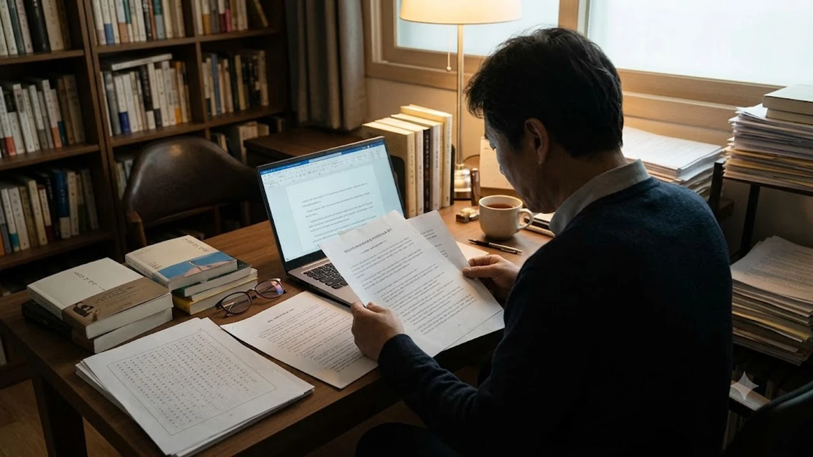

생성형 AI 모델 클로드(Claude)의 개발사 앤트로픽(Anthropic)이 진행 중인 도서 저작권 침해 집단소송 합의 과정에서, **앤트로픽 AI 저작권 배상** 대상 도서 목록에 한국 대표 문학 작품들이 대거 포함된 사실이 확인되었습니다. 인공지능 학습용 데이터셋으로 전 세계 도서를 무단 스크래핑하는 과정에서 발생한 이번 사태는 번역 출판물뿐만 아니라 한국어 원작까지 광범위하게 침해되었음을 명백히 보여줍니다. 창작자의 고유한 지적재산권이 거대 기술 기업의 무단 학습 데이터로 소비되는 현실 속에서, 국내 작가들과 출판계가 실제로 피해 보상을 받을 수 있을지 관심이 집중되고 있습니다.

## 앤트로픽 대규모 소송 합의와 한국 작가 저작물 무단 학습 실태

### 앤트로픽 합의 사이트 공개와 유출된 韓 작가 20여 편 도서 명단
미국 법원의 감독 아래 개설된 앤트로픽 집단소송 공식 합의 사이트에서 열람 가능한 보상 대상 목록에 국내 대표 작가들의 이름이 무더기로 등장했습니다. 노벨문학상을 수상한 한강의 '채식주의자'와 '소년이 온다' 영문 번역본 및 한국어 원문 판본을 시작으로, 김영하의 '살인자의 기억법', 황석영의 '철도원 삼대', 김애란의 단편선 등 한국 문학을 상징하는 서적 20여 종이 고스란히 등재되었습니다.

> "인공지능 모델 훈련이라는 명분 아래 전 세계 문학 자산을 동의 없이 긁어모아 상업용 엔진의 거름으로 삼았다는 명확한 기록이 수면 위로 드러났다."

이 명단은 그간 소문으로만 무성하던 글로벌 빅테크의 K-문학 무단 크롤링을 공적 문서로 입증한 결정적 장면입니다.

### 한강·김영하 등 대표 문학 작품이 AI 학습 데이터셋에 들어간 경로
앤트로픽의 대규모 언어 모델은 매끄러운 다국어 문맥 생성을 위해 방대한 서적 원문을 마구잡이로 삼켰습니다. 정식 라이선스 계약을 거친 출판 데이터 대신 어둠의 경로로 유통되던 해적판 텍스트 코퍼스가 여과 없이 엔지니어링 파이프라인에 주입된 결과입니다.

- **토큰화 파이프라인 가동:** 불법 공유 사이트에 올라온 PDF 및 ePub 파일을 OCR과 텍스트 정제기로 밀어 넣고 모델 가중치(Weights) 산출에 반영
- **영미권 번역본 우선 타깃:** 펭귄랜덤하우스 등을 통해 영미권 서점에 정식 배급된 번역본을 먼저 긁어모은 뒤 다국어 번역 성능 강화용 병렬 말뭉치로 구축
- **국내 웹 텍스트 파일(TXT) 스크래핑:** 번역본뿐 아니라 국내 불법 파일 공유 커뮤니티에 떠돌던 한글 텍스트 파일까지 크롤러로 긁어 언어 간 전이 학습(Cross-lingual Transfer)에 투입

### 해외 집단소송 합의금이 국내 출판계 및 작가들에게 지급될 가능성
미국 법원에 계류된 합의안은 데이터셋에 저작물이 들어간 권리자들에게 정해진 보상 기금을 쪼개어 분배하도록 규정합니다. 다만 국내 창작자가 이 돈을 쥐기까지는 넘어야 할 행정적 장벽이 만만치 않습니다. 미국 연방 저작권청(US Copyright Office)에 작품을 사전에 등록했는지, 국내 출판사와 해외 에이전시 간 권리 지분을 어떻게 증명할지, 해외 송금과 원천징수 세금 문제를 어떻게 털어낼지가 승인의 갈림길입니다.

## 섀도우 라이브러리와 생성형 AI: 텍스트 무단 수집의 법적 쟁점

### '북스3(Books3)' 등 불법 데이터베이스를 활용한 AI 학습 메커니즘
빅테크가 인공지능을 훈련할 때 애용한 비밀 병기는 섀도우 라이브러리(Shadow Library), 즉 해적판 도서 아카이브였습니다. 19만 권이 넘는 도서 텍스트를 불법 스크랩해 오픈소스로 풀었던 '북스3(Books3)' 데이터셋이 대표적입니다. 복제 방지 기술(DRM)을 무단 해제한 판본을 '연구용'이라는 꼬리표를 달아 엔지니어링에 끌어다 쓴 점이 이번 법정 공방의 결정타였습니다.

### 미국 법원의 공정이용(Fair Use) 기준과 이번 합의가 갖는 선례적 가치
미국 저작권법 제107조의 '공정이용' 조항은 비평이나 학술 연구 목적의 제한적 복제를 인정합니다. 개발사들은 기계학습이 원작의 가치를 파괴하지 않고 새로운 지능을 빚어내는 '변형적 이용(Transformative Use)'이라고 항변해 왔습니다. 그러나 법원은 남의 완제품 소설을 통째로 털어 넣어 유료 구독형 챗봇을 만든 행위를 두고 원저작물의 시장을 교란하는 명백한 침해로 판단했습니다. 앤트로픽이 거액의 합의금을 내놓은 배경에는 변형적 이용이라는 방패막이가 깨졌다는 현실 인식이 자리합니다.

### 국내 저작권법상 '텍스트·데이터 마이닝(TDM)' 면책 규정과의 충돌 지점
한국 저작권법 개정 논의에서도 이 판결은 큰 파동을 일으키고 있습니다. 국회에 올라온 법안에는 AI 학습 목적의 분석에 한해 복제와 전송을 허용하는 'TDM 면책 규정'이 담겨 있습니다. 출판계는 적법한 대가를 치르지 않은 해적판 데이터까지 무제한 면책을 베풀어서는 안 된다고 거세게 반발합니다. 인공지능이 인간의 지적 산물을 손쉽게 집어삼키는 환경에서 창작자의 주체성을 지키는 일은, 알고리즘 중심 환경 속 인간의 통제권을 따져본 [제로 클릭 2026, 내 자유의지는 진짜 살아있을까?](/posts/humanities/zero-click-era-autonomy-2026/)의 고민과 정확히 일치합니다.

## 글로벌 빅테크 vs K-문학: 창작자 권리 침해와 대응 전략 비교

### 해외 주요 작가 조합(Authors Guild)의 집단 대응 방식과 성과
미국 작가조합(Authors Guild)은 오픈AI와 메타, 앤트로픽을 상대로 체계적인 법정 투쟁을 펼쳐 실리를 챙겼습니다. 조합원들의 저작물 침해 내역을 데이터 단위로 전수 검증하고, 불법 다운로드 접속 기록을 법원에 증거로 제출하며 기술 기업의 목을 옥죄었습니다. 그 결과 거액의 합의금을 뜯어내는 데 그치지 않고 차기 모델 훈련 시 정식 라이선스를 사들이도록 하는 확약까지 받아냈습니다.

### 한국 출판·문학 단체의 대응 현황 및 개별 작가 권리 구제 한계
국내 문학판의 사정은 턱없이 열악합니다. 바다 건너 미국 법정에서 무슨 일이 벌어지는지 정보조차 제때 돌지 않고, 개별 작가가 홀로 미국 로펌을 선임해 피해를 입증하는 것은 계란으로 바위 치기입니다. 출판사, 작가협회, 저작권 신탁단체가 한데 뭉쳐 글로벌 빅테크의 한국어 코퍼스 침해 내역을 합동 조사하는 창구가 시급한 이유입니다.

### AI 기업의 라이선스 계약 전환 사례와 출판 생태계의 실익 비교
해외 미디어 기업들은 법정 공방을 지렛대 삼아 유료 공급 계약이라는 실리를 챙기는 중입니다. 악셀 슈프링어와 파이낸셜 타임스 등은 수천만 달러짜리 데이터 라이선스 계약을 체결했습니다. 무작정 빗장을 걸어 잠그기보다 양질의 정제 텍스트에 정당한 가격표를 붙여 파는 시장 질서를 먼저 세우는 편이 창작 생태계에 훨씬 보탬이 됩니다.

## 내 작품도 학습됐을까? 창작자와 독자를 위한 후속 확인 및 대처법

### 앤트로픽 소송 합의 청구 포털 확인 및 청구 자격 가이드
단행본을 출간한 이력이 있는 작가나 출판사라면 앤트로픽 합의 전용 포털에 들어가 목록을 직접 조회해 볼 필요가 있습니다.
- **국제표준도서번호(ISBN) 대조:** 국문 및 영문 도서명, 등록 ISBN 번호를 입력해 피해 저작물 목록에 걸려 있는지 대조
- **저작권 증빙 서류 정리:** 출판권 설정 계약서, 저작권 등록증, 국립중앙도서관 납본 증명서를 스캔해 권리 관계 소명 준비
- **온라인 청구서(Claim Form) 접수:** 정해진 접수 기간 내에 단독 저자, 번역자, 출판권자 구분을 명확히 찍어 청구서 전송

### 출판 계약 시 AI 학습 제외(Opt-out) 특약 설정 시 주의점
새로 계약 도장을 찍는 작가라면 계약서 특약 조항에 인공지능 관련 문구를 반드시 박아 넣어야 합니다. 계약서에 **"본 저작물은 AI 모델의 기계학습 및 텍스트·데이터 마이닝(TDM) 목적의 무단 수집과 이용을 일절 불허한다"**는 거부(Opt-out) 조항을 명시해 권리를 묶어두는 편이 안전합니다. 출판사 역시 전자책 메타데이터와 웹 아카이브에 인공지능 크롤러 차단 메타 태그를 의무적으로 걸어야 합니다.

### AI 시대 창작물의 데이터 주권 보호를 위해 바뀌는 저작권 정책 방향
문화체육관광부는 AI 모델의 학습 데이터 투명성을 확보하기 위해 산출물 식별 표시와 훈련용 데이터 출처 공개를 제도화하는 방안을 다듬고 있습니다. 기계가 활자를 손쉽게 복제해 지능을 흉내 내는 시대일수록, 종이 위에 찍힌 생각의 오리지널리티와 글 쓰는 손의 노동을 지키는 인문학적 방파제는 더욱 튼튼해야 합니다.

[원고 집필 및 독서용 문구용품 쿠팡에서 보기](https://www.coupang.com/np/search?q=%EB%8F%84%EC%84%9C%20%EB%AC%B8%EA%B5%AC%EC%9A%A9%ED%92%88&sourceType=affiliate&trackingCode=AF8691300)

#앤트로픽 #AI저작권 #클로드무단학습 #한강저작권소송 #북스3데이터셋 #TDM면책규정 #출판저작권 #AI데이터주권