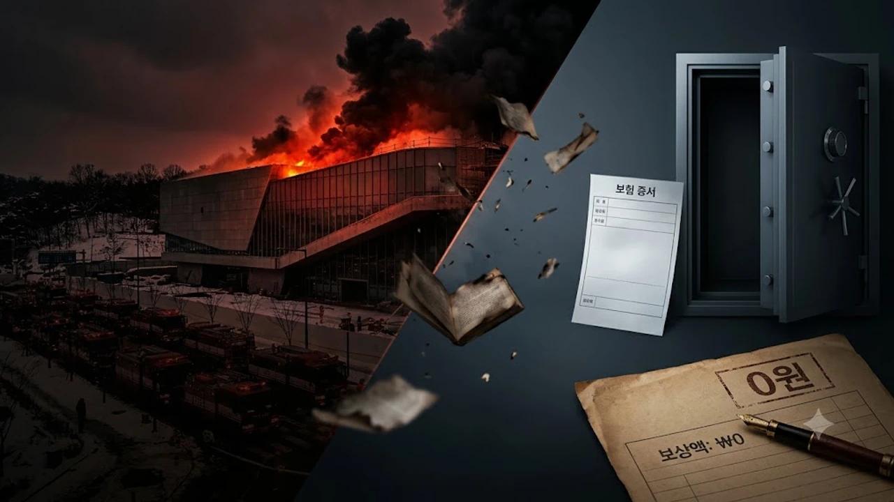

국립한글박물관 화재 사건이 발생한 지 1년 8개월이라는 시간이 흘렀으나, 최근 국회 문화체육관광위원회 국정감사에서 109억 원에 달하는 재산 피해와 부실한 사후 대처의 실체가 드러났습니다. 특히 국가 핵심 문화시설의 복구비로 218억 원의 국민 세금이 투입되는 동안 수령한 화재 보험금은 전무하다는 사실이 밝혀지며 공공기관 방재 시스템 전반에 거센 비판이 쏟아지고 있습니다.

## 국립한글박물관 109억 화재와 1년 8개월의 침묵

### 2026년 국감에서 드러난 피해 규모와 방치된 사고 경위
2026년 10월 국회 문체위 국정감사 현장에서 공개된 자료에 따르면, 증축 공사 현장에서 발생했던 화재로 인한 직접적 피해 산정액은 약 109억 원으로 집계되었습니다. 사고 직후 단순 집기 및 일부 외벽 훼손으로 축소 보고되었던 초기 발표와 달리, 건물 내부 공조 설비와 디지털 전시 시스템, 특수 보존 수장고 인접 구역까지 유독가스와 그을음 피해가 번진 사실이 뒤늦게 확인되었습니다. 국가 공공시설의 대형 재난이 장기간 공론화되지 않은 채 수면 아래에 머물렀던 배경을 두고 관리 감독 소홀에 대한 질타가 이어졌습니다.

### 증축 공사 현장의 초기 화재 원인과 안전 매뉴얼 점검
화재는 박물관 증축 및 시설 개선을 담당하던 하도급 업체의 용접 작업 중 튄 불꽃이 단열재에 옮겨붙으며 번졌습니다. 당시 현장에는 화재감시자 배치 규정이 지켜지지 않았고, 임시 소방시설 작동 점검표 역시 부실하게 작성된 상태였습니다. 

> "국가 문화자산을 관리하는 1급 보안 시설의 공사 현장 매뉴얼이 민간 일반 건설 현장보다 허술하게 운용되었다는 점은 결코 묵과할 수 없는 직무 유기다." — 국회 문체위 감사위원 지적 사항

### 관람객 통제와 중요 유물 긴급 반출 과정의 실태
화재 발생 당시 관람 구역에 머물던 시민들의 대피 유도는 방재 방송 지연으로 혼선을 빚었습니다. 다행히 인명 피해는 없었으나, 훈민정음 해례본 영인본을 비롯한 주요 고문서 및 한글 금석문 탁본 등 지정 문화유산의 비상 반출 프로토콜이 제대로 가동되지 않았습니다. 박물관 보안과 보존 관리 체계의 허점이 적나라하게 드러난 순간이었습니다. 이러한 문화재 보안 관리 실패는 유럽 유수 기관에서 발생한 [빈 박물관 보석 도난, 진짜 보안 뚫린 이유 3가지](/posts/humanities/vienna-museum-jewel-heist-security-2026/) 사례와 마찬가지로 총체적인 안전 불감증이 낳은 인재였습니다.

## 보험금 0원의 진실: 가액 63% 저가입과 보상금 미지급 사유

### 건물 가액 평가 오류와 불완전 보험 가입 논란
국립한글박물관 건물과 시설물에 체결된 화재보험 계약은 실제 자산 평가액을 밑도는 수준이었습니다. 박물관 측은 예산 절감을 이유로 감정평가액의 63%에 불과한 금액으로 손해보험에 가입하는 '일부보험' 방식을 택했습니다. 이로 인해 사고 발생 시 손해액 전체를 보상받지 못하고 비례 보상 원칙이 적용되어, 배상 청구 가능 금액 자체가 본래 손해의 절반 이하로 깎이는 치명적인 재정적 덫에 걸렸습니다.

### 보험사와의 책임 공방 및 1년 8개월간 협상 지연 배경
사고 발생 후 1년 8개월이 흐르도록 보험금이 단 1원도 나오지 않은 핵심 원인은 책임 소재 공방에 있습니다. 보험사는 시공사와 하도급 업체의 중과실 여부, 계약서상 면책 조항, 건물 감정가 불일치를 이유로 지급을 거부했습니다. 
- **박물관 측 주장**: 공공기관 화재보험 약관에 따른 전액 선지급 및 사후 구상 청구 요구
- **보험사 측 반박**: 안전관리 의무 위반 및 일부보험 조항에 따른 손해사정 지연 불가피
- **현재 진행 상황**: 법적 소송 직전의 대치 상태로 금융감독원 분쟁조정조차 결렬

### 화재 보상금 공백이 국가 재정에 미친 연쇄적 타격
보험금을 회수하지 못하면서 복구 재원 조달의 부담은 고스란히 국가 재정으로 넘어갔습니다. 원래 계획했던 2026년도 한글 역사 자료 아카이브 구축 사업과 국외 소재 한글 문헌 수집 연구 예산이 대폭 깎였으며, 연간 기획 전시 스케줄이 취소되는 등 문화 행정의 연속성이 심각하게 끊겼습니다.

## 투입된 세금 218억: 복구 예산 편성과 증액 과정 비교

### 긴급 예비비와 본예산으로 충당된 218억 복구비 세부 내역
파괴된 시설을 복원하고 항온·항습 시스템을 다시 세우기 위해 투입된 총예산은 218억 원으로 집계되었습니다. 이는 당초 추정된 피해액 109억 원의 두 배에 달하는 규모입니다.
- **긴급 철거 및 유독물질 정화**: 34억 원 (정부 일반 예비비 배정)
- **공조 설비 및 특수 방화벽 재시공**: 112억 원 (문화체육관광부 본예산 편성)
- **디지털 미디어 전시관 복원 및 소방 설비 보강**: 72억 원 (추가경정예산 확보)

### 타 국립 문화기관 재난 복구 사례와의 예산 집행 비교
국내외 공공 문화재 보존 시설의 사고 복구와 비교할 때, 이번 예산 집행은 기형적인 구조를 보입니다. 정상적인 국립 시설은 자산 가치의 100%를 담보하는 포괄 손해보험을 유지해 국고 손실을 줄입니다. 반면 한글박물관은 초기 보험료 수천만 원을 아끼려다 200억 원이 넘는 혈세를 메워 넣는 결과를 불렀습니다. 이는 최근 [유홍준 사의, 친일파 유묵 전말과 숨은 논란 3가지](/posts/humanities/yoohongjun-resignation-pro-japanese-calligraphy-controversy-2026/) 사태처럼 공공 문화 기관 내부의 검증 결여와 주먹구구식 행정이 낳은 참사였습니다.

### 국민 혈세 대위 투입의 법적 근거와 구상권 청구 가능성
정부는 우선 예산을 투입해 복구를 마친 뒤 원인 제공자인 건설 컨소시엄에 구상권을 청구하겠다는 방침을 세웠습니다. 그러나 하도급 업체의 자본 잠식과 영세성으로 인해 실질적인 변제 능력이 없는 실정입니다. 시공사와의 법정 다툼 역시 대법원 확정판결까지 수년이 걸릴 것으로 보여, 투입된 세금 218억 원 중 상당수가 영구 결손 처리될 가능성이 큽니다.

## 국립 박물관 문화재 안전 관리 시스템 전면 쇄신 방안

### 공사 중 문화유산 방재 프로토콜의 구조적 한계와 취약점
현재 국립 박물관 및 미술관의 공사 현장은 일반 건축 기준의 소방 법규를 준용하고 있어 문화재 특수성을 담아내지 못합니다. 
- 불연재 의무 사용 기준이 박물관 부속 시설까지 일괄 적용되지 않는 맹점
- 화재 발생 시 문화재 손상을 방지하기 위한 가스계 소화설비의 수동 전환 오류
- 야간 및 휴일 공사 현장 전담 방재 요원 지정의 제도적 공백

### 국립 문화시설 전수조사를 통한 안전 가이드라인 정비
이번 사태를 계기로 전국 국립 시설 40여 곳의 화재보험 가입 실태와 소방 시설 전수조사가 긴급 시행되었습니다. 자산 가치 재평가를 거쳐 실손 보상 체계로 보험을 갱신하도록 의무화하고, 가액 80% 미만의 저가입 관행을 감사원 징계 항목으로 신설하는 제도 개선에 착수했습니다.

### 향후 재발 방지를 위한 문화행정 체계와 책임 강화 대책
사고 은폐를 막기 위해 공공 문화시설 내 1억 원 이상의 재산 피해가 나면 24시간 이내 국회 및 주무 부처에 의무 보고하도록 법령 개정을 추진하고 있습니다. 공사 발주처인 박물관 관리자의 책임을 명문화하고 정기 방재 훈련 점검을 외부 전문 기관에 위탁해 투명성을 확보해야 합니다. 고문서와 역사 서적 등 소중한 인문 유산을 온전히 지켜내기 위한 기초 보존 용품 관리는 박물관뿐만 아니라 가정과 서재에서도 철저한 규격 제품을 갖추는 일에서 출발합니다.

[가정용 서재 문화재 보관 문구함 쿠팡에서 보기](https://www.coupang.com/np/search?q=%EB%8F%84%EC%84%9C%20%EB%AC%B8%EA%B5%AC%EC%9A%A9%ED%92%88&sourceType=affiliate&trackingCode=AF8691300)

#국립한글박물관 #국립한글박물관화재 #문체위국감 #박물관안전관리 #문화재방재시스템 #화재보험금미지급 #공공기관예산낭비 #국정감사이슈