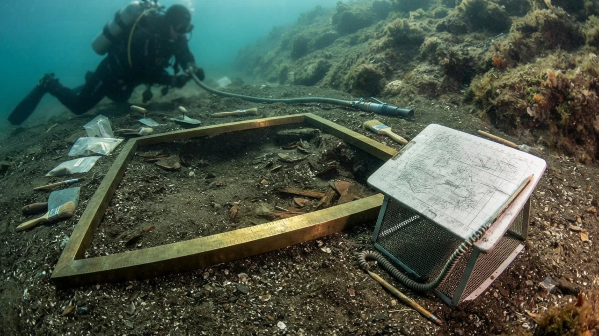
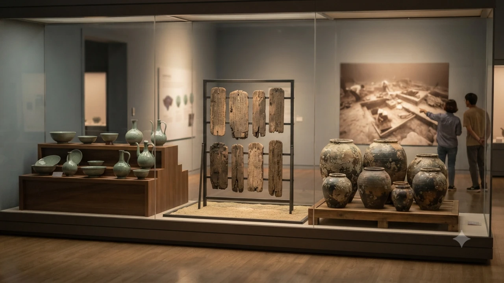

**수중발굴 50주년**을 기념해 2026년 11월 25일 태안수중유산박물관에서 문을 연 특별전이 반세기 해양 고고학의 궤적을 수면 위로 끌어올리고 있다. 차가운 서해 갯벌과 난파선 화물 속에 갇혀 있던 도자기와 목간, 생활용품은 종이 기록이 놓친 해상 교역과 뱃사람들의 숨결을 선명하게 되살린다.

## 한국 수중발굴 50주년 특별전의 기획 배경과 의의

국가유산청 국립해양유산연구소 태안수중유산박물관이 한국 수중발굴 50주년을 맞아 기획한 이번 전시는 지난 50년간 바다 밑에서 건져 올린 조사 기록과 보존 과학의 현주소를 집약했다. 거친 조류와 탁한 시야 속에서 유물을 찾아낸 잠수·측량 기술의 변화부터, 한 점의 유물이 전시대에 오르기까지의 과학적 공정을 함께 비춘다.

### 태안수중유산박물관 개막 소식과 반세기 기록

한국 수중고고학은 1976년 전남 신안 앞바다에서 시작된 신안선 발굴과 함께 본격적인 길을 열었다. 어부의 그물에 걸린 청자 한 점에서 출발한 조사는 이후 완도선, 십이동파도선, 태안선, 마도 1~4호선 등 서해안 주요 해역의 고선박 발굴로 이어지며 해양 유산 연구의 뼈대를 세웠다.

이번 특별전은 1976년부터 2026년까지 이어진 50년의 기록을 발굴 연표, 현장 장비, 조사 보고 자료로 풀어낸다. 초기 잠수 조사의 수동 측량 기구와 현대의 음파탐사·수중 3D 기록 장비를 나란히 배치해 조사 현장의 기술 도약을 한눈에 보여준다.

### 바닷속 문화유산이 들려주는 해상 교류사

육지 유적이 궁궐·사찰·무덤 중심의 의례와 권력을 주로 남긴다면, 바닷속 난파선은 **항해 중 멈춘 교역 현장**을 통째로 품고 있다. 배가 가라앉는 순간 선적된 화물과 선원들의 물건이 함께 침몰하기 때문에, 특정 시기의 생산지와 소비지, 바닷길의 흐름이 맞물려 드러난다.

> "난파선 한 척은 교역 물품과 항해 기술, 이름 없는 선원들의 생활이 겹쳐진 살아 있는 해상 기록이다."

서해 해역에서 확인된 고려청자와 곡물, 화물표 역할을 한 목간은 지방 도요지의 생산 유통과 내륙·연안을 잇던 조운 체계의 단서를 구체적으로 보여준다. 유산의 보존 기준과 공공성을 둘러싼 현대적 쟁점은 [유홍준 부여 자택 담장 문화유산 등록 논란 진짜 쟁점](/posts/humanities/yoohongjun-buyeo-wall-heritage-controversy-2026/) 글에서도 함께 짚어볼 수 있다.

### 발굴 현장과 보존 과학이 만든 인문학적 가치

물속에 잠겨 있던 유물은 공기 중으로 나오는 순간 염분 결정화와 목재 변형이라는 거센 시험대에 오른다. 수백 년간 바닷물을 머금은 고선박 목재는 세포 조직이 약해진 상태라 탈염과 안정화 처리가 끝나야 전시실에 설 수 있다.

그 긴 시간을 견뎌낸 유물 앞에서는 발굴자의 집념과 보존 과학자의 손길이 함께 읽힌다. 기록과 유산의 의미를 넓게 이어 보고 싶다면 [청년문화예술패스 도서 확대! 바뀐 3가지](/posts/humanities/youth-culture-pass-book-expansion-2026/) 글도 참고할 만하다.

## 주요 전시 포인트와 관람객이 주목할 유물

전시 공간은 해역별 출토품의 성격과 선상 생활 유물을 엮어 시대·항로별 차이를 비교하기 쉽게 꾸몄다.

### 수중 고고학 성과와 대표 출토 유물 비교

해역과 선박 성격에 따라 출토 유물의 결이 뚜렷하게 갈린다.

- **신안선 출토품:** 동아시아 원거리 무역망을 보여주는 다량의 청자·백자와 금속 화폐, 향신료 관련 자료가 중심을 이룬다.
- **태안·마도 해역 출토 유물:** 고려 시대 연안 항로를 오간 조운선 화물로, 청자와 곡물, 저장 용기 등이 실려 있어 국내 물류 흐름을 비춘다.
- **보존 처리 전후 비교 자료:** 건져 올린 직후의 상태와 탈염·복원 과정을 거친 유물을 함께 보여줘 보존 처리의 실체를 전한다.

외항 무역선과 연안 조운선의 적재 품목을 비교하면 교역권의 넓이와 생활 물자의 이동 경로가 더욱 입체적으로 다가온다.

### 난파선과 선적 화물로 읽는 옛 생활사

관객의 발길을 붙잡는 건 화려한 기물보다 **배 위 사람들의 손때 묻은 일상**이다. 선상 취사용 솥과 그릇, 바둑돌, 빗, 화물 정보를 적은 목간은 수백 년 전 항해자들의 하루를 구체적인 장면으로 불러낸다.

목간에 남은 발송·수취 기록과 품목명은 문헌 기록에서 비어 있던 지방 유통망의 연결고리를 보여준다. 거대한 역사 서술 뒤에 가려졌던 평범한 사람들의 흔적을 마주할 때 수중 유산의 인문학적 결이 살아난다.

### 전시 동선과 체험 요소 활용 팁

관람 순서는 **발굴 50년 연표 → 해역별 핵심 유물 → 보존 과학·선상 생활 존**으로 잡는 편이 매끄럽다. 먼저 인양 해역 지도와 발굴 시기를 짚고 유물을 살피면, 각 유물이 어떤 항로를 지나다 그 자리에 머물게 되었는지 맥락을 놓치지 않는다.

## 수중유산 보존·전시의 장점과 현실적 한계

수중발굴 50주년 특별전은 해양 문화유산을 가까이서 마주할 계기를 열지만, 현장 조사와 보존 운영에는 뚜렷한 이점과 과제가 나란히 놓여 있다.

### 현장 체험과 역사 교육 효과라는 장점

바닷가 인근 현장에서 실물 유물과 발굴 장비를 보는 경험은 화면이나 활자로만 접할 때와 결이 다르다.

- **현장감 있는 공간 이해:** 실제 수중발굴이 이루어진 해역과 가까운 공간에서 유물을 보며 조류와 바닷길의 성격을 직관적으로 체감할 수 있다.
- **학문 간 시야 확장:** 고고학과 역사뿐 아니라 해양학, 화학, 보존과학이 맞물리는 과정을 보며 입체적인 시각을 넓힐 수 있다.
- **지역 문화 접점 확대:** 수도권 중심 관람 동선을 넘어 서해안 해양 유산 공간으로 발걸음을 넓히는 계기가 된다.

### 수중 환경 훼손 우려와 보존 비용 부담이라는 단점

반면 인양 이후의 관리 부담은 만만치 않다. 물속에서 평형을 이루던 유물을 꺼내면 탈염·건조·수장고 환경 유지에 오랜 시간과 비용이 이어지며, 수장 공간 확보 문제도 뒤따른다.

해수 온도 변화나 해저 지형 변동, 불법 훼손 우려 역시 수중 유산이 안고 있는 변수다. 그래서 무조건적인 인양보다 현장 보존과 선별 조사 중 무엇이 유산의 가치를 지키는 길인지 신중히 따져야 한다.

### 해양 문화유산 기록화를 둘러싼 과제

앞으로의 50년은 유물 인양을 넘어 정밀 해저 탐사 데이터와 디지털 기록을 축적하는 방향으로 나아가야 한다. 시야 확보가 까다로운 서해 환경에서도 정밀 측량 기술과 전문 인력이 뒷받침되어야 수중 유산 기록의 정확도와 활용 폭이 커진다.

## 태안수중유산박물관 방문 전 실전 가이드

특별전 관람을 계획하고 있다면 이동 시간과 현장 확인 사항을 미리 챙겨 두는 편이 훨씬 수월하다.

### 관람 일정·위치 파악 및 동선 계획 순서

1. **개관 일정 및 프로그램 확인:** 출발 전 국립해양유산연구소와 태안수중유산박물관 안내를 통해 관람 시간, 휴관일, 전시 해설 운영 여부를 확인한다.
2. **이동 시간 여유 확보:** 해안 지형 특성상 자차 이동이 편리하며, 주말에는 인근 해안도로 혼잡을 감안해 이른 시간에 도착하는 일정이 무난하다.
3. **인근 유적 연계:** 박물관 관람 뒤 주변 해안 유적과 역사 공간을 함께 둘러보면 하루 인문 답사 코스로 짜기 좋다.

### 아이·가족 동반 관람객을 위한 이해 포인트

아이와 함께 찾을 때는 모든 설명문을 읽기보다 **질문 두세 가지**를 정해 같이 찾아보는 방식이 효과적이다. "이 유물은 어디서 만들어져 어디로 가고 있었을까?", "선원들은 배 안에서 어떤 물건을 썼을까?"처럼 질문을 던지면 관람이 단순 구경을 넘어 함께 추리하는 시간이 된다.

### 전시 연계 도서·역사 자료로 여운 잇는 법

전시를 보고 난 뒤에는 신안선·마도선 조사 이야기나 고려 시대 해상 교류 관련 교양서를 펼쳐 보면 유물의 맥락이 한층 단단해진다. 관람 메모와 독서 기록을 정리할 때 쓸 만한 [해양역사 도서 및 전시기록 노트 쿠팡에서 보기](https://www.coupang.com/np/search?q=%ED%95%B4%EC%96%91%EC%97%AD%EC%82%AC%20%EB%8F%84%EC%84%9C%20%EB%85%B8%ED%8A%B8&sourceType=affiliate&trackingCode=AF8691300)도 함께 살펴보길 권한다.

#수중발굴50주년 #태안수중유산박물관 #수중고고학 #해양문화유산 #신안선 #마도선 #고려청자 #해상교류사 #박물관전시 #인문답사