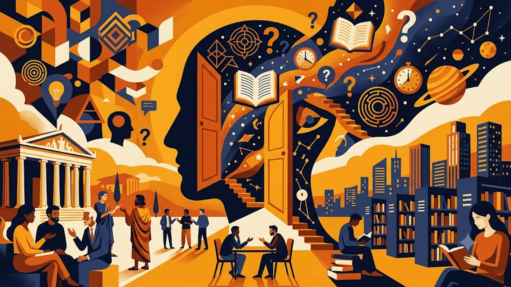

2026년 11월 19일은 유네스코가 지정한 **세계 철학의 날**입니다. 스마트폰에 질문만 던지면 AI가 1초 만에 깔끔한 요약본을 내놓는 요즘, 굳이 철학적 사유를 기념하는 이유가 낯설게 느껴지기도 합니다. 오늘 하루만큼은 알고리즘이 떠먹여 주는 결론을 잠시 닫아두고, 비판적 사고로 내 생각의 좌표를 점검해 볼 때입니다.

## 2026 세계 철학의 날, 왜 매년 11월 셋째 목요일일까?

### 유네스코가 세계 철학의 날을 제정한 진짜 이유

유네스코(UNESCO)는 2002년 철학의 날 행사를 처음 연 뒤, 2005년 총회에서 **매년 11월 셋째 목요일**을 공식 기념일로 확정했습니다. 두꺼운 원서와 대학 강의실에 갇혀 있던 철학을 광장과 일상으로 끌어내자는 취지입니다.

온라인 댓글창부터 일상 대화까지 의견이 조금만 달라도 곧장 날을 세우는 일이 잦아졌습니다. 유네스코가 이 날을 통해 짚고자 하는 핵심은 단순합니다. **철학은 학자들의 전유물이 아니라, 나와 다른 생각을 마주했을 때 감정적으로 폭발하지 않고 질문으로 풀어내는 생활의 기술**이라는 점입니다.

### 과거의 고전 철학과 2026년 AI 시대 철학의 결정적 차이

고대 아테네의 광장에서 소크라테스가 던진 질문은 정보 자체가 귀하던 시절의 본질 탐구였습니다. 반면 2026년의 우리는 정보가 부족해서가 아니라, 너무 빠르고 매끄럽게 가공된 정보가 쏟아져서 생각할 틈을 잃고 있습니다.

- **고전 철학의 과제**: 모르는 세계의 원리를 밝혀내고 지식을 넓히는 일
- **2026년 AI 시대 철학의 과제**: 매끄러운 AI 답변과 추천 알고리즘 사이에서 **스스로 판단하는 주도권**을 지키는 일

검색 결과를 일일이 비교할 필요조차 없어지는 환경에서는 내 취향과 의견마저 남의 설계에 맡기기 쉽습니다. 기술의 편리함 속에서 인간의 선택권이 어떻게 흐려지는지 더 짚어보고 싶다면 [제로 클릭 2026, 내 자유의지는 진짜 살아있을까?](/posts/humanities/zero-click-era-autonomy-2026/) 글도 함께 확인해 보세요.

## 일상에서 철학이 필요한 이유: 생각의 근육을 키우는 법

### 비판적 사고와 정서적 회복, 철학적 사유의 명확한 장점

철학을 생활 습관으로 들이면 거창한 교양을 쌓기 전에 먼저 **일상의 멘탈과 판단력**이 단단해집니다.

- **자극적인 정보에 휘둘리지 않는 힘**: SNS에서 화제가 되는 주장을 보더라도 곧장 분노하거나 동조하기 전에 '이 주장의 근거가 무엇인지' 한 박자 멈춰 따져 보게 됩니다.
- **불안을 객관화하는 습관**: 로마 황제 마르쿠스 아우렐리우스가 《명상록》에 남긴 기록처럼, 내가 바꿀 수 있는 일과 어쩔 수 없는 일을 선 긋기 시작하면 퇴근 후까지 이어지던 꼬리 물기식 걱정이 확연히 줄어듭니다.
- **관계의 피로도 감소**: 내 기준이 유일한 정답이 아니라는 사실을 받아들이면, 직장 동료나 가족의 다른 태도를 나를 향한 공격이 아닌 '다른 관점'으로 넘길 여유가 생깁니다.

### 지나친 관념주의와 회의주의, 철학 입문 시 주의할 함정

물론 철학에 처음 관심을 가질 때 빠지기 쉬운 함정도 분명합니다. 난해한 학술 용어를 외워 남에게 과시하거나, 당장 해결해야 할 현실의 문제는 미뤄둔 채 **공허한 말장난**에만 매달리는 경우입니다.

모든 기준을 의심하다가 '어차피 다 부질없다'는 식의 무기력한 **냉소**로 흐르는 태도 역시 경계해야 합니다. 철학은 현실에서 도망치기 위한 핑계가 아니라, 눈앞의 선택을 더 선명하게 내리기 위한 도구로 쓸 때 비로소 쓸모가 생깁니다.

## 오늘 당장 시작하는 나만의 철학적 질문 루틴 3단계

### 알고리즘 추천 대신 스스로에게 '왜'라고 묻기

가장 현실적인 첫걸음은 스마트폰을 켰을 때 습관적인 터치를 멈추는 일입니다. 쇼핑 앱의 추천 상품이나 짧은 영상 썸네일을 누르기 직전, 속으로 딱 한 번만 물어보세요. **"지금 이걸 내가 원해서 보는 걸까, 아니면 화면이 나를 끌어당긴 걸까?"** 이 짧은 3초의 멈춤이 주체적인 사유의 출발선입니다.

### 하루 10분, 고전 철학 문장 필사 및 사유 기록하기

벽돌처럼 두꺼운 철학 개론서를 첫 페이지부터 완독하려 들면 일주일을 넘기기 어렵습니다. 세네카나 니체, 혹은 동양 고전의 짧은 문장 하나만 골라 노트에 옮겨 적고, 그 아래에 오늘 겪은 일과 연결해 두세 줄만 덧붙여 보세요. 부담 없이 철학 입문서나 인문 서적을 구해보고 싶다면 [청년문화예술패스 도서 확대! 바뀐 3가지](/posts/humanities/youth-culture-pass-book-expansion-2026/) 같은 제도를 활용해 책 한 권을 마련해 보는 것도 알찬 방법입니다.

### 일상 속 선택의 딜레마를 철학 개념으로 재해석하기

이직을 고민하거나 팀 내 의견 충돌이 생겼을 때, 철학의 렌즈를 잠깐 빌려오면 감정에 매몰되지 않습니다. 당장의 손익 계산에만 매달리기보다 '아리스토텔레스가 말한 중용의 기준이라면 어디쯤일까', '칸트의 관점에서 이 선택을 남에게도 똑같이 권할 수 있을까'를 대입해 보면 훨씬 차분한 결론에 닿게 됩니다.

## 철학하는 일상이 가져온 생각의 변화

### 매일 15분 철학 에세이 읽기로 달라진 문제 해결 방식

출근 전 15분씩 짧은 철학 에세이를 읽고 메모하는 루틴을 이어가면서 가장 크게 바뀐 부분은 **돌발 변수를 대하는 태도**였습니다. 예전에는 업무 일정이 꼬이거나 예상치 못한 피드백이 날아오면 당황해서 눈앞의 불부터 끄느라 진을 빼기 일쑤였습니다.

하지만 매일 질문하는 습관이 붙고 나서는, 일단 1분만 멈춰 서서 '지금 꼬인 지점의 핵심 원인이 정확히 무엇인지'부터 문장으로 적어 내려가게 되었습니다. 문제의 윤곽을 먼저 정의하고 움직이니 불필요한 감정 소모가 줄고 해결 속도도 오히려 빨라졌습니다.

### 완벽한 정답보다 '좋은 질문'을 남기는 삶의 태도

> "성찰하지 않는 삶은 살 가치가 없다." — 소크라테스

검색 한 번이면 그럴듯한 모범 답안이 쏟아지는 시대일수록, 결국 사람의 깊이를 가르는 기준은 **남들이 당연하게 넘기는 전제에 의문을 던지는 감각**입니다.

2026년 세계 철학의 날을 맞아 오늘 밤에는 스마트폰을 잠시 내려놓고, 내 생각을 차분히 눌러 담을 책과 노트를 펼쳐 보시는 건 어떨까요? [철학 입문서 및 필사 노트 쿠팡에서 보기](https://www.coupang.com/np/search?q=%EC%B2%A0%ED%95%99%20%EC%9E%85%EB%AC%B8%EC%84%9C&sourceType=affiliate&trackingCode=AF8691300)

#세계철학의날 #유네스코 #철학적사유 #비판적사고 #AI시대인문학 #철학입문 #일상철학 #독서루틴