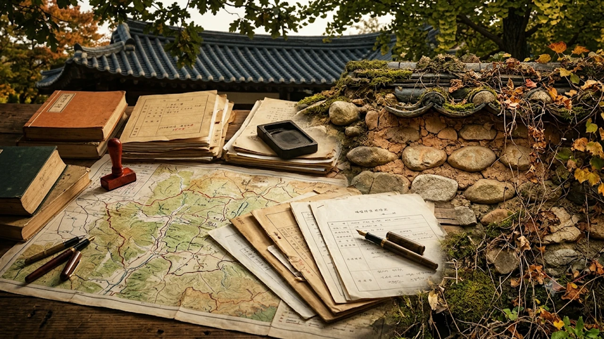

유홍준 전 문화재청장 재임 시절 추진된 충남 부여 반교마을 옛 담장의 국가등록문화유산 지정 구역에 본인 자택 담장이 포함된 사실이 알려지며 **유홍준 자택 담장 문화유산** 등록 논란이 거세지고 있습니다. 공직자의 이해충돌 문제와 근현대 생활유산 보존이라는 공익적 가치 사이에서 특혜 의혹과 직권 등록의 정당성을 둘러싼 공방이 이어지는 상황입니다.

## 유홍준 전 청장 자택 담장 문화유산 등록 논란의 발단

### 2026년 11월 13일 제기된 부여 반교마을 옛 담장 '셀프 등록' 의혹
논란은 유 전 청장이 기관장으로 재직하던 당시, 충남 부여군 외산면 반교마을의 옛 돌담길이 국가등록문화유산으로 지정된 행정 이력이 재조명되면서 불거졌습니다. 핵심 쟁점은 해당 지정 구역 안에 유 전 청장의 개인 별장 겸 자택인 '휴휴당'의 담장 일부가 포함되었다는 사실입니다. 기관장이 본인 소유 부동산이 속한 구역의 문화유산 지정 결재 라인에 있었다는 점에서, 공직자의 이해충돌 방지 의무와 행정 절차의 객관성에 의문이 제기되었습니다.

### 문화재청장 재임 시절 지정된 휴휴당 돌담장과 국비 투입 내역
반교마을 옛 담장은 마을 전체의 전통 경관을 이루는 토석담과 돌담의 보존 가치를 인정받아 등록되었습니다. 그러나 지정 이후 마을 경관 정비 및 보존 관리 명목으로 국비와 지방비가 투입되면서, 결과적으로 개인 자택 담장의 보수·관리 비용을 세금으로 지원받은 셈이 아니냐는 비판이 뒤따랐습니다. 과거 [유홍준 사의, 친일파 유묵 전말과 숨은 논란 3가지](/posts/humanities/yoohongjun-resignation-pro-japanese-calligraphy-controversy-2026/) 사례처럼 문화유산 행정의 공정성과 도덕적 기준을 둘러싼 논쟁이 다시 한번 수면 위로 떠오른 양상입니다.

## 국가유산청의 공식 해명과 직권 등록 절차 분석

### 일괄 조사 방식의 마을 단위 등록문화유산 지정 기준
국가유산청은 특정 개인에게 혜택을 주기 위한 맞춤형 지정이 아니라는 입장을 분명히 밝혔습니다. 당시 전국 농어촌 지역의 근현대 옛 담장을 보존하기 위해 외부 학술 조사 용역을 거쳐 일괄적으로 '면(선) 단위' 등록을 추진했으며, 반교마을 역시 개별 가옥이 아닌 마을 전체의 돌담 네트워크를 하나의 유산으로 묶어 평가했다는 설명입니다.
- **조사 주체:** 외부 전문가 및 지자체 학술 조사를 통한 대상지 발굴
- **지정 범위:** 특정 건축물이 아닌 마을 골목길을 따라 이어지는 옛 담장 구간 전체
- **심의 과정:** 문화재위원회 근대문화재분과 위원들의 현장 실사와 의결 통과

### 개인 사유지 포함 시 문화유산 보호법상 규제와 혜택 비교
등록문화유산은 국보나 보물 같은 국가지정문화유산보다 규제가 완화된 제도이지만, 소유자에게 일방적인 금전적 이득만 돌아가는 구조는 아닙니다.

| 구분 | 소유자에게 적용되는 규제 및 의무 | 국가 및 지자체 지원 혜택 |
| :--- | :--- | :--- |
| **현상 변경** | 외관의 4분의 1 이상 변경 시 지자체 신고 필수 | 수리·보수 시 설계 및 공사비 일부 보조 |
| **매매·처분** | 소유자 변경 시 신고 의무 발생 | 세제 감면 혜택 일부 적용 가능 |
| **관리 책임** | 훼손 방지를 위한 선량한 관리 의무 부과 | 정기 안전 점검 및 기술 자문 지원 |

> "마을 단위로 이어진 옛 담장은 특정 필지만 떼어내어 지정할 경우 경관의 연속성이 훼손되므로, 소유주와 무관하게 구간 전체를 포함해 등록하는 것이 학술적 원칙에 부합한다."

## 문화유산 지정의 공정성을 둘러싼 찬반 쟁점

### 공직자 이해충돌 및 행정 절차적 정당성을 비판하는 시각
비판 측에서는 행정 절차가 규정을 따랐더라도 최고 책임자의 사유지가 포함된 사안이라면 더욱 엄격한 회피와 검증이 선행되었어야 한다고 지적합니다. 일반 시민 입장에서는 전직 기관장의 자택 담장이 국가 유산으로 지정되고 보수 예산까지 배정된 결과 자체가 공정성 훼손으로 비칠 수밖에 없다는 논리입니다. 특히 국비 지원 사업 선정 과정에서 해당 지역이 우선순위를 점한 배경에 대한 투명한 자료 공개를 요구하는 목소리가 큽니다.

### 근현대 마을 경관 보존이라는 공익적 가치를 강조하는 입장
반면 문화유산 보존론자들은 인물의 공직 이력 때문에 보존 가치가 뚜렷한 마을 유산을 배제하는 것 역시 형평성에 어긋난다고 반박합니다. 반교마을 돌담은 20세기 초반 농촌 공동체의 석축 기술을 보여주는 귀중한 생활사 자료이며, 소유자가 누구인지에 따라 유산의 학술적 가치가 달라지지 않는다는 것입니다. 당시 전국 여러 농어촌 지역의 옛 담장이 동일한 기준으로 함께 등록되었다는 점도 특혜론을 반박하는 근거로 제시됩니다.

## 이번 논란이 남긴 근현대 문화유산 보존 제도의 과제

### 등록문화유산 지정 과정의 투명성 확보와 이해충돌 방지 대책
이번 사안은 근현대 생활유산처럼 사유지와 밀접하게 얽힌 문화유산을 다룰 때 행정 기관이 갖추어야 할 윤리적 기준을 환기합니다. 앞으로 지자체나 국가유산청이 면 단위·마을 단위 등록을 추진할 때는 기획 단계부터 고위 공직자 및 심의위원의 이해관계 여부를 사전 공시하고, 해당 필지에 대한 예산 집행 내역을 별도로 검증하는 제도적 장치가 요구됩니다.

### 사유 재산권 보호와 국비 지원 기준의 합리적 개선 방향
등록문화유산 제도가 본래 취지인 '자발적 보존 유도'를 달성하려면, 소유자의 재산권 제약에 상응하는 합리적 보상과 엄격한 세금 집행 기준이 균형을 이루어야 합니다. 공공의 보행로와 맞닿은 담장처럼 공익적 개방성이 높은 유산에 한해 보수비를 차등 지원하는 등 국민이 납득할 수 있는 세부 가이드라인 정비가 시급합니다. 한국 문화유산의 역사와 답사 현장의 맥락을 깊이 이해하고 싶다면 유홍준 교수의 대표 저서를 직접 읽어보길 권합니다. [나의 문화유산답사기 쿠팡에서 보기](https://www.coupang.com/np/search?q=%EB%82%98%EC%9D%98+%EB%AC%B8%ED%99%94%EC%9C%A0%EC%82%B0%EB%8B%B5%EC%82%AC%EA%B8%B0&sourceType=affiliate&trackingCode=AF8691300)

#유홍준 #자택담장 #문화유산논란 #국가등록문화유산 #부여반교마을 #국가유산청 #문화재행정 #근현대문화유산 #나의문화유산답사기