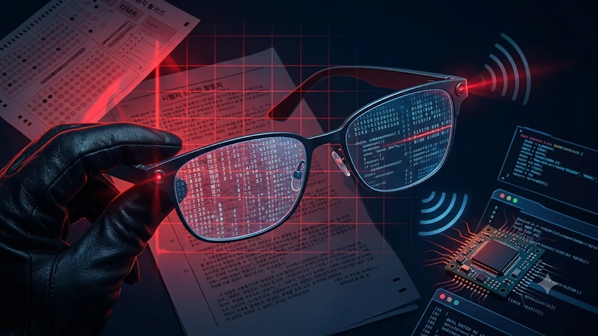

최근 대학 중간고사와 공인 어학시험 현장에서 **AI 안경 부정행위** 적발 사례가 잇따르면서, 스마트 글래스가 시험 공정성과 일상 프라이버시를 위협하는 새로운 화두로 떠올랐습니다. 일반 뿔테안경과 구별하기 힘든 초경량 프레임 안에 초소형 카메라와 마이크로 LED 디스플레이, 실시간 음성 AI가 탑재되면서 육안 감시만으로는 악용 여부를 가려내기 어려워졌기 때문입니다. 2026년 하반기 수능과 각종 국가자격시험을 앞두고 교육 당국과 일선 현장이 긴장하는 핵심 이유와 구체적인 판별 기준을 짚어보겠습니다.

## AI 안경이 시험장과 일상에서 논란이 된 배경

### 최근 대학·고교 시험장 부정행위 적발 사례와 수능 대비 현장
국내 주요 대학의 온라인·대면 병행 시험과 일부 고교 내신 평가에서 응시자가 안경다리를 가볍게 터치해 문제지를 촬영한 뒤, 골전도 스피커로 AI의 풀이 답변을 듣다 감독관에게 적발되는 사례가 보고되었습니다. 기존 스마트폰이나 스마트워치는 시험 시작 전 일괄 수거하지만, 시력 교정용 렌즈를 끼운 스마트 안경은 수험생이 착용한 채 입실해도 감독관이 즉각 알아채기 어렵다는 허점을 파고든 것입니다. 한국교육과정평가원 역시 2027학년도 대학수학능력시험 반입 금지 물품 안내에서 통신·촬영 기능이 내장된 모든 안경형 웨어러블 기기를 명확히 금지 품목으로 지정하고 감독관 교육을 강화하고 있습니다.

### 일반 안경과 구분하기 어려운 초소형 카메라·디스플레이 구조
과거 1세대 스마트 글래스는 두꺼운 배터리 모듈과 투박한 프리즘 렌즈 탓에 멀리서도 착용 사실을 단번에 알 수 있었습니다. 반면 최신 AI 안경은 무게를 30~40g대까지 줄이고, 안경테 경첩 부위에 바늘구멍 크기의 카메라 렌즈를 숨기는 방식으로 설계되었습니다.

> "렌즈 안쪽 도파관(Waveguide) 디스플레이는 착용자 시야에만 텍스트를 띄우기 때문에, 바로 옆자리 수험생이나 앞을 지나가는 감독관 눈에는 평범한 투명 렌즈처럼 보입니다."

### 길거리 불법 촬영(몰카) 우려로 번진 사생활 침해 쟁점
시험장 밖 일상 공간에서는 무단 촬영 문제가 더 큰 갈등을 낳고 있습니다. 스마트폰을 들어 올리는 동작 없이 시선만 돌리면 고화질 사진과 영상이 즉시 녹화되다 보니, 대중교통이나 탈의실, 카페 등에서 타인의 얼굴과 사생활이 동의 없이 기록될 위험이 커졌습니다. 해외에서는 레스토랑이나 헬스장 출입구에서 AI 안경 착용을 제한하는 안내문을 내거는 매장까지 등장하며 사회적 경계심이 높아지고 있습니다.

## 기존 스마트 글래스와 최신 AI 안경의 기능·보안 비교

### LED 표시등 작동 방식과 우회 가능성 비교
주요 제조사들은 카메라가 작동할 때 안경 전면부에 흰색이나 녹색 LED 불빛이 점등되도록 설계해 주변 사람에게 촬영 사실을 알리고 있습니다. 하지만 온라인 커뮤니티와 해외 포럼에서는 LED 센서를 검은색 절연 테이프나 전용 스티커로 가려 불빛을 차단하는 편법이 공유되면서 보안 장치의 실효성 논란이 불거졌습니다. 일부 저가형 해외 직구 제품의 경우 LED 점등 기능 자체가 없거나 펌웨어 조작으로 불빛을 끌 수 있어 관리 사각지대가 더욱 넓습니다.

### 음성 비서·실시간 번역·화면 투사 기능별 악용 리스크
단순 사진 촬영을 넘어 기기 자체의 인공지능 연산 능력이 고도화되면서 악용 방식도 훨씬 교묘해졌습니다. 단순히 글자를 읽는 수준을 넘어 맥락을 파악하는 AI 기술의 진화([텍스트 AI의 한계와 진화](/posts/it-devices/text-based-ai-limits-and-evolution/))가 초소형 웨어러블 기기에 그대로 이식되었기 때문입니다.
- **실시간 번역 및 요약**: 외국어 지문이나 전문 용어를 시선으로 훑기만 해도 렌즈 화면에 즉시 번역문을 띄워 어학·전공 시험의 변별력을 무력화합니다.
- **저소음 골전도·지향성 오디오**: 이어폰을 꽂지 않고도 안경다리 내부 스피커가 귓바퀴 바로 앞으로 소리를 전달해 주변 정적 속에서도 외부에 소리가 거의 새어 나가지 않습니다.
- **클라우드 연동 데이터 전송**: 블루투스로 주머니 속 스마트폰과 연결해 촬영본을 외부 조력자에게 실시간 전송하는 방식도 기술적으로 가능합니다.

### 제조사별 프라이버시 보호 정책 및 하드웨어 제한 차이
글로벌 빅테크 기업들은 LED 센서를 물리적으로 가리면 촬영 자체가 중단되도록 조도 감지 센서를 연동하는 등 보안 규정을 강화하는 추세입니다. 반면 브랜드 인지도가 낮은 중소 제조사 제품들은 이러한 하드웨어 인터록(잠금) 장치가 빠져 있어, 규제를 비켜간 변형 기기가 시중에 유통되는 원인이 되고 있습니다.

## 시험 감독관 및 일반 이용자를 위한 AI 안경 판별·예방 가이드

### 외형·프레임 두께·렌즈 반사로 AI 안경 구별하는 법
전문 탐지 장비가 없는 현장에서도 몇 가지 외형적 특징만 유심히 살피면 일반 안경과 스마트 안경을 구분할 수 있습니다.
- **안경다리(템플) 두께와 경첩 구조**: 배터리와 메인보드가 내장된 탓에 일반 아세테이트 뿔테보다 힌지(경첩) 부위가 두껍고 직선 형태로 뻗어 있습니다.
- **프레임 전면 양끝의 원형 홀**: 전면부 좌우 모서리에 대칭으로 배치된 작은 원형 렌즈와 LED 점등부가 있는지 가까이서 확인해야 합니다.
- **렌즈 표면의 미세한 격자 반사**: 디스플레이 투사 기능이 탑재된 모델은 형광등 불빛 아래에서 렌즈 중앙부에 미세한 무지개빛이나 사각형 광학 패턴이 비칩니다.

### 시험장 반입 금지 기준 및 전자기기 탐지 대응 절차
감독관은 시험 시작 전 안경 착용 응시자를 대상으로 안경다리 안쪽의 충전 단자(포고 핀)나 전원 버튼 유무를 육안으로 점검하는 절차를 도입하고 있습니다. 수험생 본인이 일반 도수 안경을 착용했더라도 프레임이 지나치게 두꺼운 디자인이라면 불필요한 오해를 피하기 위해 시험 당일에는 얇은 금속테나 기본형 뿔테를 착용하는 편이 안전합니다.

### 일상 공간에서 사생활 침해 피해를 줄이는 실전 대처법
카페, 도서관, 피트니스 센터 등 사적 공간에서 상대방의 안경 전면부에 작은 불빛이 깜빡이거나 렌즈 모서리에 카메라 모듈이 보인다면 촬영 여부를 정중히 확인하고 중단을 요청할 권리가 있습니다. 만약 동의 없는 촬영 정황이 명백하다면 현장에서 즉시 기기 화면 확인을 요구하거나 시설 관리자에게 알려 기록을 확보하는 것이 바람직합니다.

## AI 웨어러블 확산에 따른 향후 규제와 기술적 해법 전망

### 국내외 교육기관·공공장소의 스마트 안경 규제 움직임
교육부와 주요 대학들은 시험장 내 전자기기 탐지기 도입을 확대하고, 부정행위 적발 시 학칙에 따른 최고 수위 징계 및 국가시험 응시 자격 제한 규정을 명문화하고 있습니다. 공공기관과 기업 보안 구역에서도 스마트폰 카메라에 보안 스티커를 붙이던 기존 방식에서 나아가, 스마트 안경 반입 자체를 통제하는 출입 보안 지침을 신설하는 곳들이 늘고 있습니다.

### 하드웨어 차원의 촬영 알림 의무화 및 보안 표준 논의
전문가들은 소프트웨어 경고만으로는 편법 악용을 막기 어렵다고 지적하며, 촬영 시 일정 데시벨 이상의 셔터음 발생을 강제하거나 LED 차단 시 카메라 전원을 자동 차단하는 국제 하드웨어 표준 제정이 시급하다고 강조합니다.

### 편의성과 프라이버시 균형을 위한 향후 기기 발전 방향
AI 안경은 시각장애인 보행 보조, 실시간 통역, 산업 현장 원격 지원 등 긍정적인 활용 가치가 매우 큰 차세대 폼팩터입니다. 기술의 편리함이 사회적 신뢰를 무너뜨리지 않으려면 제조사의 철저한 프라이버시 설계와 사용자의 윤리 의식, 그리고 현실을 반영한 제도적 가이드라인이 함께 자리 잡아야 합니다.

[스마트 안경·웨어러블 관련 기기 쿠팡에서 보기](https://www.coupang.com/np/search?q=%EC%8A%A4%EB%A7%88%ED%8A%B8%EC%95%88%EA%B2%BD%20%EC%9B%A8%EC%96%B4%EB%9F%AC%EB%B8%94&sourceType=affiliate&trackingCode=AF8691300)

#AI안경부정행위 #스마트안경 #AI글래스 #수능부정행위 #사생활침해 #웨어러블기기 #IT트렌드