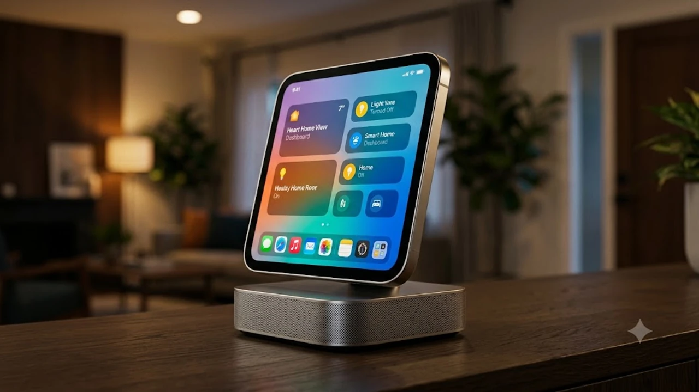

애플이 스마트홈 시장의 판도를 바꿀 전용 스마트 디스플레이 기기인 **애플 홈뷰**를 전격 발표했습니다. 오랫동안 소문만 무성했던 탁상형 스마트홈 허브 기기가 마침내 실물을 드러내면서 애플 생태계 사용자들의 시선이 집중되고 있습니다.

## 애플 홈뷰 전격 공개, 아이패드와 무엇이 다른가

### 벽걸이 거치와 마그네틱 독 구조의 실물 폼팩터
애플 홈뷰는 휴대용 태블릿이 아닌 집안의 고정형 제어 센터를 표방합니다. 본체는 정사각형에 가까운 콤팩트한 비율의 7인치 레티나 디스플레이를 갖추고 있으며, 기본 제공되는 마그네틱 사운드 독에 자석으로 단단히 결합됩니다.

- **스피커 통합 베이스**: 홈팟 미니 수준의 풍성한 저음을 내는 스피커 베이스가 거치대 역할을 겸합니다.
- **벽면 마운트 옵션**: 월 마운트 브래킷을 사용해 거실 벽면이나 주방 타일에 인터폰처럼 매립 형태로 고정할 수 있습니다.
- **초광각 센터 스테이지 카메라**: 주방에서 요리하거나 거실을 오갈 때 화각을 알아서 조절해 페이스타임 영상 통화를 돕습니다.

### 스마트 디스플레이 전용 'homeOS'와 아이패드 iPadOS 차이점
아이패드가 개인 작업과 멀티미디어 소비에 초점을 맞춘 iPadOS를 구동한다면, 홈뷰는 가족 공용 환경에 특화된 신규 운영체제인 **homeOS**를 탑재했습니다. 복잡한 앱 서랍 대신 화면 전체가 실시간 위젯 패널로 채워집니다.

> "개인 기기인 태블릿을 거실에 방치할 때 생기는 사생활 알림 노출 문제를 원천 차단하고, 모든 가족 구성원이 한눈에 집안 상태를 파악하도록 재설계한 인터페이스"

개인용 메신저나 업무용 메일 알림은 걸러내고 조명, 실내 온도, 홈캠 모니터링, 가족 공용 캘린더 등 공동 관리 요소만 간결한 위젯 카드로 상시 띄워둡니다.

## 업그레이드된 Siri AI와 온디바이스 홈 제어 성능

### 집안 내 사용자 음성 분별 및 맥락 인식 비서 기능
홈뷰의 핵심은 차세대 인공지능이 결합된 Siri입니다. 마이크 어레이 4개를 배치해 주방 후드 소음이나 TV 소리가 섞인 환경에서도 사용자 음성을 정확히 분리해냅니다. 특히 음성 프로필 분석 기술을 고도화하여 발화자가 누구인지 즉각 파악합니다.

- **발화자별 맞춤 브리핑**: 부모가 "오늘 일정 뭐야?"라고 물으면 출퇴근 교통 정보와 직장 일정을, 자녀가 물으면 학원 시간표와 숙제 메모를 띄웁니다.
- **연속 명령 수행**: 문장을 끊지 않고 "거실 조명 끄고 에어컨 온도 24도로 맞춰" 같은 복합 명령도 지체 없이 처리합니다.
- 온디바이스 언어 모델의 세부 작동 방식과 생성형 인터페이스 변화는 [텍스트 AI의 한계와 진화](/posts/it-devices/text-based-ai-limits-and-evolution/) 분석에서도 다룬 바 있듯, 단순 대화형 챗봇을 넘어 기기 조작 자동화로 이어지는 흐름입니다.

### 매터(Matter) 표준과 LG 스마트 가전 생태계 연동 범위
홈뷰는 독자 규격에 갇히지 않고 개방형 스마트홈 표준인 **매터(Matter)**와 스레드(Thread) 프로토콜을 온보드로 지원합니다. 애플 전용 기기가 아니더라도 호환 등록이 빠릅니다.

국내 거주 환경에서 체감도가 높은 LG 씽큐(ThinQ) 및 삼성 스마트싱스 연동 기기들을 브릿지 없이 직접 등록할 수 있습니다. 예를 들어 거실 홈뷰 화면 터치 한 번으로 로봇청소기를 가동하거나 세탁기 잔여 시간을 실시간 타일 위젯으로 확인하는 식입니다. 수십 대의 IoT 센서가 얽힌 환경에서는 데이터 지연을 줄여주는 무선 환경이 뒷받침되어야 하므로 [Wi-Fi 8 공유기 진짜 살까? 2026 차세대 네트워크 완전 정리](/posts/it-devices/wifi-8-next-gen-router-trend-2026/)와 같은 고대역폭 네트워크 인프라와의 시너지도 눈여겨볼 대목입니다.

## 출시일·출고가와 경쟁 기기 대비 스펙 장단점

### 공식 출시 일정 및 국내 사전 예약 예상 가격대
공개 직후 발표된 1차 출시국 일정에 따르면 북미 시장 기준 이번 달 하순부터 공식 배송이 시작됩니다. 한국은 전파 인증 절차를 거쳐 11월 초순 사전 예약에 돌입할 전망입니다.

- **북미 출시가**: 사운드 독 포함 기본형 249달러
- **국내 출고 예상가**: 환율 및 부가세를 감안할 때 34만 9,000원 전후 형성 유력
- **추가 마운트 액세서리**: 벽면 매립형 전원 플레이트 키트 약 4만 원대 별매

### 구글 네스트 허브 및 아마존 에코 쇼 대비 가격 대비 가치
기존 시장을 양분하던 구글 네스트 허브 2세대나 아마존 에코 쇼 8과 견주었을 때 기기 마감 완성도와 오디오 출력은 확실히 우위에 있습니다.

| 비교 항목 | 애플 홈뷰 (HomeView) | 구글 네스트 허브 2세대 | 아마존 에코 쇼 8 3세대 |
| :--- | :--- | :--- | :--- |
| **운영체제** | homeOS | 캐스트 OS | Fire OS |
| **디스플레이** | 7인치 레티나 (트루톤) | 7인치 LCD | 8인치 HD |
| **음성 인식 비서** | 고도화 Siri (온디바이스) | 구글 어시스턴트 | 알렉사 |
| **스피커 성능** | 베이스 독 일체형 고출력 우퍼 | 풀레인지 드라이버 | 공간 음향 듀얼 드라이버 |
| **정가 기준** | 249달러 | 99달러 | 149달러 |

구글과 아마존 제품 대비 가격은 100달러 이상 높게 책정되었습니다. 단순 날씨 확인용 타이머로 쓰기에는 부담스러운 금액이지만, 집안 내 허브와 고품질 거실 스피커를 하나로 통합한다는 점에서는 납득 가능한 간극입니다.

## 구매 전 체크할 필수 호환성과 실제 추천 대상

### 기존 애플 홈킷 유저가 체감할 3가지 편의성
이미 아이폰과 애플TV, 홈팟을 구동 중인 가정이라면 기기 간 전환 과정에서 탁월한 일체감을 맛볼 수 있습니다.

- **상시 켜짐 인터폰 기능**: 아이폰을 주머니에서 꺼내지 않아도 현관 도어벨이 울리는 즉시 화면에 방문자 영상이 팝업됩니다.
- **핸드오프 음악 재생**: 외출했다가 돌아와 아이폰을 홈뷰 상단에 살짝 대는 것만으로 듣던 음악이 사운드 독으로 이어집니다.
- **가족 구성원 공동 메모**: 냉장고 문에 포스트잇을 붙이듯 음성으로 남긴 메모가 화면 메인 카드에 박제되어 소통이 직관적입니다.

### 구매를 보류해야 하는 사용자 유형과 주의사항
반면 태블릿 대체재를 기대했거나 안드로이드 중심의 가전 구성을 갖춘 사용자라면 실망할 소지가 큽니다. 유튜브 전용 앱이나 웹 브라우징 기능이 극도로 제한되어 있으며, 별도의 동영상 감상용 앱 설치를 지원하지 않습니다. 순수 스마트홈 허브 및 음악 플레이어로 목적을 한정해야 제값을 합니다.

[스마트홈 허브 및 호환 기기 쿠팡에서 보기](https://www.coupang.com/np/search?q=%EC%8A%A4%EB%A7%88%ED%8A%B8%ED%99%88+%ED%97%88%EB%B8%8C+%EC%95%A0%ED%94%8C%ED%99%88%ED%82%B7&sourceType=affiliate&trackingCode=AF8691300)

#애플홈뷰 #애플스마트디스플레이 #homeOS #스마트홈허브 #애플홈킷 #시리인공지능 #매터스마트홈 #구글네스트허브비교