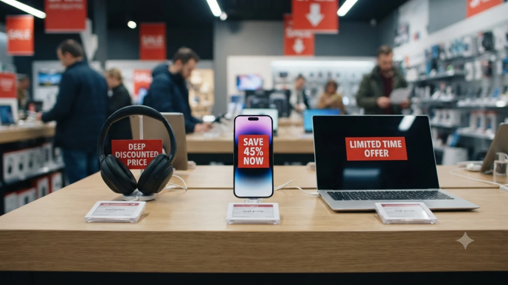

연말 쇼핑 시즌을 맞아 블랙프라이데이 IT기기 할인 프로모션이 쏟아지고 있지만, 행사 직전 정가를 먼저 슬쩍 올린 뒤 할인율 숫자만 크게 보이게 만드는 눈속임 마케팅도 적지 않습니다. 해외 직구와 국내 정발 특가 사이에서 실제 체감 가격이 낮아지는 품목을 골라내려면 가격 변동 이력과 통관 세금 조건을 꼼꼼히 대조해야 합니다. 진짜 최저가 판별 기준부터 올해 체감 할인폭이 두드러지는 핵심 디바이스 5가지, 구매처별 유불리와 AS 체크리스트까지 핵심만 정리했습니다.

## 블랙프라이데이 IT기기 할인, 진짜 최저가 기준 3가지

### 역대 최저가 트래커로 정가 부풀리기 구별하기

쇼핑몰 배너에 적힌 할인율 퍼센트만 보고 결제 버튼을 누르면 평소 상시 판매가와 별 차이가 없는 제품을 살 위험이 큽니다. **카멜카멜카멜(CamelCamelCamel)**이나 **키파(Keepa)** 같은 아마존 가격 추적 도구에 상품 링크를 붙여 넣으면 최근 3개월에서 1년 사이의 실제 가격 변동 곡선이 그래프로 바로 드러납니다. 국내 오픈마켓 역시 다나와나 에누리 같은 가격비교 사이트의 기간별 시세 추이를 대조해 최근 한 달 평균가 대비 최소 15% 이상 낮아졌는지 확인해야 합니다.

### 직구 관부가세 포함 실제 체감가 계산법

해외 직구 결제 창에 찍히는 달러 금액이 통장에서 빠져나가는 최종 지출액은 아닙니다.

- **미국 발송 목록통관 기준**: 물품 가격에 미국 내 현지 배송비와 세금을 합산한 금액이 미화 200달러 이하일 때만 관부가세가 면제됩니다.
- **기타 국가 및 일반통관 기준**: 일본, 유럽, 중국 등에서 출발하는 화물은 미화 150달러를 넘기는 순간 관세와 부가가치세 10%가 한꺼번에 부과됩니다.
- **환율 변동 및 수수료**: 카드사 전신환 매도율과 해외 결제 수수료(약 1~1.5%)까지 더하면 표시 가격보다 약 3~5% 정도 실결제액이 불어납니다.

> 결제 직전 장바구니 총액이 200달러 문턱에 걸린다면, 할인 쿠폰을 적용해 기준선 아래로 내리거나 국내 정발 카드 할인 가격과 원화 총액을 나란히 비교해 보는 편이 안전합니다.

### 카드사 즉시할인과 청구할인 중복 적용 조건

국내 이커머스 플랫폼의 블랙프라이데이 기획전에서는 쿠폰 할인과 카드 혜택이 맞물리는 방식에 따라 최종 결제액이 크게 달라집니다. **즉시할인**은 결제 단계에서 금액이 곧바로 차감되므로 해외 직구 면세 한도나 쿠폰 최소 주문 금액 조건에 직접 영향을 줍니다. 반면 **청구할인**은 결제 당시 전액을 승인한 뒤 카드 대금 청구일에 환급되는 구조라 카드 잔여 한도를 넉넉히 확보해 두어야 합니다.

## 올해 할인폭이 가장 큰 핵심 IT기기 5선

### 노이즈캔슬링 무선 헤드폰 및 이어버드 세대교체 물량

오디오 카테고리에서는 신형 플래그십 모델 출시 직전이나 직후에 놓인 전작 재고 소진 할인이 가장 공격적으로 풀립니다. 소니 WH-1000XM5나 보스 QC 울트라 헤드폰처럼 성능이 검증된 액티브 노이즈캔슬링(ANC) 기기는 상시 판매가 대비 25~35% 수준까지 몸값을 낮추는 경우가 많습니다. 음질과 차음 성능이 이미 상향 평준화되어 있어 최신 세대 고집을 조금만 내려놓으면 실사용 만족도가 뛰어납니다.

### OLED 포터블 모니터와 썬더볼트 독 주변기기

모바일 작업 환경과 멀티 디바이스 활용이 늘면서 15~16인치급 **OLED 포터블 모니터**와 다중 포트 **썬더볼트 독(Dock)**의 할인 폭이 크게 넓어졌습니다. 특히 USB-C 케이블 한 가닥으로 영상 출력과 65W 이상 전원 공급(PD)을 동시에 처리하는 모델들은 연중 최저가 갱신 빈도가 높습니다. 미니 PC나 휴대용 게이밍 기기를 확장해 데스크 셋업을 꾸미려는 사용자라면 [UMPC OCuLink eGPU 성능 병목 연구](/posts/it-devices/umpc-oculink-egpu-bottleneck-research/) 글에서 다룬 대역폭 규격과 포트 구성을 함께 확인한 뒤 독 제품을 고르는 편이 좋습니다.

### 휴대용 고출력 GaN 멀티 충전기 및 보조배터리

질화갈륨(GaN) 소자를 탑재한 100W~140W급 멀티 포트 충전기와 노트북 충전이 가능한 대용량 보조배터리 역시 블랙프라이데이 단골 특가 품목입니다. 부피가 작고 무게가 가벼워 해외 직구 시 배송대행지 무게 구간 요금이 최소 단위로 책정되므로 직구 가격 메리트가 뚜렷합니다. 단, 국내 벽면 콘센트에 헐거움 없이 꽂히는지 확인하려면 EU 플러그 버전이나 국내 KC 인증 정발 특가 제품을 우선 선택하는 편이 편리합니다.

## 직구 vs 국내 정발, 품목별 유리한 구매처 비교

### 글로벌 워런티 적용되는 SSD 및 저장장치

WD, 삼성전자, 솔리다임, 크루셜 등의 **NVMe M.2 SSD**와 외장 SSD는 블랙프라이데이 시즌 직구 효율이 가장 높은 대표 품목입니다. 2TB~4TB 고용량 모델은 국내 오픈마켓과 해외 직구 간의 가격 격차가 크게 벌어지며, 충격 파손 위험이 적은 반도체 부품 특성상 항공 배송 과정에서도 안전합니다. 최신 공유기나 네트워크 스토리지와 연동할 고속 저장장치를 찾는다면 [Wi-Fi 8 공유기 진짜 살까? 2026 차세대 네트워크 완전 정리](/posts/it-devices/wifi-8-next-gen-router-trend-2026/) 포스팅의 전송 속도 기준도 함께 점검해 보세요.

### 초기 불량 위험이 높은 디스플레이와 노트북

패널 빛샘, 불량 화소, 백라이트 균일도 문제가 발생할 수 있는 **게이밍 모니터**와 고가 **노트북**은 직구보다 국내 정발 할인을 노리는 쪽이 합리적입니다. 해외에서 들여온 디스플레이 제품은 초기 불량이 발견되더라도 왕복 국제 배송비 부담 때문에 반품이나 교환을 진행하기가 까다롭습니다. 국내 공식 유통사 제품은 카드사 즉시할인과 포인트 적립을 합산할 경우 직구 실구매가와 격차가 크지 않으면서도 1~2년 무상 방문 AS를 보장받습니다.

### 전압·플러그 규격 확인이 필수인 스마트홈 가전

로봇청소기, 커피머신, 스마트 조명 허브 같은 가전형 IT기기는 **정격 전압(110V vs 220V)**과 주파수(60Hz) 호환성을 반드시 따져야 합니다. 미국 내수용 110V 전용 제품을 구매하면 별도의 변압기(다운트랜스)를 물려야 하므로 설치 공간이 번잡해지고 발열 및 고장 원인이 됩니다. 프리볼트(100~240V) 지원 여부를 제품 스펙 시트에서 확인하지 못했다면 국내 정발판이나 유럽 220V 직구 모델을 선택해야 합니다.

## 결제 전 반드시 체크할 반품·AS 주의사항

### 아마존 및 해외 직구 배대지 파손 보상 절차

해외 직구로 고가 전자기기를 주문할 때는 배송대행지의 **정밀 검수 옵션**을 신청해 박스 외관 파손과 구성품 누락 여부를 국내 반입 전에 걸러내야 합니다. 상품이 국내에 도착한 뒤 파손이 발견되면 배대지 보상 신청 기한(보통 수령 후 3~7일 이내) 안에 개봉 영상과 운송장 사진을 제출해야 처리가 원활합니다. 아마존 직배송 상품이라면 주문 내역 페이지에서 반품 라벨을 발급받아 DHL이나 우체국 국제특송 픽업으로 비교적 수월하게 환불받을 수 있습니다.

### 국내 오픈마켓 특가 상품의 단순 변심 반품비 기준

국내 대형 쇼핑몰의 블랙프라이데이 타임딜이나 브랜드 데이 특가 상품은 구매 전 **반품 배송비 정책**을 미리 확인해야 합니다. 일부 대형 가전이나 설치형 모니터는 단순 변심으로 박스를 개봉한 뒤 반품할 때 왕복 물류비와 재포장 비용 명목으로 수만 원의 위약금이 청구됩니다. 결제 전 상품 상세 페이지 하단의 교환·반품 안내 문구를 확인해 초기 불량 판정 기준과 왕복 택배비를 체크해 두면 불필요한 분쟁을 피할 수 있습니다.

[고출력 GaN 멀티 충전기 쿠팡에서 보기](https://www.coupang.com/np/search?q=GaN+%EB%A9%80%ED%8B%B0+%EC%B6%A9%EC%A0%84%EA%B8%B0&sourceType=affiliate&trackingCode=AF8691300)

#블랙프라이데이IT기기 #블랙프라이데이할인 #IT기기직구 #역대최저가 #가성비노이즈캔슬링헤드폰 #NVMeSSD특가 #포터블모니터추천 #GaN충전기 #관부가세계산 #직구주의사항