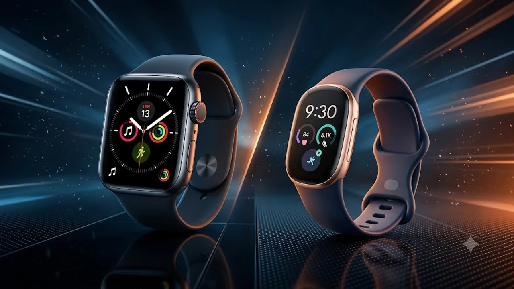

2026년 10월 12일 구글이 전격 공개한 **핏빗 엣지(Fitbit Edge)**는 고가 스마트워치 시장의 피로감을 정면으로 겨냥한 전략 모델입니다. 단순 걸음 수 측정을 넘어 구글의 최신 피트니스 트래커 기술과 온디바이스 AI 코칭을 결합해 애플워치를 대체할 실용적 대안으로 떠올랐습니다. 180달러라는 공격적인 출고가와 메탈 슬림 바디를 앞세운 이번 신제품이 일상 피트니스 환경에서 얼마나 확실한 효용을 발휘하는지 집중 점검합니다.

## 핏빗 엣지 기습 공개, 무엇이 달라졌나

### 7일 지속 배터리와 메탈 슬림 폼팩터의 결합
이번 신작의 가장 큰 무기는 일주일 동안 충전기 없이 버티는 **7일 연속 배터리 라이프**입니다. 기존 핏빗 차지 라인업의 플라스틱 질감을 걷어내고 항공우주 등급의 알루미늄 메탈 섀시를 적용해 두께를 9.8mm 수준으로 얇게 깎아냈습니다.
- **배터리 유지력**: Always-on-Display(AOD) 활성화 상태에서도 완충 기준 최소 5일, 일반 모드 7일 지속
- **외관 마감**: 고강도 알루미늄 유니바디 채택, 5ATM 방수 방진 지원
- **디스플레이**: 야외 직사광선 아래서도 또렷한 1.4인치 고휘도 AMOLED 패널 장착

### 온디바이스 제미나이 AI 헬스 코칭 탑재
구글 인수 이후 소프트웨어 역량이 기기 전면에 녹아들었습니다. 기기 내부와 연동 앱에서 구동되는 **제미나이(Gemini) AI 엔진**은 단순 수치 나열을 끝내고 개인 맞춤형 피드백을 실시간 생성합니다. 전날 수면 점수가 65점 아래로 떨어지면 오전 고강도 인터벌 러닝 대신 가벼운 스트레칭과 산책 루틴을 우선 제안하는 방식입니다. 인공지능이 텍스트 인터페이스를 넘어 하드웨어 센서 데이터를 능동적으로 해석하는 흐름은 [텍스트 AI의 한계와 진화](/posts/it-devices/text-based-ai-limits-and-evolution/)와도 맥락을 같이합니다.

### 180달러대 가격 책정이 던지는 스마트밴드 시장의 충격
북미 기준 공식 출고가는 **179.99달러(국내 출시 예상가 24만~25만 원 선)**로 책정됐습니다. 50만 원을 훌쩍 넘는 최신 플래그십 스마트워치와 5만 원대 저가형 중국산 스마트밴드 사이의 공백을 정확히 찔렀습니다. 완성도 높은 마감과 정밀 센서, 구글 소프트웨어의 신뢰도를 감안하면 시장 파급력이 상당합니다.

## 애플워치 vs 핏빗 엣지, 일상 사용성 전격 비교

### 매일 충전의 번거로움 vs 1주일 충전 프리덤
애플워치 유저들이 겪는 가장 고질적인 스트레스는 하루 한 번 치러야 하는 충전 루틴입니다. 샤워할 때 충전을 깜빡하면 다음 날 수면 측정이 통째로 끊기기 십상입니다. 반면 핏빗 엣지는 주말에 한 번 충전 케이블을 꽂아두면 평일 내내 손목에서 풀 필요가 없습니다.

> "수면 무호흡 감지와 심박 변이도(HRV) 추적의 성패는 끊김 없는 24시간 연속 데이터 수집에 달렸다."

연속 측정의 안정성 측면에서는 긴 배터리 타임을 지닌 밴드형 기기가 체감 만족도에서 확실한 우위를 점합니다.

### iOS 연동성 및 알림·생태계 호환 범위의 한계
아이폰 사용자 입장에서 감수해야 할 벽은 뚜렷합니다. 구글 산하 브랜드임에도 불구하고 **iOS 앱 연동을 기본 지원**하지만, 애플 생태계 특유의 폐쇄성 탓에 제약이 따릅니다.
- **수신 알림**: 카카오톡, 전화, 문자 수신 확인은 매끄럽게 지원
- **직접 답장**: 애플 정책 제약으로 인해 아이폰 연결 시 시계 화면에서 키보드 입력이나 음성 답장 불가
- **애플 건강 연동**: 서드파티 동기화 단계를 거쳐야 하므로 기본 피트니스 링 채우기를 선호하는 유저에겐 손이 한 번 더 가는 구조

### 정밀 건강 센서 및 심전도·수면 분석 데이터 정확도
광혈류측정(PPG) 센서와 피부온도 측정 센서, 심전도(ECG) 모듈이 알루미늄 후면 플레이트에 빈틈없이 자리 잡았습니다. 핏빗 특유의 수면 단계 분석(렘수면, 깊은 수면, 뒤척임 감지)은 수년간 축적된 알고리즘 덕분에 고가 스마트워치와 견주어도 오차 범위가 매우 좁습니다.

## 구매 전 반드시 점검해야 할 핵심 장단점

### 가성비 헬스 트래커로서 독보적인 3가지 강점
- **가벼운 착용감**: 스트랩 포함 30g대 초반 무게로 잘 때 차고 있어도 손목에 걸리는 느낌이 없음
- **정밀한 생체 알고리즘**: 24시간 심박 변이도 및 피부 온도 실시간 트래킹
- **구글 지도·지갑 기본 탑재**: 조깅 나갈 때 스마트폰 없이도 단독 턴바이턴 길찾기 지원

### 스마트워치 대비 아쉬운 단독 앱 구동 및 통화 제약
손목 위의 축소판 스마트폰을 기대한다면 궤가 다릅니다. 스피커와 마이크를 내장하지 않아 **손목 단독 음성 통화 기능이 빠졌으며**, 앱스토어에서 복잡한 독립형 서드파티 앱을 내려받아 돌리는 확장성은 없습니다. 피트니스와 건강 추적, 핵심 알림 수신이라는 본질에만 집중한 하드웨어 설계입니다.

### 핏빗 프리미엄 구독 연계 여부와 유지비 계산법
기본적인 운동 지표, 심박수, 일일 수면 점수는 평생 무료로 확인 가능합니다. 다만 6개월 무료 체험 이후 월 구독료가 발생하는 **핏빗 프리미엄(Fitbit Premium)**을 결제하지 않으면, AI가 제공하는 심층 수면 세부 지표와 장기 피로도 회복 분석 리포트의 일부 항목이 잠깁니다. 기기값 자체가 합리적인 대신 장기적인 부가 서비스 구독 모델이 얽혀 있다는 점은 구매 전 따져봐야 합니다.

## 내 사용 패턴에 맞춘 핏빗 엣지 선택 가이드

### 단순 운동·수면 기록 중심 사용자에게 추천하는 이유
스마트워치를 차고도 실제로 쓰는 기능이 카카오톡 알림 확인, 헬스장 세트 타이머, 수면 기록뿐이었다면 핏빗 엣지가 제격입니다. 매일 충전기에 올려놓는 번거로움을 감수하며 비싼 플래그십 기기를 고집할 이유가 없습니다. 가벼운 무게 덕분에 온종일 차고 있어도 손목에 피로가 쌓이지 않습니다.

### 기존 구글 픽셀워치나 갤럭시 워치 유저의 기변 가치
풀스크린 스마트워치의 디자인과 자유로운 워치페이스 커스텀, 단독 통화 기능을 일상에서 자주 쓴다면 역체감이 올 수 있습니다. 반대로 매일 닳아 없어지는 배터리 스트레스 때문에 워치를 서랍 속에 방치해 둔 경험이 있다면, 실사용 빈도를 끌어올리는 현실적인 갈아타기 선택지가 됩니다.

### 후회 없는 구매를 위한 선택 기준
자신의 사용 목적이 '손목 위의 미니 스마트폰'인지, '충전 신경 안 쓰는 24시간 건강 코치'인지 명확히 가르는 것이 핵심입니다. 일주일 동안 배터리 걱정 없이 내 몸의 바이오 데이터를 정밀하게 기록하고 싶다면 핏빗 엣지는 정가 이상의 역할을 톡톡히 해냅니다. 초기 물량에는 핏빗 프리미엄 1년 이용권과 교체용 스포츠 밴드가 패키지로 묶이는 만큼 사전 프로모션 조건을 꼼꼼히 챙기는 편이 유리합니다.

[스마트워치 및 헬스케어 기기 쿠팡에서 보기](https://www.coupang.com/np/search?q=%EC%8A%A4%EB%A7%88%ED%8A%B8%EC%9B%8C%EC%81%98%20%ED%94%BC%ED%8A%B8%EB%8B%88%EC%8A%A4%EB%B0%B4%EB%93%9C&sourceType=affiliate&trackingCode=AF8691300)

#핏빗엣지 #구글핏빗 #핏빗신제품 #스마트밴드추천 #애플워치비교 #헬스트래커 #수면측정기 #가성비스마트워치 #웨어러블기기