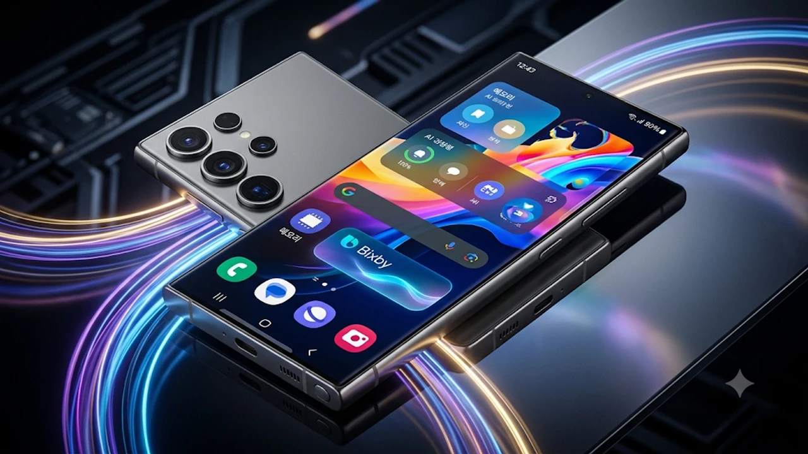

삼성전자의 차세대 소프트웨어 업데이트인 **갤럭시 S26 원UI 9.5 베타** 공개 일정이 가시권에 들어왔습니다. 테스트 서버에 새로운 펌웨어 빌드가 연이어 등록되면서 안드로이드 17 기반의 사용자 경험과 온디바이스 AI 기능이 어떻게 바뀔지 사용자들의 관심이 쏠리고 있습니다.

## 갤럭시 S26 원UI 9.5 베타 출시 임박, 무엇이 달라질까?

### 최근 포착된 새 빌드와 11월 16일 주간 공개 전망
삼성전자 내부 테스트 서버에서 갤럭시 S26 시리즈용 원UI 9.5 베타 펌웨어(빌드명 ZZKF 계열)가 포착되었습니다. 통상 마이너 업데이트 테스트 빌드가 서버에 올라온 뒤 1~2주 내에 삼성 멤버스를 통해 베타 프로그램 공지가 게시되는 패턴을 고려하면, **2026년 11월 16일 주간에 1차 베타가 열릴 가능성**이 높습니다. 한국과 미국, 독일 등 주요 1차 출시국부터 순차적으로 문이 열릴 전망입니다.

### 안드로이드 17 QPR2 기반, 기존 원UI 9.0과의 핵심 차이점
이번 업데이트는 구글의 안드로이드 17 분기별 플랫폼 릴리스(QPR2)를 토대로 설계되었습니다. 단순 보안 패치나 버그 수정을 넘어 시스템 전반의 애니메이션 프레임 드롭을 잡고, 백그라운드 메모리 점유율을 낮추는 데 초점을 맞췄습니다. 

> **핵심 포인트:** 기존 원UI 9.0이 하드웨어 폼팩터 최적화에 집중했다면, 원UI 9.5는 기기 내부에서 독자적으로 돌아가는 에이전트형 AI와 개인화 인터페이스 완성도를 끌어올리는 중간 기착지 역할을 합니다.

## 원UI 9.5에서 진짜 바뀌는 핵심 기능 4가지

### 새로 도입되는 AI 기반 메모리 앱
가장 눈에 띄는 변화는 스마트폰 속 파편화된 정보를 한곳에 모아 맥락을 짚어주는 **메모리(Memory) 앱**의 탑재입니다. 갤러리 스크린샷, 삼성 노트 메모, 웹 브라우저 기록, 메신저에서 주고받은 일정이나 장소 정보를 온디바이스 NPU가 스스로 분류합니다. 사용자가 "지난주에 친구랑 가기로 한 강남역 파스타집 어디였지?"라고 물으면 관련 대화 캡처와 지도 링크를 즉시 띄워주는 식입니다. 최근 모바일과 PC 환경을 가리지 않고 [텍스트 AI의 한계와 진화](/posts/it-devices/text-based-ai-limits-and-evolution/)가 화두가 되는 가운데, 삼성 역시 단순 문장 생성에서 벗어나 사용자 개인 데이터를 직접 다루는 에이전트 방향으로 노선을 분명히 했습니다.

### 작업 수행 능력이 대폭 강화된 빅스비 개편
그동안 단순 기기 설정이나 날씨 안내에 머물렀던 빅스비도 거대언어모델(LLM) 통합 폭을 넓혀 복합 명령 수행 능력을 갖추게 됩니다.
- **앱 간 연동 실행:** "방금 받은 영수증 사진에서 금액만 뽑아서 가계부 메모에 적어줘" 같은 다단계 명령 처리
- **화면 맥락 인식:** 현재 띄워둔 웹페이지나 PDF 문서 내용을 요약해 특정 연락처로 바로 전송
- **자연어 기기 제어:** 정확한 메뉴 이름을 몰라도 "밤에 눈이 너무 부신데 화면 톤 좀 따뜻하게 바꿔줘"라고 말하면 편안하게 보기 모드와 밝기를 동시에 조절

### 한층 직관적으로 다듬어진 인터페이스 및 앱 잠금 기능
시각적인 요소와 보안 편의성도 손봤습니다. 알림창과 빠른 설정창의 블러(Blur) 효과가 한층 부드러워졌으며, 배터리 잔량 표시 아이콘과 위젯 여백 비율이 재조정되었습니다. 또한 그동안 보안 폴더를 우회해 사용해야 했던 **개별 앱 잠금(App Lock) 기능**이 기본 설정에 정식으로 들어옵니다. 카카오톡이나 금융 앱, 갤러리 등 민감한 앱을 지문이나 얼굴 인식으로 즉시 잠글 수 있어 타인에게 폰을 잠시 빌려줄 때 유용합니다.

## 갤럭시 S26 원UI 9.5 베타 참여 및 신청 방법

### 베타 지원 대상 기기 확인
1차 베타 프로그램은 플래그십 라인업인 **갤럭시 S26, 갤럭시 S26 플러스, 갤럭시 S26 울트라** 자급제 및 통신사 모델(일부 기업용 단말 제외)을 대상으로 먼저 진행됩니다. 이후 안정화 단계를 거쳐 갤럭시 Z 폴드8 및 플립8 시리즈로 대상 기기가 확대될 예정입니다.

### 삼성 멤버스 앱을 통한 베타 신청 절차
베타 펌웨어는 일반 소프트웨어 업데이트 메뉴가 아닌 전용 신청 과정을 거쳐야 내려받을 수 있습니다.
1. 스마트폰에 설치된 **삼성 멤버스(Samsung Members)** 앱을 실행하고 삼성 계정으로 로그인합니다.
2. 메인 화면 상단 배너 또는 공지사항 탭에서 **'원UI 9.5 베타 프로그램 가입'** 항목을 선택합니다.
3. 약관 동의 후 신청을 완료한 뒤, 기기의 **[설정] > [소프트웨어 업데이트] > [다운로드 및 설치]** 경로로 들어가 베타 펌웨어를 내려받습니다.

### 베타 설치 전 필수 데이터 백업 및 주의사항
베타 버전에서 다시 공식 원UI 9.0 버전으로 다운그레이드하려면 기기 전체 초기화가 강제됩니다. 업데이트 버튼을 누르기 전 반드시 **스마트 스위치(Smart Switch)** PC 버전이나 삼성 클라우드 임시 백업 기능을 활용해 사진, 연락처, 메신저 대화 내역을 안전하게 옮겨두어야 합니다.

## 원UI 9.5 베타 업데이트, 지금 바로 올려도 될까?

### 베타 버전의 장단점과 실사용 시 예상되는 호환성 문제
새로운 AI 메모리 기능과 개선된 애니메이션을 남들보다 먼저 써볼 수 있다는 점은 매력적입니다. 하지만 초기 1~2차 베타 빌드에서는 일부 국내 은행 앱이나 모바일 신분증, 대중교통 카드 앱이 보안 정책 문제로 실행되지 않는 현상이 잦습니다. 발열 제어나 대기 전력 소모 역시 정식 버전보다 불안정할 수 있습니다.

### 정식 버전 출시까지 기다려야 할 사용자 유형
메인 스마트폰 한 대로 업무용 인증서, 모바일 사원증, 금융 결제를 모두 처리하는 직장인이라면 초기 베타 참여를 피하는 편이 현명합니다. 정식 버전은 차기 플래그십인 갤럭시 S27 시리즈 공개 시점인 2027년 초에 맞춰 배포될 가능성이 크므로, 안정적인 실사용 환경이 우선이라면 정식 빌드 배포까지 기다리시길 권합니다.

[갤럭시 S26 시리즈 자급제 및 호환 액세서리 쿠팡에서 보기](https://www.coupang.com/np/search?q=%EA%B0%A4%EB%9F%AD%EC%8B%9C+S26&sourceType=affiliate&trackingCode=AF8691300)

#갤럭시S26 #원UI95 #OneUI95베타 #삼성전자 #안드로이드17 #갤럭시업데이트 #IT기기트렌드 #스마트폰추천