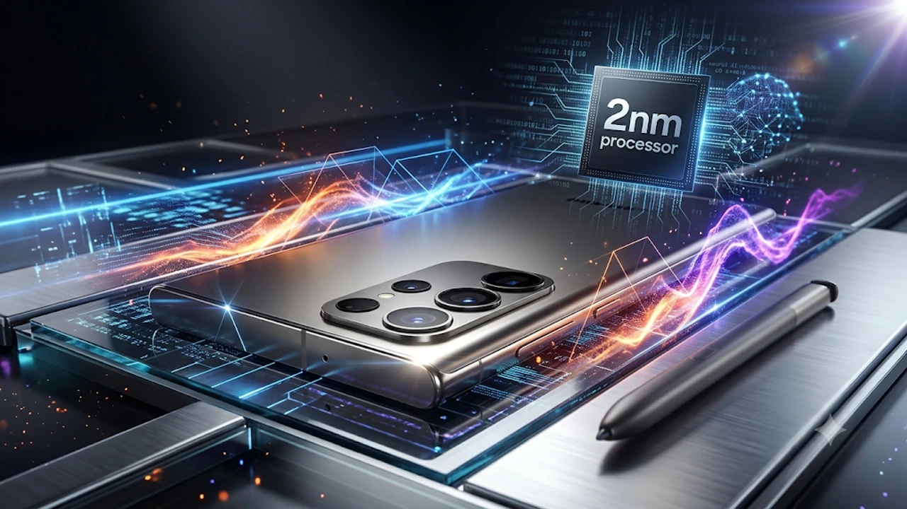

차세대 플래그십 스마트폰 판도를 흔들 **갤럭시 S27 울트라**의 2026년 11월 최신 유출 사양이 공개되면서 모바일 시장의 열기가 달아오르고 있습니다. 극한까지 깎아낸 초슬림 베젤 설계와 함께 차세대 모바일 AP, 카메라 센서 구조의 대대적인 변화가 포착되어 기기 교체를 앞둔 소비자들의 셈법이 분주해졌습니다. 현재까지 부품 공급망과 주요 팁스터를 통해 윤곽이 드러난 핵심 업그레이드 포인트를 짚어보았습니다.

## 갤럭시 S27 울트라 최신 유출 디자인과 디스플레이 변화

외관 디자인에서는 그립감 개선과 전면 화면 몰입도 극대화에 초점을 맞춘 설계 변경이 눈에 띕니다. 

### 베젤 축소와 티타늄 프레임 곡률 개선
전작에서 확립된 평면 디스플레이 기조는 유지하되, 측면 티타늄 프레임의 모서리 곡률을 한층 부드럽게 다듬어 손바닥에 파고드는 이물감을 줄였습니다.

- 상하좌우 대칭형 초슬림 베젤 적용으로 전면 화면 비율 극대화
- 내구성과 경량화를 동시에 잡은 5등급 티타늄 합금 표면 마감 개선
- S펜 수납부 위치 미세 조정에 따른 하단 스피커 홀 구조 재설계

> "화면 대각선 크기는 유지하면서 기기 전체의 가로 폭을 좁혀 한 손 조작성을 끌어올리는 방향이 이번 외형 설계의 핵심입니다."

### 차세대 M15 OLED 패널 탑재와 최대 밝기 향상
삼성디스플레이의 최신 유기재료를 적용한 **M15 OLED 패널**이 들어가면서 야외 시인성과 전력 효율이 함께 올라갑니다. 저반사 코팅 기술 역시 한 단계 진화해 한낮 직사광선 아래에서도 눈부심 없이 선명한 화면을 보여주며, 주사율 가변 제어 범위가 넓어져 대기 전력 소모를 크게 낮췄습니다.

## 스냅드래곤 8 엘리트 2세대 탑재와 온디바이스 AI 성능

연산 성능의 중심에는 TSMC의 차세대 미세 공정을 거친 모바일 프로세서가 자리 잡고 있습니다.

### 3nm 2세대 공정 기반 발열 제어 및 전력 효율 개선
**스냅드래곤 8 엘리트 2세대** 칩셋은 고성능 코어 클럭을 끌어올리면서도 소비 전력을 줄이는 데 집중했습니다. 내부 베이퍼 챔버 면적을 전작보다 넓히고 열전도율이 높은 신소재 방열 패드를 배치해 고사양 3D 게임이나 4K 영상 편집 시에도 성능 저하(쓰로틀링)를 효과적으로 방어합니다.

### 램 용량 확대에 따른 실시간 멀티모달 AI 구동 속도
네트워크 연결 없이 기기 자체에서 연산을 처리하는 **온디바이스 AI** 기능을 뒷받침하기 위해 기본 16GB RAM 탑재가 유력하게 거론됩니다. 넉넉한 메모리를 바탕으로 음성, 이미지, 텍스트를 동시에 인식하는 멀티모달 모델이 지연 없이 작동하며, [텍스트 AI의 한계와 진화](/posts/it-devices/text-based-ai-limits-and-evolution/)에서 짚었던 클라우드 서버 의존도를 낮춘 개인화 비서 기능이 한층 정교해집니다.

## 카메라 센서 업그레이드와 망원 줌 화질 개선 포인트

울트라 라인업의 정체성인 카메라 시스템은 화소 수 경쟁을 넘어 빛을 받아들이는 센서 물리적 크기와 렌즈 광학 성능 강화로 방향을 틀었습니다.

### 2억 화소 메인 센서 개선 및 저조도 노이즈 억제력
새로운 2억 화소 메인 이미지 센서는 픽셀 비닝 기술과 개선된 마이크로 렌즈 구조를 결합해 야간 촬영 시 암부 노이즈를 대폭 걷어냈습니다. 셔터 랙 현상을 최소화해 움직이는 반려동물이나 아이를 포착할 때도 흔들림 없는 선명한 결과물을 건질 수 있습니다.

### 가변 조리개 재도입 여부와 5배 광학 망원 센서 변화
주변 광량에 따라 조리개 값을 물리적으로 조절하는 **가변 조리개** 기술의 부활이 유력하게 점쳐집니다. 맑은 주간에는 깊은 심도로 풍경을 선명하게 담고, 어두운 실내나 밤에는 조리개를 최대로 개방해 풍부한 광량을 확보하는 방식입니다.

- 5배 광학 망원 렌즈에 고화소 대형 센서 적용으로 10배 크롭 줌 화질 보강
- 초광각 렌즈의 접사 촬영 거리 단축 및 주변부 왜곡 보정 알고리즘 고도화
- 영상 촬영 시 시네마틱 로그(Log) 포맷 지원 및 실시간 색보정 기능 추가

## 갤럭시 S26 울트라와 비교 및 출시일 예상

기존 플래그십 모델을 사용 중인 소비자라면 세대 교체에 따른 실질적인 체감 차이와 출시 시점을 꼼꼼히 따져봐야 합니다.

### 전작 S26 울트라 대비 체감되는 핵심 스펙 차이점
전작인 갤럭시 S26 울트라와 비교했을 때 가장 뚜렷한 차이는 **온디바이스 AI 처리 속도와 저조도 망원 촬영 품질**에 있습니다. 일상적인 메신저나 웹 서핑에서는 큰 격차를 느끼기 어렵지만, 고화질 영상 촬영 빈도가 높거나 무거운 AI 편집 툴을 자주 돌리는 사용자라면 확실한 체감 격차를 경험할 수 있습니다. 차세대 무선 연결 환경까지 함께 구축하려면 [Wi-Fi 8 공유기 진짜 살까? 2026 차세대 네트워크 완전 정리](/posts/it-devices/wifi-8-next-gen-router-trend-2026/) 글도 참고해 보세요.

### 2027년 1월 언팩 일정 전망과 기존 모델 구매 적기 판단
삼성전자의 통상적인 플래그십 출시 주기를 고려할 때 **2027년 1월 중순 글로벌 언팩 행사**를 통해 베일을 벗은 뒤 1월 말 정식 출시될 가능성이 높습니다. 

- 최신 카메라 광학 성능과 차세대 칩셋이 필수적이라면 2027년 1월 사전예약 혜택을 기다리는 편이 유리합니다.
- 가성비와 검증된 안정성을 우선한다면 신제품 공개 직전 공시지원금과 출고가 할인이 집중되는 시점에 전작 모델을 선택하는 전략이 합리적입니다.

[갤럭시 S26 울트라 및 최신 스마트폰 쿠팡에서 보기](https://www.coupang.com/np/search?q=%EA%B0%A4%EB%9F%AD%EC%8B%9C%20S26%20%EC%9A%B8%ED%8A%B8%EB%9D%BC&sourceType=affiliate&trackingCode=AF8691300)

#갤럭시S27울트라 #갤럭시S27 #삼성전자 #스냅드래곤8엘리트2세대 #스마트폰유출 #플래그십스마트폰 #IT기기트렌드 #갤럭시S26울트라비교