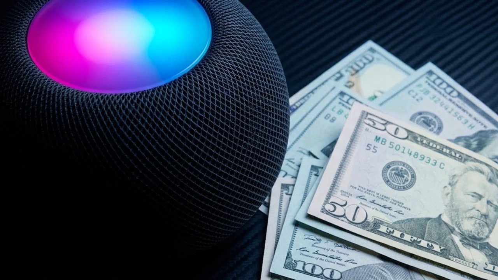

애플이 6년이라는 긴 침묵을 깨고 마침내 차세대 스마트 스피커인 **홈팟 미니 2**를 공개했습니다. 소형 폼팩터를 유지하면서도 내부 연산 칩셋과 상단 인터페이스를 전면 쇄신해 거실 오디오 생태계의 중심을 노리고 있습니다. 하지만 전작의 최대 강점이었던 99달러의 가성비가 149달러로 50달러나 오르면서, 이번 세대교체가 그만한 가격 인상 가치를 증명하는지에 대해 소비자들의 셈법이 복잡해졌습니다.

## 6년 만에 돌아온 홈팟 미니 2, 무엇이 바뀌었나

### S10 칩셋 탑재로 달라진 연산 속도와 오디오 처리
가장 핵심적인 하드웨어 변화는 구형 애플워치용 S5 프로세서에서 최신 **S10 칩셋**으로의 전환입니다. 칩셋 공정과 연산 성능이 획기적으로 개선되면서 실시간 컴퓨테이셔널 오디오 튜닝 주기가 초당 수백 회 단위로 촘촘해졌습니다. 복잡한 악기 배치가 얽힌 음원을 재생할 때 보컬의 선명도를 분리해 내는 능력이 체감될 정도로 명확해졌으며, 상시 대기 중인 음성 인식 엔진의 반응 지연 역시 대폭 줄었습니다.

### 상단 패널을 채운 풀컬러 사운드 글로우 디스플레이
외관에서 단번에 구분되는 특징은 상단 터치 인터페이스의 변화입니다. 기존의 흐릿한 단색 백라이트 형태를 벗어나 테두리 끝까지 빛이 고르게 퍼지는 **사운드 글로우(SoundGlow)** 풀컬러 LED 패널을 얹었습니다. 음악 볼륨 크기, 재생 상태, 시리 호출 반응에 맞춰 다채로운 파형 애니메이션을 유기적으로 표현해 소형 무드 램프 역할을 톡톡히 해냅니다.

### 외형 규격과 패브릭 메시 소재의 세부 변화점
콤팩트한 원구형 디자인 골격은 그대로 유지했으나 미세한 디테일을 손질했습니다. 표면을 감싼 패브릭 메시는 100% 재활용 폴리에스터 원사를 사용하면서도 격자 틈새를 촘촘하게 메워 먼지 유입을 방지하는 밀도 구조로 재설계되었습니다. 밑면의 실리콘 베이스 역시 원목 가구 표면에 원형 자국을 남기지 않도록 소재 배합을 개선했습니다.

## 99달러에서 149달러로: 가격 인상의 진짜 원인 분석

### 온디바이스 음성 AI 처리를 위한 하드웨어 원가 상승
가격 상승을 견인한 1차 요인은 오프라인 로컬 환경에서 음성 명령을 즉각 소화하는 **온디바이스 NPU 탑재**입니다. 기존 스마트 스피커들은 조명 켜기나 알람 설정 같은 기초 제어조차 외부 클라우드 서버와 통신해야 했기에 망 응답 상태에 따라 답변 속도가 들쑥날쑥했습니다. 이제는 가정 내 네트워크 트래픽에 의존하지 않고 기기 자체에서 문맥을 실시간 연산하기 위해 고밀도 메모리와 최신 프로세서를 투입했고, 이는 필연적인 부품 단가 상승으로 이어졌습니다. 음성 언어 모델의 처리 방식과 기기 제어 흐름에 대한 기술적 배경은 [텍스트 AI의 한계와 진화](/posts/it-devices/text-based-ai-limits-and-evolution/) 글에서도 구체적으로 확인할 수 있습니다.

### 스마트 홈 매터(Matter) 및 스레드(Thread) 라우터 기능 강화
홈 허브 역할을 전담할 수 있도록 통신 모듈 스펙도 대거 보강되었습니다. 차세대 **스레드(Thread) 보더 라우터 1.4 규격**과 매터 표준 프로토콜을 온전히 수용하여 수십 개의 스마트 전구, 도어락, 센서가 동시에 신호를 주고받아도 트래픽 정체를 겪지 않습니다. 집 안의 무선 통신망을 지탱하는 인프라 장비로서의 역할 비중이 커진 셈입니다.

### 전작 대비 체감되는 출력과 베이스 저음역 개선 폭
소형 스피커의 물리적 한계를 극복하기 위해 풀레인지 드라이버와 듀얼 패시브 라디에이터의 진동판 반경을 미세하게 넓혔습니다. 저음역대 드럼 킥과 베이스 라인이 울릴 때 섀시 내부에서 발생하는 공진을 억제하면서 단단한 타격감을 확보했습니다.

> "소형 인클로저에서 뿜어져 나오는 극저음의 양감은 물리 법칙상 한계가 분명하지만, S10 칩셋이 실시간으로 드라이버 변위를 제어해 음량을 최대로 올려도 찌그러짐 현상이 눈에 띄게 줄어든다."

- **초저음 제어**: 최대 볼륨 도달 시 음원 왜곡률 대폭 억제
- **공간 인식**: 방 모서리나 벽면 배치 시 반사음을 실시간 측정해 이퀄라이저 자동 보정
- **음압 향상**: 전작 대비 약 15% 상승한 지향성 음압 레벨 확보

## 홈팟 미니 1세대 사용자, 지금 갈아타야 할까

### 일상적인 음악 감상 및 팟캐스트 재생 환경 비교
단순히 책상 위에 두고 잔잔한 배경음악(BGM)을 틀거나 라디오, 팟캐스트 위주로 청취하는 패턴이라면 굳이 1세대를 처분하고 기변할 실익은 크지 않습니다. 음색의 기본적인 밸런스는 큰 틀에서 유사하며, 보컬 대역의 또렷함은 개선되었으나 배경음악용 볼륨에서는 그 격차가 극적으로 체감되지 않기 때문입니다.

### 애플 생태계 내 시리 음성 명령 반응 속도 차이
반면 홈킷(HomeKit) 기반 사물인터넷 기기를 10개 이상 연동해 음성으로 일괄 제어하는 환경이라면 체감 성능 차이가 확연합니다. 조명을 제어할 때 로컬 캐시에서 명령어를 바로 처리하므로 반응 지연 시간이 1세대 대비 절반 수준으로 줄었습니다. 아이폰이나 애플워치를 거치지 않고 스피커 자체 마이크로 인식하는 감도 역시 4개의 마이크 어레이 튜닝을 통해 잡음 속에서도 안정적으로 명령을 낚아챕니다.

### 스테레오 페어 구성 시 1세대와 2세대 혼용 가능 여부
기존 1세대를 보유한 사용자가 가장 주의해야 할 대목은 **1세대와 2세대의 스테레오 페어 결합 불가 정책**입니다. 드라이버 출력 곡선과 내장 DSP 튜닝 알고리즘이 완전히 달라졌기 때문에, 애플 홈 앱 내에서 1세대와 2세대를 묶어 좌우 2채널 스피커로 구성하는 설정은 시스템 차원에서 원천 차단됩니다. 스테레오 사운드를 구축하려면 반드시 동일한 2세대 모델 2대를 새로 구비해야 합니다.

## 홈팟 미니 2 구매 전 반드시 체크할 주의사항

### 초기 출시 시점의 Siri AI 일부 기능 업데이트 지연 이슈
사전예약 단계에서 큰 기대를 모았던 고도화된 대화형 Siri AI 기능 중 일부는 정식 펌웨어 업데이트 형태로 추후 제공될 예정입니다. 국가별 언어 지원 일정에 따라 한국어 복합 명령 처리 고도화는 초기 출고 시점에 일부 제약이 따를 수 있으므로, 완전히 새로운 AI 비서 기능을 기대하고 즉시 구매하는 것은 실망을 부를 수 있습니다.

### 안드로이드 및 서드파티 기기와의 제한적인 호환성
독립적인 블루투스 스피커로 단독 활용하는 것은 여전히 불가능합니다. 초기 기기 활성화와 와이파이 연결 설정에 반드시 최신 iOS 또는 iPadOS 기기가 요구되며, 안드로이드 스마트폰에서는 에어플레이(AirPlay)를 통한 스트리밍 전송조차 공식 지원하지 않습니다. 순수 애플 생태계 거주자가 아니라면 기기 기능의 절반도 끌어내기 어렵습니다.

### 동일 가격대 블루투스·스마트 스피커 경쟁 모델과의 포지션 비교
149달러(국내 출시 예상가 약 19만 원대) 가격대에는 이미 음질 면에서 체급이 월등히 큰 마샬 엠버튼 시리즈나 야외 휴대성을 갖춘 JBL 차지 라인업이 포진해 있습니다. 거치형 인공지능 스피커 시장에서도 네스트 오디오나 에코 스튜디오 같은 대체재가 뚜렷합니다. 실내 스마트 홈 허브와 에어플레이 기반의 유기적 연동성을 최우선으로 두는 사용자가 아니라면 순수 음향 기기로서의 가성비는 엄밀히 따져봐야 합니다.

[홈팟 미니 2 및 스마트 오디오 기기 쿠팡에서 보기](https://www.coupang.com/np/search?q=%EC%8A%A4%EB%A7%88%ED%8A%B8%EC%8A%A4%ED%84%B0%EB%94%94%EC%98%A4%20%ED%99%88%ED%8C%9F%EB%AF%B8%EB%8B%88&sourceType=affiliate&trackingCode=AF8691300)

#홈팟미니2 #애플스마트스피커 #S10칩셋 #홈팟미니비교 #스마트홈허브 #사운드글로우 #매터스레드 #애플오디오