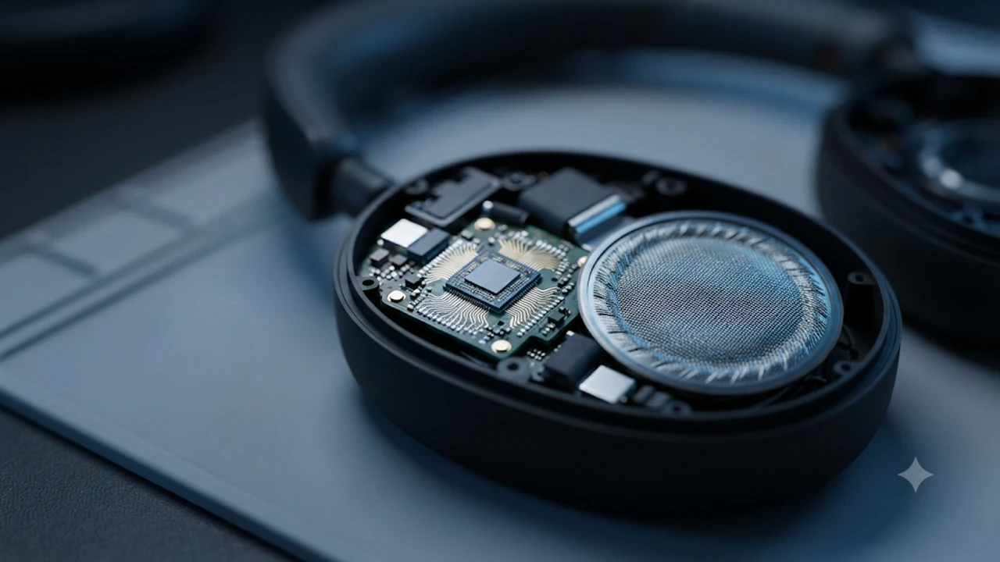

소니 플래그십 노이즈 캔슬링 헤드폰 라인업의 차세대 모델인 **소니 WH-1000XM6** 관련 정보가 글로벌 IT 커뮤니티와 인증 기관을 중심으로 빠르게 확산 중이다. 향상된 온디바이스 AI 오디오 프로세서 탑재와 착용감 개선 소식이 전해지며 음향 기기 마니아들의 이목이 집중되는 상황이다. 유출된 데이터와 전작 대비 달라지는 핵심 포인트를 집중 분석한다.

## 소니 WH-1000XM6 유출 정보와 전작 비교
### 새롭게 탑재된 QN3 AI 오디오 프로세서 성능
유출 문서에 따르면 WH-1000XM6 모델에는 전작의 QN2 칩셋을 뛰어넘는 차세대 **QN3 AI 오디오 프로세서**가 탑재된다. 머신러닝 연산 능력이 대폭 강화되면서 주변 소음 수음 및 상쇄 프로세스가 한층 정교해졌다. 고주파와 저주파 대역 소음을 실시간으로 분리하여 차단하는 능력이 비약적으로 상승했다.

### 전작 대비 눈에 띄는 디자인 및 착용감 변화
기존 XM5 모델이 보여주었던 일체형 디자인에서 탈피하여 휴대성과 수납 편의성을 높인 힌지 구조가 부활한다. 헤드밴드 압박 분산 설계를 적용해 장시간 착용 시 피로감을 줄였으며, 이어패드 밀착력을 높여 물리적인 차음성까지 동시에 확보했다.

## 노이즈 캔슬링 및 음질 성능의 진화

### 실시간 주변 소음 학습 차단 기술 분석
착용 상태와 주변 환경을 초당 수천 번 모니터링하는 **어댑티브 사운드 컨트롤** 기능이 고도화되었다. 대중교통, 카페, 사무실 등 소음 패턴이 변하는 공간에서도 수동 조작 없이 최적화된 노이즈 캔슬링 레벨을 유지한다. 고해상도 무선 코덱인 LDAC 지원은 물론, 압축 음원의 손실을 보정하는 DSEE Extreme 알고리즘 역시 진화했다.

### 고해상도 코덱 및 드라이버 유닛 업그레이드 포인트
새롭게 설계된 맞춤형 드라이버 유닛은 저음 타격감을 유지하면서 중고음 해상력을 극대화했다. 무선 환경에서도 유선 헤드폰에 준하는 균형 잡힌 사운드 스테이지를 제공하며, 고음질 스트리밍 서비스 이용 시 왜곡 없는 원음 재생을 보장한다.

## 예상 출시일과 글로벌 가격 전망
### 글로벌 전파 인증 및 예상 판매 가격대
미국 FCC 및 유럽 전파 인증 기관 데이터베이스에 포착된 정황상 공식 언팩 행사는 다가오는 겨울 시즌 말 혹은 내년 초가 유력하다. 출고가는 부품 단가 상승 요인으로 인해 전작 대비 소폭 인상될 가능성이 높다.

### 국내 정발 일정 및 사전 예약 혜택 예상하기
글로벌 동시 출시 전략을 취할 경우 국내 전파 인증 역시 빠르게 진행될 전망이다. 소니코리아 공식 스토어를 통한 사전 예약 판매 시 전용 케이스나 고속 충전 어댑터 등 번들 악세사리를 제공하는 프로모션이 진행될 확률이 높다. 고성능 무선 오디오 환경 구축을 위해서는 [Wi-Fi 8 공유기 진짜 살까? 2026 차세대 네트워크 완전 정리](/posts/it-devices/wifi-8-next-gen-router-trend-2026/)와 같은 최신 네트워크 인프라와의 궁합도 점검해야 한다.

## 소니 WH-1000XM6, 지금 기다려야 할까?
### 기존 XM5 사용자 기준 업그레이드 가치 판단
현재 WH-1000XM5 모델을 문제없이 사용 중인 유저라면 체감 성능 차이가 크지 않을 수 있다. 다만 힌지 내구성 개선이나 더 강력한 AI 노이즈 캔슬링, 멀티포인트 연결 안정성을 중시하는 사용자라면 대기할 실익이 충분하다.

### 경쟁사 플래그십 헤드폰과의 스펙 비교 요약
보스 및 애플 진영의 최신 플래그십 모델들과 비교했을 때, 소니는 경량화된 무게와 전용 앱 이퀄라이저 설정 자유도로 우위를 점한다. 특히 이번 신제품은 배터리 효율까지 개선되어 완충 시 재생 시간이 소폭 늘어날 것으로 기대된다. 하이엔드 무선 사운드를 완성해 줄 필수 주변 기기를 확인해 보자.

[소니 WH-1000XM6 동급 노이즈 캔슬링 헤드폰 추천 상품 보기](https://www.coupang.com/np/search?q=%EC%86%8C%EB%8B%88+%EB%85%B8%EC%9D%B4%EC%A6%88%EC%BA%cbdns%20%ED%97%a4%EB%93%9c%ED%8F%b0&sourceType=affiliate&trackingCode=AF8691300)

#소니WH1000XM6 #소니헤드폰 #노이즈캔슬링헤드폰 #WH1000XM6스펙 #소니이어폰 #무선헤드폰추천 #IT기기트렌드 #신제품유출