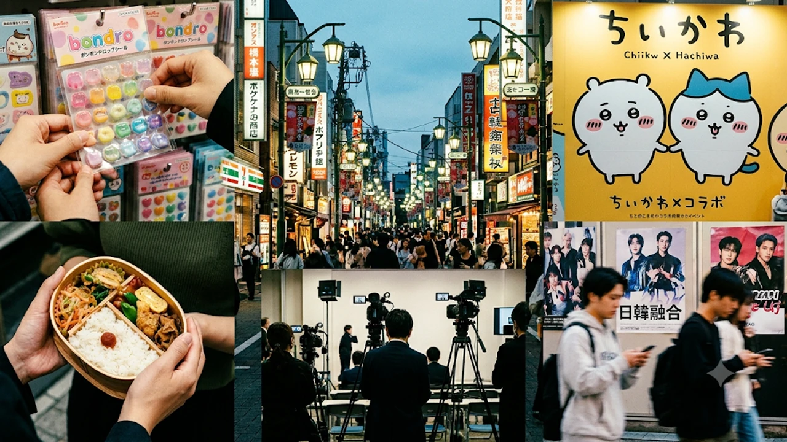

毎年11月になると大きな注目を集める「新語・流行語大賞」の季節がやってきました。**2026年 流行語大賞 ノミネート**の発表を受け、日本のSNSやメディアではどの言葉が年間大賞に輝くのか熱い議論が交わされています。今回は今年のトレンドの全体像に加え、日本の若者文化や日常会話に深く浸透している韓国発カルチャーの影響まで徹底的に紐解きます。

## 2026年新語・流行語大賞ノミネート発表！今年の傾向と注目ワード

### 11月発表のノミネート30語に見る2026年の世相
毎年11月上旬に発表されるノミネート30語は、その1年間に日本社会で何が起き、人々が何に心を動かされたかを映し出す鏡のような存在です。2026年のラインナップを見渡すと、長引く物価上昇に対するリアルな生活防衛の知恵から、スポーツ界を沸かせた劇的な逆転劇、さらにはデジタル空間で爆発的に拡散したネットミームまで多彩な顔ぶれが並びました。

> 流行語は単なる一過性のブームにとどまらず、その時代を生きる人々の感情や価値観が凝縮された社会現象そのものです。

### 昨年の結果と比べた今年のキーワードの大きな変化
2025年までは特定のテレビ番組や大型イベント発のフレーズが目立っていましたが、2026年は**個人のリアルな共感から連鎖的に広がった言葉**が圧倒的な存在感を放っています。マスメディアが仕掛けたキャッチコピーよりも、日常のちょっとした違和感や小さな幸せを切り取ったフレーズが多くの支持を集めている点が特徴的です。

### SNS発・Z世代から広がった新語の特徴
ショート動画や音声配信を通じて、Z世代が独自に編み出した略語や感情表現も数多く候補入りを果たしました。文字数を極限まで削りつつ、微妙なニュアンスを的確に伝える工夫が凝縮されており、世代を超えてオフィスの雑談やチャットでも使われるケースが増えています。

## ノミネート語に潜む韓国発トレンドと日韓カルチャーの融合

### グルメ・ファッション分野で定着した韓国由来の言葉
近年の日本のトレンドを語るうえで欠かせないのが、韓国発カルチャーとの密接なつながりです。新大久保や原宿といった若者の街から火がついた新感覚スイーツの名称や、ミニマルで洗練された着こなしを指す韓国語由来のカタカナ語が、いまや説明不要の一般用語として定着しました。

- カフェ巡りやコンビニスイーツの新作紹介で自然に使われる韓国語表現
- コスメの質感やメイク手法を表す美容専門用語の一般化
- ファッション誌や通販サイトで定番化した韓国トレンドのカテゴリー名

### 動画配信や音楽が日本の日常会話に与えた影響
動画配信サービスを通じて韓国のドラマやバラエティ番組をリアルタイムで視聴する習慣が根付いたことで、登場人物の口癖やリアクションをそのまま日常会話に取り入れる若者が急増しました。音楽シーンでも日韓合同プロジェクトの活躍が続き、国境を意識せずに双方の言語をミックスして楽しむスタイルが当たり前になっています。

### 韓国の「今年の流行語」との共通点と決定的な違い
韓国のオンラインコミュニティで話題になる新造語と比較すると、**限られた予算で最大限の満足度を得るコスパ意識**や、自分らしさを大切にするマインドセットには強い共通点が見られます。一方で、日本では周囲との調和や空気を読むニュアンスを含んだ柔らかい表現が好まれるのに対し、韓国では感情をストレートかつユーモラスに言い切る表現が支持される傾向にあります。

## なぜこの言葉が選ばれた？ヒットの裏にある社会背景

### 物価高やライフスタイルの変化を反映した節約・消費ワード
継続的な生活コストの上昇を受け、2026年は単なる我慢の節約ではなく、賢く選択して豊かさを保つ「メリハリ消費」に関連する言葉が強く支持されました。こうした消費者心理の変化については、[2026年日本の消費トレンド徹底解説](/posts/japan-trends/japan-consumer-trends-2026/)でも詳しく分析している通り、日韓両国で共通する大きな潮流となっています。

### テクノロジー進化と生成ツール普及が生んだ新しいコミュニケーション用語
日常生活や仕事のあらゆる場面に最新のデジタルツールが溶け込んだことで、人間とテクノロジーの距離感を表すユニークな新語も誕生しました。効率化の先にある「人間らしい温かみ」や「アナログな体験の価値」を再評価する動きとセットで語られることが多い点も2026年ならではの現象です。

## 大賞受賞はどの言葉？予想と注目ポイントまとめ

### メディア関係者とSNSユーザーが予想する本命ワード3選
12月上旬の年間大賞発表を前に、選考委員の傾向やSNS上の話題性を踏まえると、以下の3つのジャンルから大賞が選ばれる可能性が高いとみられています。

- **国民的共感ワード**：世代や性別を問わず誰もが一度は口にした生活密着型のフレーズ
- **カルチャー融合ワード**：韓国をはじめとする海外トレンドと日本独自の感性が掛け合わさった新語
- **ポジティブ応援ワード**：困難な状況でも前向きな気持ちにさせてくれたスポーツ・エンタメ由来の名言

### 12月の年間大賞発表までにチェックしておきたい関連トピック
年間大賞の発表当日は、受賞者のコメントや衣装、さらには惜しくもトップテン入りを逃した言葉への再評価など、多くのニュースが駆け巡ります。今年の流行を振り返りながら、話題の日本トレンドアイテムや関連書籍を手に取って2026年の記憶を整理してみてはいかがでしょうか。

[話題の日本トレンドアイテムをクーパンでチェックする](https://www.coupang.com/np/search?q=%EC%9D%BC%EB%B3%B8%20%EC%9D%B8%EA%B8%B0%EC%83%81%ED%92%88&sourceType=affiliate&trackingCode=AF8691300)

#日本トレンド #流行語大賞2026 #新語流行語大賞 #日韓トレンド #韓国カルチャー #SNSトレンド #Z世代 #2026年最新