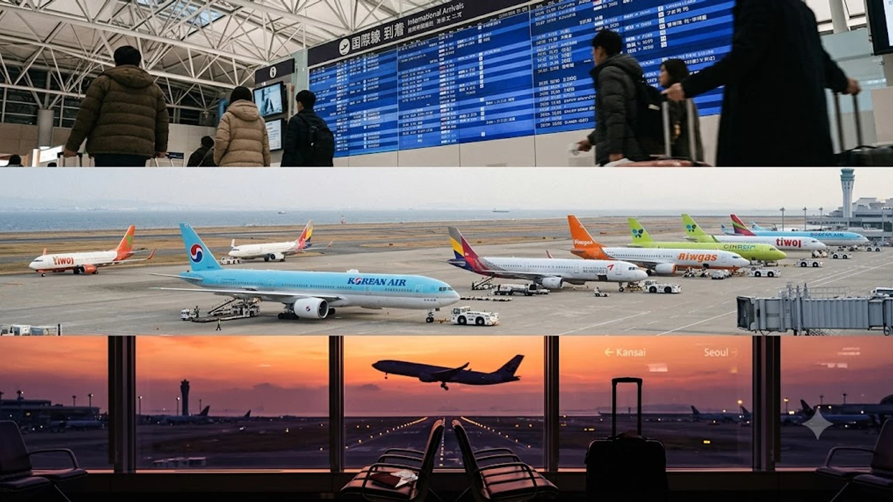

関西エアポートが公表した2026年冬期スケジュールにおいて、**関空 冬ダイヤ 2026 韓国便**の運航規模が過去最高水準に達し、航空関係者の間で大きな議論を呼んでいます。中国路線の失速と対照的に、関西国際空港を発着する国際旅客便の約4割を韓国便が占めるという前代未聞のシフトが起きており、関西発着の空路マップは今まさに歴史的な塗り替えが進んでいます。

## 関空2026年冬ダイヤ発表で何が起きたのか？国際線の最新勢力図

### 中国便37%減と韓国便10%増がもたらした決定的な構造変化
関西エアポートの公式データによると、2026年冬ダイヤ（2026年10月25日〜2027年3月27日）の関空国際線旅客便数は、前年同期比2%減の週1,180便前後で推移する見込みです。
全体の微減以上に衝撃を与えたのが、国別の構成比に見られる極端な地殻変動でした。

- **中国路線**: 前年同期比約37%減（週150便前後まで後退、全体シェアは13%台へ急落）
- **韓国路線**: 前年同期比10%増（週487.9便に到達、国際線全体の約41%を独占）
- **東南アジア・台湾路線**: 微増または前年並みをキープ

関空のインバウンドを長年牽引してきた中国市場の急速な冷え込みを、韓国線が文字通り力技でカバーする歪な構図が鮮明になりました。

### 国際線総便数の微減傾向とLCC各社による路線再編の実態
全体の総便数が伸び悩んだ背景には、フルサービスキャリア（FSC）による東アジア幹線の機材見直しに加え、中国系航空会社による運休・減便の多発が挙げられます。
機材の遊休化を何としても避けたいPeach Aviation、チェジュ航空、ティーウェイ航空などの格安航空会社（LCC）は、需要が不透明な中国路線から機材を一気に引き揚げ、回転率と搭乗率を即座に計算できる日韓シャトル便へ戦力を集中させました。この機敏な機材ローテーションこそが、関空の韓国路線を週480便超へ押し上げた実態です。

### 神戸空港チャーター便倍増が関西圏エアラインに与える波及効果
今回の冬ダイヤで業界が注視しているのが、神戸空港における国際チャーター便枠が週71便へと倍増した事実です。
増枠分の多くがソウル（仁川）や釜山、台北といった近距離アジア路線に割り振られており、関西エリア全体が「近距離アジア特化型」の運航体制へと急速に舵を切りました。関空のピーク時混雑を嫌う利用客が神戸便へシフトし始めるなど、関西3空港の一体運用を見据えた実質的な分散テストがすでに始まっています。

## なぜ今ここまで日韓路線が集中するのか？3つの要因を徹底解明

### 円安定着と韓国MZ世代による「週末関西旅行」需要の定着
為替市場における円安ウォン高の定着によって、韓国の若年層（MZ世代）にとって大阪や京都は「済州島より気軽に行ける近場の週末スポット」へと様変わりしました。
金曜の仕事終わりや土曜の早朝に関空へ降り立ち、道頓堀での食い倒れや寺社巡りを堪能して日曜深夜に帰国する弾丸旅行がライフスタイルとして根付いています。モノの爆買いから手軽な非日常体験への消費シフトについては、別稿の[2026 日本消費トレンド核心](/posts/japan-trends/japan-consumer-trends-2026/)でも詳しく分析した通り、旺盛な体験需要が日韓線の座席を埋め尽くしています。

### 地方空港発着枠の飽和とメガLCC各社による関空集中戦略
大韓航空とアシアナ航空の統合に伴うLCC再編の渦中にある韓国航空業界では、1機あたりの稼働率最大化が至上命題となっています。
福岡や松山といった日本の地方空港は、地上支援業務（グランドハンドリング）の人手不足がボトルネックとなり増便受け入れが限界に達しています。対して関空は24時間運用体制と第2ターミナルの受入枠を維持しているため、確実に高搭乗率を叩き出せる安全パイとして各社が関空へ殺到しました。

### 日中路線の減速に伴う機材・乗務員リソースの韓国シフト背景
ビザ発給要件のハードルや地政学的リスク、さらに中国国内の景気低迷が重なり、各航空会社は日中路線の拡大方針を事実上凍結しました。
> 「搭乗率が読めない路線で空席を飛ばすリスクを背負うより、85%以上の高搭乗率が堅く見込める日韓ピストン輸送に機材を回す方が事業計画として圧倒的に堅実だ」

航空関係者がこう明かす通り、エアライン各社が生き残りをかけて下したリソース集中策が、現在の「関空の4割が韓国便」という異常事態を形作っています。

## 旅行者・出張者が知っておくべき関空利用のメリットとデメリット

### 便数増加による予約の柔軟性とチケット価格競争の恩恵
週487便という運航ペースは、ソウル（仁川・金浦）や釜山へ向けて「日中はほぼ途切れなく飛行機が飛び立っている」状態を意味します。
日韓を頻繁に行き来する渡航者にとって、タイムテーブルの自由度は飛躍的に向上しました。複数キャリアが同一時間帯で競合するため値下げ圧力も強烈に働き、平日閑散期であれば片道5,000円台から1万円前後の格安チケットが日常的に流通しています。

### 第2ターミナル混雑ピークと保安検査場の通過待機リスク
便数急増の裏で、現場のオペレーション負荷は危険水準に達しています。
格安航空便が集中する関空第2ターミナル（T2）および第1ターミナル北ウィングでは、朝8時〜10時、夕方17時〜19時のラッシュ時に保安検査場前の待機列がフロア外まで伸びる事態が常態化しました。カウンターで手荷物をスムーズに預け終えても、出国審査を抜けるまでに1時間を要するトラブルが珍しくありません。

### 神戸・伊丹との使い分けで賢く回避する関西発着の移動テクニック
関空の極端な混雑に巻き込まれたくないビジネス客やリピーターの間では、利用空港を使い分ける防衛策が浸透しつつあります。
- **関空利用**: 圧倒的な低価格を狙う旅行や、早朝・深夜枠を駆使した滞在時間重視の旅
- **神戸チャーター便**: 混雑の少ないコンパクトな動線でストレスなく出国したい出張・個人旅行
- **伊丹発（羽田経由）**: 金浦空港直行枠を活用し、ソウル市内中心部へのアクセス時間を最優先する選択肢

移動総時間や手荷物検査の混雑リスクを天秤にかけ、どの空路を選ぶかが快適さを分ける境界線となっています。

## 2026年秋冬の日韓往復を最安・最速で攻略する予約ステップ

### 主要LCC（チェジュ・ティーウェイ・Peach）の運賃動向とセール時期
冬ダイヤ期間の航空券を底値で押さえるには、各社が仕掛ける突発セールへの即応性が問われます。
Peachは毎月中旬に「24時間限定セール」、韓国系LCC各社は搭乗2〜3ヶ月前をめどに座席放出キャンペーンを打つパターンが定着しています。往路と復路で別々の航空会社を組み合わせる「オープンジョー予約」を組み合わせれば、時間帯の無駄を排除しながら往復運賃を最小化できます。

### 関空深夜・早朝便をフル活用するアクセス＆ラウンジ攻略法
深夜・早朝便に搭乗する場合、鉄道の始発・終電縛りをどうクリアするかが勝負の分かれ目となります。
大阪市内からのアクセスが不安なら、なんばや梅田を発着する深夜急行バスの事前予約枠を確保しておくか、エアロプラザ内の仮眠ブースを押さえておくのが手堅い選択です。プライオリティ・パス対応の空港ラウンジも午前中のピーク帯は入場制限がかかりやすいため、保安検査後の移動時間には最低45分のバッファを見込む必要があります。

### 直前予約でも損しない韓国発着便の座席指定と荷物オプション最適化
最安クラスの運賃で購入した座席ほど、受託手荷物の後付け料金が高額に跳ね上がります。
渡航先でのショッピングで重量超過が起きやすい韓国路線では、航空券の予約完了画面で受託荷物枠を前もって買い足しておくのが鉄則です。空港カウンターでの当日追加料金はWeb決済の1.5倍から2倍近く請求されるケースが多いため、事前決済を徹底することが最大の自衛策となります。

旅行時のパッキングを無駄なく済ませたい方は、空港カウンター前での重量超過トラブルを防ぐデジタルラゲッジスケールや圧縮トラベルポーチを事前に揃えておくと便利です。
[軽量トラベルグッズをクーパンで確認する](https://www.coupang.com/np/search?q=%EC%9D%BC%EB%B3%B8%20%EC%9D%B8%EA%B8%B0%EC%83%81%ED%92%88&sourceType=affiliate&trackingCode=AF8691300)

#日本トレンド #関空 #冬ダイヤ #日韓路線 #LCC #大阪観光 #インバウンド #2026年