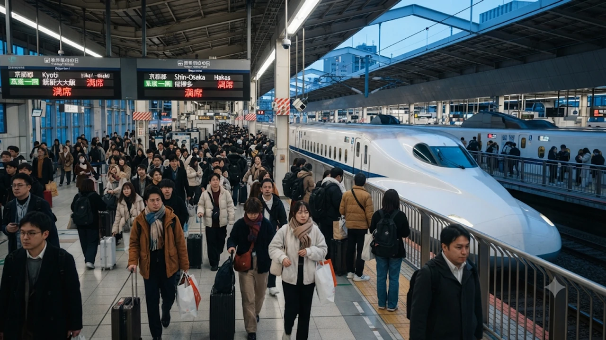
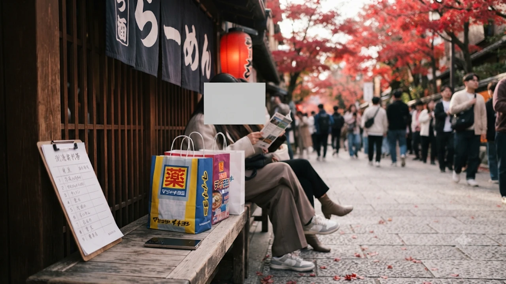

2026年11月21日から始まった**勤労感謝の日 3連休 混雑 韓国**人観光客の急増により、日本各地の主要駅や紅葉スポットは朝から熱気に包まれています。見頃を迎えた秋景色と円安の追い風が重なり、国内の行楽客だけでなくインバウンドの波が一気に押し寄せているのが今年のリアルな光景です。連休初日の現場から見える移動の実態や韓国人旅行者が急増した背景、さらには日韓の連休文化の違いまで掘り下げます。

## 2026年勤労感謝の日3連休の最新混雑と移動トレンド

### 新幹線・高速道路のピーク予測とリアルタイム状況
11月21日土曜日の早朝から、東海道・山陽新幹線や東北新幹線の下り列車は指定席を中心にほぼ満席に近い状態で出発しました。東京駅や新大阪駅のコンコースでは、大型スーツケースを引く利用客で改札付近まで人の波が途切れません。高速道路でも東名高速や中央自動車道の下り線で午前中から断続的な渋滞が発生しており、郊外の紅葉エリアへ向かうマイカーが一気に集中しました。

### 京都・東京など紅葉スポットのオーバーツーリズム実態
見頃を迎えた京都の嵐山や清水寺周辺、東京の高尾山や明治神宮外苑では、開門直後から歩道が観光客で埋め尽くされています。京都市内の主要バス路線では、**満員のため停留所で何本も見送らざるを得ない**光景が日常化しました。撮影スポットでは警備員が動線整理にあたり、通勤・通学の地域住民と観光客のルートを分ける現場対応が急ピッチで進められています。

### 3連休中の宿泊費高騰と直前予約のリアルな動き
東京都心や京都市内、福岡市内のビジネスホテルでは、連休期間中の宿泊単価が通常の週末と比べて大幅に上昇しています。直前予約サイトでも空き室はわずかしか残っておらず、宿泊費を抑えるために都心から電車で30〜40分離れた郊外駅周辺へ拠点を移す旅行者が増えました。こうした堅実な消費シフトは、[2026 일본 소비 트렌드 핵심](/posts/japan-trends/japan-consumer-trends-2026/)でも詳しく分析しています。

## なぜ今「韓国人観光客」が日本の3連休に集中しているのか

### 11月後半の韓国人インバウンド需要が急増した背景
日本の3連休と重なるこの時期に韓国人観光客が目立つ最大の理由は、**地方路線を含めた航空便の充実と圧倒的なアクセスの良さ**にあります。仁川空港や金浦空港から関西国際空港、福岡空港、成田空港へ向かう週末便は軒並み高い搭乗率を記録しており、金曜日の退勤後にそのまま日本へ飛ぶ弾丸スタイルが完全に定着しました。韓国の厳しい冷え込みに比べて、11月下旬の日本は日中は薄手のコートでも過ごしやすい気候である点も支持されています。

### 韓国の修学旅行・受験シーズン終了との意外な関係
韓国では11月中旬に大学修学能力試験（スヌン）が実施されるため、大一番を終えた受験生やその家族による慰労旅行が11月後半に集中します。国内の観光地だけでなく、パスポート一つで気軽に出かけられる日本は卒業旅行や家族旅行の筆頭候補に挙がります。日本の勤労感謝の日の3連休と韓国側の旅行需要のピークがぴったり重なったことで、観光地の混雑にさらなる拍車がかかりました。

### 外国人観光客に人気の最新日本グルメ・ショッピング傾向
最近の韓国人旅行者の間では、ガイドブックの定番店だけでなく日本のローカルスーパーやドラッグストアでの日用品買い出しが熱狂的な人気を集めています。

- コンビニ限定の季節スイーツや総菜の食べ比べ
- ドラッグストアでの医薬品やスキンケア商品のまとめ買い
- 11月下旬ならではのブラックフライデーセールを活用した家電や衣料品の購入

百貨店や大型商業施設の免税カウンターには夕方から長い列ができており、賢い買い物の手順は[2026年ブラックフライデー日本でお得に買うコツ](/posts/japan-trends/japan-black-friday-2026-deals-guide/)でも紹介しています。

## 日韓の「祝日・連休システム」徹底比較

### 日本のハッピーマンデー・振替休日と韓国の代替公休日制度の違い
2026年の勤労感謝の日は11月23日の月曜日にあたるため、土日とつながる自然な3連休となりました。日本には祝日が日曜と重なった場合の振替休日やハッピーマンデー制度がありますが、韓国にも「代替公休日（テチェゴンヒュイル）」と呼ばれるよく似た仕組みが存在します。

> 「韓国の代替公休日制度は、かつて旧正月や秋夕（チュソク）など限られた祝日にのみ適用されていましたが、法改正により三・一節や光復節、開天節、ハングルの日など多くの祝日が対象となり、日本と同様に3連休が生まれやすいカレンダー構造へと変化しました。」

### 連休の過ごし方比較：国内旅行派の日本 vs 海外・弾丸旅行派の韓国
日本の3連休では、新幹線やマイカーを使って国内の温泉地や紅葉スポットへ1泊2日〜2泊3日で出かける国内旅行が主流です。対照的に韓国の会社員は有給休暇を1日だけ組み合わせ、「**2泊3日や3泊4日で日本や東南アジアへ飛び出す**」という海外志向が非常に強く表れます。陸路で隣国へ渡れない地理的条件や、LCC（格安航空会社）の路線網の豊富さも、韓国人のフットワークの軽さを後押ししています。

### 飲食店や観光地の営業スタイルに見る日韓サービスの差
日本の連休中は観光地の飲食店に長蛇の列ができ、紙のウェイティングボードに名前を書いて店頭で待つ光景が一般的です。一方、韓国では店頭の端末に電話番号を入力して順番が来たらメッセージで呼び出されるシステムや、事前アプリ予約が徹底されています。そのため、日本の行列に戸惑う韓国人観光客がいる反面、予約なしで並んででも老舗の味を楽しむ日本の食文化を新鮮に受け止める声も多く聞かれます。

## 3連休後半を快適に過ごすための実践回避テクニック

### 混雑をズラす時間帯別・エリア別の穴場ルート活用法
連休2日目・3日目をストレスなく楽しむには、定番の観光ルートから時間帯とエリアを少しズラす工夫が欠かせません。

- 紅葉の名所や人気カフェは**午前8時〜9時台の早朝時間帯**に足を運ぶ
- 京都なら嵐山や東山を外し、大原や宇治など少し離れたエリアへルートを変更する
- ランチタイムは12時前後を避け、11時の開店直後か14時以降の遅めの時間を選ぶ

### モバイルオーダーと交通系IC・QR決済のスマート使い分け
レジ待ちや切符売り場の行列を回避するため、移動と支払いのデジタル化を徹底しましょう。新幹線のチケットレス乗車サービスや、飲食店でのスマホ注文（モバイルオーダー）を活用すれば、混雑時でも自分のペースで注文が完了します。日本の交通系ICカードは全国の鉄道やバスだけでなくコンビニ決済にも幅広く対応しているため、駅に着く前に多めにチャージしておくと安心です。

### 連休明けのUターンラッシュを乗り切るための事前チェックリスト
連休最終日となる11月23日月曜日の午後から夜にかけては、新幹線上り列車や空港の保安検査場が最も混み合う時間帯です。指定席の変更や確保は駅窓口に並ばずネット予約サイトから早めに済ませ、お土産は駅構内の混雑する売店を避けて市内の百貨店やスーパーで事前に購入しておくとスムーズです。長時間の移動や歩き疲れを和らげるトラベルグッズもあらかじめ用意しておけば、連休明けの日常へ気持ちよく切り替えられます。

[旅行快適グッズをクーパンでチェックする](https://www.coupang.com/np/search?q=%EC%97%AC%ED%96%89%20%ED%8E%B8%EC%9D%98%EC%9A%A9%ED%92%88&sourceType=affiliate&trackingCode=AF8691300)

#日本トレンド #勤労感謝の日 #3連休 #韓国旅行 #インバウンド #紅葉スポット #新幹線混雑 #日韓比較 #2026年最新