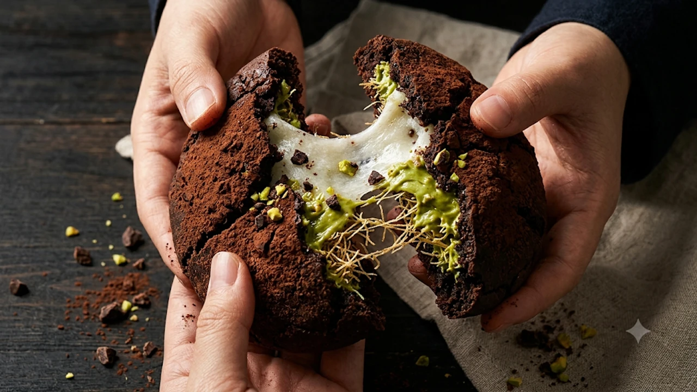

2026年11月現在、韓国のSNSを中心に爆発的なブームを巻き起こしている新感覚スイーツ「ドバイもちクッキー」をご存知でしょうか。極細麺カダイフのザクザク感と濃厚なピスタチオペースト、さらにもっちり伸びるクッキー生地を組み合わせた一品が、ついに**ドバイもちクッキー 日本上陸**を果たし、新大久保や都内のトレンドカフェで連日長い行列を作っています。本記事では、日本国内での流行の背景や従来のドバイチョコレートとの違い、さらに今すぐ購入できる店舗情報まで詳しく紐解きます。

## 韓国発「ドバイもちクッキー」が2026年11月に日本へ急上陸した背景

### SNSで拡散されたザクザク×もちもちの新食感スイーツとは
韓国のカフェ市場で2026年秋から急激に注目を集めているのが、とろけるマシュマロや求肥に似た弾力のある生地で、ローストした極細麺「カダイフ」と濃厚なピスタチオスプレッドを包み込んだハイブリッドスイーツです。一口噛むと外側はもっちり伸び、内側から乾いたカダイフの軽快な咀嚼音が響きます。この音と断面の鮮烈なコントラストがショート動画と相性抜群で、現地では開店と同時に完売するベーカリーが続出しました。

### なぜ今日本で話題に？新大久保や都内カフェでの販売状況
韓国での流行からタイムラグがほぼない状態で、2026年11月には東京・新大久保や渋谷、大阪・鶴橋の韓国系カフェが相次いでメニュー化に踏み切りました。日本のZ世代を中心としたSNSユーザーが「次世代の韓国スイーツ」として投稿を重ねたことで検索数が急上昇しています。こうした日韓の最新ヒット商品の連動性については、[2026 일본 소비 트렌드 핵심](/posts/japan-trends/japan-consumer-trends-2026/)でも触れている通り、食感のギャップを重視する若年層の消費行動が色濃く反映されています。

### 既存のドバイチョコレートブームとの決定的な違い
すでに日本でも話題となった板状のドバイチョコレートと今回のクッキーには、明確な構造上の違いがあります。

- **生地のベース**：板チョコのコーティングではなく、しっとり弾力のある焼き菓子生地やマシュマロベースの皮を採用している点
- **甘さのバランス**：カカオの濃厚さよりも、バターの香ばしさとピスタチオのナッツ感が前面に出ている点
- **食べやすさ**：常温でも溶けにくく、ワンハンドで手軽に持ち歩きながら食べられるサイズ感

> 「チョコレートよりも重たさがなく、温めても冷やしても食感が変化する点がリピーターを増やしている最大の要因です」

## 日本のトレンドスイーツと韓国「もちクッキー」の徹底比較

### 食感・甘さ・価格帯から見る日韓スイーツのトレンド差
日本のコンビニやパティスリーで人気を集めるスイーツは、なめらかな口どけや繊細な甘さ控えめの味わいが主流です。対照的に韓国発のもちクッキーは、**「噛みごたえ」と「圧倒的な具材のボリューム感」**を最優先に設計されています。1個あたりの価格は日本国内のカフェで600円から850円前後とやや高めなものの、1個で十分な満足感が得られるため、カフェでのシェア需要や自分へのご褒美スイーツとして受け入れられています。

### 日本のコンビニ・カフェチェーンが注目する理由
日本の大手コンビニエンスストアやベーカリーチェーンも、韓国発のトレンドスイーツをいち早く商品化する動きを強めています。過去にもクロワッサンとワッフルを掛け合わせたクロッフルや、薄焼きクロワッサンのクルンジが日本全国へ波及しました。今回のカダイフ入りもちクッキーも、冷凍流通との相性が良く、ベーカリー部門での展開がしやすいことから、2026年冬から2027年春にかけて量販店レベルでの商品開発が加速する見込みです。

### 韓国現地と日本国内での入手難易度と価格比較
韓国・ソウル市内の人気ベーカリーでは1個あたり約5,500ウォンから7,000ウォン前後で販売されており、日本円換算では現地のほうがやや手頃な価格設定です。ただし、現地でも週末は整理券配布や購入個数制限がかかる店舗が多く、観光の合間に手に入れるのは簡単ではありません。日本国内では取り扱い店舗数こそまだ限られているものの、事前予約制やオンラインショップの定期販売を活用すれば、確実に手に入れる道が開かれています。

## 実際に食べてわかった魅力と購入前に知るべき注意点

### 現地ファンが語るおすすめの食べ方とアレンジ術
購入後そのまま頬張るのも魅力的ですが、温度変化によってまったく異なる表情を楽しめます。

- **常温でそのまま**：カダイフの最も鋭いザクザク感と、生地本来の弾力をストレートに味わえる基本のスタイル
- **電子レンジで10秒加熱**：中のピスタチオペーストと生地がとろりと柔らかくなり、焼きたてのような香ばしさが復活
- **冷蔵庫で30分冷却**：フィリングが引き締まり、生チョコに近い濃厚な口当たりへと変化

### カロリーや賞味期限、売り切れ時間帯のリアルな注意点
バターやナッツペースト、砂糖をふんだんに使用しているため、1個あたりのエネルギー量は一般的なクッキーを大きく上回ります。また、時間が経つとカダイフが生地の水分を吸収して食感が損なわれるため、**購入当日中から翌日まで**に食べ切るのが鉄則です。都内の人気店では平日の14時前後、土日祝日は午前中のうちに当日分が完売するケースが目立ちます。

### ギフトや手土産として選ぶ際のメリット・デメリット
断面の鮮やかなグリーンと高級感のある見た目は、トレンドに敏感な友人への手土産として非常に喜ばれます。一方で、日持ちが短く食感が命のスイーツであるため、遠方への配送や数日後に渡す予定のギフトには不向きです。渡す当日に購入できるスケジュールを組むことが満足度を高める秘訣といえます。

## 2026年冬に向けて日本で買える店舗・お取り寄せガイド

### 東京・大阪エリアで今すぐ買える人気ベーカリー・カフェ
2026年11月現在、確実に入手したい場合は大都市圏の韓国トレンド発信地を狙うのが近道です。東京エリアでは新大久保駅周辺の路面店カフェや、表参道・原宿エリアの韓国系ベーカリーが期間限定および定番メニューとして提供を開始しました。関西エリアでは大阪・生野コリアタウン周辺のスイーツ専門店が品揃え豊富で、ピスタチオ味に加えてチョコヘーゼルナッツ味など複数のフレーバーを展開する店舗も登場しています。

### 通販・韓国代行サービスを利用する際の手順
店舗へ足を運ぶ時間が取れない場合は、国内のECモールや韓国直送のオンラインストアを利用する方法が便利です。注文時は冷凍便での発送に対応しているか必ず確認し、届いたら食べる分だけを自然解凍すると作りたての食感を損なわずに味わえます。また、日本国内の韓国食品専門通販サイトでも関連材料や完成品の取り扱いが順次拡大中です。

### 自宅で作れる簡単再現レシピのポイントと代用食材
市販のソフトクッキーや求肥、または溶かしたマシュマロを生地のベースにし、市販のピスタチオスプレッドと乾煎りしたカダイフを混ぜて包むことで、自宅でも驚くほど本格的な味わいを再現できます。カダイフが手に入らない場合は、細かく砕いたコーンフレークや春雨をバターで軽く炒めて代用すると、独特のザクザク感を手軽に楽しめます。本場の味や製菓材料を手軽に揃えたい方は、[관련상품 쿠팡에서 보기](https://www.coupang.com/np/search?q=%EB%91%90%EB%B0%94%EC%9D%B4%20%EC%AA%80%EB%93%9D%20%EC%BF%A0%ED%82%A4&sourceType=affiliate&trackingCode=AF8691300)から最新の関連アイテムをチェックしてみてください。

#日本トレンド #2026 #韓国スイーツ #ドバイもちクッキー #新大久保グルメ #カダイフ #ピスタチオスイーツ #トレンドグルメ