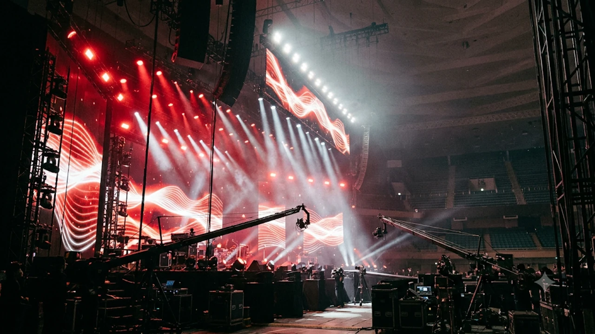

2026年の大晦日を彩るNHK紅白歌合戦の出場歌手発表を目前に控え、紅白 2026 出場 予想 K-POPの動向に日本中から熱い視線が注がれています。今年も韓国アーティストが多数選出されるのか、それとも日本の若手バンドやアイドル勢が中心となるのか、スポーツ紙の内定報道やSNSでの議論が白熱している真っ最中です。最新メディア報道をもとにした出場リストの予測やNHK独自の選考基準、さらには韓国音楽界の視点まで掘り下げます。

## 2026年紅白歌合戦の出場者発表はいつ？最新内定報道まとめ

例年通りであれば、NHK紅白歌合戦の出場歌手は11月中旬の平日正午ごろに公式サイトおよび記者会見で正式発表されます。2026年も11月13日から15日前後の発表が有力視されており、各スポーツ紙や週刊誌による「内定・落選スクープ」が連日紙面を賑わせている状況です。

### 発表日程の傾向と2026年の注目スケジュール

過去の傾向を振り返ると、紅白の出場歌手発表は11月第2週から第3週の水曜日〜金曜日に行われるケースが大半を占めます。発表当日の朝には複数のスポーツ新聞が一斉に「〇〇初出場内定」と報じるのが恒例となっており、今年もすでに複数の有力グループの名前がメディア上で取り沙汰されてきました。

### スポーツ紙が報じる「内定・落選」リストの最新動向

2026年の報道で特に注目を集めているのは、世代交代を象徴するラインナップの変化です。

- 地上波ドラマやアニメ主題歌で記録的なストリーミング再生数を叩き出した日本の新世代ロックバンド
- 国内外のアリーナツアーを全公演完売させたボーイズグループ・ガールズグループ
- 活動再開やデビュー周年を迎え、話題性に富んだベテラン勢

一方で、長年常連だった演歌・歌謡曲枠の縮小や、特定の芸能事務所からの出場枠配分についてもシビアな見方が強まっています。

### ネット上で話題のサプライズ枠と初出場候補

SNS上では、正規の紅組・白組とは別に設けられる**特別企画枠**への期待も高まっています。近年は世界的なヒットを記録したアニメ作品とのコラボレーションや、国境を越えたユニットによる一夜限りのステージが定番化しており、2026年も本番直前まで追加発表が続く見通しとなりました。

## なぜ毎年「K-POP枠」が議論になるのか？NHKの選考基準を分析

出場発表の時期になると必ずと言っていいほど議論を呼ぶのが、韓国アーティストの出場枠に関する賛否です。「日本の年末番組なのに韓国勢が多すぎる」という声がある一方で、音楽業界関係者の間ではK-POP起用は極めて合理的な判断と受け止められています。

### 視聴率と若年層ターゲットから見るK-POP起用のメリット

テレビ離れが進む10代〜20代の若年層をリアルタイム視聴に引き戻すうえで、SNSでの拡散力と圧倒的なパフォーマンス力を誇るK-POPグループは強力な切り札となります。X（旧Twitter）のトレンド入りや放送後の見逃し配信再生数においても、韓国アーティストの出演シーンは毎年トップクラスの反響を集めてきました。

### 紅白独自の「3つの選考基準」と配信・SNS指標の重要性

NHKは公式に、出場歌手の選考にあたって以下の3点を総合的に判断すると説明しています。

> 1. 今年の活躍
> 2. 世論の支持
> 3. 番組の企画・演出

かつてはCD売上枚数やカラオケランキングが重視されていましたが、現在はBillboard JAPANの総合チャートやSpotify・Apple Musicなどの**ストリーミング再生数**、さらにTikTokでの楽曲使用数が「今年の活躍」を測る決定的な指標へと変化しました。日本国内のチャート上位にK-POP楽曲が常にランクインしている現状を踏まえれば、複数組の選出はデータに基づいた自然な結果といえます。

### 日本国内アーティストとのバランスと視聴者の本音

もちろん、番組全体の構成においては幅広い世代が楽しめるバランス感覚が求められます。近年の日本のエンタメや消費動向については、[2026 일본 소비 트렌드 핵심](/posts/japan-trends/japan-consumer-trends-2026/)でも触れているように、自分の好きなジャンルや推し活に深く時間とお金を投資する傾向が鮮明です。家族全員で同じ番組を見る時代から、それぞれの世代が見たいアーティストの登場時間に合わせてチャンネルを合わせる視聴スタイルへと移行しています。

## 韓国の音楽界とメディアから見た「日本の紅白歌合戦」

日本国内で選考基準が議論される一方、韓国の音楽業界や現地メディアにとってNHK紅白歌合戦は特別なステータスを持つ舞台として認識されています。

### MAMA AWARDSや韓国年末歌謡祭とのスケジュール比較

11月下旬に開催されるアジア最大級の音楽授賞式「MAMA AWARDS」や、12月下旬に韓国の地上波3局（KBS・MBC・SBS）が放送する年末歌謡祭と並行して、日本の紅白歌合戦への出演は韓国アイドルにとって**日本市場でのトップクラスの人気を証明する勲章**のような意味合いを持ちます。大晦日のスケジュールを空けて日本へ渡航し、生放送のステージに立つことは、翌年の日本ドームツアー成功への大きな足がかりとなるからです。

### 韓国SNS・ファンダムが注目する日本人アーティストとのコラボ

韓国のオンラインコミュニティやSNSでは、自国の推しグループが紅白でどのような衣装やアレンジを披露するのかに加え、日本人アーティストとの合同ダンスチャレンジや特別ステージにも大きな関心が寄せられています。言語の壁を越えて互いの楽曲をカバーし合う演出は、日韓双方のファンダムから好意的に受け入れられてきました。

### 日韓音楽市場のボーダーレス化と紅白の立ち位置

現在では、日本人メンバーのみで構成されたK-POPシステム発のグループや、韓国のプロデューサーが手掛ける日本発グループの活躍も目覚ましく、「J-POP」と「K-POP」の境界線はかつてないほど曖昧になっています。こうしたボーダレスな音楽シーンの現在地を映し出す鏡として、紅白歌合戦のラインナップは毎年進化を遂げています。

## 紅白歌合戦2026をもっと楽しむためのチェックポイント

出場歌手の正式発表から大晦日の本番までは約1か月半あります。情報の波に乗り遅れず、年末の音楽イベントを最大限に楽しむための具体的なポイントを押さえておきましょう。

### 出場歌手発表当日のリアルタイム速報の追い方

正式発表の瞬間を逃さないためには、以下の情報源をチェックしておくのが確実です。

- **NHK紅白歌合戦の公式Xアカウントおよび公式サイト**：発表と同時に全出場歌手リストと初出場アーティストのコメント動画が公開されます
- **各アーティストの公式ファンクラブ・SNS**：発表直後にメンバー本人からの喜びのメッセージや意気込みが投稿される傾向にあります

### 発表後に注目すべき「特別企画枠」と曲目発表のタイミング

最初の出場者リストに名前がなかったとしても、落胆する必要はありません。例年、12月上旬から中旬にかけて「特別企画」としての追加出場者発表が行われ、さらに12月下旬には歌唱曲目とタイムテーブル（曲順）が順次公開されます。大晦日の夜を自宅のテレビや大画面モニターでじっくり堪能したい方は、音響機器や関連アイテムを早めに準備しておくとより臨場感を味わえます。

[관련상품 쿠팡에서 보기](https://www.coupang.com/np/search?q=J-POP%20K-POP%20%EC%9D%8C%EB%B0%98&sourceType=affiliate&trackingCode=AF8691300)

#日本トレンド #紅白歌合戦 #紅白2026 #KPOP #JPOP #韓国トレンド #音楽ニュース #年末特番