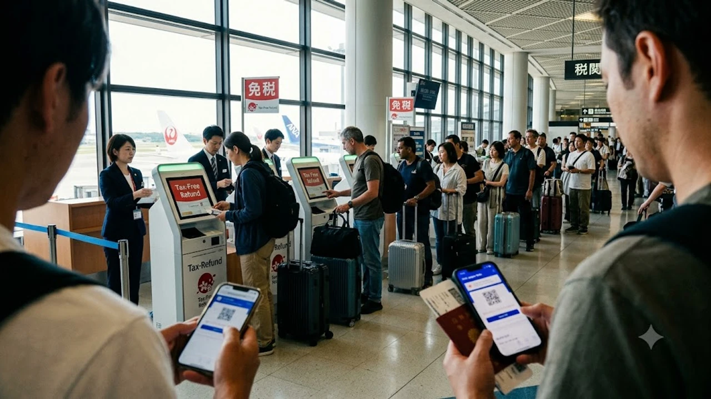

2026年11月1日より、訪日外国人向け免税の仕組みが従来の店頭即時値引きから、出国時の空港税関で払い戻しを受ける方式へと根本的に転換します。紅葉狩りや年末年始の休暇に向けて渡航を計画している旅行者にとって、**日本 免税 2026年11月 空港 還付**の運用変更は旅程の組み立てや空港待機時間、買い物の資金繰りに直結する切実なテーマに他なりません。従来のノリでレジに向かうと思わぬ落とし穴にはまるリスクが高いため、10月中の確実なアップデートが求められます。

## 2026年11月施行！日本の免税制度はどう変わるのか？

### 店頭での「その場で免税」が完全廃止へ
百貨店やドラッグストア、ドン・キホーテのレジでパスポートをかざし、消費税10%分を浮かせた金額だけをサッと決済する——長年定着したこの光景が11月1日をもって姿を消します。

施行日以降の会計では、日本人客と何ら変わらず消費税込みの満額をその場で支払うルールへ一本化。購入時に発行される電子レシートやパスポート情報を連携させ、日本を出国する直前の空港税関で還付申告を行う二段階の手順を踏まなければ、税金の払い戻しを受けられなくなります。

### 導入の背景にある転売不正と巨額追徴の実態
日本政府が長年維持した店頭免税を打ち切るに至った決定打は、免税枠を隠れ蓑にした組織的転売ヤーによる消費税搾取の横行です。国税庁の追跡調査では、訪日客名義を悪用して高級腕時計や大量のコスメを非課税で買い漁り、国内の闇ルートへ横流しして利ざやを稼ぐ手口が後を絶ちませんでした。

不正発覚後に税務署が追徴課税を打っても、ブローカー側がとっくに出国して行方をくらまし、徴収不能に陥った額は累計数百億円規模に達します。EU諸国と同じく「現物を国外へ確かに持ち出す事実を税関で確かめてから払い戻す」欧州型リファンドへの移行は、国境を越えた租税回避を断つための必然的な防衛策と言えます。

### 10月31日までの駆け込み購入と今後のスケジュール
制度の端境期となる2026年10月31日までは、使い慣れたレジ引き免税がそのまま機能します。ハイブランド品や貴金属、あるいは[2026年最新iPhone18徹底解説！進化点と買い替え判断](/posts/japan-trends/iphone-18-release-review-2026/)で取り上げたような高額ガジェットを狙う層の間では、煩雑な還付手続きを避けるべく駆け込み購入の動きが顕著です。

10月31日23時59分までにレジを通せば現行ルールが適用されますが、日付が11月1日に切り替わった瞬間から新運用が発動します。ドン・キホーテなどの深夜営業店舗で買い物をする際は、会計が日付を跨がないよう気を配る必要があります。

## 空港還付型への移行で知っておくべき3つの注意点

### 購入時は税込10%を一度全額支払い
旅行者が街中でダイレクトに痛感するのが、財布から一時的に出ていく現金の多さやカード利用枠の圧迫です。従来の感覚で免税後の手取り額を基準に予算を組んでいると、思わぬ資金難に直面します。

例えば30万円分の買い物をした場合、店頭で実際に切られる決済額は33万円。3万円分のキャッシュが一時的に拘束される計算です。利用枠に余裕のないクレジットカードを使っていると、滞在後半のホテル代や食事代の決済でカードが弾かれるトラブルを引き起こしかねません。

### 出国当日の空港カウンター・KIOSK端末での現物確認
免税対象品を確実に国外へ持ち出す証拠として、成田・羽田・関西・福岡といった各国際空港に新設される専用KIOSK端末や税関カウンターへの立ち寄りが必須ステップとなります。

端末にパスポートと電子購入記録をかざすのみならず、税関職員から購入品の提示を求められた際はその場でカバンを開けて実物を見せなければなりません。万一このステップを素通りして出国審査を抜けてしまうと、還付を受ける権利そのものがパーになります。

### クレジットカードまたは電子決済への還付フロー
空港での実物照合をパスした後の返金処理は、原則として決済に用いたクレジットカードへの残高戻入か、指定の国際電子マネー経由で行われます。

> カウンター周辺の長蛇の列を防ぐ狙いから、現金での手渡し還付はごく一部の例外を除きストップします。カード会社側の処理サイクル次第では、実際の口座着金までに2週間から1ヶ月前後のタイムラグが生じる点も織り込んでおくのが賢明です。

## 韓国の即時還付（事後免税）システムとの決定的な違い

### オリーブヤング等で定着した韓国の「即時還付」モデル
韓国のタックスリファンド（事後免税）は、外国人客のストレス軽減を主眼にシステムが磨かれてきました。オリーブヤングや各百貨店、大型マートなどの加盟店では、パスポートを提示するだけでその場の端末上で還付金が即時相殺されます。

少額のコスメや日用品であれば空港で書類を出す手間すら一切不要で、ショッピングのテンポを一切削がない設計が観光客から絶大な支持を集める理由です。

### 「空港で並ぶ日本」と「街中で完結する韓国」の利便性比較
一方、日本が今回踏み切る方式は、水際対策を固めるために「出国空港への全数集約」を選びました。転売防止の実効性こそ群を抜くものの、旅行者の利便性という物差しで測れば韓国のシステムと真逆のアプローチを取ることになります。

- 韓国：市内の街頭KIOSKや店舗レジで還付手続きが即座に完結し、身軽に空港へ直行可能
- 日本：街頭では満額立替払いのみ。出国空港の税関ブースに全旅行者が殺到し、物理的な待ち時間が発生

旅行体験の身軽さという観点において、日本の新制度は訪日リピーターに対して少なくない心理的ハードルを課す格好です。

### 訪日リピーターである韓国人旅行者が戸惑うポイント
年間に何度も日韓を往復するヘビーリピーターほど、自国の即時還付や従来の日本の店頭引き免税に慣れきっています。それだけに、11月からの「全額先払い＋出国時チェック」という二重構造に対して強いギャップを覚えるのは避けられません。

日韓の旅行コミュニティ内でも「免税書類をどこで出すのか」「フライト前に何十分並ぶ羽目になるのか」といった不安混じりの投稿が急増しており、制度の周知不足による当日の混乱が危惧されています。

## 11月以降の日本旅行で損をしないための実践ガイド

### 出国手続きは何時間前に空港へ行くべきか？
従来の国際線利用時は出発2時間前の空港到着がセオリーでしたが、11月以降は**最低でもフライト3時間前、混雑がピークに達する時間帯なら3時間半前**のターミナル入りを前提に行動を組み立てるべきです。

税関KIOSK端末の配備数には物理的な上限があり、午前便や深夜便のラッシュと重なれば還付待ちの列が果てしなく伸びる事態は火を見るより明らか。搭乗締め切り時刻に追われ、数万円分の還付金を泣く泣く捨てて保安検査場へ走り込む羽目にならないよう、空港直行のスケジュールには十分すぎる余白を割く必要があります。

### 預け入れ荷物に免税品を入れる場合のルールと申告手順
旅行者が最も踏み抜きやすい罠が、スーツケースに詰め込んだ免税品の取り扱いです。規定量を超える化粧水や酒類などの液体物は保安上機内へ持ち込めないため預け荷物へ回す必要がありますが、チェックイン時に航空会社スタッフへ「預け荷物の中に免税品がある」旨を必ず申告しなければなりません。

タグを付けたスーツケースをそのままベルトコンベアへ流してしまえば、後の税関ブースで「現物不携帯」と判定され、還付が容赦なく却下されます。荷物を預け入れる前に税関職員の目視確認を受けるという動線の順序だけは、旅程の鉄則として頭に叩き込んでおく必要があります。

### キャッシュレス決済の事前準備とスムーズな還付手続きのコツ
空港の喧騒の中で余計なタイムロスを削るには、買い物段階からの段取りがモノを言います。

- 複数店舗の購入データを滞りなく読み込ませるため、パスポートのICページに汚れや折れ目を付けない
- 還付エラーを防ぐため、全免税品を同一名義のクレジットカードで統一して決済する
- 数百円程度の還付金にしかならない日用消耗品は、空港待機の煩わしさを避けるためあえて免税扱いにせず通常決済で切り抜ける

空港での突発的な荷物整理や重量オーバーによる追加料金のトラブルを回避するためにも、パッキング用品や携帯用計量器といった旅の必需品は前もって揃えておくのが賢明です。

[旅行用ラゲッジスケール＆パッキング便利グッズをクーパンで見る](https://www.coupang.com/np/search?q=%EC%9D%BC%EB%B3%B8%20%EC%9D%B8%EA%B8%B0%EC%83%81%ED%92%88&sourceType=affiliate&trackingCode=AF8691300)

#日本トレンド #2026年 #免税制度 #空港還付 #インバウンド #訪日旅行 #タックスリファンド #日韓比較