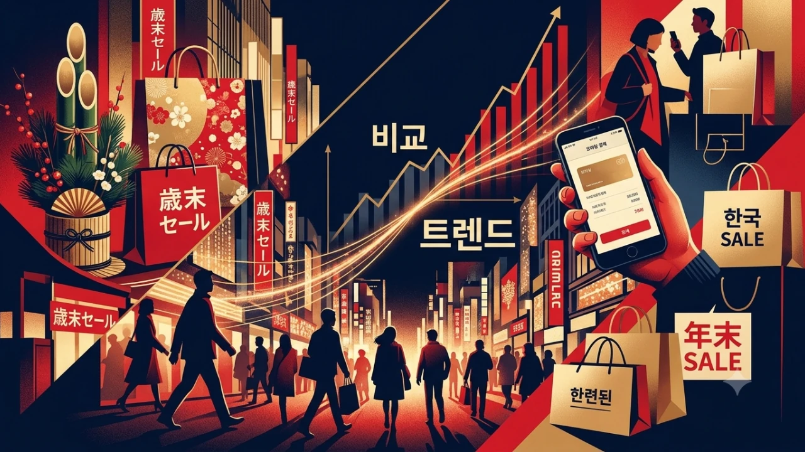
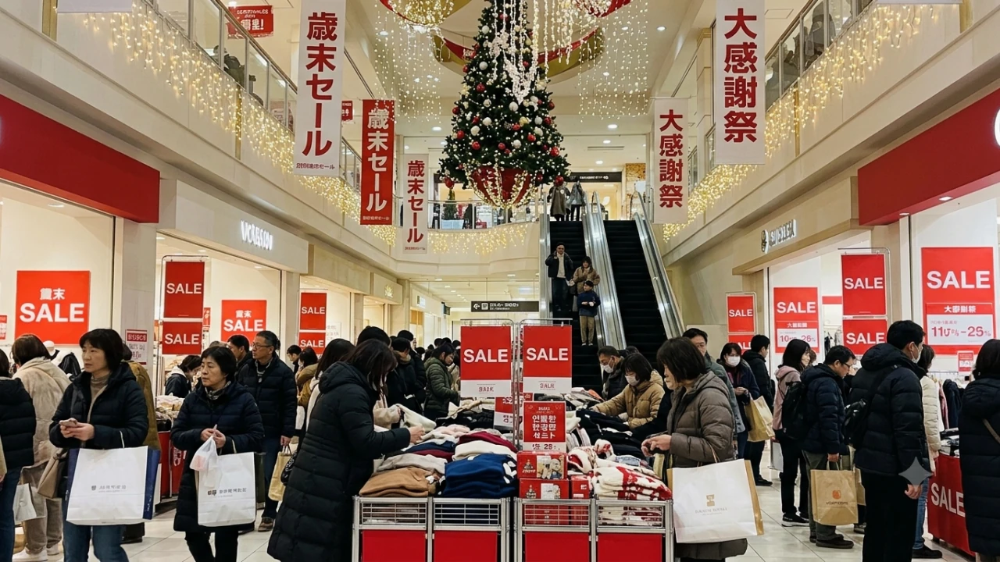

2026年11月を迎え、日本と韓国の両国で冬本番に向けた消費の動きが急速に熱を帯びています。**2026年の年末商戦**は、物価変動やデジタル化の進展を背景に、従来の季節イベントとは一線を画す新たな購買スタイルへと塗り替えられつつあります。日本の最新動向と**韓国の消費トレンド**を多角的に比較し、両国で支持される冬ギフトやインバウンド市場のリアルな変化を掘り下げます。

## 2026年日本の年末商戦が本格始動！例年との違いは？

### 物価高と実質賃金の動向が変えた2026年冬の消費行動
2026年の冬は、日常の節約意識と特別な日の贅沢需要がくっきりと二極化しています。食料品や日用品ではプライベートブランドや大容量パックを選んで支出を徹底的に抑える一方、クリスマスや年末年始のイベントには予算を集中させる**メリハリ消費**が完全に定着しました。百貨店や大手ショッピングモールでも、一律の値引きよりポイント還元率の上乗せや数量限定セットの投入によって購買意欲を刺激する戦略が主流です。

### 予約開始時期の早期化と「体験型ギフト」の急増
お歳暮やクリスマスケーキ、年末年始のおせち料理といった季節商品の予約開始は、年々早まっています。とくに2026年は、形あるモノを贈るだけでなく「記憶に残る時間」をプレゼントする**体験型ギフト**を選ぶ人が急増しました。

- 高級ホテルのアフタヌーンティーや日帰り温泉のペア利用券
- 自宅に有名店の味が届くミールキットやシェフ監修の冷凍グルメ
- 家族や友人と一緒に楽しめるワークショップやデジタルチケット

> 「限られた予算の中で確実に満足度の高い選択をしたい」という堅実な消費者心理が、事前の徹底した比較検討と早期予約を後押ししています。

### ネット通販とリアル店舗の融合（OMO施策）の最新事例
オンラインと実店舗の垣根を取り払う**OMO（Online Merges with Offline）施策**も、2026年の商戦を語るうえで欠かせない動きです。スマートフォンアプリで事前に取り置きや決済を済ませ、仕事帰りに駅ビルやコンビニの専用ロッカーで受け取るスタイルがすっかり日常になりました。実店舗では商品を試すショールーミング機能に特化し、在庫は自宅へ直送する仕組みを取り入れるアパレルや家電量販店が増えています。

## 韓国の年末トレンドと比較！日韓で共通する「賢い消費」

### 韓国で広がる節約志向と「コスパ重視」のギフト選び
韓国の年末市場でも、日本と同じく実利を重んじる**合理的な消費スタイル**が支持されています。かつての豪華な贈答品文化から一変し、受け取る側が気兼ねしない実用的な日用品セットや、カカオトークなどで気軽に贈れるモバイル商品券の需要が拡大しました。大型マートやECプラットフォームでは、まとめ買い割引や有料メンバーシップ会員向けの先行セールが激しい集客合戦を繰り広げています。なお、日本国内の具体的な消費キーワードについては[2026年日本の消費トレンド核心まとめ](/posts/japan-trends/japan-consumer-trends-2026/)でも詳しく紹介しています。

### 2026年冬に日韓のZ世代・ミレニアル世代が注目するアイテム
日韓の若年層の間では、トレンドが海を越えて共有されるスピードがかつてないほど速まっています。2026年冬に両国で共通して人気を集めているカテゴリーは以下の通りです。

- **パーソナライズ美容家電**：自宅で手軽にサロン級のケアができる美顔器やヘアケア機器
- **レトロ＆ミニマル雑貨**：懐かしさを感じさせるコンパクトデジタルカメラや小型オーディオ製品
- **ウェルネス関連アイテム**：睡眠の質を高めるリカバリーウェアや高機能な保温ボトル

### ライブコマースとSNS口コミが購買決定に与える影響
韓国で先行して根付いた**ライブコマース**は、日本でも年末商戦の主力チャネルとして定着しました。インフルエンサーや店舗スタッフがリアルタイムで商品の質感やサイズ感を見せ、視聴者の疑問にその場で答える双方向のやり取りが購入の決め手になっています。企業側の広告よりも一般ユーザーの率直なレビュー動画や比較投稿を信頼する傾向が強く、SNS上でのリアルな評判がそのまま売上に直結する構図が鮮明です。

## 2026年冬のインバウンド需要と日韓往来トレンドの現在地

### 年末年始の航空券予約状況と韓国人旅行者に人気の日本エリア
日韓間の航空路線は地方空港を結ぶ便も含めて充実しており、2026年の年末年始も双方向の旅行需要は堅調に推移しています。韓国人旅行者の間では、東京や大阪といった定番の都市部に加え、冬の温泉や雪景色を満喫できる**九州エリアや北海道、東北地方の温泉地**へ足を延ばす動きが目立ちます。為替相場の動きを見極めながら、現地でのグルメやショッピングをじっくり楽しむリピーター層が中心です。

### 免税制度変更やキャッシュレス決済普及による買い物の変化
インバウンド消費の現場では、免税手続きのデジタル化やキャッシュレス決済の浸透によって買い物体験そのものが様変わりしました。韓国の主要なモバイル決済アプリが日本のドラッグストアや百貨店、飲食店でもそのまま使える環境が整い、両替の手間なくスムーズに支払える点が喜ばれています。かつての大量購入から、日本の暮らしに根ざした文房具やスキンケア用品、限定スイーツを厳選して買い求めるスタイルへと移行しました。

### 日本人旅行者が韓国の年末セールで狙うべき注目スポット
日本から韓国へ渡航する旅行者にとっては、ソウル市内の大型百貨店や複合ショッピングモールで開催される**年末の大型セール**が見逃せません。聖水（ソンス）や漢南（ハンナム）エリアのフラッグシップストアでは、冬物アウターやデザイナーズブランドの限定アイテムが並び、日本未上陸のコスメブランドを直接試せるポップアップストアも連日多くの買い物客で賑わいます。

## 失敗しない2026年年末の買い物・旅行計画の立て方

### 早期割引やポイント還元を最大限に活用するコツ
年末の出費を賢く抑えるには、各プラットフォームのキャンペーン日程を早めに把握し、決済手段を一つに集約させるのが近道です。クレジットカードの特定日割引や、電子マネーのポイントアップ期間を組み合わせれば、実質的な購入価格をぐっと引き下げられます。欲しい商品はあらかじめお気に入りリストへ入れておき、価格の推移を見極めながら最適なタイミングで購入する習慣をつけましょう。

### 混雑ピークを避けて快適に移動・ショッピングするための日程術
年末年始の帰省や旅行を予定している場合、移動日の選び方ひとつで快適さが大きく変わります。国内の鉄道や高速道路は年末の最終営業日翌日から混雑が集中するため、可能であれば**日程を1日から2日前倒しする**だけで移動のストレスを大幅に減らせます。鉄道移動の具体的な予約スケジュールについては[日本の年末年始新幹線予約のコツと帰省ラッシュ総まとめ](/posts/japan-trends/japan-year-end-shinkansen-booking-tips/)もあわせてチェックしておくと安心です。ショッピングモールへ出向く際も、開店直後の午前中や平日の夜間を狙えば人混みを避けて落ち着いて買い物ができます。

### 2027年に向けた今後の日韓トレンド予測とチェックすべき指標
2026年の年末商戦から浮かび上がるのは、日韓双方の消費者が「価格以上の納得感」と「タイパ（タイムパフォーマンス）」をシビアに求めているという現実です。2027年に向けては、生成AIを活用したパーソナルな商品提案や、環境配慮型パッケージを採用したサステナブル商品の普及がさらに広がる見通しです。日韓の最新トレンドや冬の防寒・旅行グッズを探す際は、[日本の人気冬ギフト・トレンド関連商品をチェックする](https://www.coupang.com/np/search?q=%EC%9D%BC%EB%B3%B8%20%EC%9D%B8%EA%B8%B0%EC%83%81%ED%92%88&sourceType=affiliate&trackingCode=AF8691300)から最新のラインナップを覗いてみてください。

#日本トレンド #2026年最新 #年末商戦 #韓国トレンド #消費動向 #インバウンド #冬ギフト #日韓比較